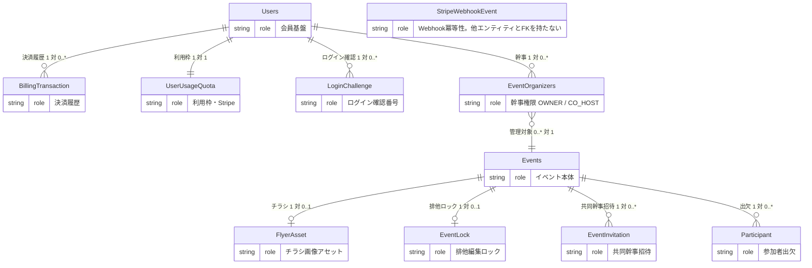

# データベース物理設計書（DBschema.md）

## イベント紹介ページ生成・出欠管理 ＆ 利用枠・課金決済基盤 統合データベース仕様書

## 1. 全体アーキテクチャ・設計方針

本ドキュメントは、「イベント紹介ページ生成＆出欠管理基盤」「利用枠（クォータ）管理＆課金決済基盤（Stripe連携）」「ユーザー登録（ローカルパスワードと Google サインイン）」「チラシ生成結果の保存」を一つのデータベース物理設計書にまとめたものである。概念データモデル（CDM）、論理データモデル（LDM）、物理データモデル（PDM）、Prismaスキーマ、および各エンティティのCRUD操作トランザクション仕様を網羅する。チラシ生成の途中状態（プロンプト、背景画像、フォールバック判定）は本データベースには持たない。生成サービスが返した JPEG をファイルとして保存し、その所在だけを `flyer_assets` に記録する。

### 1.1. 5大設計基本方針

1. **ハイブリッド・アイデンティティ（段階的会員化）のデータ吸収:**
   - 「未登録（端末Cookie依存）」「ゲスト幹事（暗号化トークン所持）」「認証済み会員（User ID保持）」という3つの利用形態を、単一スキーマ体系で一貫して保持する。
2. **暗号学的トークンハッシュ化によるゼロトラスト設計:**
   - ゲスト幹事トークン、出欠照会トークン、共同幹事招待コードは、DB内に平文で保存せず、すべてSHA-256ハッシュ値として保存する。
3. **PostgreSQL固有のアトミック排他制御（Pessimistic Lease Lock）:**
   - 共同幹事の同時編集事故（Lost Update）を防ぐため、外部キャッシュ（Redis等）を用いず、PostgreSQLの `ON CONFLICT DO UPDATE WHERE lock_token_hash = :currentLockTokenHash` 構文を活用してDB単体で厳密な原子性を担保する。ロックは時間で失効させず、保持者が解放するか他の幹事が引き継ぐまで保持する。
4. **マネタイズ基盤（課金クォータ・Stripe連携）の完全統合:**
   - 主催者の利用枠（累計2回無料、単発299円クレジット、月額980円サブスクリプション）を `user_usage_quotas` テーブルで管理。
   - 決済監査ログ（`billing_transactions`）および Webhook冪等性制御（`stripe_webhook_events`）を統合し、二重課金・二重付与を物理遮断する。
5. **筆頭作成者（オーナー）のみ枠消費ルール:**
   - イベントを複数幹事で共同運営する場合でも、クォータを消費するのは筆頭作成者（OWNER）のみとし、招待された共同幹事（CO_HOST）の枠は消費しない。

---

## 2. 概念データモデル（Conceptual Data Model: CDM）

### 2.1. コア概念（Entities）の抽出と役割

* **User (認証済み会員):** 確認済み電話番号（E.164）で人物を一意にする会員。メールアドレスと Google の `sub` はログイン手段である。パスワードだけの会員は `passwordHash` を持ち `googleSub` は空。Google だけの会員は `googleSub` を持ち `passwordHash` は空。同じ確認済みメールの会員が後から Google で入ったときは、既存行へ `googleSub` を結ぶ。同じ確認済み電話番号の会員が別メールや別 Google で入ったときも、新しい行は作らずその会員へ手段を足す。パスワード登録は確認メールのあと、電話番号確認が終わるまで会員行を作らない。プラットフォーム全体の権限は `platformRole`（`MEMBER` / `ADMIN`）であり、イベント単位の幹事ロールとは別である。公開登録の初期値は `MEMBER` である。ログイン中のセッションは `auth_sessions`、確認メールのトークンハッシュは `email_verification_tokens`、登録意向は `signup_intents`、SMS 確認コードのハッシュは `phone_verification_codes`、ログイン確認番号のハッシュは `login_challenges`、試行回数とログインロックの開始時刻は `auth_attempts` に置く。確認番号の失敗が 10 回に達した会員は 15 分ロックする。
* **SignupIntent (登録意向):** メール確認または Google 確認のあと、電話番号確認が終わるまでの一時行。会員行と利用枠はまだ無い。
* **UserUsageQuota (利用枠クォータ):** 主催者のイベント作成可能枠（無料消化数、単発クレジット残数、サブスク状態、Stripe連携情報）を管理。
* **BillingTransaction (課金決済履歴):** 利用枠の単発購入、月額の初回 Checkout、月額の更新請求、失敗、全額返金、異議申立の監査ログ。管理者の一覧は SCR-ADM-03。参加費の領収書とは別である。
* **StripeWebhookEvent (Webhook冪等性ログ):** Stripeから受信・処理したWebhook Event IDを記録し、重複処理を防止。
* **Event (イベント本体):** 主催者が告知・出欠を集めるイベントの実体（基本7項目＋ステータス＋掲載フラグ＋任意の申し込み期限）。`visibility` は将来のメディアサイト用の予約列であり、いまのアプリは一覧を持たないため常に `UNLISTED`（紹介制）。
* **Receipt (参加費の領収書):** 幹事が出席者へ発行する文書。1参加者につき1件。金額は幹事が入力し、参加費の決済は持たない。
* **FlyerAsset (チラシ画像アセット):** チラシ生成 API が保存した 9:16 の JPEG、または主催者がアップロードした完成済みの画像。`imageUrl` は `GET /api/v1/flyer-assets/{id}/image` を指し、バイト列そのものは生成なら `storage/flyers/{id}.jpg`、アップロードなら `storage/flyers/{id}.{jpg|png|webp}` に置く。アップロードは再エンコードせず、`aspectRatio` は `auto`、`externalFlyerId` は NULL になる。チラシなしのイベントも許容する。
* **EventOrganizer (幹事権限):** イベントと主催者を結ぶ多対多エンティティ。OWNER（筆頭幹事。1イベント1行）とCO_HOST（共同主催者）を識別する。会員は `User.name` を表示名に使い、ゲストは `display_name` を使う。
* **Participant (参加者・出欠):** 参加者の出欠登録実体。未登録時は端末Cookieトークンで紐付け。
* **EventLock (排他編集ロック):** 共同主催者間の同時編集競合を防止する排他編集ロック。保持者が解放するか、他の幹事が引き継ぐまで保持され、時間では失効しない。
* **EventInvitation (共同主催者の招待):** 既存幹事が他の会員を共同主催者として迎えるためのワンタイム招待実体。受諾は会員のみ。

### 2.2. 概念ER図



---

## 3. 論理データモデル（Logical Data Model: LDM）

### 3.1. 正規化（第1〜第3正規形）の適用

* **第1正規形 (1NF):** `event_date` (DATE) と `event_time` (VARCHAR) を分離。ステータスや雨天対応、決済方式を列挙型（ENUM）で独立定義し、アトミック値を保証。
* **第2正規形 (2NF):** `EventOrganizer` をサロゲートキーで独立させ、複合キーによる部分関数従属を排除。
* **第3正規形 (3NF):**
  * 課金・利用枠情報（`UserUsageQuota`）および決済ログ（`BillingTransaction`）を `User` から完全に分離。
  * 出欠人数（参加確定数等）は集計クエリとして導出し、物理テーブルへの二重保持による更新不整合を防止。

### 3.2. 列挙型（ENUM）定義一覧

| 列挙型名 | 定義値 | 概要 |
| :---- | :---- | :---- |
| **SubscriptionStatus** | `NONE`, `ACTIVE`, `PAST_DUE`, `CANCELED`, `INCOMPLETE` | サブスクリプション契約状態 |
| **PaymentType** | `ONE_TIME`, `SUBSCRIPTION` | 決済種別（単発299円 / 月額980円） |
| **PaymentStatus** | `PENDING`, `SUCCEEDED`, `FAILED`, `REFUNDED`, `DISPUTED` | 決済ステータス。`DISPUTED` は異議申立 |
| **RainPolicy** | `RAIN_OR_SHINE`, `CANCEL_ON_RAIN`, `POSTPONE_ON_RAIN`, `INDOOR` | 雨天時の催行方針 |
| **EventStatus** | `DRAFT`, `PUBLISHED`, `CLOSED` | イベント公開状態 |
| **EventVisibility** | `PUBLIC`, `UNLISTED` | 将来のメディアサイト向けの掲載フラグ。`PUBLIC` は一覧掲載、`UNLISTED` は紹介制。いまのアプリは常に `UNLISTED` |
| **OrganizerRole** | `OWNER`, `CO_HOST` | 幹事ロール（筆頭作成者 / 共同幹事）。イベント単位 |
| **RevenueSplitMode** | `RATIO`, `HEADCOUNT` | 売上の按分方式。割合（basis points）か、連れてきた人数か |
| **RevenueShareVisibility** | `ALL`, `OWN_ONLY` | 按分の閲覧範囲。`OWN_ONLY` は共同主催者に自分の行だけを見せる |
| **PlatformRole** | `MEMBER`, `ADMIN` | プラットフォーム権限。会員行に1つ。既定は `MEMBER` |
| **LoginChallengeChannel** | `SMS`, `EMAIL` | ログイン確認番号の届け方。既定はSMS |
| **LoginChallengePurpose** | `MEMBER`, `ADMIN`, `PARTICIPANT` | 主催者入口か管理者入口か参加者入口か。`PARTICIPANT` は管理者も通り抜けられる |
| **SignupAudience** | `ORGANIZER`, `PARTICIPANT` | 登録を始めた入口。確認メール後の着地を分ける。既定は `ORGANIZER` |
| **PricingTarget** | `ONE_TIME`, `SUBSCRIPTION`, `BOTH` | 価格キャンペーンの適用対象 |
| **DiscountKind** | `PERCENT`, `FREE` | 割引の種類。`FREE` は `percent = 100` の別名 |
| **BillingNoticeKind** | `FREE_PERIOD_ENDING_3D`, `FREE_PERIOD_ENDING_1D` | 0 円月額の終了前に送る案内の種別 |
| **RsvpStatus** | `ATTENDING`, `DECLINED` | 出欠意思表示（参加 / 不参加） |
| **AccountChangeKind** | `NAME`, `EMAIL`, `PHONE`, `PASSWORD`, `WITHDRAW`, `REACTIVATE` | 会員が自分の情報を変えた種別。`WITHDRAW` は退会、`REACTIVATE` は退会済み行の復帰 |

---

## 4. 物理データモデル（Physical Data Model: PDM）

### 4.1. Prisma スキーマ完全定義 (`schema.prisma`)

```text
datasource db {
  provider = "postgresql"
  url      = env("DATABASE_URL")
}

generator client {
  provider = "prisma-client-js"
}

// =============================================================
// ENUM 定義
// =============================================================
enum SubscriptionStatus {
  NONE
  ACTIVE
  PAST_DUE
  CANCELED
  INCOMPLETE
}

enum PaymentType {
  ONE_TIME
  SUBSCRIPTION
}

enum PaymentStatus {
  PENDING
  SUCCEEDED
  FAILED
  REFUNDED
  DISPUTED
}

enum RainPolicy {
  RAIN_OR_SHINE     // 雨天決行
  CANCEL_ON_RAIN    // 雨天中止
  POSTPONE_ON_RAIN  // 雨天順延
  INDOOR            // 屋内開催
}

enum EventStatus {
  DRAFT       // 下書き
  PUBLISHED   // 公開中（受付中）
  CLOSED      // 終了・締切
}

enum EventVisibility {
  PUBLIC    // 一覧掲載（将来のメディアサイト用。いまは保存しない）
  UNLISTED  // 紹介制（URL直開きのみ）。いまの唯一の値
}

enum OrganizerRole {
  OWNER    // 主催幹事（筆頭作成者・枠消費対象）
  CO_HOST  // 共同幹事（枠消費なし）
}

enum RsvpStatus {
  ATTENDING // 参加
  DECLINED  // 不参加
}

enum PlatformRole {
  MEMBER // 一般会員。公開登録の既定
  ADMIN  // プラットフォーム管理者
}

enum LoginChallengeChannel {
  SMS
  EMAIL
}

enum LoginChallengePurpose {
  MEMBER
  ADMIN
  /// 参加者向けの入口（/participant/login）。管理者も参加者として通り抜けられる。
  PARTICIPANT
}

/// 会員登録を始めた入口。確認メールのあとの着地を分けるために保持する。
enum SignupAudience {
  ORGANIZER
  PARTICIPANT
}

// =============================================================
// 1. ユーザー＆会員基盤
// =============================================================
model User {
  id           String   @id @default(uuid()) @db.Uuid
  email        String   @unique @db.VarChar(255)
  name         String   @db.VarChar(50)
  /// ローカル会員認証用。Google のみのユーザーは NULL。
  passwordHash String?  @map("password_hash") @db.VarChar(255)
  /// Google アカウントの sub。
  googleSub    String?  @unique @map("google_sub") @db.VarChar(255)
  /// 公開登録では常に MEMBER。ADMIN は DB または管理コンソールから付与する。
  platformRole PlatformRole @default(MEMBER) @map("platform_role")
  /// パスワード登録は確認メールのリンクを開くまで NULL。Google は確認済みメールだけで進む。
  emailVerifiedAt DateTime? @map("email_verified_at") @db.Timestamptz
  /// 確認済みの電話番号（E.164）。未確認の番号は入れない。NULL は複数行で共存できる。
  phoneE164       String?   @unique @map("phone_e164") @db.VarChar(20)
  phoneVerifiedAt DateTime? @map("phone_verified_at") @db.Timestamptz
  /// 退会（論理削除）の日時。NULL は在籍。電話番号は退会後も残し、再登録の突き合わせに使う。
  deletedAt       DateTime? @map("deleted_at") @db.Timestamptz
  createdAt    DateTime @default(now()) @map("created_at") @db.Timestamptz
  updatedAt    DateTime @updatedAt @map("updated_at") @db.Timestamptz
  quota         UserUsageQuota?
  transactions  BillingTransaction[]
  organizers    EventOrganizer[]
  participants  Participant[]
  locks         EventLock[]
  loginChallenges LoginChallenge[]
  accountChangeLogs   AccountChangeLog[]
  emailChangeRequests EmailChangeRequest[]
  @@index([deletedAt])
  @@map("users")
}

/// 会員が自分の情報を変えた記録。値はマスク済みのものだけを残し、パスワードは入れない。
model AccountChangeLog {
  id          String            @id @default(uuid()) @db.Uuid
  userId      String?           @map("user_id") @db.Uuid
  kind        AccountChangeKind
  /// 変更前の値（メールはマスク、電話は下4桁）。パスワードは NULL。
  beforeValue String?           @map("before_value") @db.VarChar(255)
  /// 変更後の値（同じ規則）。退会・復帰は NULL。
  afterValue  String?           @map("after_value") @db.VarChar(255)
  ipHash      String?           @map("ip_hash") @db.VarChar(64)
  createdAt   DateTime          @default(now()) @map("created_at") @db.Timestamptz

  user User? @relation(fields: [userId], references: [id], onDelete: SetNull)

  @@index([userId, createdAt])
  @@map("account_change_logs")
}

/// メールアドレス変更の保留中。新しいアドレスに届いたリンクを開くと確定する。
model EmailChangeRequest {
  id        String    @id @default(uuid()) @db.Uuid
  userId    String    @map("user_id") @db.Uuid
  newEmail  String    @map("new_email") @db.VarChar(255)
  tokenHash String    @unique @map("token_hash") @db.VarChar(64)
  expiresAt DateTime  @map("expires_at") @db.Timestamptz
  usedAt    DateTime? @map("used_at") @db.Timestamptz
  createdAt DateTime  @default(now()) @map("created_at") @db.Timestamptz

  user User @relation(fields: [userId], references: [id], onDelete: Cascade)

  @@index([userId])
  @@map("email_change_requests")
}

/// メール確認または Google 確認のあと、電話番号確認で会員になるまでの意向。
model SignupIntent {
  id              String    @id @default(uuid()) @db.Uuid
  email           String    @db.VarChar(255)
  name            String    @db.VarChar(50)
  passwordHash    String?   @map("password_hash") @db.VarChar(255)
  googleSub       String?   @map("google_sub") @db.VarChar(255)
  emailVerifiedAt DateTime? @map("email_verified_at") @db.Timestamptz
  /// 登録を始めた入口。メール確認後の着地（/mypage と /participant）を決める。
  audience        SignupAudience @default(ORGANIZER)
  expiresAt       DateTime  @map("expires_at") @db.Timestamptz
  createdAt       DateTime  @default(now()) @map("created_at") @db.Timestamptz
  @@index([email])
  @@map("signup_intents")
}

model PhoneVerificationCode {
  id             String    @id @default(uuid()) @db.Uuid
  phoneE164      String    @map("phone_e164") @db.VarChar(20)
  codeHash       String    @unique @map("code_hash") @db.VarChar(64)
  signupIntentId String?   @map("signup_intent_id") @db.Uuid
  userId         String?   @map("user_id") @db.Uuid
  expiresAt      DateTime  @map("expires_at") @db.Timestamptz
  usedAt         DateTime? @map("used_at") @db.Timestamptz
  attempts       Int       @default(0) @db.SmallInt
  createdAt      DateTime  @default(now()) @map("created_at") @db.Timestamptz
  @@index([phoneE164])
  @@map("phone_verification_codes")
}

model LoginChallenge {
  id        String   @id @default(uuid()) @db.Uuid
  userId    String   @map("user_id") @db.Uuid
  purpose   LoginChallengePurpose
  channel   LoginChallengeChannel
  codeHash  String   @unique @map("code_hash") @db.VarChar(64)
  expiresAt DateTime @map("expires_at") @db.Timestamptz
  usedAt    DateTime? @map("used_at") @db.Timestamptz
  attempts  Int      @default(0) @db.SmallInt
  createdAt DateTime @default(now()) @map("created_at") @db.Timestamptz
  user User @relation(fields: [userId], references: [id], onDelete: Cascade)
  @@index([userId])
  @@map("login_challenges")
}

// =============================================================
// 2. 利用枠・課金管理（マネタイズ基盤）
// =============================================================
model UserUsageQuota {
  userId               String             @id @map("user_id") @db.Uuid
  freeEventCount       Int                @default(0) @map("free_event_count") @db.SmallInt
  paidCredits          Int                @default(0) @map("paid_credits") @db.Integer
  subscriptionStatus   SubscriptionStatus @default(NONE) @map("subscription_status")
  currentPeriodEnd     DateTime?          @map("current_period_end") @db.Timestamptz
  stripeCustomerId     String?            @unique @map("stripe_customer_id") @db.VarChar(255)
  stripeSubscriptionId String?            @unique @map("stripe_subscription_id") @db.VarChar(255)
  createdAt            DateTime           @default(now()) @map("created_at") @db.Timestamptz
  updatedAt            DateTime           @updatedAt @map("updated_at") @db.Timestamptz
  user User @relation(fields: [userId], references: [id], onDelete: Cascade)
  @@index([stripeCustomerId])
  @@index([stripeSubscriptionId])
  @@map("user_usage_quotas")
}

model BillingTransaction {
  id                      String        @id @default(uuid()) @db.Uuid
  userId                  String        @map("user_id") @db.Uuid
  paymentType             PaymentType   @map("payment_type")
  paymentStatus           PaymentStatus @default(PENDING) @map("payment_status")
  amount                  Int           @db.Integer
  currency                String        @default("jpy") @db.VarChar(3)
  stripeCheckoutSessionId String?       @unique @map("stripe_checkout_session_id") @db.VarChar(255)
  stripePaymentIntentId   String?       @unique @map("stripe_payment_intent_id") @db.VarChar(255)
  stripeInvoiceId         String?       @unique @map("stripe_invoice_id") @db.VarChar(255)
  createdAt               DateTime      @default(now()) @map("created_at") @db.Timestamptz
  updatedAt               DateTime      @updatedAt @map("updated_at") @db.Timestamptz
  user User @relation(fields: [userId], references: [id], onDelete: Cascade)
  @@index([userId])
  @@index([stripeCheckoutSessionId])
  @@map("billing_transactions")
}

model StripeWebhookEvent {
  stripeEventId String   @id @map("stripe_event_id") @db.VarChar(255)
  eventType     String   @map("event_type") @db.VarChar(255)
  processedAt   DateTime @default(now()) @map("processed_at") @db.Timestamptz
  @@map("stripe_webhook_events")
}

// =============================================================
// 3. チラシ画像アセット（チラシ生成機能との疎結合連携）
// =============================================================
model FlyerAsset {
  id              String   @id @default(uuid()) @db.Uuid
  externalFlyerId String?  @map("external_flyer_id") @db.VarChar(100)
  imageUrl        String   @map("image_url") @db.Text
  lqipDataUrl     String?  @map("lqip_data_url") @db.Text
  aspectRatio     String   @default("9:16") @map("aspect_ratio") @db.VarChar(10)
  createdAt       DateTime @default(now()) @map("created_at") @db.Timestamptz
  events Event[]
  @@map("flyer_assets")
}

/// チラシ生成 1 回分の記録。回数制限と監査に使う。
/// 保存済みイベントは event_id で数え、共同主催者も同じ枠を共有する。
/// 公開前の新規作成は event_id を NULL にし、公開時に付け替える。
/// 候補画像そのものは保存しない（使い捨てのため、サービス側の TTL で消える）。
model FlyerGenerationLog {
  id             String   @id @default(uuid()) @db.Uuid
  draftKey       String   @map("draft_key") @db.Uuid
  eventId        String?  @map("event_id") @db.Uuid
  userId         String?  @map("user_id") @db.Uuid
  ownerTokenHash String?  @map("owner_token_hash") @db.VarChar(64)
  templateId     String   @map("template_id") @db.VarChar(40)
  layoutId       String   @map("layout_id") @db.VarChar(40)
  paletteId      String   @map("palette_id") @db.VarChar(32)
  flyerAssetId   String?  @map("flyer_asset_id") @db.Uuid
  createdAt      DateTime @default(now()) @map("created_at") @db.Timestamptz
  @@index([draftKey, createdAt])
  @@index([eventId, createdAt])
  @@index([ownerTokenHash, createdAt])
  @@index([userId, createdAt])
  @@map("flyer_generation_logs")
}

// =============================================================
// 3-2. 過去に入力した開催場所（住所サジェスト）
// =============================================================
/// 作成画面の「過去の会場から選ぶ」に出す会場の候補。
/// 会員は `u:<userId>`、未登録の幹事は `d:<端末トークンのsha256>` を ownerKey に持つ。
model VenueSuggestion {
  id          String   @id @default(uuid()) @db.Uuid
  ownerKey    String   @map("owner_key") @db.VarChar(80)
  fingerprint String   @db.VarChar(64)
  venueName   String?  @map("venue_name") @db.VarChar(150)
  postalCode  String?  @map("postal_code") @db.VarChar(7)
  prefecture  String?  @db.VarChar(20)
  city        String?  @db.VarChar(100)
  town        String?  @db.VarChar(100)
  addressLine String?  @map("address_line") @db.VarChar(200)
  building    String?  @db.VarChar(150)
  lastUsedAt  DateTime @default(now()) @map("last_used_at") @db.Timestamptz
  createdAt   DateTime @default(now()) @map("created_at") @db.Timestamptz
  @@unique([ownerKey, fingerprint])
  @@index([ownerKey, lastUsedAt])
  @@map("venue_suggestions")
}

// =============================================================
// 4. イベント本体
// =============================================================
model Event {
  id           String      @id @default(uuid()) @db.Uuid
  title        String      @db.VarChar(100)
  sortDate     DateTime    @map("sort_date") @db.Date
  /// 表示用に合成した開催場所。構造化住所があればそこから作り、無ければ入力された文字列をそのまま使う。
  location     String      @db.VarChar(255)
  /// 郵便番号検索で入れた住所。既存イベントは NULL のまま（location を表示に使う）。
  postalCode   String?     @map("postal_code") @db.VarChar(7)
  prefecture   String?     @db.VarChar(20)
  city         String?     @db.VarChar(100)
  town         String?     @db.VarChar(100)
  /// 丁目・番地・号。
  addressLine  String?     @map("address_line") @db.VarChar(200)
  building     String?     @db.VarChar(150)
  venueName    String?     @map("venue_name") @db.VarChar(150)
  rainPolicy   RainPolicy  @default(RAIN_OR_SHINE) @map("rain_policy")
  capacity     Int?        @db.Integer
  flyerAssetId String?     @map("flyer_asset_id") @db.Uuid
  status       EventStatus @default(DRAFT)
  /// 将来のメディアサイト向けの掲載フラグ。いまのアプリは一覧を持たないため常に UNLISTED（紹介制）。
  /// PUBLIC はメディアサイトを別サービスとして足したときに使う。読み取り契約として列は残す。
  visibility   EventVisibility @default(UNLISTED)
  /// この日時（日本時間で入力）になると出欠の新規登録と変更を止める。空なら期限なし。
  rsvpDeadline DateTime?   @map("rsvp_deadline") @db.Timestamptz
  isDeleted    Boolean     @default(false) @map("is_deleted")
  /// 告知ページの勧誘カードから作ったときの参照元。直接の参照元だけを持ち、消えたら NULL に戻す。
  referrerEventId String?  @map("referrer_event_id") @db.Uuid
  createdAt    DateTime    @default(now()) @map("created_at") @db.Timestamptz
  updatedAt    DateTime    @updatedAt @map("updated_at") @db.Timestamptz
  flyerAsset     FlyerAsset?       @relation(fields: [flyerAssetId], references: [id], onDelete: SetNull)
  referrerEvent  Event?            @relation("EventReferral", fields: [referrerEventId], references: [id], onDelete: SetNull)
  referredEvents Event[]           @relation("EventReferral")
  organizers   EventOrganizer[]
  participants Participant[]
  receipts     Receipt[]
  lock         EventLock?
  invitations  EventInvitation[]
  schedules    EventSchedule[]
  pricePlans   EventPricePlan[]
  revenueSetting EventRevenueSetting?
  revenueShares  EventRevenueShare[]
  @@index([status, isDeleted, sortDate])
  @@index([visibility, status, isDeleted, sortDate])
  @@index([referrerEventId])
  @@map("events")
}

model EventSchedule {
  id        String   @id @default(uuid()) @db.Uuid
  eventId   String   @map("event_id") @db.Uuid
  eventDate DateTime @map("event_date") @db.Date
  /// 開始・終了から合成した表示用の値。既存行は移行前の文字列のまま残る。
  eventTime String   @map("event_time") @db.VarChar(50)
  /// 開始時刻（HH:mm）。移行前の既存行は NULL。
  startTime String?  @map("start_time") @db.VarChar(5)
  /// 終了時刻（HH:mm）。endTime < startTime は翌日への日跨ぎとして扱う。
  endTime   String?  @map("end_time") @db.VarChar(5)
  sortOrder Int      @map("sort_order")
  event     Event    @relation(fields: [eventId], references: [id], onDelete: Cascade)
  @@index([eventId, sortOrder])
  @@map("event_schedules")
}

model EventPricePlan {
  id        String        @id @default(uuid()) @db.Uuid
  eventId   String        @map("event_id") @db.Uuid
  name      String        @db.VarChar(50)
  /// 男女別の料金にするための対象。ANY は男女共通。
  audience  PriceAudience @default(ANY)
  /// 金額（円）。0 は無料。
  amount    Int           @default(0) @db.Integer
  /// 「1ドリンク付」などの補足。表示文はサーバーで合成する。
  note      String?       @db.VarChar(100)
  /// 旧・費用文。移行の取りこぼしを防ぐため残す。新規・更新では書き込まない。
  price     String?       @db.VarChar(50)
  sortOrder Int           @map("sort_order")
  event     Event         @relation(fields: [eventId], references: [id], onDelete: Cascade)
  /// 男性用「一般」と女性用「一般」を並べられるようにする。
  @@unique([eventId, audience, name])
  @@index([eventId, sortOrder])
  @@map("event_price_plans")
}

// =============================================================
// 5. 幹事権限テーブル（会員幹事 ＆ ゲスト幹事ハイブリッド）
// =============================================================
model EventOrganizer {
  id             String        @id @default(uuid()) @db.Uuid
  eventId        String        @map("event_id") @db.Uuid
  userId         String?       @map("user_id") @db.Uuid
  guestTokenHash String?       @unique @map("guest_token_hash") @db.VarChar(64)
  role           OrganizerRole @default(CO_HOST)
  /// ゲスト幹事の公開表示名。会員は User.name を都度参照するため NULL。
  displayName    String?       @map("display_name") @db.VarChar(50)
  createdAt      DateTime      @default(now()) @map("created_at") @db.Timestamptz
  event Event @relation(fields: [eventId], references: [id], onDelete: Cascade)
  user  User? @relation(fields: [userId], references: [id], onDelete: Cascade)
  revenueShare EventRevenueShare?
  @@unique([eventId, userId])
  @@index([userId])
  @@map("event_organizers")
}

-- 1イベント1オーナーは、Prisma で表現できない部分ユニーク索引で保証する（migration の生SQL）。
-- CREATE UNIQUE INDEX "event_organizers_one_owner"
--   ON "event_organizers" ("event_id") WHERE "role" = 'OWNER';

// =============================================================
// 5-2. 共同主催の売上按分
// =============================================================
/// イベントごとの按分の設定。行が無いときは RATIO / OWN_ONLY として扱う。
model EventRevenueSetting {
  eventId         String                @id @map("event_id") @db.Uuid
  mode            RevenueSplitMode      @default(RATIO)
  visibility      RevenueShareVisibility @default(OWN_ONLY)
  updatedByUserId String?               @map("updated_by_user_id") @db.Uuid
  updatedAt       DateTime              @updatedAt @map("updated_at") @db.Timestamptz

  event Event @relation(fields: [eventId], references: [id], onDelete: Cascade)

  @@map("event_revenue_settings")
}

/// 主催者1人ぶんの配分。割合方式は shareBps、人数方式は headcount を使う。
/// 主催者が外れると Cascade で消え、残った主催者だけで再計算する。
model EventRevenueShare {
  organizerId String   @id @map("organizer_id") @db.Uuid
  eventId     String   @map("event_id") @db.Uuid
  shareBps    Int?     @map("share_bps") @db.Integer
  headcount   Int?     @map("headcount") @db.Integer
  updatedAt   DateTime @updatedAt @map("updated_at") @db.Timestamptz

  organizer EventOrganizer @relation(fields: [organizerId], references: [id], onDelete: Cascade)
  event     Event          @relation(fields: [eventId], references: [id], onDelete: Cascade)

  @@index([eventId])
  @@map("event_revenue_shares")
}

// =============================================================
// 6. 出欠・参加者レコード（未登録出欠 ＆ 会員出欠ハイブリッド）
// =============================================================
model Participant {
  id            String     @id @default(uuid()) @db.Uuid
  eventId       String     @map("event_id") @db.Uuid
  userId        String?    @map("user_id") @db.Uuid
  rsvpTokenHash String     @unique @map("rsvp_token_hash") @db.VarChar(64)
  name          String     @db.VarChar(50)
  /// 男女別の費用プランを選ぶための性別。移行前の既存行は NULL。
  gender        Gender?
  status        RsvpStatus
  comment       String?    @db.Text
  ipHash        String?    @map("ip_hash") @db.VarChar(64)
  createdAt     DateTime   @default(now()) @map("created_at") @db.Timestamptz
  updatedAt     DateTime   @updatedAt @map("updated_at") @db.Timestamptz
  event Event @relation(fields: [eventId], references: [id], onDelete: Cascade)
  user  User? @relation(fields: [userId], references: [id], onDelete: SetNull)
  /// 会員 1 人につきイベント 1 行。匿名行（userId が NULL）は重複を許す。
  @@unique([eventId, userId])
  @@index([eventId, status])
  @@index([userId, updatedAt])
  @@map("participants")
}

// 参加費の領収書。決済は行わず、幹事が金額を入力して発行する。1参加者につき1件。
model Receipt {
  id            String   @id @default(uuid()) @db.Uuid
  participantId String   @unique @map("participant_id") @db.Uuid
  eventId       String   @map("event_id") @db.Uuid
  addressee     String   @db.VarChar(100)
  amount        Int
  description   String   @db.VarChar(100)
  issuerName    String   @map("issuer_name") @db.VarChar(100)
  issuedAt      DateTime @default(now()) @map("issued_at") @db.Timestamptz
  createdAt     DateTime @default(now()) @map("created_at") @db.Timestamptz
  updatedAt     DateTime @updatedAt @map("updated_at") @db.Timestamptz
  participant Participant @relation(fields: [participantId], references: [id], onDelete: Cascade)
  event       Event       @relation(fields: [eventId], references: [id], onDelete: Cascade)
  @@index([eventId])
  @@map("receipts")
}

// =============================================================
// 7. 排他編集ロック
// =============================================================
model EventLock {
  eventId            String   @id @map("event_id") @db.Uuid
  lockedByUserId     String?  @map("locked_by_user_id") @db.Uuid
  lockedByTokenHash  String?  @map("locked_by_token_hash") @db.VarChar(64)
  lockHolderName     String   @map("lock_holder_name") @db.VarChar(50)
  lockTokenHash      String   @unique @map("lock_token_hash") @db.VarChar(64)
  updatedAt          DateTime @updatedAt @map("updated_at") @db.Timestamptz
  event Event @relation(fields: [eventId], references: [id], onDelete: Cascade)
  user  User? @relation(fields: [lockedByUserId], references: [id], onDelete: SetNull)
  @@map("event_locks")
}

// =============================================================
// 8. 共同幹事招待
// =============================================================
model EventInvitation {
  id             String   @id @default(uuid()) @db.Uuid
  eventId        String   @map("event_id") @db.Uuid
  inviteCodeHash String   @unique @map("invite_code_hash") @db.VarChar(64)
  expiresAt      DateTime @map("expires_at") @db.Timestamptz
  isRevoked      Boolean  @default(false) @map("is_revoked")
  createdAt      DateTime @default(now()) @map("created_at") @db.Timestamptz
  event Event @relation(fields: [eventId], references: [id], onDelete: Cascade)
  @@index([eventId, isRevoked, expiresAt])
  @@map("event_invitations")
}

// =============================================================
// 9. 主催者の公開プロフィール
// =============================================================

/// 行が無い会員は「未作成（非公開）」として扱う。ページ自体は誰でも開ける。
model OrganizerProfile {
  userId       String   @id @map("user_id") @db.Uuid
  isPublished  Boolean  @default(false) @map("is_published")
  headline     String?  @db.VarChar(60)
  bio          String?  @db.VarChar(400)
  area         String?  @db.VarChar(50)
  tags         String[]
  xUrl         String?  @map("x_url") @db.VarChar(200)
  instagramUrl String?  @map("instagram_url") @db.VarChar(200)
  websiteUrl   String?  @map("website_url") @db.VarChar(200)
  lineUrl      String?  @map("line_url") @db.VarChar(200)
  showStats    Boolean  @default(false) @map("show_stats")
  createdAt    DateTime @default(now()) @map("created_at") @db.Timestamptz
  updatedAt    DateTime @updatedAt @map("updated_at") @db.Timestamptz

  user User @relation(fields: [userId], references: [id], onDelete: Cascade)

  @@map("organizer_profiles")
}
```

---

### 4.2. PostgreSQL 16+ DDL 定義

```sql
-- 列挙型の作成
CREATE TYPE subscription_status_enum AS ENUM ('NONE', 'ACTIVE', 'PAST_DUE', 'CANCELED', 'INCOMPLETE');

CREATE TYPE payment_type_enum AS ENUM ('ONE_TIME', 'SUBSCRIPTION');

CREATE TYPE payment_status_enum AS ENUM ('PENDING', 'SUCCEEDED', 'FAILED', 'REFUNDED', 'DISPUTED');

CREATE TYPE rain_policy_enum AS ENUM ('RAIN_OR_SHINE', 'CANCEL_ON_RAIN', 'POSTPONE_ON_RAIN', 'INDOOR');

CREATE TYPE event_status_enum AS ENUM ('DRAFT', 'PUBLISHED', 'CLOSED');

CREATE TYPE event_visibility_enum AS ENUM ('PUBLIC', 'UNLISTED');

CREATE TYPE organizer_role_enum AS ENUM ('OWNER', 'CO_HOST');

CREATE TYPE rsvp_status_enum AS ENUM ('ATTENDING', 'DECLINED');

-- 費用プランの対象（ANY は男女共通）と参加者の性別。
CREATE TYPE price_audience_enum AS ENUM ('ANY', 'MALE', 'FEMALE');

CREATE TYPE gender_enum AS ENUM ('MALE', 'FEMALE');

CREATE TYPE platform_role_enum AS ENUM ('MEMBER', 'ADMIN');

CREATE TYPE login_challenge_channel_enum AS ENUM ('SMS', 'EMAIL');

CREATE TYPE login_challenge_purpose_enum AS ENUM ('MEMBER', 'ADMIN', 'PARTICIPANT');

CREATE TYPE signup_audience_enum AS ENUM ('ORGANIZER', 'PARTICIPANT');

-- 1. 会員テーブル
CREATE TABLE users (
    id UUID PRIMARY KEY DEFAULT gen_random_uuid(),
    email VARCHAR(255) UNIQUE NOT NULL,
    name VARCHAR(50) NOT NULL,
    password_hash VARCHAR(255) NULL,
    google_sub VARCHAR(255) UNIQUE NULL,
    platform_role platform_role_enum NOT NULL DEFAULT 'MEMBER',
    email_verified_at TIMESTAMPTZ NULL,
    phone_e164 VARCHAR(20) UNIQUE NULL,
    phone_verified_at TIMESTAMPTZ NULL,
    deleted_at TIMESTAMPTZ NULL,
    created_at TIMESTAMPTZ NOT NULL DEFAULT NOW(),
    updated_at TIMESTAMPTZ NOT NULL DEFAULT NOW()
);

CREATE INDEX idx_users_deleted_at ON users(deleted_at) WHERE deleted_at IS NOT NULL;

COMMENT ON COLUMN users.deleted_at IS '退会（論理削除）の日時。NULL は在籍。電話番号は退会後も残し、再登録の突き合わせに使う。';

-- 会員が自分の情報を変えた記録。値はマスク済みだけを残し、パスワードは入れない。
CREATE TYPE account_change_kind_enum AS ENUM ('NAME', 'EMAIL', 'PHONE', 'PASSWORD', 'WITHDRAW', 'REACTIVATE');

CREATE TABLE account_change_logs (
    id UUID PRIMARY KEY DEFAULT gen_random_uuid(),
    user_id UUID NULL REFERENCES users(id) ON DELETE SET NULL,
    kind account_change_kind_enum NOT NULL,
    before_value VARCHAR(255) NULL,
    after_value VARCHAR(255) NULL,
    ip_hash VARCHAR(64) NULL,
    created_at TIMESTAMPTZ NOT NULL DEFAULT NOW()
);

CREATE INDEX idx_account_change_logs_user_created ON account_change_logs(user_id, created_at);

-- メールアドレス変更の保留中。新しいアドレスに届いたリンクを開くと確定する。
CREATE TABLE email_change_requests (
    id UUID PRIMARY KEY DEFAULT gen_random_uuid(),
    user_id UUID NOT NULL REFERENCES users(id) ON DELETE CASCADE,
    new_email VARCHAR(255) NOT NULL,
    token_hash VARCHAR(64) UNIQUE NOT NULL,
    expires_at TIMESTAMPTZ NOT NULL,
    used_at TIMESTAMPTZ NULL,
    created_at TIMESTAMPTZ NOT NULL DEFAULT NOW()
);

CREATE INDEX idx_email_change_requests_user ON email_change_requests(user_id);

CREATE TABLE signup_intents (
    id UUID PRIMARY KEY DEFAULT gen_random_uuid(),
    email VARCHAR(255) NOT NULL,
    name VARCHAR(50) NOT NULL,
    password_hash VARCHAR(255) NULL,
    google_sub VARCHAR(255) NULL,
    email_verified_at TIMESTAMPTZ NULL,
    audience signup_audience_enum NOT NULL DEFAULT 'ORGANIZER',
    expires_at TIMESTAMPTZ NOT NULL,
    created_at TIMESTAMPTZ NOT NULL DEFAULT NOW()
);

CREATE INDEX idx_signup_intents_email ON signup_intents(email);

CREATE TABLE phone_verification_codes (
    id UUID PRIMARY KEY DEFAULT gen_random_uuid(),
    phone_e164 VARCHAR(20) NOT NULL,
    code_hash VARCHAR(64) UNIQUE NOT NULL,
    signup_intent_id UUID NULL REFERENCES signup_intents(id) ON DELETE CASCADE,
    user_id UUID NULL REFERENCES users(id) ON DELETE CASCADE,
    expires_at TIMESTAMPTZ NOT NULL,
    used_at TIMESTAMPTZ NULL,
    attempts SMALLINT NOT NULL DEFAULT 0,
    created_at TIMESTAMPTZ NOT NULL DEFAULT NOW(),
    CONSTRAINT phone_verification_codes_subject_check CHECK (user_id IS NOT NULL OR signup_intent_id IS NOT NULL)
);

CREATE TABLE login_challenges (
    id UUID PRIMARY KEY DEFAULT gen_random_uuid(),
    user_id UUID NOT NULL REFERENCES users(id) ON DELETE CASCADE,
    purpose VARCHAR(16) NOT NULL,
    channel VARCHAR(16) NOT NULL,
    code_hash VARCHAR(64) UNIQUE NOT NULL,
    expires_at TIMESTAMPTZ NOT NULL,
    used_at TIMESTAMPTZ NULL,
    attempts SMALLINT NOT NULL DEFAULT 0,
    created_at TIMESTAMPTZ NOT NULL DEFAULT NOW()
);

CREATE INDEX idx_login_challenges_user_id ON login_challenges(user_id);

-- 確認番号の失敗回数は bucket = 'login-2fa:fail:user:<user_id>'、
-- ロックの開始時刻は bucket = 'login-2fa:lock:user:<user_id>' として auth_attempts に置く。
-- 失敗が 10 回に達したらロック開始行を作り、15 分後に自動で解除する。

-- 2. 利用枠クォータテーブル
CREATE TABLE user_usage_quotas (
    user_id UUID PRIMARY KEY REFERENCES users(id) ON DELETE CASCADE,
    free_event_count SMALLINT NOT NULL DEFAULT 0 CHECK (free_event_count >= 0),
    paid_credits INT NOT NULL DEFAULT 0 CHECK (paid_credits >= 0),
    subscription_status subscription_status_enum NOT NULL DEFAULT 'NONE',
    current_period_end TIMESTAMPTZ NULL,
    stripe_customer_id VARCHAR(255) UNIQUE NULL,
    stripe_subscription_id VARCHAR(255) UNIQUE NULL,
    created_at TIMESTAMPTZ NOT NULL DEFAULT NOW(),
    updated_at TIMESTAMPTZ NOT NULL DEFAULT NOW()
);

CREATE INDEX idx_quotas_customer ON user_usage_quotas(stripe_customer_id);

CREATE INDEX idx_quotas_subscription ON user_usage_quotas(stripe_subscription_id);

-- 3. 課金決済履歴テーブル
CREATE TABLE billing_transactions (
    id UUID PRIMARY KEY DEFAULT gen_random_uuid(),
    user_id UUID NOT NULL REFERENCES users(id) ON DELETE CASCADE,
    payment_type payment_type_enum NOT NULL,
    payment_status payment_status_enum NOT NULL DEFAULT 'PENDING',
    amount INT NOT NULL CHECK (amount >= 0),
    currency VARCHAR(3) NOT NULL DEFAULT 'jpy',
    stripe_checkout_session_id VARCHAR(255) UNIQUE NULL,
    stripe_payment_intent_id VARCHAR(255) UNIQUE NULL,
    stripe_invoice_id VARCHAR(255) UNIQUE NULL,
    created_at TIMESTAMPTZ NOT NULL DEFAULT NOW(),
    updated_at TIMESTAMPTZ NOT NULL DEFAULT NOW()
);

CREATE INDEX idx_billing_tx_user ON billing_transactions(user_id);

CREATE INDEX idx_billing_tx_session ON billing_transactions(stripe_checkout_session_id);

-- 4. Webhook冪等性管理テーブル
CREATE TABLE stripe_webhook_events (
    stripe_event_id VARCHAR(255) PRIMARY KEY,
    event_type VARCHAR(255) NOT NULL,
    processed_at TIMESTAMPTZ NOT NULL DEFAULT NOW()
);

-- 5. チラシ画像アセットテーブル
CREATE TABLE flyer_assets (
    id UUID PRIMARY KEY DEFAULT gen_random_uuid(),
    external_flyer_id VARCHAR(100) NULL,
    image_url TEXT NOT NULL,
    lqip_data_url TEXT NULL,
    aspect_ratio VARCHAR(10) NOT NULL DEFAULT '9:16',
    created_at TIMESTAMPTZ NOT NULL DEFAULT NOW()
);

-- 5-2. チラシ生成履歴（イベント単位の回数制限）
-- 候補の作り直しでは増やさない。確定したときだけ 1 行足す。
-- event_id が NULL の行は公開前の新規作成で、公開時にイベントへ付け替える。
CREATE TABLE flyer_generation_logs (
    id UUID PRIMARY KEY DEFAULT gen_random_uuid(),
    draft_key UUID NOT NULL,
    event_id UUID NULL, -- events(id) を参照（ON DELETE SET NULL）
    user_id UUID NULL,
    owner_token_hash VARCHAR(64) NULL,
    template_id VARCHAR(40) NOT NULL,
    layout_id VARCHAR(40) NOT NULL,
    palette_id VARCHAR(32) NOT NULL,
    flyer_asset_id UUID NULL,
    created_at TIMESTAMPTZ NOT NULL DEFAULT NOW()
);

CREATE INDEX flyer_generation_logs_draft_key_created_at_idx
    ON flyer_generation_logs (draft_key, created_at);
CREATE INDEX flyer_generation_logs_event_id_created_at_idx
    ON flyer_generation_logs (event_id, created_at);
CREATE INDEX flyer_generation_logs_owner_token_hash_created_at_idx
    ON flyer_generation_logs (owner_token_hash, created_at);
CREATE INDEX flyer_generation_logs_user_id_created_at_idx
    ON flyer_generation_logs (user_id, created_at);

-- 5-3. 過去に入力した会場の候補（住所サジェスト）
-- 会員は u:<user_id>、未登録の幹事は d:<Cookie venue_owner の sha256> を owner_key に持つ。
-- 同じ会場は (owner_key, fingerprint) で 1 行にまとめ、last_used_at だけを更新する。
CREATE TABLE venue_suggestions (
    id UUID PRIMARY KEY DEFAULT gen_random_uuid(),
    owner_key VARCHAR(80) NOT NULL,
    fingerprint VARCHAR(64) NOT NULL,
    venue_name VARCHAR(150) NULL,
    postal_code VARCHAR(7) NULL,
    prefecture VARCHAR(20) NULL,
    city VARCHAR(100) NULL,
    town VARCHAR(100) NULL,
    address_line VARCHAR(200) NULL,
    building VARCHAR(150) NULL,
    last_used_at TIMESTAMPTZ NOT NULL DEFAULT NOW(),
    created_at TIMESTAMPTZ NOT NULL DEFAULT NOW()
);

CREATE UNIQUE INDEX venue_suggestions_owner_key_fingerprint_key
    ON venue_suggestions (owner_key, fingerprint);
CREATE INDEX venue_suggestions_owner_key_last_used_at_idx
    ON venue_suggestions (owner_key, last_used_at);

-- 6. イベント本体テーブル
CREATE TABLE events (
    id UUID PRIMARY KEY DEFAULT gen_random_uuid(),
    title VARCHAR(100) NOT NULL,
    sort_date DATE NOT NULL,
    location VARCHAR(255) NOT NULL,
    postal_code VARCHAR(7) NULL,
    prefecture VARCHAR(20) NULL,
    city VARCHAR(100) NULL,
    town VARCHAR(100) NULL,
    address_line VARCHAR(200) NULL,
    building VARCHAR(150) NULL,
    venue_name VARCHAR(150) NULL,
    rain_policy rain_policy_enum NOT NULL DEFAULT 'RAIN_OR_SHINE',
    capacity INT NULL CHECK (capacity > 0),
    flyer_asset_id UUID NULL REFERENCES flyer_assets(id) ON DELETE SET NULL,
    status event_status_enum NOT NULL DEFAULT 'DRAFT',
    visibility event_visibility_enum NOT NULL DEFAULT 'UNLISTED',
    rsvp_deadline TIMESTAMPTZ NULL,
    is_deleted BOOLEAN NOT NULL DEFAULT FALSE,
    referrer_event_id UUID NULL REFERENCES events(id) ON DELETE SET NULL,
    created_at TIMESTAMPTZ NOT NULL DEFAULT NOW(),
    updated_at TIMESTAMPTZ NOT NULL DEFAULT NOW()
);

CREATE INDEX idx_events_search ON events(status, is_deleted, sort_date);
CREATE INDEX idx_events_visibility_search ON events(visibility, status, is_deleted, sort_date);
CREATE INDEX idx_events_referrer ON events(referrer_event_id);

-- 6b. 開催日時（1〜8件）
CREATE TABLE event_schedules (
    id UUID PRIMARY KEY DEFAULT gen_random_uuid(),
    event_id UUID NOT NULL REFERENCES events(id) ON DELETE CASCADE,
    event_date DATE NOT NULL,
    event_time VARCHAR(50) NOT NULL,
    start_time VARCHAR(5) NULL,
    end_time VARCHAR(5) NULL,
    sort_order INT NOT NULL
);

CREATE INDEX idx_event_schedules_event ON event_schedules(event_id, sort_order);
CREATE INDEX idx_event_schedules_date ON event_schedules(event_date);

-- 6c. 費用プラン（プラン名 + 対象 + 金額。1〜8件）
CREATE TABLE event_price_plans (
    id UUID PRIMARY KEY DEFAULT gen_random_uuid(),
    event_id UUID NOT NULL REFERENCES events(id) ON DELETE CASCADE,
    name VARCHAR(50) NOT NULL,
    audience price_audience_enum NOT NULL DEFAULT 'ANY',
    amount INT NOT NULL DEFAULT 0 CHECK (amount >= 0),
    note VARCHAR(100) NULL,
    price VARCHAR(50) NULL,
    sort_order INT NOT NULL,
    CONSTRAINT uq_event_audience_name UNIQUE (event_id, audience, name)
);

CREATE INDEX idx_event_price_plans_event ON event_price_plans(event_id, sort_order);

-- 7. 幹事権限テーブル
CREATE TABLE event_organizers (
    id UUID PRIMARY KEY DEFAULT gen_random_uuid(),
    event_id UUID NOT NULL REFERENCES events(id) ON DELETE CASCADE,
    user_id UUID NULL REFERENCES users(id) ON DELETE CASCADE,
    guest_token_hash VARCHAR(64) UNIQUE NULL,
    role organizer_role_enum NOT NULL DEFAULT 'CO_HOST',
    display_name VARCHAR(50) NULL,
    created_at TIMESTAMPTZ NOT NULL DEFAULT NOW(),
    CONSTRAINT uq_event_user UNIQUE (event_id, user_id)
);

CREATE INDEX idx_organizers_user ON event_organizers(user_id);

-- 1イベント1オーナー（筆頭幹事）を保証する部分ユニーク索引。
CREATE UNIQUE INDEX event_organizers_one_owner
    ON event_organizers(event_id)
    WHERE role = 'OWNER';

-- 8. 共同主催の売上按分
CREATE TABLE event_revenue_settings (
    event_id UUID PRIMARY KEY REFERENCES events(id) ON DELETE CASCADE,
    mode revenue_split_mode_enum NOT NULL DEFAULT 'RATIO',
    visibility revenue_share_visibility_enum NOT NULL DEFAULT 'OWN_ONLY',
    updated_by_user_id UUID NULL,
    updated_at TIMESTAMPTZ NOT NULL
);

CREATE TABLE event_revenue_shares (
    organizer_id UUID PRIMARY KEY REFERENCES event_organizers(id) ON DELETE CASCADE,
    event_id UUID NOT NULL REFERENCES events(id) ON DELETE CASCADE,
    share_bps INTEGER NULL,
    headcount INTEGER NULL,
    updated_at TIMESTAMPTZ NOT NULL
);

CREATE INDEX idx_revenue_shares_event ON event_revenue_shares(event_id);

-- 9. 参加者・出欠テーブル
CREATE TABLE participants (
    id UUID PRIMARY KEY DEFAULT gen_random_uuid(),
    event_id UUID NOT NULL REFERENCES events(id) ON DELETE CASCADE,
    user_id UUID NULL REFERENCES users(id) ON DELETE SET NULL,
    rsvp_token_hash VARCHAR(64) UNIQUE NOT NULL,
    name VARCHAR(50) NOT NULL,
    gender gender_enum NULL,
    status rsvp_status_enum NOT NULL,
    comment TEXT NULL,
    schedule_id UUID NULL REFERENCES event_schedules(id) ON DELETE SET NULL,
    price_plan_id UUID NULL REFERENCES event_price_plans(id) ON DELETE SET NULL,
    -- 出欠確定時点の費用プランの写し。プラン編集後も見込み売上を変えない。
    price_amount INTEGER NULL,
    price_plan_name VARCHAR(50) NULL,
    price_audience price_audience_enum NULL,
    ip_hash VARCHAR(64) NULL,
    created_at TIMESTAMPTZ NOT NULL DEFAULT NOW(),
    updated_at TIMESTAMPTZ NOT NULL DEFAULT NOW()
);

CREATE INDEX idx_participants_event_status ON participants(event_id, status);

-- 会員 1 人につきイベント 1 行。匿名行（user_id が NULL）は PostgreSQL の一意制約では重複を許す。
CREATE UNIQUE INDEX participants_event_id_user_id_key ON participants(event_id, user_id);

CREATE INDEX participants_user_id_updated_at_idx ON participants(user_id, updated_at);

-- 8b. 参加費の領収書（1参加者につき1件。決済は持たない）
CREATE TABLE receipts (
    id UUID PRIMARY KEY DEFAULT gen_random_uuid(),
    participant_id UUID NOT NULL UNIQUE REFERENCES participants(id) ON DELETE CASCADE,
    event_id UUID NOT NULL REFERENCES events(id) ON DELETE CASCADE,
    addressee VARCHAR(100) NOT NULL,
    amount INTEGER NOT NULL CHECK (amount > 0),
    description VARCHAR(100) NOT NULL,
    issuer_name VARCHAR(100) NOT NULL,
    issued_at TIMESTAMPTZ NOT NULL DEFAULT NOW(),
    created_at TIMESTAMPTZ NOT NULL DEFAULT NOW(),
    updated_at TIMESTAMPTZ NOT NULL DEFAULT NOW()
);

CREATE INDEX idx_receipts_event ON receipts(event_id);

-- 9. 排他編集ロックテーブル
CREATE TABLE event_locks (
    event_id UUID PRIMARY KEY REFERENCES events(id) ON DELETE CASCADE,
    locked_by_user_id UUID NULL REFERENCES users(id) ON DELETE SET NULL,
    locked_by_token_hash VARCHAR(64) NULL,
    lock_holder_name VARCHAR(50) NOT NULL,
    lock_token_hash VARCHAR(64) UNIQUE NOT NULL,
    updated_at TIMESTAMPTZ NOT NULL DEFAULT NOW()
);

-- 10. 共同幹事招待テーブル
CREATE TABLE event_invitations (
    id UUID PRIMARY KEY DEFAULT gen_random_uuid(),
    event_id UUID NOT NULL REFERENCES events(id) ON DELETE CASCADE,
    invite_code_hash VARCHAR(64) UNIQUE NOT NULL,
    expires_at TIMESTAMPTZ NOT NULL,
    is_revoked BOOLEAN NOT NULL DEFAULT FALSE,
    created_at TIMESTAMPTZ NOT NULL DEFAULT NOW()
);

CREATE INDEX idx_invitations_valid ON event_invitations(event_id, is_revoked, expires_at);

-- 11. 主催者の公開プロフィール（行が無い会員は未作成・非公開）
CREATE TABLE organizer_profiles (
    user_id UUID PRIMARY KEY REFERENCES users(id) ON DELETE CASCADE,
    is_published BOOLEAN NOT NULL DEFAULT FALSE,
    headline VARCHAR(60) NULL,
    bio VARCHAR(400) NULL,
    area VARCHAR(50) NULL,
    tags TEXT[] NOT NULL DEFAULT '{}',
    x_url VARCHAR(200) NULL,
    instagram_url VARCHAR(200) NULL,
    website_url VARCHAR(200) NULL,
    line_url VARCHAR(200) NULL,
    show_stats BOOLEAN NOT NULL DEFAULT FALSE,
    created_at TIMESTAMPTZ NOT NULL DEFAULT NOW(),
    updated_at TIMESTAMPTZ NOT NULL DEFAULT NOW()
);
```

---

### 4.3. 価格キャンペーン関連（追加マイグレーション）

`prisma/migrations/20261021150000_pricing_campaigns/migration.sql` で追加する。要件は [価格キャンペーン要件定義書](pricing_campaign_requirements.md) を正とする。

#### 追加カラム

```sql
-- 割引前の定価と適用キャンペーンを会計記録に残す
ALTER TABLE billing_transactions
  ADD COLUMN list_amount INTEGER NOT NULL DEFAULT 0,
  ADD COLUMN discount_amount INTEGER NOT NULL DEFAULT 0,
  ADD COLUMN campaign_id UUID,
  ADD COLUMN applied_percent SMALLINT,
  ADD COLUMN stripe_coupon_id VARCHAR(255),
  ADD COLUMN request_key VARCHAR(255) UNIQUE;

UPDATE billing_transactions SET list_amount = amount WHERE amount > 0;

-- 0円月額の終了前通知の基準日時
ALTER TABLE user_usage_quotas
  ADD COLUMN pricing_campaign_id UUID,
  ADD COLUMN discount_ends_at TIMESTAMPTZ,
  ADD COLUMN discount_percent SMALLINT;

-- 外部キーは pricing_campaigns の作成後に張る（migration.sql の順序に従う）
ALTER TABLE billing_transactions
  ADD CONSTRAINT billing_transactions_campaign_id_fkey
  FOREIGN KEY (campaign_id) REFERENCES pricing_campaigns(id) ON DELETE SET NULL;

ALTER TABLE user_usage_quotas
  ADD CONSTRAINT user_usage_quotas_pricing_campaign_id_fkey
  FOREIGN KEY (pricing_campaign_id) REFERENCES pricing_campaigns(id) ON DELETE SET NULL;

CREATE INDEX user_usage_quotas_discount_ends_at_idx ON user_usage_quotas(discount_ends_at);
CREATE INDEX billing_transactions_campaign_id_user_id_payment_type_payment_status_idx
  ON billing_transactions(campaign_id, user_id, payment_type, payment_status);
```

#### Prisma モデル（抜粋）

```text
model PricingCampaign {
  id               String         @id @default(uuid()) @db.Uuid
  name             String         @db.VarChar(100)
  target           PricingTarget
  discountKind     DiscountKind   @map("discount_kind")
  percent          Int            @db.SmallInt
  startsAt         DateTime       @map("starts_at") @db.Timestamptz
  endsAt           DateTime       @map("ends_at") @db.Timestamptz
  priority         Int            @default(0) @db.SmallInt
  isEnabled        Boolean        @default(true) @map("is_enabled")
  freePerUserLimit Int            @default(1) @map("free_per_user_limit") @db.SmallInt
  version          Int            @default(1)
  createdByUserId  String?        @map("created_by_user_id") @db.Uuid
  stoppedAt        DateTime?      @map("stopped_at") @db.Timestamptz
  createdAt        DateTime       @default(now()) @map("created_at") @db.Timestamptz
  updatedAt        DateTime       @updatedAt @map("updated_at") @db.Timestamptz
  coupons          PricingCampaignCoupon[]
  audits           PricingCampaignAudit[]
  transactions     BillingTransaction[]
  quotas           UserUsageQuota[]        @relation("QuotaPricingCampaign")
  notices          BillingNotice[]
  @@index([target, isEnabled, startsAt, endsAt, priority])
  @@map("pricing_campaigns")
}

model PricingCampaignCoupon {
  id             String       @id @default(uuid()) @db.Uuid
  campaignId     String       @map("campaign_id") @db.Uuid
  version        Int
  months         Int          @db.SmallInt
  kind           DiscountKind
  stripeCouponId String       @unique @map("stripe_coupon_id") @db.VarChar(255)
  createdAt      DateTime     @default(now()) @map("created_at") @db.Timestamptz
  @@unique([campaignId, version, months, kind])
  @@map("pricing_campaign_coupons")
}

model PricingCampaignAudit {
  id          String   @id @default(uuid()) @db.Uuid
  campaignId  String   @map("campaign_id") @db.Uuid
  actorUserId String?  @map("actor_user_id") @db.Uuid
  action      String   @db.VarChar(20)
  before      Json?
  after       Json?
  createdAt   DateTime @default(now()) @map("created_at") @db.Timestamptz
  @@index([campaignId, createdAt])
  @@map("pricing_campaign_audits")
}

model BillingNotice {
  id             String            @id @default(uuid()) @db.Uuid
  userId         String            @map("user_id") @db.Uuid
  campaignId     String?           @map("campaign_id") @db.Uuid
  kind           BillingNoticeKind
  periodEnd      DateTime          @map("period_end") @db.Timestamptz
  recipientEmail String            @map("recipient_email") @db.VarChar(255)
  subject        String            @db.VarChar(200)
  body           String            @db.Text
  status         String            @db.VarChar(20)
  createdAt      DateTime          @default(now()) @map("created_at") @db.Timestamptz
  @@unique([userId, kind, periodEnd])
  @@index([createdAt])
  @@map("billing_notices")
}
```

`BillingNotice` の `@@unique([userId, kind, periodEnd])` が、同じ無料期間に 3 日前・1 日前の案内を 1 回ずつしか送らないための冪等キーになる。

---

## 5. CRUD操作詳細仕様（トランザクション＆アトミック処理）

### 5.1. イベント新規作成（課金認可ゲート判定＆枠消費）

```ts
import { prisma } from '@/lib/prisma';

export async function createEventWithQuotaGate(
  userId: string,
  input: {
    title: string;
    schedules: { eventDate: string; eventTime: string }[];
    pricePlans: { name: string; price: string }[];
    location: string;
    rainPolicy: any;
    capacity?: number;
    flyerAssetId?: string;
  }
) {
  return await prisma.$transaction(async (tx) => {
    // 1. クォータレコード取得
    const quota = await tx.userUsageQuota.findUniqueOrThrow({
      where: { userId },
    });
    const now = new Date();
    let isAuthorized = false;
    // ① サブスクリプション判定 (最優先・枠消費なし)
    if (
      quota.subscriptionStatus === 'ACTIVE' &&
      quota.currentPeriodEnd &&
      quota.currentPeriodEnd > now
    ) {
      isAuthorized = true;
    }
    // ② 単発クレジット判定 (第2優先・クレジットを1デクリメント)
    else if (quota.paidCredits >= 1) {
      await tx.userUsageQuota.update({
        where: { userId },
        data: { paidCredits: { decrement: 1 } },
      });
      isAuthorized = true;
    }
    // ③ 無料枠判定 (第3優先・累計利用数を1インクリメント)
    else if (quota.freeEventCount < 2) {
      await tx.userUsageQuota.update({
        where: { userId },
        data: { freeEventCount: { increment: 1 } },
      });
      isAuthorized = true;
    }
    if (!isAuthorized) {
      const error: any = new Error('QUOTA_EXCEEDED');
      error.status = 402;
      throw error;
    }
    // 2. イベント本体作成
    const event = await tx.event.create({
      data: {
        title: input.title,
        sortDate: new Date(input.schedules[0].eventDate),
        location: input.location,
        schedules: { create: input.schedules.map((row, sortOrder) => ({ eventDate: new Date(row.eventDate), eventTime: row.eventTime, sortOrder })) },
        pricePlans: { create: input.pricePlans.map((row, sortOrder) => ({ name: row.name, price: row.price, sortOrder })) },
        rainPolicy: input.rainPolicy,
        capacity: input.capacity || null,
        flyerAssetId: input.flyerAssetId || null,
        // 一覧を持たないため常に紹介制。値は将来のメディアサイト用に残す。
        visibility: 'UNLISTED',
        status: 'PUBLISHED',
      },
    });
    // 3. 筆頭幹事ロール（OWNER）を付与
    await tx.eventOrganizer.create({
      data: {
        eventId: event.id,
        userId: userId,
        role: 'OWNER',
      },
    });
    return event;
  });
}
```

---

### 5.2. Webhook 冪等性トランザクション（単発クレジット付与 / サブスク更新）

```ts
export async function handleStripeWebhookEvent(event: any) {
  return await prisma.$transaction(async (tx) => {
    // 1. 冪等性チェック（二重処理遮断）
    const existing = await tx.stripeWebhookEvent.findUnique({
      where: { stripeEventId: event.id },
    });
    if (existing) {
      return { skipped: true };
    }
    // イベントID記録
    await tx.stripeWebhookEvent.create({
      data: {
        stripeEventId: event.id,
        eventType: event.type,
      },
    });
    // 2. イベント種別ハンドリング
    if (event.type === 'checkout.session.completed') {
      const session = event.data.object;
      const userId = session.metadata?.userId;
      if (session.mode === 'payment') {
        // 単発決済完了: paidCredits + 1
        await tx.userUsageQuota.update({
          where: { userId },
          data: { paidCredits: { increment: 1 } },
        });
        await tx.billingTransaction.updateMany({
          where: { stripeCheckoutSessionId: session.id },
          data: { paymentStatus: 'SUCCEEDED' },
        });
      } else if (session.mode === 'subscription') {
        // サブスク初回加入
        await tx.userUsageQuota.update({
          where: { userId },
          data: {
            subscriptionStatus: 'ACTIVE',
            stripeSubscriptionId: session.subscription,
            stripeCustomerId: session.customer,
          },
        });
      }
    } else if (event.type === 'invoice.payment_succeeded') {
      const invoice = event.data.object;
      const customerId = invoice.customer;
      const periodEnd = new Date(invoice.lines.data[0].period.end * 1000);
      await tx.userUsageQuota.update({
        where: { stripeCustomerId: customerId },
        data: {
          subscriptionStatus: 'ACTIVE',
          currentPeriodEnd: periodEnd,
        },
      });
    }
    return { success: true };
  });
}
```

---

### 5.3. PostgreSQL アトミック排他ロッククエリ (Raw SQL)

```sql
-- 排他編集ロックの取得・再確認（失効なし）
INSERT INTO event_locks (
  event_id,
  locked_by_user_id,
  locked_by_token_hash,
  lock_holder_name,
  lock_token_hash,
  updated_at
) VALUES (
  :eventId,
  :userId,
  :tokenHash,
  :holderName,
  :newLockTokenHash,
  NOW()
)
ON CONFLICT (event_id) DO UPDATE
SET
  locked_by_user_id    = EXCLUDED.locked_by_user_id,
  locked_by_token_hash = EXCLUDED.locked_by_token_hash,
  lock_holder_name     = EXCLUDED.lock_holder_name,
  lock_token_hash      = EXCLUDED.lock_token_hash,
  updated_at           = NOW()
WHERE
  event_locks.lock_token_hash = :currentLockTokenHash;  -- 保持者自身の再確認のみ許可
```

---

### 5.4. イベント複製（Clone）トランザクション

```ts
export async function cloneEvent(sourceEventId: string, currentUserId: string) {
  return await prisma.$transaction(async (tx) => {
    // コピー元イベント取得
    const source = await tx.event.findUniqueOrThrow({
      where: { id: sourceEventId, isDeleted: false },
    });
    // 新規イベントレコード作成（出欠・ロック情報は初期化）
    const newEvent = await tx.event.create({
      data: {
        title: `${source.title} (コピー)`,
        sortDate: source.sortDate,
        schedules: { create: source.schedules.map((row) => ({ eventDate: row.eventDate, eventTime: row.eventTime, sortOrder: row.sortOrder })) },
        pricePlans: { create: source.pricePlans.map((row) => ({ name: row.name, price: row.price, sortOrder: row.sortOrder })) },
        location: source.location,
        rainPolicy: source.rainPolicy,
        capacity: source.capacity,
        flyerAssetId: source.flyerAssetId,
        // 複製も常に紹介制。
        visibility: 'UNLISTED',
        status: 'DRAFT',
      },
    });
    // 複製実行者をオーナーとして登録
    await tx.eventOrganizer.create({
      data: {
        eventId: newEvent.id,
        userId: currentUserId,
        role: 'OWNER',
      },
    });
  });
}
```

### 5.5. 退会（論理削除）と復帰のトランザクション

退会は `users` の行を消さない。確認済みの電話番号だけを残し、同じ番号で登録し直したときに前の行と利用枠を引き継ぐ。無料枠の使い回しを防ぐため、`user_usage_quotas` の `free_event_count` と `paid_credits` は戻さない。

```ts
export async function withdrawAccount(input: {
  userId: string;
  ipHash: string | null;
  cancelSubscription: (subscriptionId: string) => Promise<void>;
}) {
  const user = await prisma.user.findUnique({
    where: { id: input.userId },
    select: { platformRole: true, deletedAt: true, quota: { select: { stripeSubscriptionId: true, subscriptionStatus: true } } },
  });
  if (!user || user.deletedAt) throw userNotFound();
  if (user.platformRole === 'ADMIN') throw adminCannotWithdraw(); // 403

  // Stripe の解約に失敗したら退会を進めない。
  const subscriptionId = user.quota?.stripeSubscriptionId ?? null;
  if (subscriptionId && user.quota?.subscriptionStatus !== 'CANCELED') {
    await input.cancelSubscription(subscriptionId); // 失敗は 502
  }

  const now = new Date();
  await prisma.$transaction(async (tx) => {
    // 筆頭幹事のイベントだけ閉じる。共同幹事の紐付けは外し、他の筆頭のイベントは残す。
    await tx.event.updateMany({
      where: { isDeleted: false, organizers: { some: { userId: input.userId, role: 'OWNER' } } },
      data: { isDeleted: true, status: 'CLOSED' },
    });
    await tx.eventOrganizer.deleteMany({ where: { userId: input.userId, role: 'CO_HOST' } });

    // 電話番号は残す。メールアドレスは解放し、別の会員が使えるようにする。
    await tx.user.update({
      where: { id: input.userId },
      data: {
        deletedAt: now,
        name: '退会した会員',
        email: `deleted+${input.userId}@deleted.invalid`,
        emailVerifiedAt: null,
        passwordHash: null,
        googleSub: null,
      },
    });
    await tx.userUsageQuota.updateMany({
      where: { userId: input.userId, stripeSubscriptionId: subscriptionId },
      data: {
        stripeSubscriptionId: null,
        subscriptionStatus: 'CANCELED',
        currentPeriodEnd: null,
        discountEndsAt: null,
        discountPercent: null,
        pricingCampaignId: null,
      },
    });
    await tx.authSession.updateMany({
      where: { userId: input.userId, revokedAt: null },
      data: { revokedAt: now },
    });
    await tx.emailChangeRequest.deleteMany({ where: { userId: input.userId } });
    await tx.phoneVerificationCode.deleteMany({ where: { userId: input.userId } });
    await tx.emailVerificationToken.deleteMany({ where: { userId: input.userId } });
    await tx.loginChallenge.deleteMany({ where: { userId: input.userId, usedAt: null } });
    await tx.accountChangeLog.create({ data: { userId: input.userId, kind: 'WITHDRAW', ipHash: input.ipHash } });
  });
}
```

復帰は、電話番号確認の完了時（`POST /api/v1/auth/phone/confirm`）に、同じ確認済み `phone_e164` の行が退会済みだったときに行う。

```ts
const target = bySub ?? byEmail ?? byPhone;
if (target?.deletedAt) {
  const user = await tx.user.update({
    where: { id: target.id },
    data: {
      deletedAt: null,
      email: intent.email,
      name: intent.name,
      passwordHash: intent.passwordHash,
      googleSub: intent.googleSub,
      emailVerifiedAt: intent.emailVerifiedAt ?? new Date(),
      phoneE164,
      phoneVerifiedAt: target.phoneVerifiedAt ?? new Date(),
    },
  });
  // update: {} なので、消化済みの無料枠は戻らない。
  await tx.userUsageQuota.upsert({ where: { userId: user.id }, create: { userId: user.id }, update: {} });
  await tx.accountChangeLog.create({ data: { userId: user.id, kind: 'REACTIVATE' } });
  await tx.signupIntent.delete({ where: { id: intentId } });
  return { user, attachedExisting: true, reactivated: true };
}
```

`account_change_logs` は追記のみとする。退会で会員が消えても記録は残すため、`user_id` は `ON DELETE SET NULL` とする。値はマスク済みだけを入れ、パスワードは入れない。`ip_hash` は IP の SHA-256 である。