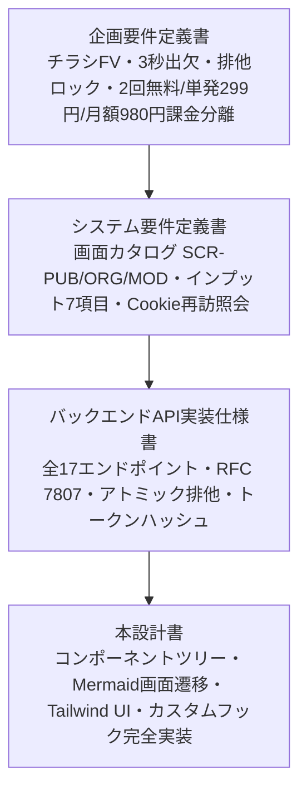

# フロントエンド画面・コンポーネント実装設計書

> **実装前の設計文書です。** 現在の正は `prisma/schema.prisma` と `src/` のコードです。実装と差分があればコードを優先してください。

## チラシファースト型 イベント紹介ページ生成＆出欠管理基盤（Next.js App Router / React / Tailwind CSS）

## 1. 全体アーキテクチャ・設計方針

本ドキュメントは、システム要件定義書、データモデル設計書、およびバックエンドAPI実装仕様書に基づき、Next.js 14（App Router）、React 18、TypeScript、Tailwind CSSによるフロントエンド画面・UIコンポーネント・カスタムフックの実装仕様を定義する。



### 1.1. 4大設計原則

1. **Flyer-First & Peek UI (視覚訴求とCTAの共存):**
   * スマホのファーストビュー（FV）でチラシ画像（9:16）を美しくカード状に埋め込みつつ（`max-height: 65vh`）、画面下部に出欠フォームの頭部が自然に見える「Peek UI」および追従型「Sticky CTAバー」を実装し、FV直帰率35%以下・スクロール誘導を担保する。
2. **Zero-Friction RSVP (極小摩擦の出欠体験):**
   * 参加者はアカウント作成不要。氏名・出欠トグル（参加/不参加）・追加コメントを入力するだけで3秒回答。端末Cookie（`rsvp_token`）をフックし、再訪時は自回答を自動プリフィル・上書き変更可能とする。
3. **Robust Lease Lock UX (競合時の可視化):**
   * 複数幹事の同時編集事故を防ぐため、時間で失効しない排他ロック、他幹事編集中モーダル、および緊急時の「強制引き継ぎ（Takeover）」を完全なUI/UXとして実装する。ロック保持者本人の画面には、残り時間を出さない。
4. **Decoupled Billing Gate (課金誘導モーダル):**
   * イベント作成時にバックエンドから HTTP 402（Quota Exceeded）が返却された場合、画面遷移を遮断して「単発299円 / 月額980円」の課金選択モーダル（`SCR-MOD-01`）を自然に起動する。

---

## 2. 画面ルーティング＆画面遷移図（Mermaid）

### 2.1. ルーティングテーブル

| パス | 画面ID | 対象アクター | 認可・アクセス条件 | 概要 |
| :---- | :---- | :---- | :---- | :---- |
| `/events/[id]` | `SCR-PUB-01` | 参加者 / 全員 | 誰でも可（Cookie自動照会） | チラシFV埋め込み告知・未登録出欠登録画面 |
| `/organizer/events` | `SCR-ORG-01` | 主催幹事 / 共同幹事 | 会員JWT または ゲスト幹事Cookie | 主催・担当イベント一覧ダッシュボード |
| `/organizer/events/new` | `SCR-ORG-02` | 主催幹事 | 任意（作成時スキップ可） | 新規イベント作成画面（インプット7項目） |
| `/organizer/events/[id]/edit` | `SCR-ORG-05` | 幹事（排他ロック保持） | 幹事権限 ＋ 有効排他ロック | イベント排他編集画面（同時編集防止） |
| `/organizer/events/[id]/participants` | `SCR-ORG-06` | 幹事（全員） | 幹事権限必須 | 参加者一覧・出欠集計・コメント詳細閲覧 |
| `/invitations/[code]` | `SCR-ORG-07` | 招待されたメンバー | 招待コード有効期限内 | 共同幹事受諾・権限バインド画面 |
| `/mypage` | `SCR-PUB-03` | ログイン会員 | 会員JWT必須 | 参加履歴・主催イベント一覧マイページ |
| `/auth/register` | `SCR-PUB-02` | ゲストユーザー | 未ログイン | 会員登録・アカウント統合（Hydration） |

---

### 2.2. 全体画面遷移シーケンス図（Mermaid）

```mermaid
graph TD
    classDef public fill:#E0F2FE,stroke:#0284C7,stroke-width:2px;
    classDef organizer fill:#FEF3C7,stroke:#D97706,stroke-width:2px;
    classDef modal fill:#FEE2E2,stroke:#DC2626,stroke-width:2px;
    classDef member fill:#DCFCE7,stroke:#16A34A,stroke-width:2px;
    %% 画面ノード
    PUB01["SCR-PUB-01: イベント告知・出欠画面<br/>/events/[id]"]:::public
    PUB02["SCR-PUB-02: 会員登録・ログイン<br/>/auth/register"]:::member
    PUB03["SCR-PUB-03: 会員マイページ<br/>/mypage"]:::member
    ORG01["SCR-ORG-01: 主催イベント一覧<br/>/organizer/events"]:::organizer
    ORG02["SCR-ORG-02: 新規イベント作成<br/>/organizer/events/new"]:::organizer
    ORG03["SCR-ORG-03: チラシ選択モーダル"]:::modal
    ORG04["SCR-ORG-04: 公開完了モーダル"]:::modal
    ORG05["SCR-ORG-05: 排他編集画面<br/>/organizer/events/[id]/edit"]:::organizer
    ORG06["SCR-ORG-06: 参加者一覧閲覧<br/>/organizer/events/[id]/participants"]:::organizer
    ORG07["SCR-ORG-07: 共同幹事受託<br/>/invitations/[code]"]:::organizer
    MOD01["SCR-MOD-01: 課金プランモーダル<br/>(299円単発 / 980円サブスク)"]:::modal
    MOD02["排他ロック競合モーダル<br/>(他者編集中 / Takeover)"]:::modal
    %% 遷移線
    ORG01 -->|新規作成ボタン| ORG02
    ORG02 -->|チラシを選択| ORG03
    ORG03 -->|アセット決定| ORG02
    ORG02 -->|公開リクエスト| MOD01
    ORG02 -->|作成成功 (201)| ORG04
    ORG04 -->|共有リンク| PUB01
    ORG04 -->|管理ダッシュボードへ| ORG01
    PUB01 -->|3秒出欠登録 (Cookie付与)| PUB01
    PUB01 -->|会員登録して履歴保存| PUB02
    PUB02 -->|Hydration成功| PUB03
    ORG01 -->|編集ボタン| ORG05
    ORG05 -.->|他幹事編集中 (409 Conflict)| MOD02
    MOD02 -->|強制引き継ぎ (Takeover)| ORG05
    ORG05 -->|保存完了 (ロック解放)| ORG01
    ORG01 -->|出欠確認ボタン| ORG06
    ORG01 -->|コピー作成| ORG02
    ORG01 -->|共同幹事を招待| ORG07
    ORG07 -->|受託完了| ORG01
```

---

## 3. コンポーネント階層ツリー＆ディレクトリ構成

```text
src/
├── app/
│   ├── events/[id]/page.tsx                   # SCR-PUB-01 (公開告知・出欠)
│   ├── organizer/
│   │   ├── events/
│   │   │   ├── page.tsx                       # SCR-ORG-01 (主催者一覧)
│   │   │   ├── new/page.tsx                   # SCR-ORG-02 (新規作成)
│   │   │   ├── [id]/
│   │   │   │   ├── edit/page.tsx              # SCR-ORG-05 (排他編集)
│   │   │   │   └── participants/page.tsx      # SCR-ORG-06 (参加者一覧)
│   ├── invitations/[code]/page.tsx            # SCR-ORG-07 (共同幹事受諾)
│   ├── mypage/page.tsx                        # SCR-PUB-03 (会員マイページ)
│   └── auth/register/page.tsx                 # SCR-PUB-02 (会員登録・Hydration)
├── components/
│   ├── public/
│   │   ├── PosterHero.tsx                     # チラシFV埋め込み・LQIPブラー・Peek UI
│   │   ├── EventMetaCard.tsx                  # 7項目の実用アクション（カレンダー・地図等）
│   │   ├── DynamicRsvpBox.tsx                 # 未登録出欠フォーム 兼 再訪自動照会
│   │   └── StickyRsvpBar.tsx                  # モバイル画面下部追従CTAバー
│   ├── organizer/
│   │   ├── EventCard.tsx                      # 主催一覧の各イベントカード（出欠集計バー付）
│   │   ├── EventForm.tsx                      # 基本7項目（公開状態は下書きの公開だけ）
│   │   ├── FlyerAssetPickerModal.tsx          # SCR-ORG-03 (チラシ選択)
│   │   ├── PublishSuccessModal.tsx            # SCR-ORG-04 (公開完了・共有URL)
│   │   ├── ParticipantListTable.tsx           # SCR-ORG-06 (出欠テーブル・フィルタ)
│   │   └── InviteOrganizerModal.tsx           # SCR-ORG-07 (招待URL発行)
│   ├── common/
│   │   ├── LockConflictModal.tsx              # 排他ロック競合・カウントダウン・Takeover
│   │   ├── PricingModal.tsx                   # SCR-MOD-01 (課金プラン選択)
│   │   ├── Navbar.tsx                         # 共通ヘッダー。役割と画面領域の出し分けは共通編 2.4.1 に従う
│   │   └── Toast.tsx                          # トースト通知
├── hooks/
│   ├── useEditLock.ts                         # 排他ロック・再確認・Takeover管理
│   ├── useRsvp.ts                             # 出欠登録・Cookie照会・楽観的更新
│   ├── useEventQuota.ts                       # 課金クォータ・402エラー検知・モーダル制御
│   └── useEventForm.ts                        # イベント作成/編集フォーム状態管理
└── types/
    └── event.ts                               # 型定義（Event, Participant, Lock, Quota等）
```

---

## 4. 主要UIコンポーネント詳細実装（React / Tailwind CSS）

### 4.1. `PosterHero.tsx`（ポスター埋め込み型FV・LQIPブラー・Peek UI）

ファーストビューでチラシ画像を主役に配置しつつ、下部の出欠フォームが視界に入るよう高さを制限（`max-height: 65vh`）します。低解像度プレビュー（LQIP）によるブラーアップでLCPを極小化します。

```text
"use client";
import React, { useState } from "react";
import Image from "next/image";
import { FlyerAsset } from "@/types/event";

interface PosterHeroProps {
  flyerAsset: FlyerAsset | null;
  title: string;
}

export const PosterHero: React.FC<PosterHeroProps> = ({ flyerAsset, title }) => {
  const [isLoaded, setIsLoaded] = useState(false);
  // チラシ画像が存在しない場合の標準アイキャッチテンプレート
  if (!flyerAsset) {
    return (
      <div className="w-full bg-gradient-to-br from-indigo-900 via-slate-900 to-slate-950 px-6 py-12 text-center text-white shadow-inner">
        <span className="inline-block rounded-full bg-indigo-500/20 px-3 py-1 text-xs font-semibold tracking-wider text-indigo-300 backdrop-blur-sm">
          EVENT ANNOUNCEMENT
        </span>
        <h1 className="mt-4 text-2xl font-black tracking-tight sm:text-4xl">{title}</h1>
      </div>
    );
  }
  return (
    <div className="relative w-full overflow-hidden bg-slate-950 px-4 pt-4 pb-6">
      {/* 背景のアンビエント発光（チラシの色味をぼかして背景に広げる演出） */}
      <div
        className="absolute inset-0 scale-110 opacity-30 blur-2xl"
        style={{ backgroundImage: `url(${flyerAsset.imageUrl})`, backgroundPosition: "center", backgroundSize: "cover" }}
        aria-hidden="true"
      />
      {/* ポスター埋め込みカード（画面高さ65vhに収め、下のフォームをチラ見せする） */}
      <div className="relative mx-auto flex max-w-sm justify-center">
        <div className="relative max-h-[65vh] w-full overflow-hidden rounded-2xl shadow-2xl ring-1 ring-white/10">
          {/* 低解像度プレビュー（Blur-up） */}
          {flyerAsset.lqipDataUrl && !isLoaded && (
            
          )}
          {/* 高解像度WebP画像（Next.js Image最適化） */}
          <Image
            src={flyerAsset.imageUrl}
            alt={title}
            width={1080}
            height={1920}
            priority
            sizes="(max-width: 640px) 90vw, 400px"
            className={`h-auto max-h-[65vh] w-full object-contain transition-opacity duration-500 ${
              isLoaded ? "opacity-100" : "opacity-0"
            }`}
            onLoad={() => setIsLoaded(true)}
          />
        </div>
      </div>
      {/* 下部へのスクロールを促すマイクロインジケータ */}
      <div className="mt-2 flex justify-center">
        <span className="inline-flex items-center text-xs text-slate-400">
          <svg className="mr-1 h-3.5 w-3.5 animate-bounce" fill="none" viewBox="0 0 24 24" stroke="currentColor">
            <path strokeLinecap="round" strokeLinejoin="round" strokeWidth={2} d="M19 14l-7 7m0 0l-7-7m7 7V3" />
          </svg>
          スクロールして出欠を回答
        </span>
      </div>
    </div>
  );
};
```

---

### 4.2. `EventMetaCard.tsx`（基本7項目の実用アクション表示）

画像では不可能な「カレンダー連携」「マップ表示」などのユーティリティ機能に特化し、情報の重複感を解消します。

```text
import React from "react";
import { Calendar, Clock, MapPin, JapaneseYen, Users, CloudRain } from "lucide-react";
import { EventData, RainPolicy } from "@/types/event";

const rainPolicyLabels: Record<RainPolicy, { label: string; color: string }> = {
  RAIN_OR_SHINE: { label: "雨天決行", color: "bg-emerald-500/10 text-emerald-400 border-emerald-500/20" },
  CANCEL_ON_RAIN: { label: "雨天中止", color: "bg-rose-500/10 text-rose-400 border-rose-500/20" },
  POSTPONE_ON_RAIN: { label: "雨天順延", color: "bg-amber-500/10 text-amber-400 border-amber-500/20" },
  INDOOR: { label: "屋内開催", color: "bg-blue-500/10 text-blue-400 border-blue-500/20" },
};

export const EventMetaCard: React.FC<{ event: EventData }> = ({ event }) => {
  const rainInfo = rainPolicyLabels[event.rainPolicy];
  // 地図検索用クエリ
  const mapSearchUrl = `/map-search?query=${encodeURIComponent(event.location)}`;
  return (
    <div className="mx-auto max-w-xl rounded-2xl bg-slate-900/90 p-5 text-slate-200 shadow-xl ring-1 ring-slate-800 backdrop-blur-md">
      <h2 className="text-xl font-bold text-white">{event.title}</h2>
      <div className="mt-4 grid grid-cols-1 gap-3.5 sm:grid-cols-2">
        {/* 日時 */}
        <div className="flex items-start space-x-3">
          <Calendar className="mt-0.5 h-4 w-4 shrink-0 text-indigo-400" />
          <div>
            <p className="text-xs text-slate-400">開催日</p>
            <p className="text-sm font-semibold text-white">{event.eventDate}</p>
          </div>
        </div>
        {/* 時間 */}
        <div className="flex items-start space-x-3">
          <Clock className="mt-0.5 h-4 w-4 shrink-0 text-indigo-400" />
          <div>
            <p className="text-xs text-slate-400">時間</p>
            <p className="text-sm font-semibold text-white">{event.eventTime}</p>
          </div>
        </div>
        {/* 場所＆地図ボタン */}
        <div className="flex items-start space-x-3">
          <MapPin className="mt-0.5 h-4 w-4 shrink-0 text-rose-400" />
          <div className="flex-1">
            <p className="text-xs text-slate-400">場所</p>
            <a
              href={mapSearchUrl}
              target="_blank"
              rel="noopener noreferrer"
              className="text-sm font-semibold text-indigo-300 underline-offset-2 hover:underline"
            >
              {event.location}
            </a>
          </div>
        </div>
        {/* 費用 */}
        <div className="flex items-start space-x-3">
          <JapaneseYen className="mt-0.5 h-4 w-4 shrink-0 text-amber-400" />
          <div>
            <p className="text-xs text-slate-400">費用</p>
            <p className="text-sm font-semibold text-white">{event.price}</p>
          </div>
        </div>
        {/* 雨天対応 */}
        <div className="flex items-center space-x-3">
          <CloudRain className="h-4 w-4 shrink-0 text-sky-400" />
          <div>
            <p className="text-xs text-slate-400">雨天対応</p>
            <span className={`inline-block mt-0.5 rounded border px-2 py-0.5 text-xs font-medium ${rainInfo.color}`}>
              {rainInfo.label}
            </span>
          </div>
        </div>
        {/* 定員＆現在の参加状況 */}
        <div className="flex items-center space-x-3">
          <Users className="h-4 w-4 shrink-0 text-teal-400" />
          <div>
            <p className="text-xs text-slate-400">定員 / 参加状況</p>
            <p className="text-sm font-semibold text-white">
              現在 <span className="text-emerald-400">{event.attendingCount}名</span> 参加予定
              {event.capacity && <span className="text-slate-400"> / 定員 {event.capacity}名</span>}
            </p>
          </div>
        </div>
      </div>
    </div>
  );
};
```

---

### 4.3. `DynamicRsvpBox.tsx`（未登録出欠フォーム 兼 再訪自動照会）

未登録でも3秒で出欠登録でき、端末Cookieが存在すれば「回答済み・変更可能」状態として自動表示します。

```text
"use client";
import React, { useState } from "react";
import { CheckCircle2, XCircle, Send, Check } from "lucide-react";
import { RsvpStatus, ParticipantRsvp } from "@/types/event";

interface DynamicRsvpBoxProps {
  eventId: string;
  initialRsvp: ParticipantRsvp | null;
  onSubmit: (data: { name: string; status: RsvpStatus; comment?: string }) => Promise<void>;
}

export const DynamicRsvpBox: React.FC<DynamicRsvpBoxProps> = ({ eventId, initialRsvp, onSubmit }) => {
  const [status, setStatus] = useState<RsvpStatus>(initialRsvp?.status || "ATTENDING");
  const [name, setName] = useState(initialRsvp?.name || "");
  const [comment, setComment] = useState(initialRsvp?.comment || "");
  const [isSubmitting, setIsSubmitting] = useState(false);
  const [isSuccess, setIsSuccess] = useState(false);
  const handleSubmit = async (e: React.FormEvent) => {
    e.preventDefault();
    if (!name.trim()) return;
    setIsSubmitting(true);
    try {
      await onSubmit({ name: name.trim(), status, comment: comment.trim() || undefined });
      setIsSuccess(true);
      setTimeout(() => setIsSuccess(false), 3000);
    } catch (error) {
      console.error("出欠送信に失敗しました", error);
    } finally {
      setIsSubmitting(false);
    }
  };
  return (
    <div id="rsvp-section" className="mx-auto mt-6 max-w-xl rounded-2xl bg-slate-900 p-6 shadow-xl ring-1 ring-slate-800">
      <div className="flex items-center justify-between border-b border-slate-800 pb-3">
        <h3 className="text-lg font-bold text-white">出欠の登録</h3>
        {initialRsvp && (
          <span className="rounded-full bg-emerald-500/10 px-2.5 py-0.5 text-xs font-medium text-emerald-400 ring-1 ring-emerald-500/20">
            回答済み（変更可能）
          </span>
        )}
      </div>
      <form onSubmit={handleSubmit} className="mt-4 space-y-4">
        {/* 出欠トグルボタン（Yes / No） */}
        <div>
          <label className="block text-xs font-semibold text-slate-300">参加可否</label>
          <div className="mt-1.5 grid grid-cols-2 gap-3">
            <button
              type="button"
              onClick={() => setStatus("ATTENDING")}
              className={`flex items-center justify-center rounded-xl py-3 text-sm font-bold transition-all ${
                status === "ATTENDING"
                  ? "bg-emerald-600 text-white shadow-lg shadow-emerald-900/40 ring-2 ring-emerald-400"
                  : "bg-slate-800 text-slate-400 hover:bg-slate-700"
              }`}
            >
              <CheckCircle2 className="mr-2 h-4 w-4" />
              参加する
            </button>
            <button
              type="button"
              onClick={() => setStatus("DECLINED")}
              className={`flex items-center justify-center rounded-xl py-3 text-sm font-bold transition-all ${
                status === "DECLINED"
                  ? "bg-rose-600 text-white shadow-lg shadow-rose-900/40 ring-2 ring-rose-400"
                  : "bg-slate-800 text-slate-400 hover:bg-slate-700"
              }`}
            >
              <XCircle className="mr-2 h-4 w-4" />
              不参加
            </button>
          </div>
        </div>
        {/* 氏名入力欄 */}
        <div>
          <label htmlFor="rsvp-name" className="block text-xs font-semibold text-slate-300">
            お名前（ニックネーム可） <span className="text-rose-400">*</span>
          </label>
          <input
            id="rsvp-name"
            type="text"
            required
            value={name}
            onChange={(e) => setName(e.target.value)}
            placeholder="例: 山田 太郎"
            className="mt-1.5 w-full rounded-xl border border-slate-700 bg-slate-800 px-3.5 py-2.5 text-sm text-white placeholder-slate-500 focus:border-indigo-500 focus:outline-none focus:ring-1 focus:ring-indigo-500"
          />
        </div>
        {/* 追加コメント欄 */}
        <div>
          <label htmlFor="rsvp-comment" className="block text-xs font-semibold text-slate-300">
            主催者へのメッセージ・備考（任意）
          </label>
          <textarea
            id="rsvp-comment"
            rows={2}
            value={comment}
            onChange={(e) => setComment(e.target.value)}
            placeholder="例: 少し遅れて参加します！楽しみにしています。"
            className="mt-1.5 w-full rounded-xl border border-slate-700 bg-slate-800 px-3.5 py-2 text-sm text-white placeholder-slate-500 focus:border-indigo-500 focus:outline-none focus:ring-1 focus:ring-indigo-500"
          />
        </div>
        {/* 送信ボタン */}
        <button
          type="submit"
          disabled={isSubmitting || !name.trim()}
          className={`flex w-full items-center justify-center rounded-xl py-3 text-sm font-bold shadow-lg transition-all ${
            isSuccess
              ? "bg-emerald-500 text-white"
              : "bg-indigo-600 text-white hover:bg-indigo-500 active:scale-[0.99] disabled:opacity-50"
          }`}
        >
          {isSuccess ? (
            <>
              <Check className="mr-2 h-4 w-4" />
              {initialRsvp ? "回答を更新しました" : "登録が完了しました"}
            </>
          ) : isSubmitting ? (
            "送信中..."
          ) : (
            <>
              <Send className="mr-2 h-4 w-4" />
              {initialRsvp ? "回答内容を変更する" : "出欠を登録する（登録不要）"}
            </>
          )}
        </button>
      </form>
    </div>
  );
};
```

---

### 4.4. `LockConflictModal.tsx`（他幹事編集中ブロッカー＆強制引き継ぎ）

他幹事が編集画面を開いている際に発火し、残り秒数をカウントダウン表示しながら、放置対策の「強制引き継ぎ（Takeover）」を安全に実行させます。

```text
"use client";
import React, { useEffect, useState } from "react";
import { AlertTriangle, Clock, ArrowRightLeft } from "lucide-react";

interface LockConflictModalProps {
  isOpen: boolean;
  holderName: string;
  initialRemainingSeconds: number;
  onTakeover: () => Promise<void>;
  onViewOnly: () => void;
}

export const LockConflictModal: React.FC<LockConflictModalProps> = ({
  isOpen,
  holderName,
  initialRemainingSeconds,
  onTakeover,
  onViewOnly,
}) => {
  const [seconds, setSeconds] = useState(initialRemainingSeconds);
  const [isTakingOver, setIsTakingOver] = useState(false);
  useEffect(() => {
    setSeconds(initialRemainingSeconds);
  }, [initialRemainingSeconds]);
  useEffect(() => {
    if (!isOpen || seconds <= 0) return;
    const timer = setInterval(() => {
      setSeconds((prev) => Math.max(0, prev - 1));
    }, 1000);
    return () => clearInterval(timer);
  }, [isOpen, seconds]);
  if (!isOpen) return null;
  const handleForceTakeover = async () => {
    setIsTakingOver(true);
    try {
      await onTakeover();
    } finally {
      setIsTakingOver(false);
    }
  };
  return (
    <div className="fixed inset-0 z-50 flex items-center justify-center bg-black/80 p-4 backdrop-blur-sm">
      <div className="w-full max-w-md rounded-2xl bg-slate-900 p-6 text-slate-100 shadow-2xl ring-1 ring-slate-800">
        <div className="flex items-center space-x-3 text-amber-400">
          <AlertTriangle className="h-6 w-6 shrink-0" />
          <h3 className="text-lg font-bold text-white">他の幹事が編集中です</h3>
        </div>
        <p className="mt-3 text-sm text-slate-300">
          現在、<span className="font-semibold text-white">{holderName} さん</span>がこのイベントを編集しています。
          内容の競合を防ぐため、同時編集は制限されています。
        </p>
        {/* ロック有効期限カウントダウン */}
        <div className="mt-4 flex items-center justify-between rounded-xl bg-slate-800/80 px-4 py-3 border border-slate-700">
          <span className="flex items-center text-xs text-slate-400">
            <Clock className="mr-1.5 h-4 w-4 text-indigo-400" />
            自動ロック解除まで
          </span>
          <span className="font-mono text-base font-bold text-indigo-300">
            {Math.floor(seconds / 60)}分 {seconds % 60}秒
          </span>
        </div>
        <div className="mt-6 flex flex-col gap-2.5 sm:flex-row-reverse">
          {/* 強制引き継ぎボタン */}
          <button
            type="button"
            disabled={isTakingOver}
            onClick={handleForceTakeover}
            className="flex flex-1 items-center justify-center rounded-xl bg-rose-600 px-4 py-2.5 text-sm font-bold text-white shadow-lg shadow-rose-900/30 hover:bg-rose-500 active:scale-95 disabled:opacity-50"
          >
            <ArrowRightLeft className="mr-2 h-4 w-4" />
            {isTakingOver ? "引き継ぎ中..." : "編集権を引き継ぐ"}
          </button>
          {/* 閲覧専用で開くボタン */}
          <button
            type="button"
            onClick={onViewOnly}
            className="rounded-xl border border-slate-700 bg-slate-800 px-4 py-2.5 text-sm font-semibold text-slate-300 hover:bg-slate-700"
          >
            閲覧のみ（Read-Only）
          </button>
        </div>
      </div>
    </div>
  );
};
```

---

### 4.5. `PricingModal.tsx`（SCR-MOD-01: 課金プラン選択モーダル）

無料枠（2回）消化時にバックエンドが返却する HTTP 402 を契機として表示する課金モーダル。

```text
"use client";
import React from "react";
import { Sparkles, Check, Zap } from "lucide-react";

interface PricingModalProps {
  isOpen: boolean;
  onClose: () => void;
  onSelectPlan: (plan: "SINGLE" | "SUBSCRIPTION") => void;
}

export const PricingModal: React.FC<PricingModalProps> = ({ isOpen, onClose, onSelectPlan }) => {
  if (!isOpen) return null;
  return (
    <div className="fixed inset-0 z-50 flex items-center justify-center bg-black/80 p-4 backdrop-blur-sm">
      <div className="w-full max-w-lg rounded-3xl bg-slate-900 p-6 text-slate-100 shadow-2xl ring-1 ring-slate-800 sm:p-8">
        <div className="text-center">
          <div className="mx-auto flex h-12 w-12 items-center justify-center rounded-2xl bg-indigo-500/20 text-indigo-400 ring-1 ring-indigo-500/30">
            <Sparkles className="h-6 w-6" />
          </div>
          <h3 className="mt-4 text-xl font-black text-white sm:text-2xl">無料作成枠の上限に達しました</h3>
          <p className="mt-2 text-xs text-slate-400 sm:text-sm">
            トライアル枠（2回）をご利用いただきありがとうございます。<br />
            継続して告知ページを生成するには、以下のプランをお選びください。
          </p>
        </div>
        <div className="mt-6 grid grid-cols-1 gap-4 sm:grid-cols-2">
          {/* 単発生成チケット（299円） */}
          <div className="relative flex flex-col justify-between rounded-2xl border border-slate-800 bg-slate-800/50 p-5 hover:border-slate-700">
            <div>
              <p className="text-sm font-bold text-slate-300">単発生成チケット</p>
              <p className="mt-2 text-2xl font-black text-white">
                ¥299 <span className="text-xs font-normal text-slate-400">/ 1回</span>
              </p>
              <ul className="mt-4 space-y-2 text-xs text-slate-400">
                <li className="flex items-center"><Check className="mr-1.5 h-3.5 w-3.5 text-emerald-400" />告知ページと出欠の生成</li>
                <li className="flex items-center"><Check className="mr-1.5 h-3.5 w-3.5 text-emerald-400" />チラシ画像FV連携</li>
              </ul>
            </div>
            <button
              onClick={() => onSelectPlan("SINGLE")}
              className="mt-5 w-full rounded-xl bg-slate-700 py-2.5 text-xs font-bold text-white hover:bg-slate-600"
            >
              単発で購入する
            </button>
          </div>
          {/* 月額使い放題プラン（980円/月） */}
          <div className="relative flex flex-col justify-between rounded-2xl border-2 border-indigo-500 bg-indigo-950/20 p-5 shadow-lg shadow-indigo-950/50">
            <span className="absolute -top-3 right-4 rounded-full bg-gradient-to-r from-indigo-500 to-purple-500 px-2.5 py-0.5 text-[10px] font-black tracking-wider text-white uppercase">
              RECOMMENDED
            </span>
            <div>
              <p className="text-sm font-bold text-indigo-300">月額定期プラン</p>
              <p className="mt-2 text-2xl font-black text-white">
                ¥980 <span className="text-xs font-normal text-slate-400">/ 月</span>
              </p>
              <ul className="mt-4 space-y-2 text-xs text-slate-300">
                <li className="flex items-center font-semibold text-white"><Zap className="mr-1.5 h-3.5 w-3.5 text-amber-400" />生成回数 無制限</li>
                <li className="flex items-center"><Check className="mr-1.5 h-3.5 w-3.5 text-emerald-400" />共同幹事の招待・共同運営</li>
                <li className="flex items-center"><Check className="mr-1.5 h-3.5 w-3.5 text-emerald-400" />過去イベントの無制限コピー</li>
              </ul>
            </div>
            <button
              onClick={() => onSelectPlan("SUBSCRIPTION")}
              className="mt-5 w-full rounded-xl bg-indigo-600 py-2.5 text-xs font-bold text-white shadow-md shadow-indigo-900/50 hover:bg-indigo-500"
            >
              定期購入で使い放題
            </button>
          </div>
        </div>
        <div className="mt-6 text-center">
          <button onClick={onClose} className="text-xs text-slate-500 hover:text-slate-400">
            キャンセルして下書きに戻る
          </button>
        </div>
      </div>
    </div>
  );
};
```

---

## 5. カスタムフック詳細実装（React Hooks）

### 5.1. `useEditLock.ts`（排他ロック・再確認・Takeover管理）

編集画面の排他制御を一括制御する中核カスタムフック。

```ts
"use client";
import { useEffect, useRef, useState, useCallback } from "react";

interface LockState {
  hasLock: boolean;
  lockToken: string | null;
  conflict: {
    isConflicted: boolean;
    holderName: string;
    remainingSeconds: number;
  } | null;
}

export function useEditLock(eventId: string, organizerName: string) {
  const [state, setState] = useState<LockState>({
    hasLock: false,
    lockToken: null,
    conflict: null,
  });
  const tokenRef = useRef<string | null>(null);
  tokenRef.current = state.lockToken;
  // 1. ロック取得 / 再確認延長 API呼び出し
  const acquireOrExtendLock = useCallback(
    async (forceTakeover: boolean = false) => {
      try {
        const res = await fetch(`/api/v1/organizer/events/${eventId}/lock`, {
          method: "POST",
          headers: { "Content-Type": "application/json" },
          body: JSON.stringify({
            holderName: organizerName,
            currentLockToken: tokenRef.current || undefined,
            forceTakeover,
          }),
        });
        if (res.status === 409) {
          const errData = await res.json();
          setState({
            hasLock: false,
            lockToken: null,
            conflict: {
              isConflicted: true,
              holderName: errData.holderName || "他の幹事",
            },
          });
          return false;
        }
        if (!res.ok) throw new Error("ロック取得に失敗しました");
        const data = await res.json();
        setState({
          hasLock: true,
          lockToken: data.lockToken,
          conflict: null,
        });
        return true;
      } catch (e) {
        console.error(e);
        return false;
      }
    },
    [eventId, organizerName]
  );
  // 2. ロック解放 API呼び出し
  const releaseLock = useCallback(() => {
    if (!tokenRef.current) return;
    // 画面離脱時にも確実に送信するため sendBeacon を優先
    const payload = JSON.stringify({ lockToken: tokenRef.current });
    if (navigator.sendBeacon) {
      navigator.sendBeacon(
        `/api/v1/organizer/events/${eventId}/lock?_method=DELETE`,
        new Blob([payload], { type: "application/json" })
      );
    } else {
      fetch(`/api/v1/organizer/events/${eventId}/lock`, {
        method: "DELETE",
        headers: { "Content-Type": "application/json" },
        body: payload,
        keepalive: true,
      });
    }
  }, [eventId]);
  // 3. 初回取得＆30秒ごとの自動再確認延長タイマー
  useEffect(() => {
    acquireOrExtendLock(false);
    const interval = setInterval(() => {
      if (tokenRef.current) {
        acquireOrExtendLock(false);
      }
    }, 30000); // 30秒ごと
    window.addEventListener("beforeunload", releaseLock);
    return () => {
      clearInterval(interval);
      window.removeEventListener("beforeunload", releaseLock);
      releaseLock();
    };
  }, [acquireOrExtendLock, releaseLock]);
  return {
    hasLock: state.hasLock,
    lockToken: state.lockToken,
    conflict: state.conflict,
    takeoverLock: () => acquireOrExtendLock(true),
    dismissConflict: () => setState((s) => ({ ...s, conflict: null })),
  };
}
```

---

### 5.2. `useRsvp.ts`（出欠登録・Cookie照会・楽観的更新）

未登録参加者の出欠登録とCookie照会を扱うフック。

```ts
"use client";
import { useState } from "react";
import { ParticipantRsvp, RsvpStatus } from "@/types/event";

export function useRsvp(eventId: string, initialRsvp: ParticipantRsvp | null) {
  const [myRsvp, setMyRsvp] = useState<ParticipantRsvp | null>(initialRsvp);
  const [isSubmitting, setIsSubmitting] = useState(false);
  const submitRsvp = async (input: { name: string; status: RsvpStatus; comment?: string }) => {
    setIsSubmitting(true);
    // 楽観的UI更新
    const previous = myRsvp;
    setMyRsvp({
      id: previous?.id || "temp-id",
      name: input.name,
      status: input.status,
      comment: input.comment || null,
    });
    try {
      const res = await fetch(`/api/v1/public/events/${eventId}/rsvp`, {
        method: "POST",
        headers: { "Content-Type": "application/json" },
        body: JSON.stringify(input),
      });
      if (!res.ok) throw new Error("RSVP failed");
      const data = await res.json();
      setMyRsvp(data.myRsvp);
    } catch (e) {
      setMyRsvp(previous); // ロールバック
      throw e;
    } finally {
      setIsSubmitting(false);
    }
  };
  return { myRsvp, submitRsvp, isSubmitting };
}
```

---

## 6. アクセシビリティ・レスポンシブ・パフォーマンス設計

### 6.1. Thumb Zone（親指操作領域）最適化

* **追従CTAバー（`StickyRsvpBar.tsx`）:** スマホ画面下部から60px以内の領域に「参加 / 不参加」のクイックアクションを常時追従させ、スクロール位置に関係なく親指だけで瞬時に回答完了できる導線を設ける。
* **Peek UI（覗き見レイアウト）:** チラシの高さを `max-height: 65vh` に抑え、ファーストビュー内に「出欠フォームのタイトルとYes/Noトグルボタン」が約15〜20%露出するように設計。

### 6.2. Core Web Vitals（LCP 1.5秒以内）担保

* **Blur-up LQIP (Low-Quality Image Placeholder):** ページ初期表示時は数KBのインラインBase64 WebPを表示し、背後でNext.js Imageコンポーネントがクライアント幅に応じた最適解像度画像をロード。
* **Cumulative Layout Shift (CLS = 0):** チラシ画像の縦横比を `aspect-[9/16]` または固定最大高さで確保し、画像ロード完了時のコンテンツガタつきを完全に防止。

---

## 7. フロントエンド検証マトリクス＆テスト計画表

| テストID | 検証項目 | 操作シナリオ | 期待結果 |
| :---- | :---- | :---- | :---- |
| **FE-TC-01** | **ポスター埋め込みFV** | チラシ画像ありイベントを表示 | 画面高さ65vh以内に画像が収まり、下部に出欠フォーム頭部が覗き見えていること |
| **FE-TC-02** | **登録不要出欠** | 名前と参加を選択して送信 | アカウント不要で201が返り、画面が「回答済み・変更可能」状態になること |
| **FE-TC-03** | **Cookie自動再訪照会** | 回答後にブラウザをリロード | 前回入力した氏名・ステータス・コメントがフォームに自動プリフィルされていること |
| **FE-TC-04** | **排他ロック競合** | 幹事A編集中に幹事Bが編集URL開く | 幹事Bに「幹事Aさんが編集中」のモーダルが表示され、フォームが操作不可になること |
| **FE-TC-05** | **強制引き継ぎ** | 幹事Bが「引き継ぐ」ボタン押下 | 幹事Bがロックを獲得して編集可能となり、幹事A側は編集権喪失通知が表示されること |
| **FE-TC-06** | **課金モーダル起動** | 無料枠消化後に新規作成を実行 | HTTP 402を検知し、「単発299円/月額980円」の課金選択モーダルが表示されること |

