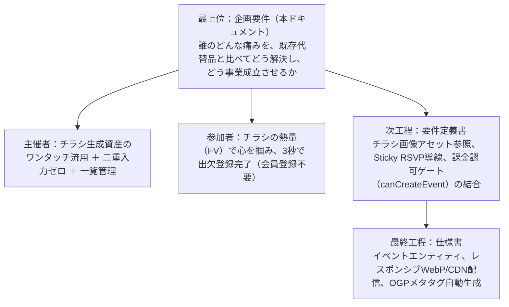

# 機能別企画要件定義書

> **実装前の設計文書です。** 現在の正は `prisma/schema.prisma` と `src/` のコードです。実装と差分があればコードを優先してください。

## チラシファースト型 イベント紹介・告知ページ生成＆出欠管理基盤（Flyer-Driven Event Page & Frictionless RSVP）

## 1. 目的と位置づけ（階層構造）

本ドキュメントは、イベント管理プラットフォームにおける「告知ページの作成摩擦ゼロ」と「参加者の離脱防止・出欠コンバージョン最大化」を両立するための目的関数を定義する。

---

## 2. 企画要件コア5項目

### 2.1. ターゲットの解像度と現状の代替手段

#### ペルソナA（イベント主催者／個人店舗オーナー・コミュニティ幹事）

* **属性:** 個人経営バーの店主、小規模サロンオーナー、勉強会・サークル幹事、ワークショップ主催者。
* **行動コンテキスト:**
  * すでに先行機能の「チラシ生成機能」を利用して魅力的な告知画像（9:16ポスター等）を作成済み。
  * 画像をSNSやLINEで共有するだけでは、出欠人数の集計やリマインドが個別DM・チャット頼みになり、日々の仕込みや本業の時間を圧迫されている。
  * 既存のイベント管理ツールでは、チラシ作成時に入力した「催し名・開催日時・場所・費用」をもう一度入力させられるため、二度手間で耐えられない。
  * 自身が過去〜現在に作成したイベント一覧をダッシュボードで一元管理し、集客状況を即座に把握したい。

#### ペルソナB（参加者）

* **属性:** 主催者からLINE、Instagramストーリーズ、X等で共有されたURLをスマートフォンで開くユーザー。
* **行動コンテキスト:**
  * リンクを開いた瞬間に、イベントの世界観や熱量を魅力的なビジュアル（チラシ）で直感的に理解したい。
  * 「会員登録」「アプリインストール」「パスワード設定」「メール認証コード入力」を求められた瞬間に離脱する。
  * 登録後は「何時集合だっけ？」「参加登録できているか」を同じ端末ですぐに確認したい。

#### 現状の代替手段（As-Is）とペインポイント

* **Peatix / Connpass / Doorkeeper:**
  * 参加者に会員登録やアプリ導入を強制するため、カジュアルな集まりでの参加障壁が極めて高い。
  * デザインテンプレートが画一的で、せっかく作った美麗なチラシ画像を主役として全画面で魅せるUIになっていない。
* **Googleフォーム / 調整さん:**
  * 出欠は集められるが、画面が事務的・無機質でイベントの魅力や情緒が一切伝わらない。
  * チラシ画像を配置してもサムネイル程度に縮小され、視覚的訴求が損なわれる。
* **SNS投稿（Instagram / LINE / X）のみ:**
  * 画像は見てもらえるが、参加人数の確定・出欠リスト化が手動（コメントやDMの拾い出し）となり、主催者の管理コストが破綻する。

---

### 2.2. 独自の提供価値（Core Value Proposition）

#### 1. チラシ主導型ファーストビュー（Flyer-First Visual Experience）

* **アセット連携による二重入力ゼロ:**
  * 先行機能で生成したチラシ画像のアセットIDを選択・紐付けるだけで、チラシ生成時のメタデータ（催し名、開催日時、場所、費用、定員）がイベントフォームに自動展開され、**30秒以内に美麗なランディングページが完成**する。
* **スマホ全画面のビジュアルインパクト:**
  * 参加者がページを開いたファーストビュー（FV）に、生成された高品質なチラシ画像が最適アスペクト比で堂々と表示され、一瞬でイベントの世界観と概要を伝える。

#### 2. FVから直結する極小摩擦の出欠登録（Zero-Friction Sticky RSVP）

* **会員登録不要・3秒ワンタップ回答:**
  * 参加者はアカウント作成不要。氏名（ニックネーム可）と出欠トグル（参加・不参加）を選択するだけで即座に回答が完了する。
* **視覚的スクロール不要の導線設計:**
  * チラシ画像を見ながらでも、画面下部に常時追従する「Sticky RSVPバー」またはPeek UI（チラシ直下の入力コンポーネントが少し見えている状態）により、迷わず最短アクションへ誘導する。
* **端末Cookieによる再訪自動照会:**
  * 暗号化トークン／Cookieにより、再アクセス時に自分の出欠ステータスが自動認識され、いつでも変更・確認が可能。

#### 3. 主催者ダッシュボード（イベント一覧＆リアルタイム出欠集計）

* **イベント一覧のステータス管理:**
  * 主催者がこれまでに作成したイベント（下書き、公開中、開催終了）が一覧化され、現在の参加人数／定員が一目で把握できる。
* **セキュアな出欠リスト閲覧:**
  * 参加者の実名リストや回答ログは、主催者権限（幹事トークン／ログインアカウント）を持つユーザーのみが専用管理画面で確認可能（参加者への情報漏洩を完全防止）。

---

### 2.3. 成功指標（KPI / ガードレール指標）

| 指標カテゴリ | 指標名 | 目標値 | 計測定義 / 意図 |
| :---- | :---- | :---- | :---- |
| **UX摩擦指標** | **Time-to-Publish** | **30秒以内** | チラシ選択からイベントページ公開完了までの所要時間中央値 |
| **参加コンバージョン** | **Time-to-RSVP** | **15秒以内** | ページ到達から出欠登録完了までの所要時間中央値 |
| **訴求力** | **FV直帰率（Bounce Rate）** | **35%以下** | チラシ画像FVによる離脱防止（一般的な告知ページの直帰率50〜60%を大幅に改善） |
| **表示性能** | **LCP（Largest Contentful Paint）** | **1.5秒以内** | モバイル回線における高解像度チラシ画像の初回表示完了時間 |
| **運用効率** | **イベント複製率** | **25%以上** | 過去イベントからのコピー作成機能の利用率 |

---

### 2.4. メディア・データ連携コスト＆境界設計

#### チラシ生成機能との疎結合アーキテクチャ

* **参照連携（Loose Coupling）:**
  * チラシ生成機能の成果物（画像バイナリ）をイベントテーブル内に直接保持せず、「生成済みFlyer ID（または永続化URL）」を参照キーとして保持する。
* **メタデータの初期流し込み（Hydration）:**
  * イベントページ作成時にチラシ側のメタ情報（タイトル、日時、会場など）を初期値としてフォームにプリフィルするが、イベントページ側で補足文章（詳細説明、持ち物、注意事項等）を追加編集できるようにする。

#### 画像最適化配信とインフラ原価抑止

* **CDNエッジキャッシュとWebP/AVIF自動変換:**
  * 1080×1920の高解像度PNGを生配信せず、クライアントの画面幅に応じたサイズ縮小と次世代画像フォーマット変換をエッジ（Cloudflare / Vercel Image Optimization等）で実行する。
* **帯域コスト（Egress）の極小化:**
  * 1PVあたり数百KB以内に抑え、急なアクセス集中時でもインフラ原価が急騰しない構造とする。

#### 課金決済基盤との認可ゲート

* **認可インターフェースの分離:**
  * イベント作成・公開を実行するAPI境界で `canCreateEvent(userId)` ゲートをフックする。
  * 「無料枠残り（累計2回以内）」「有効サブスクリプション（月額980円）」「単発チケット（299円）」のいずれかを満たす場合のみ作成を認可し、不足時は課金モーダルを起動する。

---

### 2.5. やらないことリスト（Non-Goals）

1. **WYSIWYG（ノーコードWebビルダー）の実装:**
   * ブロックの自由ドラッグ＆ドロップ、自由なフォント・カラー変更機能は作らない（チラシが主役であり、レイアウト破綻を防ぐため固定型テンプレートを採用）。
2. **イベントページ上でのチラシ画像の再生成・直接編集:**
   * 文字の打ち替えや背景の再生成は「チラシ生成機能」側の責務とし、イベントページ機能内には画像編集ツールを持ち込まない。
3. **オンライン事前決済・有料チケット販売:**
   * 本フェーズでは「出欠の可否（Yes/No）と名前の登録」に限定し、参加者から参加費をクレジットカード決済等で事前徴収する機能はスコープ外とする。
4. **課金・決済処理の本機能内への密結合:**
   * Stripe等の決済画面やサブスクリプション状態管理は「利用枠＆課金決済基盤」に委譲し、本機能は認可結果の受け取りのみを行う。

---

## 3. 想定される3つの自己反証と構造的批判

### 批判1: チラシ画像による「出欠アクション（CTA）」のスクロール埋没リスク（The Below-the-Fold Friction）

* **批判内容:** スマホのファーストビューいっぱいに縦型チラシ（9:16）を表示すると、出欠ボタンやフォームが画面外（ファーストビュー下部）に押し出され、ユーザーが「画像を見て満足して閉じる（スクロールせず離脱する）」リスクが高まる。
* **対抗仮説（Adaptive Sticky CTA Pattern）:**
  * 画面最下部に「参加 / 不参加」が1タップで押せる高さ60px程度の**常時固定フッターバー（Sticky Action Bar）**を配置する。
  * チラシ画像の縦横比を画面高さの約70〜75%に自動フィットさせ、画面下部に「出欠フォームの頭」がチラ見えするレイアウト（Peek UI）を採用することで、無意識のスクロールまたは即時タップを誘発する。

### 批判2: 高解像度AI生成画像による表示速度低下と初期離脱（The LCP Penalty）

* **批判内容:** チラシ画像はAIによって高精細（1080×1920等）に生成されているため、スマホの4G/低速回線環境では画像の読み込みに2〜3秒を要し、Core Web Vitals（特にLCP）が悪化してユーザーが即座に離脱する。
* **対抗仮説（Blur-up LQIP & Progressive Rendering）:**
  * チラシ生成完了時に、わずか数KBの超軽量ぼかしプレビュー画像（LQIP: Low Quality Image Placeholder）を生成する。
  * ページ初期描画時はまずLQIPを即座（100ms以内）に表示し、バックグラウンドで最適化されたWebP画像をフェードインで読み込む。テキストや出欠フォームは画像読み込みを待たずに即座に操作可能とする。

### 批判3: チラシ内の文字とWebテキスト情報の重複による認知的ノイズ（The Visual Redundancy Paradox）

* **批判内容:** チラシ画像の中にも「日時」「場所」「タイトル」が書かれており、その直下に再びWebテキストとして同じ情報が並ぶと、画面がくどくなりユーザーに退屈・冗長な印象を与える。
* **対抗仮説（Emotional Visual vs. Actionable Dataの機能分担）:**
  * チラシは「情緒的訴求（ワクワク感・デザイン・世界観）」を担当する。
  * Webテキスト部分は「カレンダー登録（Google/Appleカレンダー連携ボタン）」「地図を開く（Google Mapsリンク）」「主催者への連絡」「最新の出欠状況」など、**画像では不可能な「アクション可能なユーティリティ（Actionable Utilities）」に特化**させ、役割を明確に分担する。

---

## 4. 【参考】難易度順の参照フレームワーク

* **Step 1（基礎原理）: Steve Krug『Don't Make Me Think: A Common Sense Approach to Web Usability』**
  * *視座:* 「ユーザーに考えさせない」Web設計の鉄則。チラシで直感的にイベントを理解させ、出欠ボタンを押すまでに認知的思考を一切挟ませない。
  * *他分野との接続:* 街頭ポスターの視線誘導、店頭POPのアイキャッチ理論。
* **Step 2（実装・実践）: Luke Wroblewski『Mobile First』**
  * *視座:* スマートフォン特有のビューポート制約と親指操作（Thumb Zone）に基づいた、スティッキーCTAおよび縦型メディアの設計論。
  * *他分野との接続:* InstagramストーリーズやTikTokにおける「フルスクリーン縦型コンテンツ＋下部アクションボタン」のUI心理学。
* **Step 3（最先端の限界）: Alex Russell, Addy Osmani et al.『Modern Web Performance Architecture & Core Web Vitals』**
  * *視座:* メディアの多い告知ページにおけるLCP（Largest Contentful Paint）とCLS（Cumulative Layout Shift）の極小化。
  * *他分野との接続:* コンテンツ配信ネットワーク（CDN）のエッジコンピューティング、次世代画像コーデック（AVIF）、アダプティブストリーミング。

---

## 5. 次工程（要件定義書）に向けた確認・ヒアリング事項

本企画要件定義書をベースに、次工程である **システム要件定義書（画面遷移・データモデル・API境界）** を策定するにあたり、以下の4点について仕様の方向性を確認する。

1. **チラシ生成機能との連携方法:**
   * 案A（チラシ必須）: イベントページ作成時は、必ず事前に生成したチラシ画像を選択してFVに配置する。
   * 案B（チラシ任意）: チラシがない場合でも、標準テンプレート（テキスト中心＋シンプルなアイキャッチ色）でイベントページを作成できる。
2. **主催者のイベント一覧画面で確認したい情報:**
   * タイトル・開催日・公開ステータスの他に、「現在の参加人数／定員」「直近作成順/開催日順ソート」などを表示するか。
3. **出欠フォームの入力項目:**
   * 参加者の入力項目は「参加可否（参加/不参加）＋名前（ニックネーム可）」のみで十分か、または「コメント」「メールアドレス（任意）」「同伴者人数」なども含めるか。
4. **チラシの表示スタイル（FVのデザイン）:**
   * 案A（ポスター埋め込み型）: 画面上部に縦型ポスターがカード状に収まり、その下にテキスト情報と出欠ボタンが続くスタイル。
   * 案B（全画面背景カバー型）: 画面全体にチラシ画像が広がり、下部に半透明グラデーションで情報と出欠ボタンがオーバーレイ表示されるスタイル。