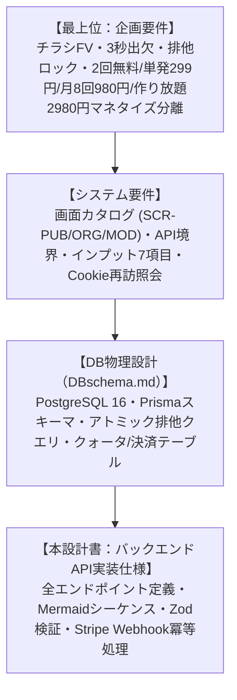
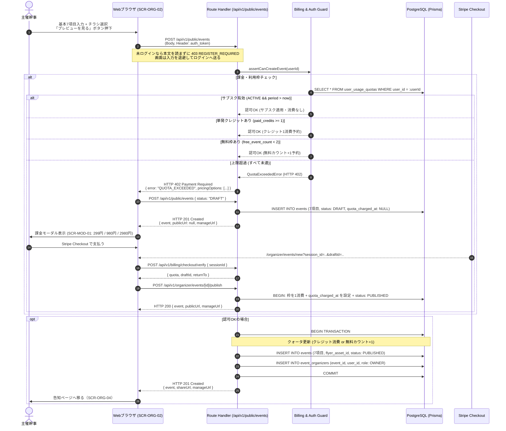
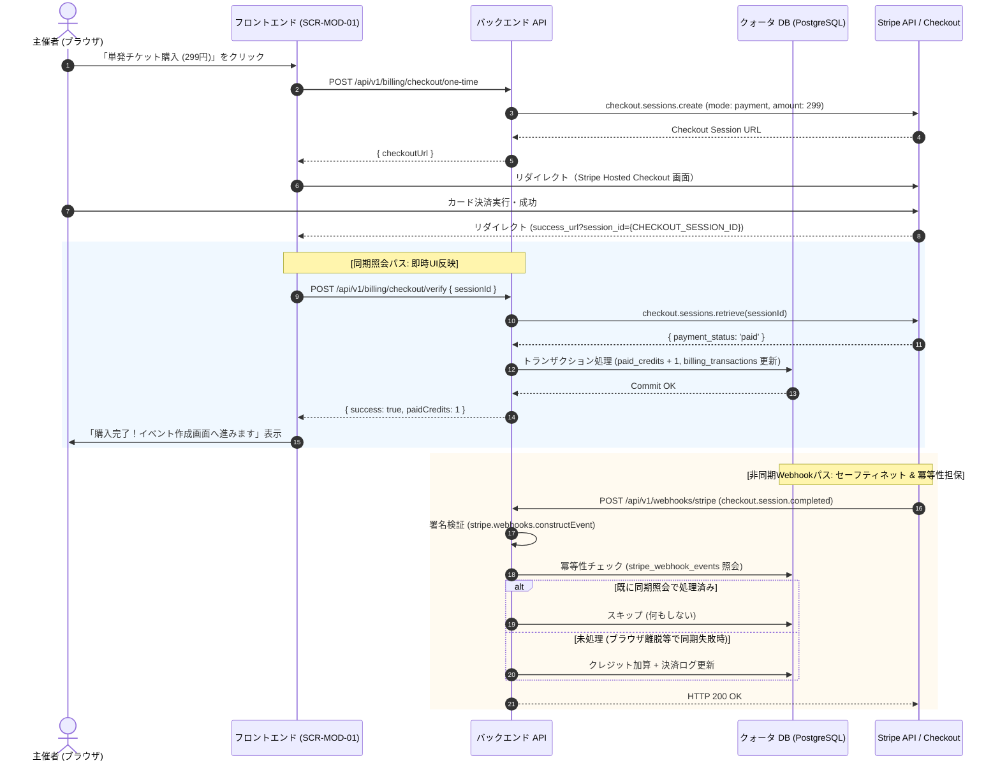
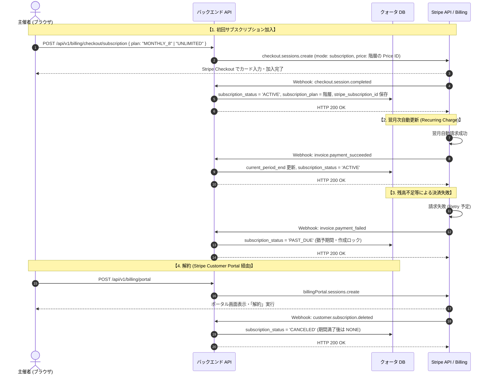
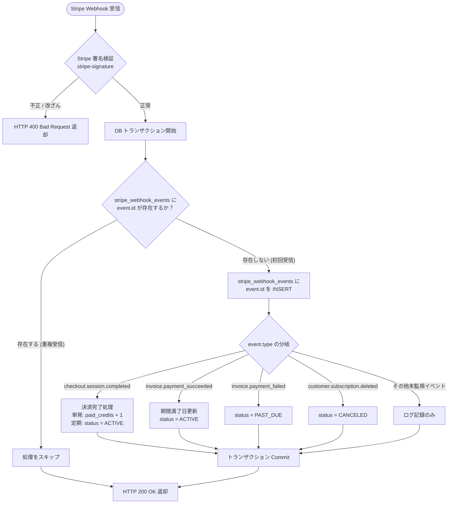
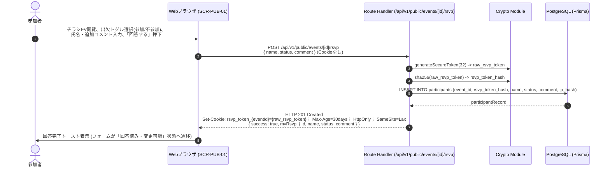
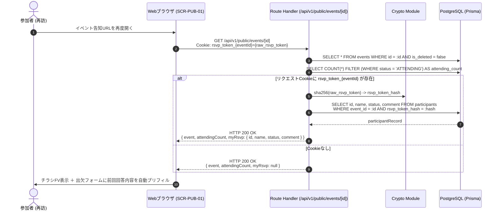
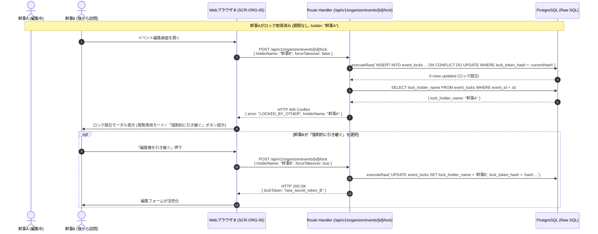
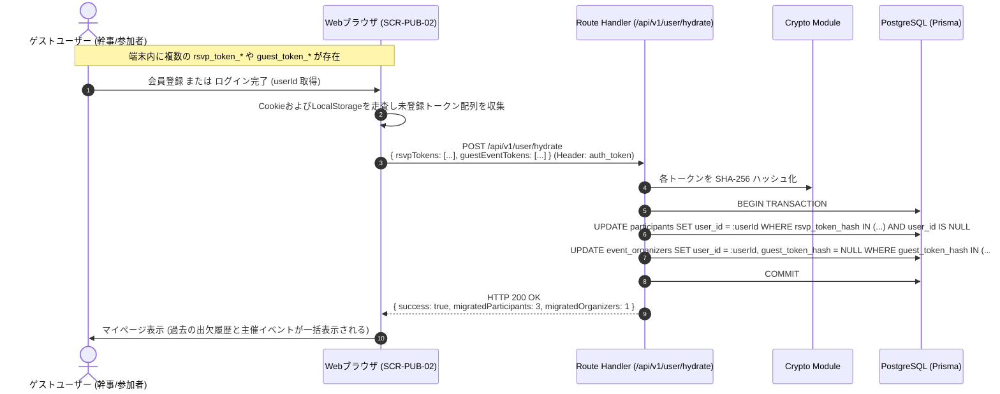

# バックエンドAPI実装仕様書

## チラシファースト型 イベント紹介ページ生成・出欠管理 兼 利用枠・課金決済基盤（Next.js App Router, Prisma & Stripe）

## 1. 全体アーキテクチャ・設計方針

本ドキュメントは、「機能別企画要件定義書」「システム要件定義書」「統合データベース物理設計書（DBschema.md）」に基づき、Next.js 14 App Router（Route Handlers）、Prisma ORM（PostgreSQL 16）、および Stripe によるバックエンドAPIの完全な実装仕様を定義する。



### 1.1. 基本方針

1. **ハイブリッド認証・認可アーキテクチャ:**
   - **未登録参加者:** 端末Cookie（`rsvp_token_<eventId>`）のSHA-256ハッシュ照合によるゼロフリクション出欠登録・再訪照会。
   - **ゲスト幹事:** 作成時に発行された暗号化トークン（`X-Organizer-Token` または Cookie）によるリソース認可。
   - **認証済み会員幹事:** ローカル HS256 署名 JWT（Cookie `auth_token` または Bearer Token）による認可。JWT はローカル登録・ログインと Google サインインのどちらでも発行する。人物の一意キーは確認済み電話番号（`users.phone_e164`）である。メールと `google_sub` はログイン手段であり、同じ確認済みメールまたは同じ電話番号なら同じ会員行にする。
2. **PostgreSQLネイティブのアトミック排他編集ロック（Pessimistic Lease Lock）:**
   - 共同幹事の同時編集事故（Lost Update）を防ぐため、`INSERT ... ON CONFLICT (event_id) DO UPDATE WHERE lock_token_hash = :hash` を実行し、DBレベルで厳密な排他制御を担保する。ロックは期限を持たず、解放または引き継ぎまで保持する。
3. **課金基盤（Stripe）との認可ゲート結合:**
   - イベント作成リクエスト受付時に `canCreateEvent(userId)` ゲートを評価。サブスク有効 $\rightarrow$ 単発クレジット消費 $\rightarrow$ 電話番号確認済みの無料枠消化の優先順で判定する。電話未確認の無料枠は HTTP 403、上限超過時は HTTP 402 Payment Required と課金プラン一覧を返却。
4. **Stripe 同期検証 ＆ Webhook 冪等性（Idempotency）二重化:**
   - Checkout 完了リダイレクト時に即時同期検証（`verify`）を行って待ち時間を排除し、バックグラウンドの Webhook では `stripe_webhook_events` テーブルを用いた排他制御により二重付与を物理遮断。
5. **RFC 7807 準拠のエラーレスポンス:**
   - すべてのエラーレスポンスを `application/problem+json` 構造に統一。
6. **チラシ生成は外部サービスへ委譲し、結果だけを自前で保存する:**
   - `POST /api/v1/flyers/generate` はチラシ生成サービス（`FLYER_API_URL`、既定 `http://127.0.0.1:8000`）の同じパスを呼ぶ。画面は先に `/api/v1/flyers/candidates/...` でタイプ・背景・文字配置・配色の候補を作り、選ばれた候補 ID を確定時に渡す。サービスは候補の完成画像をそのまま返すので、本アプリはそれを `storage/flyers/{id}.jpg` に書き、`flyer_assets` 行の `imageUrl` を `GET /api/v1/flyer-assets/{id}/image` にする。生成途中のデータは本データベースに置かない。手元の完成済み画像を上げる `POST /api/v1/flyer-assets` も同じ `flyer_assets` 行を作り、原本の形式のまま `storage/flyers/{id}.{jpg|png|webp}` に置く（回数は消費しない）。回数は `flyer_generation_logs` で数え、保存済みイベントはイベント単位（共同主催者で共有）、公開前の新規作成は下書き単位とする。候補の作り直しでは減らさない。

---

## 2. エンドポイント一覧カタログ

| エンドポイント | メソッド | 対象画面ID | 認証・認可 | 概要 |
| :---- | :---- | :---- | :---- | :---- |
| `/api/v1/public/events` | POST | SCR-ORG-02 | 会員JWT必須（未ログインは 403 `REGISTER_REQUIRED`） | イベント新規作成（課金認可チェック・枠消費連携）。`visibility` は受け取らず、常に `UNLISTED`。任意の `referrerEventId` を検証して `referrer_event_id` に保存。`status` は既定 `PUBLISHED`。`DRAFT` を指定すると課金判定を通さず下書きとして保存する。未登録の幹事は作れない |
| `/api/v1/public/events/[id]` | GET | SCR-PUB-01 | 不要（Cookie照会） | 告知ページ取得。URL 直開き。下書きと削除済みは 404。自出欠自動照会と、勧誘カード用の `viewer` を含む |
| `/api/v1/public/events/[id]/rsvp` | POST | SCR-PUB-01 | 不要（Cookie発行） | 未登録出欠登録および更新。ログイン中は `userId` でも対象行を探す |
| `/api/v1/public/events/[id]/rsvp` | DELETE | SCR-PUB-01 | Cookie または会員 | 出欠の取り消し（キャンセル）。申し込み期限後も可 |
| `/api/v1/public/events/[id]/receipt` | GET | SCR-PUB-04 | 出欠 Cookie または会員 | 自分の参加費領収書 |
| `/api/v1/public/organizers/[userId]` | GET | SCR-PUB-14 | 不要 | 主催者の公開プロフィール。非公開でも 200 を返し、`profile.isPublished = false` にして本文・リンク・実績・テーマを空にする（アイコンの `avatarUrl` は返す）。会員が無い・退会済み・催しが0件は 404 |
| `/api/v1/public/organizers/[userId]/events` | GET | SCR-PUB-14 | 参加者（会員） | 主催者のページの催し部分。未ログインは 403 `LOGIN_REQUIRED` で催しを1件も返さない。筆頭幹事と共同主催の催しをまとめ、掲載条件を満たすものだけを返す |
| `/api/v1/organizer/profile` | GET | SCR-ORG-14 | 会員＋主催イベント1件以上 | 自分の公開プロフィールの下書き、実績、公開ページの URL。催し0件は 403 `NOT_ORGANIZER`、ゲスト幹事は 403 `REGISTER_REQUIRED` |
| `/api/v1/organizer/profile` | PUT | SCR-ORG-14 | 同左 | 公開プロフィールの保存（upsert）。`users.name` は変えない。`themeId` は null（標準）または 5 テーマのいずれか |
| `/api/v1/organizer/profile/avatar` | POST | SCR-ORG-14 | 会員＋主催イベント1件以上 | アイコン画像の登録・差し替え。WebP 256px 角に作り直して保存し、旧画像を退役させる（5.17） |
| `/api/v1/organizer/profile/avatar` | DELETE | SCR-ORG-14 | 同左 | アイコンの削除。以後は名前の頭文字に戻る（5.17） |
| `/api/v1/image-assets/[id]/image` | GET | SCR-ORG-14、SCR-PUB-14 | 不要 | 会員が上げた画像の配信。WebP・1 年キャッシュ。論理削除済みは 404（5.18） |
| `/api/v1/organizer/events/[id]/participants/[participantId]/receipt` | GET | SCR-ORG-09 | 幹事（会員のみ） | 発行済み領収書の取得。未登録の幹事は 403 `REGISTER_REQUIRED` |
| `/api/v1/organizer/events/[id]/participants/[participantId]/receipt` | POST | SCR-ORG-06 | 幹事（会員のみ） | 出席者への領収書発行・再発行。未登録の幹事は 403 `REGISTER_REQUIRED` |
| `/api/v1/organizer/events` | GET | SCR-ORG-01 | 幹事（会員/ゲスト） | 主催イベント一覧取得（出欠数集計含む） |
| `/api/v1/organizer/events/[id]` | GET | SCR-ORG-05 | 幹事（会員/ゲスト） | 幹事用イベント詳細取得 |
| `/api/v1/organizer/events/[id]` | PUT | SCR-ORG-05 | 幹事＋有効ロック。未登録の幹事は作成から 24 時間以内 | イベント情報更新（排他ロック保護）。`visibility` は受け付けない。`status` は下書きから公開中への変更だけ許可し、`quota_charged_at` が未設定ならこの時点で枠を1つ消費する。猶予を過ぎたゲスト幹事は 403 `REGISTER_REQUIRED` |
| `/api/v1/organizer/events/[id]` | DELETE | SCR-ORG-01 | 主催幹事（OWNER） | イベントの論理削除。未登録の幹事も実行できる |
| `/api/v1/organizer/events/[id]/lock` | POST | SCR-ORG-05 | 幹事（会員/ゲスト）。ゲストは作成から 24 時間以内 | 排他ロック取得・保持確認・強制引き継ぎ。猶予を過ぎたゲスト幹事の取得は 403 `REGISTER_REQUIRED`。解放は常に可 |
| `/api/v1/organizer/events/[id]/lock` | DELETE | SCR-ORG-05 | ロック保持幹事 | 排他ロックの明示的解放 |
| `/api/v1/organizer/events/[id]/participants` | GET | SCR-ORG-06 | 幹事（会員のみ） | 参加者一覧・出欠ステータス・コメント詳細閲覧。売上サマリも返す。未登録の幹事は 403 `REGISTER_REQUIRED` |
| `/api/v1/organizer/events/[id]/revenue` | GET | SCR-ORG-12 | 幹事（会員のみ） | イベント1件の売上内訳。見込み・領収書発行額・差額・平均単価と、プラン別・開催回別の小計、主催者別の按分。未登録の幹事は 403 `REGISTER_REQUIRED` |
| `/api/v1/organizer/events/[id]/revenue/allocation` | PUT | SCR-ORG-12 | 主催幹事（OWNER・会員のみ） | 按分の方式（割合／人数）と公開範囲、主催者ごとの配分を保存。未登録は 403 `REGISTER_REQUIRED` |
| `/api/v1/organizer/revenue` | GET | SCR-ORG-11 | 会員必須（ゲスト幹事は 403 `REGISTER_REQUIRED`） | 主催イベント横断の売上。`from` / `to` は開催日（`sort_date`）で絞る。初期表示は全期間。按分後の `myShare` を含む |
| `/api/v1/organizer/events/[id]/reminders` | GET | SCR-ORG-06 | 幹事（会員のみ） | リマインドの文面と宛先数を返す。アカウントのない参加者へ個別送信するときのコピー用。未登録の幹事は 403 `REGISTER_REQUIRED` |
| `/api/v1/organizer/events/[id]/reminders` | POST | SCR-ORG-06 | 幹事（会員のみ） | 会員参加者へリマインドメールを送り、送信記録を残す。未登録の幹事は 403 `REGISTER_REQUIRED` |
| `/api/v1/organizer/events/[id]/invitations` | POST | SCR-ORG-07 | 主催幹事（OWNER・会員のみ） | 共同幹事招待コード発行。未登録の幹事は 403 `REGISTER_REQUIRED` |
| `/api/v1/invitations/[code]` | GET | SCR-ORG-07 | 任意（要受諾） | 共同幹事招待コード検証＆幹事権限付与 |
| `/api/v1/organizer/events/[id]/clone` | POST | SCR-ORG-01 | 幹事（会員/ゲスト） | 過去イベントの複製作成。`DRAFT` で作り、この時点で枠を1つ消費して `quota_charged_at` を入れる。`publicUrl` は `null` |
| `/api/v1/organizer/events/[id]/publish` | POST | SCR-ORG-02、SCR-ORG-15、SCR-ORG-16 | 筆頭幹事（OWNER・会員のみ）。編集ロック不要 | 下書きの公開。`quota_charged_at` が未設定なら枠を1つ消費し、入力内容も同時に保存して `PUBLISHED` にする。枠不足は 402、公開済みは 409 |
| `/api/v1/organizer/events/[id]/draft` | POST | SCR-ORG-02 | 筆頭幹事（OWNER・会員のみ）。編集ロック不要 | 作成画面からの下書きの上書き保存。状態は変えず、日時・費用プラン・住所・定員・期限・チラシを入れ替える。公開済みは 409、ゲスト幹事は 403 `REGISTER_REQUIRED` |
| `/api/v1/organizer/events/[id]/lifecycle` | POST | SCR-ORG-01、SCR-ORG-15 | 主催幹事（OWNER） | `close`（受付停止）、`reopen`（公開の再開）、`delete`（論理削除）。`close` は `PUBLISHED` のみ、`reopen` は `CLOSED` のみ（それ以外は 409）。`DRAFT` への `close` は 409 `DRAFT_CANNOT_STOP`、`CLOSED` 以外への `reopen` は 409 `NOT_CLOSED`。`reopen` は公開の枠を消費しない |
| `/api/v1/user/hydrate` | POST | SCR-PUB-02 | 会員必須 | 端末の httpOnly Cookie にある出欠・ゲスト幹事トークンだけを会員へ統合する。本文のトークンは無視する |
| `/api/v1/auth/local` | POST | SCR-PUB-02 | 不要 | パスワード登録は確認メールを送り、会員行はまだ作らない。ログインはメール確認済みの会員だけ。成功時はセッションではなく確認番号チャレンジ。登録の成否はメールの有無で変えない |
| `/api/v1/auth/login-challenge` | GET | SCR-PUB-02、SCR-ADM-00 | チャレンジ Cookie | 進行中の確認番号の経路とマスク済み宛先 |
| `/api/v1/auth/login-challenge` | POST | SCR-PUB-02、SCR-ADM-00 | チャレンジ Cookie | SMSとメールの切り替え。同じチャネルを渡すと送り直しになる。前のチャレンジは無効にし、新しい番号を発行する |
| `/api/v1/auth/login-challenge/confirm` | POST | SCR-PUB-02、SCR-ADM-00 | チャレンジ Cookie | 確認番号の照合。成功時だけ JWT を発行する |
| `/api/v1/auth/session` | GET | SCR-PUB-02、SCR-PUB-07 | 不要 | 入口ページのセッション確認。有効な会員セッションがあれば `authenticated: true` と `user`（`phoneVerified` / `platformRole`）、確認番号の入力待ちなら `pendingChallenge: true` を返す。無ければ 401 |
| `/api/v1/auth/verification` | POST | SCR-PUB-02 | 不要 | 未確認の登録意向またはレガシー未確認会員へ確認メールを再送する。応答はメールの有無で変えない |
| `/api/v1/auth/verify` | POST | SCR-PUB-05 | 不要 | 確認トークンを検証する。新規は電話番号確認へ進み、既存会員はログインへ戻す |
| `/api/v1/auth/phone/start` | POST | SCR-PUB-02 | 登録意向 Cookie または会員 | 確認コードを SMS 送信する。番号と IP で回数を制限する |
| `/api/v1/auth/phone/confirm` | POST | SCR-PUB-02 | 登録意向 Cookie または会員 | コードを検証し、電話番号で既存会員へ手段を足すか、会員と利用枠を作る |
| `/api/v1/auth/google` | GET | SCR-PUB-02 | 不要 | Google 認可画面へリダイレクト（state と nonce を Cookie に保存）。`next` は許可した相対パスだけ |
| `/api/v1/auth/google/callback` | GET | SCR-PUB-02 | Google 認可コード | ID トークン検証。同じ確認済みメールの会員へ `googleSub` を結ぶ。会員が無ければ電話番号確認へ進む |
| `/api/v1/auth/logout` | POST | SCR-PUB-02 | 不要 | セッション行を失効させ、会員 Cookie を削除する |
| `/api/v1/user/profile` | GET | SCR-PUB-03、SCR-PUB-08、SCR-PUB-11 | 会員必須 | 会員プロフィールと、主催者として使えるか（`isOrganizer` / `organizerCount`）、ヘッダーの出し分けに使う `platformRole`。参加履歴は含めない |
| `/api/v1/user/profile` | PATCH | SCR-PUB-11 | 会員必須 | 表示名の変更。過去の参加者名と領収書の宛名は変えない |
| `/api/v1/user/reauth` | POST | SCR-PUB-11 | 会員必須 | アカウント操作の確認番号を、登録済みのSMSまたはメールへ送る。セッションは発行しない |
| `/api/v1/user/password` | POST | SCR-PUB-11 | 会員必須 | パスワードの変更。Google のみの会員は最初の設定に使う。他の端末のログインを切る |
| `/api/v1/user/email` | POST | SCR-PUB-11 | 会員必須 | メールアドレス変更の開始。確認番号を照合し、新しいアドレスへ確認リンクを送る |
| `/api/v1/user/email/confirm` | POST | SCR-PUB-11 | 不要（確認トークン） | 新しいアドレスの確認リンクを確定する。メールアドレスを更新し、他の端末のログインを切る |
| `/api/v1/user/phone` | POST | SCR-PUB-11 | 会員必須 | 電話番号変更の開始。パスワードまたは確認番号で本人確認し、新しい番号へSMSを送る |
| `/api/v1/user/phone/confirm` | POST | SCR-PUB-11 | 会員必須 | 新しい電話番号の確認コードを照合する。他の端末のログインを切る |
| `/api/v1/user` | DELETE | SCR-PUB-11 | 会員必須 | 退会（論理削除）。筆頭幹事のイベントを閉じ、サブスクを即時解約し、確認済みの電話番号だけを残す |
| `/api/v1/user/participations` | GET | SCR-PUB-09 | 会員必須 | 参加履歴の一覧。`status`（ATTENDING/DECLINED）、`scope`（all/upcoming/past）、`page`、`limit` |
| `/api/v1/admin/session` | GET | SCR-ADM-04 | 管理者必須 | 管理者セッションの確認。ログイン済みならホームへ進む判定にも使う |
| `/api/v1/admin/session` | POST | SCR-ADM-00 | 不要 | 管理者ログイン。`ADMIN` かつパスワード一致かつ確認済み電話があるとき、確認番号チャレンジを始める。着地は SCR-ADM-04 |
| `/api/v1/admin/session` | DELETE | SCR-ADM-04 | 不要 | 管理者セッション Cookie の削除 |
| `/api/v1/admin/users` | GET | SCR-ADM-01 | 管理者必須 | 登録会員の検索一覧 |
| `/api/v1/admin/users/[id]` | PATCH | SCR-ADM-01 | 管理者必須 | 他会員の `platformRole` 変更 |
| `/api/v1/admin/events` | GET | SCR-ADM-02 | 管理者必須 | 登録イベントの検索一覧（全状態） |
| `/api/v1/admin/payments` | GET | SCR-ADM-03 | 管理者必須 | 利用枠の決済履歴。返金操作はしない |
| `/api/v1/admin/pricing-campaigns` | GET | SCR-ADM-05 | 管理者必須 | 価格キャンペーンの一覧と成立件数・売上・割引総額 |
| `/api/v1/admin/pricing-campaigns` | POST | SCR-ADM-05 | 管理者必須 | 価格キャンペーン作成。監査ログを残す |
| `/api/v1/admin/pricing-campaigns/[id]` | GET | SCR-ADM-05 | 管理者必須 | 詳細・監査ログ・発行済みクーポン |
| `/api/v1/admin/pricing-campaigns/[id]` | PATCH | SCR-ADM-05 | 管理者必須 | 編集。価格に関わる変更は版を上げる |
| `/api/v1/admin/pricing-campaigns/[id]/stop` | POST | SCR-ADM-05 | 管理者必須 | 新規申込の停止。既存購入者の割引は継続 |
| `/api/v1/public/pricing` | GET | SCR-PUB-06 | 不要 | 現在の販売価格と実施中キャンペーン |
| `/api/v1/internal/billing/notices` | POST | - | `BILLING_NOTICE_SECRET` | 0円の定額プランの 3 日前・1 日前の通知バッチ |
| `/api/v1/flyers/quota` | GET | SCR-ORG-03 | 不要 | イベント（公開前は下書き）の残り作成回数。未ログインは端末通算 |
| `/api/v1/flyers/candidates/types` | POST | SCR-ORG-03 | 不要 | ステップ 1。3 テンプレートの完成イメージ |
| `/api/v1/flyers/candidates` | POST | SCR-ORG-03 | 不要 | ステップ 2。背景タイルを 1 枚返す（AI は 1 時間 3 枚まで） |
| `/api/v1/flyers/uploads` | POST | SCR-ORG-03 | 不要 | ステップ 2。自分の写真を背景候補 1 枚にする |
| `/api/v1/flyers/candidates/[id]/layouts` | POST | SCR-ORG-03 | 不要 | ステップ 3。同じ背景で 4 通りの文字配置 |
| `/api/v1/flyers/candidates/[id]/palettes` | POST | SCR-ORG-03 | 不要 | ステップ 4。同じ配置で 4 通りの配色 |
| `/api/v1/flyers/candidates/[id]` | GET | SCR-ORG-03 | 不要 | 候補 JPEG の中継 |
| `/api/v1/flyers/generate` | POST | SCR-ORG-03 | 不要 | 選んだ候補を確定し、JPEG と `flyer_assets` を保存 |
| `/api/v1/flyer-assets` | GET | SCR-ORG-03 | 不要 | この端末・会員が作ったチラシの一覧（削除済みを除き、新しい順に最大 60 件） |
| `/api/v1/flyer-assets` | POST | SCR-ORG-03 | 不要 | 手元のチラシ画像をそのまま保存する（multipart、quota 非消費） |
| `/api/v1/flyer-assets/[id]/image` | GET | SCR-PUB-01 | 不要 | 保存済みチラシの取得。`?download=1` で添付保存 |
| `/api/v1/flyer-assets/[id]/pdf` | GET | SCR-ORG-05 / SCR-ORG-16 | 不要 | 公開済みイベントのチラシを A4 PDF で返す。`?eventId=` が公開済みで、そのチラシを掲載しているときだけ。告知ページの QR を右下に入れる |
| `/api/v1/venues` | GET | SCR-ORG-02 / SCR-ORG-05 | 不要 | 過去に入力した会場の候補（自分の会員分＋この端末分、新しい順に最大 20 件） |
| `/api/v1/venues/[id]` | DELETE | SCR-ORG-02 / SCR-ORG-05 | 不要 | 会場の候補を削除（自分の候補のみ） |
| `/api/v1/voice/transcriptions` | POST | SCR-ORG-02 | 不要（IP 単位の回数制限） | 音声を文字にする。音声は保存せず OpenAI の `gpt-4o-mini-transcribe` へ中継し、`text` だけを返す。未設定なら 503 `TRANSCRIBE_DISABLED` |
| `/api/v1/billing/quota` | GET | SCR-MOD-01 | 会員必須 | 利用枠・残クレジット・サブスク状態に加え、現在の販売価格（`pricing`）、0円チケットの残数、適用中の割引を返す |
| `/api/v1/billing/checkout/one-time` | POST | SCR-MOD-01 | 会員必須 | 単発チケットの購入。任意の `draftId` / `returnTo` を受け取り、Stripe の `metadata` と成功・キャンセルの URL に載せる。0円キャンペーン中は Stripe を通さず 1 回分を付与する |
| `/api/v1/billing/checkout/subscription` | POST | SCR-MOD-01 | 会員必須 | 定額プランの加入（`plan` = `MONTHLY_8` / `UNLIMITED`）。割引中は期間付き Stripe クーポンを付ける。`draftId` / `returnTo` の扱いは単発と同じ |
| `/api/v1/billing/checkout/verify` | POST | SCR-MOD-01 | 会員必須 | Stripe Checkout 完了後の即時同期検証・枠反映。検証済みセッションの `metadata` から `draftId` と `returnTo` を返す |
| `/api/v1/billing/portal` | POST | SCR-ORG-01 | 会員必須 | Stripe Customer Portal（解約・カード変更）遷移URL発行 |
| `/api/v1/webhooks/stripe` | POST | - | Stripe署名検証 | Stripe Webhook 受信ハンドラー（二重処理遮断） |

---

## 3. 主要処理シーケンス図（Mermaid）

### 3.1. イベント作成＆クォータ認可ゲート（canCreateEvent）

主催者がイベント作成を要求した際、クォータ判定ルール（サブスク $\rightarrow$ 単発クレジット $\rightarrow$ 無料枠）に従って検証・消費を行う。



---

### 3.2. 単発チケット購入（299円）同期照会 ＆ Webhook 二重化

Stripe Checkout 完了後のリダイレクト時にフロントエンド経由で同期照会を行い、即座にクォータを反映。非同期 Webhook をセーフティネットとして二重運用する。



---

### 3.3. 定額プラン（月8回 980円 / 作り放題 2,980円）ライフサイクルシーケンス

初回加入、月次自動更新、決済失敗、解約の一連のステート遷移を管理する。加入する階層は Checkout の `plan` で選び、Webhook では Price ID から `subscription_plan` を決める。



---

### 3.4. Stripe Webhook 冪等性ハンドリングフロー

ネットワーク不調による重複受信に対し、`stripe_webhook_events` テーブルによる排他制御で二重実行を遮断する。



---

### 3.5. 参加者：登録ゼロ出欠登録＆Cookie発行



---

### 3.6. 参加者：端末Cookie再訪による出欠自動照会



---

### 3.7. 共同幹事：排他編集ロック取得・保持確認・Takeover競合



---

### 3.8. 会員昇格・データ統合トランザクション（Hydration）



---

## 4. 共通ミドルウェア・認可ガード仕様

### 4.1. 暗号化ユーティリティ (`src/lib/crypto.ts`)

```ts
import { createHash, randomBytes } from 'crypto';

export function sha256(input: string): string {
  return createHash('sha256').update(input).digest('hex');
}

export function generateSecureToken(length: number = 32): string {
  return randomBytes(length).toString('hex');
}
```

### 4.2. 認証・認可ガード (`src/lib/guards.ts`)

```ts
import { NextRequest } from 'next/server';
import { prisma } from '@/lib/prisma';
import { verifyLocalToken } from '@/lib/auth';
import { sha256 } from '@/lib/crypto';
import { ProblemDetailException } from '@/lib/exceptions';

export interface AuthContext {
  userId: string | null;
  guestTokenHash: string | null;
  role: 'OWNER' | 'CO_HOST' | null;
}

export async function resolveAuthContext(req: NextRequest, eventId?: string): Promise<AuthContext> {
  let userId: string | null = null;
  let guestTokenHash: string | null = null;
  // 1. JWT 会員認証チェック
  const authCookie = req.cookies.get('auth_token')?.value;
  const authHeader = req.headers.get('Authorization')?.replace('Bearer ', '');
  const token = authCookie || authHeader;
  if (token) {
    const verified = await verifyLocalToken(token);
    if (verified) userId = verified.userId;
  }
  // 2. ゲスト幹事トークンチェック
  if (eventId) {
    const guestToken = req.headers.get('X-Organizer-Token') || req.cookies.get(`org_token_${eventId}`)?.value;
    if (guestToken) {
      guestTokenHash = sha256(guestToken);
    }
  }
  // 3. ロール特定
  let role: 'OWNER' | 'CO_HOST' | null = null;
  if (eventId && (userId || guestTokenHash)) {
    const organizer = await prisma.eventOrganizer.findFirst({
      where: {
        eventId,
        OR: [
          ...(userId ? [{ userId }] : []),
          ...(guestTokenHash ? [{ guestTokenHash }] : []),
        ],
      },
    });
    if (organizer) role = organizer.role as 'OWNER' | 'CO_HOST';
  }
  return { userId, guestTokenHash, role };
}

export async function assertOrganizer(req: NextRequest, eventId: string): Promise<AuthContext> {
  const ctx = await resolveAuthContext(req, eventId);
  if (!ctx.role) {
    throw new ProblemDetailException({
      status: 403,
      title: 'Forbidden',
      detail: 'このイベントの幹事権限がありません。',
    });
  }
  return ctx;
}

/**
 * 出欠の管理など、会員登録が要る操作の入口。
 * 幹事ではあるが会員でない（ゲスト幹事）要求は 403 REGISTER_REQUIRED。
 * 401 にはしない。本人であることは端末 Cookie で分かっている。
 */
export async function assertRegisteredOrganizer(
  req: NextRequest,
  eventId: string,
): Promise<AuthContext & { userId: string }> {
  const ctx = await assertOrganizer(req, eventId);
  if (!ctx.userId) {
    throw new ProblemDetailException({
      status: 403,
      title: 'Forbidden',
      type: 'probs/register-required',
      detail: '出欠の管理には会員登録が必要です。',
      error: 'REGISTER_REQUIRED',
    });
  }
  return { ...ctx, userId: ctx.userId };
}

/** 未登録の幹事が使える編集の猶予。作成から 24 時間。 */
export const GUEST_EDIT_WINDOW_MS = 24 * 60 * 60 * 1000;

/** 猶予を過ぎた未登録の幹事には、編集とロック取得を 403 REGISTER_REQUIRED にする。 */
export function assertGuestEditWindow(ctx: AuthContext, eventCreatedAt: Date, now = Date.now()): void {
  if (ctx.userId) return;
  if (now - eventCreatedAt.getTime() <= GUEST_EDIT_WINDOW_MS) return;
  throw new ProblemDetailException({
    status: 403,
    title: 'Forbidden',
    type: 'probs/register-required',
    detail: '作成から24時間を過ぎたイベントの編集には会員登録が必要です。',
    error: 'REGISTER_REQUIRED',
  });
}

export async function assertLockHolder(eventId: string, lockToken: string): Promise<void> {
  const lockTokenHash = sha256(lockToken);
  const lock = await prisma.eventLock.findUnique({
    where: { eventId },
  });
  if (!lock || lock.lockTokenHash !== lockTokenHash) {
    throw new ProblemDetailException({
      status: 409,
      title: 'Lock Conflict',
      detail: '編集権を保持していません。他の幹事が編集中です。',
    });
  }
}
```

会員セッションの検証は `verifyLocalToken` が行う。JWT の `jti` に対応する `auth_sessions` 行が存在し、`revoked_at` が空で、`expires_at` が未来であることを確かめる。あわせて `users.deleted_at` が空であることも確かめる。退会済みの会員の JWT は、署名と期限が正しくても使えない。管理 API（`/api/v1/admin/*`）は、さらに毎回 `platform_role = 'ADMIN'` をデータベースで確かめる。

**未登録の幹事（ゲスト幹事）の境界。** 新規作成は会員だけが行える（`POST /api/v1/public/events` は `userId` が無ければ 403 `REGISTER_REQUIRED`）。以前に未登録で作ったイベントの行は残っており、その端末の Cookie では読み取りだけが通る。次の API は `assertRegisteredOrganizer` を通し、ゲスト幹事には 403 `REGISTER_REQUIRED` を返す。画面はこのコードを見て `/organizer/register-required?eventId=<id>` へ送る。`GET /api/v1/organizer/events/[id]` 自体は幹事ならゲストでも読め、応答に `registered: boolean`（会員かどうか）を含める。登録直後の案内ページはこれを見て、登録済みの幹事を管理画面へ返す。

| 対象 | ルート |
| :--- | :--- |
| 参加者名簿 | `GET /api/v1/organizer/events/[id]/participants` |
| 出欠の変更・削除 | `PATCH` / `DELETE /api/v1/organizer/events/[id]/participants/[participantId]` |
| 領収書 | `GET` / `POST /api/v1/organizer/events/[id]/participants/[participantId]/receipt` |
| リマインド | `GET` / `POST /api/v1/organizer/events/[id]/reminders` |
| 売上の内訳 | `GET /api/v1/organizer/events/[id]/revenue` |
| 共同幹事の招待 | `POST /api/v1/organizer/events/[id]/invitations`（オーナーのみ） |

名簿（GET）と出欠の変更（PATCH）が返す `pricePlanLabel` と `pricePlanAmount` は、出席者では申込時点のスナップショット（`price_amount` / `price_plan_name` / `price_audience`）を優先する。費用プランの金額や名前を編集しても、名簿の金額が売上と食い違わないようにするためである。スナップショットが無い行は現在のプラン値を返す。領収書の発行画面が使う既定額（`pricePlanAmount`）も同じ値になる。

横断の売上（`GET /api/v1/organizer/revenue`）は会員の幹事だけが使える。ゲスト幹事の Cookie では 403 `REGISTER_REQUIRED`、未ログインは 401 を返す（`requireOrganizerAccount`）。

編集（`PUT /api/v1/organizer/events/[id]`）とロック取得（`POST /api/v1/organizer/events/[id]/lock`）は、会員なら常に通り、ゲスト幹事は `events.created_at` から 24 時間以内だけ通る（`assertGuestEditWindow`）。ロックの解放と受付停止・削除は猶予の対象外で、ゲスト幹事でも常に実行できる。

**未登録の端末はイベントを作れない。** `POST /api/v1/public/events` は `resolveUserId` が `null` を返した時点で、本文を読まずに 403 `REGISTER_REQUIRED`（`type: probs/register-required`）を返す。以前の「未登録でも1件だけ作れる」数え上げ（`assertGuestCanCreate`）は削除した。

* 理由は 2 つある。出欠を見るには結局 `assertRegisteredOrganizer` が要るため、未登録で作っても直後に登録へ送られること。枠の消費と下書きの復元がゲストだけ別扱いになり、`createEventForGuest` が `createEventForUser` とほぼ同じ処理を二重に持っていたこと。
* 画面は 403 を受けたら入力を `sessionStorage` に退避してログインへ送る（`docs/front_implementation_spec.md` 12.3.1）。応答の `guestOrganizerToken` は常に `null` にする。

**登録・ログイン後の引き継ぎ。** `POST /api/v1/user/hydrate` は `migrateGuestOrganizers(tx, userId, guestTokens)`（`src/modules/auth/lib/hydrate.ts`）を呼ぶ。端末の `org_token_*` に一致し `user_id` が空の `event_organizers` を会員へ付け替え、`guest_token_hash` を `NULL` にする。付け替えた行のうち `OWNER` の数だけ `user_usage_quotas.free_event_count` に加算し、`FREE_EVENT_LIMIT` で頭打ちにする。`CO_HOST` は加算しない。応答は `{ success, migratedParticipants, migratedOrganizers, promotedOwners, freeEventCount }`。

```json
{
  "type": "probs/register-required",
  "title": "Forbidden",
  "status": 403,
  "detail": "出欠の管理には会員登録が必要です。",
  "error": "REGISTER_REQUIRED"
}
```

### 4.3. イベント作成認可ミドルウェア (`assertCanCreateEvent`)

```ts
import { SUBSCRIPTION_EVENT_LIMIT } from '@/modules/billing/lib/plans';

/** 暦月のキー（日本時間）。月8回プランの数え直しはこの値が変わったときに行う。 */
export function jstMonthKey(now: Date): string {
  const jst = new Date(now.getTime() + 9 * 60 * 60 * 1000);
  return `${jst.getUTCFullYear()}-${String(jst.getUTCMonth() + 1).padStart(2, '0')}`;
}

/**
 * 消費の入口。行をロックしてから、`monthly_period_key` が今月と違えば 0 回から数え直す。
 * 参照だけの `assertCanCreateEvent` は同じ判定を読み取りで行う。
 */
export async function consumeEventQuota(tx: Prisma.TransactionClient, userId: string) {
  const quota = await lockAndReadQuota(tx, userId);
  const now = new Date();
  const subscriptionActive =
    quota.subscriptionStatus === 'ACTIVE' &&
    quota.currentPeriodEnd !== null &&
    quota.currentPeriodEnd > now;

  // 1. 作り放題（回数を数えない）
  if (subscriptionActive && quota.subscriptionPlan !== 'MONTHLY_8') {
    return 'SUBSCRIPTION_UNLIMITED';
  }
  // 2. 月8回プラン（暦月で数え直す）
  if (subscriptionActive) {
    const key = jstMonthKey(now);
    const used = quota.monthlyPeriodKey === key ? quota.monthlyEventCount : 0;
    if (used < SUBSCRIPTION_EVENT_LIMIT) {
      await tx.userUsageQuota.update({
        where: { userId },
        data: { monthlyPeriodKey: key, monthlyEventCount: used + 1 },
      });
      return 'SUBSCRIPTION_MONTHLY_8';
    }
  }
  // 3. 単発クレジット
  if (quota.paidCredits >= 1) {
    await tx.userUsageQuota.update({
      where: { userId },
      data: { paidCredits: { decrement: 1 } },
    });
    return 'PAID_CREDIT';
  }
  // 4. 無料トライアル。加入中は、上限に達しても無料枠では抜けない。
  if (!subscriptionActive && quota.freeEventCount < FREE_EVENT_LIMIT) {
    if (!(await hasVerifiedPhone(tx, userId))) throw phoneRequired();
    await tx.userUsageQuota.update({
      where: { userId },
      data: { freeEventCount: { increment: 1 } },
    });
    return 'FREE_TRIAL';
  }
  // 5. 上限超過 (402)。月8回の上限だけが理由なら作り放題への変更を案内する。
  throw monthlyExhausted(quota, now) ? monthlyLimitExceeded() : quotaExceeded();
}
```

402 の本文は、現在の販売価格（`price`）と定価（`listPrice`）、割引率、キャンペーン名を持つ配列を返す。

```json
{
  "type": "probs/quota-exceeded",
  "title": "Payment Required",
  "status": 402,
  "detail": "無料トライアル枠（2回）が上限に達しています。単発チケット（299円）、月8回プラン（980円）、作り放題（2,980円）のいずれかをご利用ください。",
  "error": "QUOTA_EXCEEDED",
  "pricingOptions": [
    { "type": "SINGLE", "name": "単発生成チケット", "price": 299, "listPrice": 299, "currency": "JPY" },
    { "type": "SUBSCRIPTION_8", "name": "月8回プラン", "price": 980, "listPrice": 980, "currency": "JPY", "interval": "month", "eventLimit": 8 },
    { "type": "SUBSCRIPTION_UNLIMITED", "name": "作り放題", "price": 2980, "listPrice": 2980, "currency": "JPY", "interval": "month" }
  ]
}
```

---

## 5. イベント・出欠・ロック系 API エンドポイント詳細仕様

### 5.1. POST `/api/v1/public/events`（イベント新規作成）

主催者が入力7項目とチラシIDを指定して新規イベントを作成する。イベントの一覧・検索は提供しないため、`visibility` はリクエストで受け取らず、常に `UNLISTED`（紹介制）で保存する。公開状態は既定で `PUBLISHED` である。

- **認可:** 会員のみ（`userId` が解決できないときは 403 `REGISTER_REQUIRED`、`type: probs/register-required`）。未登録の幹事はイベントを作れない。作成画面は入力を `sessionStorage` に退避してログインへ送り、戻ってから続きを保存する。
- **下書きの作成:** `status: "DRAFT"` のときは `assertCanCreateEvent` を通さず、`status = DRAFT`、`quota_charged_at = NULL` で 1 行作る。枠は消費しない。SCR-ORG-02 は 402 を受けたときにこの経路で入力を退避する。
- **リクエストスキーマ (Zod):**

```ts
export const CreateEventSchema = z.object({
  title: z.string().min(1, '催しの名前を入力してください').max(100),
  schedules: z.array(z.object({
    id: z.string().uuid().optional(),
    eventDate: z.string().regex(/^\d{4}-\d{2}-\d{2}$/, '日付形式(YYYY-MM-DD)が不正です'),
    eventTime: z.string().min(1, '開催時間を入力してください').max(50),
  })).min(1).max(8),
  pricePlans: z.array(z.object({
    id: z.string().uuid().optional(),
    name: z.string().min(1, 'プラン名を入力してください').max(50),
    price: z.string().min(1, '費用を入力してください').max(50),
  })).min(1).max(8),
  location: z.string().min(1, '開催場所を入力してください').max(150),
  rainPolicy: z.enum(['RAIN_OR_SHINE', 'CANCEL_ON_RAIN', 'POSTPONE_ON_RAIN', 'INDOOR']),
  capacity: z.number().int().positive().nullable().optional(),
  /** 想定する参加者の世代。空欄は NULL で、告知ページに「対象」として出さない。 */
  targetGeneration: z.string().trim().max(50).nullable().optional(),
  /** 告知ページのセマンティックテーマ。null は標準。未知の ID は 400。 */
  themeId: z.enum(['modern-slate', 'enterprise-clean', 'parchment', 'neo-brutalism', 'neon']).nullable().default(null),
  flyerAssetId: z.string().uuid().nullable().optional(),
  rsvpDeadline: z.string().regex(/^\d{4}-\d{2}-\d{2}T\d{2}:\d{2}$/).nullable().optional(),
  /** 告知ページの勧誘カードから来たときの参照元。存在しない・削除済み・下書きなら NULL として保存する。 */
  referrerEventId: z.string().uuid().nullish(),
  /** 未指定は公開。DRAFT は枠不足で入力を退避するときだけ使う。 */
  status: z.enum(['DRAFT', 'PUBLISHED']).default('PUBLISHED'),
});
```

- **参照元 (`referrerEventId`) の扱い:** `referrerEventId` は任意である。値があっても、`is_deleted = false` かつ `status` が `PUBLISHED` / `CLOSED` のイベントだけを `events.referrer_event_id` に入れる。見つからなければ `NULL` にし、作成は止めない。紹介の連鎖は数えず、直接の参照元だけを持つ。

- **レスポンス (201 Created):**

```json
{
  "event": {
    "id": "e8a93b4c-9f82-4c28-9721-6b8c4d29a581",
    "title": "金曜夜のアコースティックライブ",
    "sortDate": "2026-11-20",
    "schedules": [
      { "id": "11111111-1111-4111-8111-111111111111", "eventDate": "2026-11-20", "eventTime": "19:00〜21:30" },
      { "id": "22222222-2222-4222-8222-222222222222", "eventDate": "2026-11-21", "eventTime": "14:00〜16:00" }
    ],
    "pricePlans": [
      { "id": "33333333-3333-4333-8333-333333333333", "name": "プランA", "price": "3,000円（1ドリンク付）" },
      { "id": "44444444-4444-4444-8444-444444444444", "name": "プランB", "price": "2,000円（学生）" }
    ],
    "location": "Cafe & Bar Moonlight, 新宿区",
    "rainPolicy": "RAIN_OR_SHINE",
    "capacity": 30,
    "rsvpDeadline": "2026-11-18T23:59:00.000Z",
    "rsvpOpen": true,
    "status": "PUBLISHED",
    "visibility": "UNLISTED",
    "flyerAsset": {
      "id": "f5b82c1a-9a8b-4c7d-8e9f-0123456789ab",
      "imageUrl": "/uploads/flyers/acoustic_live.webp",
      "lqipDataUrl": "data:image/webp;base64,UklGRl...",
      "aspectRatio": "A4"
    }
  },
  "guestOrganizerToken": null,
  "publicUrl": "/events/e8a93b4c-9f82-4c28-9721-6b8c4d29a581",
  "manageUrl": "/organizer/events/e8a93b4c-9f82-4c28-9721-6b8c4d29a581"
}
```

`status` が `DRAFT` のときは、`publicUrl` が `null` になる。告知ページが無いため、カードや管理画面はリンクを出さない。`guestOrganizerToken` は `status` にかかわらず常に `null` である（作成は会員だけが行える）。応答の形は変えないので、キーの有無で分岐する古いクライアントも壊れない。

---

### 5.1.1. POST `/api/v1/organizer/events/[id]/publish`（下書きの公開）

SCR-ORG-02 の購入後の復元と、SCR-ORG-05 の「公開する」から呼ぶ。編集ロックを要求しないのは、作成画面がロックを持たないまま公開するためである。処理は 1 トランザクションで行う。

1. `assertOrganizer` で幹事権限を確認し、`role` が `OWNER` であること。`CO_HOST` と未登録のゲスト幹事は 403、未ログインは 401。
2. 本文は任意。付けるときは `UpdateEventSchema`（編集の保存と同じ形）で検証する。付いていれば `syncEventOptions` と `eventUpdateData` で公開と同時に保存する。
3. `events` の行を `SELECT ... FOR UPDATE` で取る。無い、または削除済みは 404。`status` が `DRAFT` でなければ 409（`error: "ALREADY_PUBLISHED"`）。
4. `quota_charged_at` が `NULL` のとき、`consumeEventQuota(userId, tx)` で枠を1つ消費し、`quota_charged_at = NOW()` にする。すでに入っているとき（複製した下書き）は消費しない。
5. `status = PUBLISHED` にして、`{ event, publicUrl, manageUrl }` を返す。

- **枠が無いとき:** 例外でトランザクションが巻き戻り、402 を返す。`status` と `quota_charged_at` は変わらないので、下書きはそのまま残る。
- **二重実行:** 同じ `id` で 2 回目を呼ぶと 409 になる。枠は 1 回しか引かれない。
- **`PUT /api/v1/organizer/events/[id]` との関係:** 編集画面の保存で `DRAFT → PUBLISHED` にするときも、同じ規則（`quota_charged_at` が未設定なら消費）を通す。ロックは PUT 側の要件のままである。

---

### 5.1.2. POST `/api/v1/organizer/events/[id]/draft`（下書きの上書き保存）

SCR-ORG-02 の「下書き保存」と「プレビューを見る」から呼ぶ。2 回目以降の保存はこの入口を使う。編集画面の `PUT` は排他ロックを要求するが、作成画面はロックを持たず競合モーダルも置いていないため、ロック不要の入口を分ける。状態（`status`）は変えない。

1. `assertOrganizer` で幹事権限を確認し、`role` が `OWNER` かつ会員であること。未登録のゲスト幹事は 403 `REGISTER_REQUIRED`、`CO_HOST` は 403、未ログインは 401。
2. 本文は `SaveEventDraftSchema`（`UpdateEventSchema` に `flyerDraftKey` を足したもの）で検証する。`status` は省略するか `"DRAFT"` だけを許し、それ以外は 400 `STATUS_CHANGE_NOT_ALLOWED`。公開は `publish` に任せる。
3. `events` の行を `SELECT ... FOR UPDATE` で取る。無い、または削除済みは 404。`DRAFT` でなければ 409 `ALREADY_PUBLISHED`。
4. `syncEventOptions` と `eventUpdateData` で内容を入れ替える。日時が変われば `sort_date` も更新する。
5. `flyerDraftKey` が付いていれば `attributeFlyerLogsToEvent` で、作成中のチラシ回数をこのイベントへ付け替える。
6. `{ event }` を返す。

- **必須項目:** `title`、`schedules` 1 件以上、`pricePlans` 1 件以上、開催場所（構造化住所か `venueName`・`location`）。定員・申し込み期限・チラシは空でよい。下書きの作成（`POST /api/v1/public/events` に `status: "DRAFT"`）も同じ条件である。
- **対象世代とテーマ:** `targetGeneration`（50 文字まで）と `themeId` はどちらも任意で、`events.target_generation`・`events.theme_id` に保存する。`themeId` は `null`（標準）または 5 テーマのいずれかで、未知の値は 400 にする。更新（`PUT .../organizer/events/[id]`）と下書き保存（`POST .../draft`）も同じ 2 項目を受け取る。
- **枠:** 消費しない。公開時に 1 回だけ消費する。
- **行ロック:** 公開と同時に走っても、後から来た保存が公開済みの催しを上書きしない。

---

### 5.2. GET `/api/v1/public/events/[id]`（公開情報取得・Cookie自動照会）

告知URLを直接開いた人に、`PUBLISHED` または `CLOSED` かつ未削除のイベントを返す。下書きと削除済みは 404。一覧・検索の API は持たない。`visibility` は将来のメディアサイト用にレスポンスへ残し、いまは常に `UNLISTED` である。`myRsvp` は端末の Cookie を先に照会し、無ければログイン中の会員（`userId`）で探す。参加していなければ `null` である。

- **リクエスト Cookie:** `rsvp_token_<id>`（任意）。`auth_token` があれば会員としても照会する。`org_token_<id>` があると、その端末のゲスト幹事としても判定する
- **`viewer` の用途:** 告知ページの主催者勧誘カードの出し分け専用である。`isThisEventsOrganizer` は、`userId` がこのイベントの幹事であるか、`org_token_<id>` / `X-Organizer-Token` のハッシュが幹事行に一致するとき `true`。`hasOrganizerRole` は、`userId` が削除されていない主催イベントを 1 件以上持つとき `true`。未ログインなら両方 `false` である。
- **レスポンス (200 OK):**

```json
{
  "id": "e8a93b4c-9f82-4c28-9721-6b8c4d29a581",
  "title": "金曜夜のアコースティックライブ",
  "sortDate": "2026-11-20",
  "schedules": [
    { "id": "11111111-1111-4111-8111-111111111111", "eventDate": "2026-11-20", "eventTime": "19:00〜21:30" }
  ],
  "pricePlans": [
    { "id": "33333333-3333-4333-8333-333333333333", "name": "プランA", "price": "3,000円（1ドリンク付）" }
  ],
  "location": "Cafe & Bar Moonlight, 新宿区",
  "rainPolicy": "RAIN_OR_SHINE",
  "capacity": 30,
  "status": "PUBLISHED",
  "visibility": "UNLISTED",
  "rsvpDeadline": "2026-11-18T23:59:00.000Z",
  "rsvpOpen": true,
  "attendingCount": 18,
  "loggedIn": false,
  "viewer": {
    "loggedIn": false,
    "isThisEventsOrganizer": false,
    "hasOrganizerRole": false
  },
  "flyerAsset": {
    "imageUrl": "/uploads/flyers/acoustic_live.webp",
    "lqipDataUrl": "data:image/webp;base64,UklGRl...",
    "aspectRatio": "A4"
  },
  "myRsvp": {
    "id": "p1a2b3c4-1111-2222-3333-444455556666",
    "name": "佐藤",
    "status": "ATTENDING",
    "comment": "楽しみにしています！少し遅れるかもしれません。"
  }
}
```

---

### 5.3. POST `/api/v1/public/events/[id]/rsvp`（未登録出欠登録・変更）

- **リクエストスキーマ (Zod):**

```ts
export const SubmitRsvpSchema = z.object({
  name: z.string().min(1, '名前を入力してください').max(50),
  status: z.enum(['ATTENDING', 'DECLINED']),
  comment: z.string().max(500).optional(),
  scheduleId: z.string().uuid().optional(),
  pricePlanId: z.string().uuid().optional(),
});
```

- **処理仕様:**
  1. `status` が `PUBLISHED` でない、または `rsvpDeadline` 以降であるときは HTTP 403。期限後の detail は「申し込み期限を過ぎているため、出欠の新規登録と変更はできません。」。`rsvpDeadline` は日本時間の `YYYY-MM-DDTHH:mm` を `TIMESTAMPTZ` にしたもので、その時刻になると受け付けを止める。空なら期限なし。
  2. 対象行は Cookie の `rsvp_token_<id>` を先に見て、無ければログイン中の会員（`userId`）で探す。順序は `findMyParticipant` に集約する。
  3. 見つかった行を UPDATE する。会員の行とこの端末の匿名行が同じイベントに並んでいるときは、会員の行を残し、匿名行の内容を写してから匿名行を削除する（`chooseRsvpTarget`）。匿名行を会員へ付け替えるだけでは `(event_id, user_id)` の一意制約に当たるため。
  4. 見つからなければ新規トークンを発行し INSERT する。ログイン中なら `userId` も入れる。
  5. 同じ会員の同時送信で一意制約に当たった場合は、1 回だけ更新としてやり直す。
  6. `Set-Cookie: rsvp_token_<id>=<token>; Path=/; Max-Age=2592000; HttpOnly; SameSite=Lax; Secure` をセット。会員の行を使い続ける場合は新しいトークンを発行しない。
  7. 出席にしたときは、選んだ費用プランの金額・プラン名・対象を `participants.price_amount` / `price_plan_name` / `price_audience` に写す（スナップショット）。既に同じプランを選んでいる行の更新では、申込時点の金額を保つ（`keepPriceSnapshot`）。幹事が名簿で名前だけ直したときに、あとから変えたプラン金額へ引きずられないようにするため。欠席にしたときは 3 つとも `NULL` にする。
- **取消（DELETE）:** 申し込み期限後も取り消せる。対象行の決め方は POST と同じで、Cookie と `userId` の両方を受け付ける。削除後は Cookie を消す。

---

### 5.4. GET `/api/v1/organizer/events`（主催イベント一覧取得）

- **認可:** 幹事（会員 または ゲスト幹事トークン所持）
- **レスポンス (200 OK):**

```json
{
  "events": [
    {
      "id": "e8a93b4c-9f82-4c28-9721-6b8c4d29a581",
      "title": "金曜夜のアコースティックライブ",
      "sortDate": "2026-11-20",
      "schedules": [
        { "id": "11111111-1111-4111-8111-111111111111", "eventDate": "2026-11-20", "eventTime": "19:00〜21:30" }
      ],
      "pricePlans": [
        { "id": "33333333-3333-4333-8333-333333333333", "name": "プランA", "price": "3,000円（1ドリンク付）" }
      ],
      "location": "Cafe & Bar Moonlight, 新宿区",
      "rainPolicy": "RAIN_OR_SHINE",
      "capacity": 30,
      "status": "PUBLISHED",
      "role": "OWNER",
      "stats": {
        "attendingCount": 18,
        "declinedCount": 2,
        "totalResponses": 20
      },
      "flyerThumbnailUrl": "/uploads/flyers/acoustic_live_thumb.webp",
      "createdAt": "2026-10-18T10:00:00Z"
    }
  ]
}
```

下書きも含めて全件を返す（絞り込みのクエリは持たない）。参加者を持つのは公開後の催しだけなので、下書きの `stats` はすべて 0 になる。主催一覧（SCR-ORG-01）とマイページは `DRAFT` を除いて表示し、下書きは専用の一覧（SCR-ORG-15）が受け持つ。カレンダー（SCR-ORG-13）は全件を使い、下書きの予定から編集画面へ進む。

---

### 5.5. POST `/api/v1/organizer/events/[id]/participants/[participantId]/receipt`（参加費の領収書）

出席の参加者に1件だけ発行する。再発行は同じ行の宛名、金額、但し書き、発行者、発行日を上書きする。欠席には HTTP 400。金額は 1 以上 9,999,999 以下の整数円。発行者名は操作した会員の名前、ゲスト幹事は「ゲスト幹事」。参加費の決済は行わない。

GET は発行済みを返す。未発行は HTTP 404。

**認可:** `assertRegisteredOrganizer`。未登録のゲスト幹事（Cookie の幹事トークンだけで本人と分かる状態）には 403 `REGISTER_REQUIRED` を返す。参加者名簿と同じ扱いである。

参加者本人の取得は `GET /api/v1/public/events/[id]/receipt`。出欠 Cookie、またはログイン会員の参加履歴に領収書があるときだけ 200。それ以外は 404。

### 5.6. POST `/api/v1/organizer/events/[id]/lock`（排他ロック取得・延長・引き継ぎ）

**認可:** `assertOrganizer`。加えて、ロックの取得（`release` でない要求）だけは `assertGuestEditWindow` を通す。未登録のゲスト幹事が `events.created_at` から 24 時間を過ぎて取得しようとしたら 403 `REGISTER_REQUIRED`。解放（`release: true` と DELETE）は常に通す。期限切れのゲスト幹事でも、自分が握ったロックを離せなくなる状態を作らない。

- **リクエストスキーマ (Zod):**

```ts
export const AcquireLockSchema = z.object({
  holderName: z.string().min(1).max(50),
  currentLockToken: z.string().optional(),
  forceTakeover: z.boolean().default(false),
});
```

- **Raw SQL アトミック排他クエリ:**

```text
INSERT INTO event_locks (event_id, locked_by_user_id, locked_by_token_hash, lock_holder_name, lock_token_hash, updated_at)
VALUES (:eventId, :userId, :tokenHash, :holderName, :newLockTokenHash, NOW())
ON CONFLICT (event_id) DO UPDATE SET
  locked_by_user_id = EXCLUDED.locked_by_user_id,
  locked_by_token_hash = EXCLUDED.locked_by_token_hash,
  lock_holder_name = EXCLUDED.lock_holder_name,
  lock_token_hash = EXCLUDED.lock_token_hash,
  updated_at = NOW()
WHERE event_locks.lock_token_hash = :currentHash;
```

---

### 5.7. POST `/api/v1/user/hydrate`（アカウント統合・昇格）

未登録状態で端末の httpOnly Cookie に保持されていた出欠トークンとゲスト幹事トークンを、会員アカウントへ紐付ける。リクエスト本文のトークン配列は受け取らない。

```ts
export async function handleHydrate(userId: string, cookies: { rsvpTokens: string[]; guestEventTokens: string[] }) {
  return await prisma.$transaction(async (tx) => {
    let migratedParticipants = 0;
    let migratedOrganizers = 0;
    if (cookies.rsvpTokens.length > 0) {
      const hashes = cookies.rsvpTokens.map((t) => sha256(t));
      const anonymousRows = await tx.participant.findMany({
        where: { rsvpTokenHash: { in: hashes }, userId: null },
        include: { receipt: { select: { id: true } } },
      });
      for (const row of anonymousRows) {
        const already = await tx.participant.findFirst({
          where: { eventId: row.eventId, userId },
          include: { receipt: { select: { id: true } } },
        });
        if (!already) {
          await tx.participant.update({ where: { id: row.id }, data: { userId } });
          migratedParticipants += 1;
          continue;
        }
        // 同じイベントに会員の行と端末だけの行がある。領収書を持つ方を残す。
        if (row.receipt && !already.receipt) {
          await tx.participant.update({ where: { id: row.id }, data: { userId } });
          await tx.participant.delete({ where: { id: already.id } });
          migratedParticipants += 1;
          continue;
        }
        // 会員の行を残し、端末の行が新しければ内容だけ引き継いで端末の行を消す。
        if (row.updatedAt > already.updatedAt) {
          await tx.participant.update({
            where: { id: already.id },
            data: {
              name: row.name,
              status: row.status,
              comment: row.comment,
              scheduleId: row.scheduleId,
              pricePlanId: row.pricePlanId,
              ipHash: row.ipHash,
            },
          });
        }
        await tx.participant.delete({ where: { id: row.id } });
        migratedParticipants += 1;
      }
    }
    if (cookies.guestEventTokens.length > 0) {
      const hashes = cookies.guestEventTokens.map((t) => sha256(t));
      const res = await tx.eventOrganizer.updateMany({
        where: { guestTokenHash: { in: hashes }, userId: null },
        data: { userId, guestTokenHash: null },
      });
      migratedOrganizers = res.count;
    }
    return { success: true, migratedParticipants, migratedOrganizers };
  });
}
```

`participants` の `(event_id, user_id)` は一意なので、端末の匿名行をそのまま `userId` で更新すると、同じ会員の既存行と衝突する。統合は 1 行ずつ次の順で決める。

1. 会員の行が無ければ、匿名行をそのまま会員へ付け替える。
2. 会員の行がある場合、領収書を持つ方を残す。
3. どちらも領収書を持たない、または両方持つ場合は会員の行を残す。匿名行の `updatedAt` が新しければ、内容だけ会員の行へ写す。
4. 残さなかった行を削除し、一意制約の衝突を避ける。

### 5.8. GET / POST `/api/v1/organizer/events/[id]/reminders`（参加者へのリマインド）

**認可:** `assertRegisteredOrganizer`。未登録のゲスト幹事には 403 `REGISTER_REQUIRED`。受け取った名簿が無い状態で宛先を作れないため、名簿と同じ入口で止める。

幹事権限が必要である。リマインドは標準機能であり、プランや利用枠に関係なく使える。

- **GET:** 文面と宛先数を返す。画面の「文面をコピー」はこの応答をそのままクリップボードへ入れる。アカウントを持たない参加者には、この文面を LINE や DM に貼って送る。

```json
{
  "subject": "〇〇 のリマインド",
  "body": "〇〇 の開催が近づいています。\n2026-12-01 18:00\n標準 ¥3,000\n東京都…\n告知ページ: http://localhost:3012/events/<id>\nマイページ: http://localhost:3012/mypage",
  "recipientCount": 2,
  "skippedGuests": 5
}
```

- **POST:** `recipientCount` の宛先（`participants.user_id` がある会員のメール）へ送る。本文は GET と同じ組み立てで、告知URL とマイページのリンクを含む。
  - 配送先 `MAIL_WEBHOOK_URL` が空のときは送信せず、`status = "RECORDED"` として `reminder_deliveries` に残す。
  - 会員の参加者がいないときも 200 を返し、`sent = 0`、`recorded = 0`、`skippedGuests = 参加者数` とする。画面は文面コピーへ誘導する。
  - 応答は `{ sent, recorded, skippedGuests, subject, body }`。

```text
POST /api/v1/organizer/events/[id]/reminders
→ 200 { "sent": 2, "recorded": 0, "skippedGuests": 5, "subject": "...", "body": "..." }
```

### 5.9. GET `/api/v1/organizer/revenue`（主催イベント横断の売上）

対象画面は SCR-ORG-11。認可は `requireOrganizerAccount`。会員の幹事だけが使える。未ログインは 401、未登録のゲスト幹事（Cookie の幹事トークンだけで本人と分かる状態）は 403 `REGISTER_REQUIRED` を返す。ゲスト幹事には、複数のイベントをまたいだ金額を出さない。

クエリは次のとおり。どれも省略できる。

| 名前 | 既定 | 内容 |
| :--- | :--- | :--- |
| `from` | 指定なし | `events.sort_date` の下限（`YYYY-MM-DD`、含む） |
| `to` | 指定なし | `events.sort_date` の上限（`YYYY-MM-DD`、含む） |
| `status` | 指定なし | `DRAFT` / `PUBLISHED` / `CLOSED` のいずれか |

絞り込みの基準は開催日であり、回答日時や領収書の発行日ではない。初期表示は全期間なので、画面はどれも送らない。日付の形式が違えば 400（`Validation Error`、`fromは YYYY-MM-DD の形式で指定してください。`）、`status` が 3 つ以外でも 400 を返す。

レスポンスは `period`、`totals`、`myShare`、`events` の 4 つである。

```json
{
  "period": { "from": null, "to": null, "status": null },
  "myShare": { "expectedRevenue": 4000 },
  "totals": {
    "expectedRevenue": 8000,
    "issuedRevenue": 3000,
    "unreconciled": 5000,
    "attendingCount": 4,
    "paidAttendingCount": 3,
    "unassignedPlanCount": 1,
    "declinedCount": 1,
    "receiptCount": 1,
    "averagePerAttendee": 2667
  },
  "events": [
    {
      "id": "20ccffe6-...",
      "title": "秋の音楽会",
      "sortDate": "2026-11-14",
      "status": "PUBLISHED",
      "expectedRevenue": 8000,
      "issuedRevenue": 3000,
      "unreconciled": 5000,
      "attendingCount": 4,
      "paidAttendingCount": 3,
      "unassignedPlanCount": 1,
      "declinedCount": 1,
      "receiptCount": 1,
      "averagePerAttendee": 2667,
      "myShare": { "expectedRevenue": 4000 }
    }
  ]
}
```

- `period` は受け取った絞り込みをそのまま返す。`from` と `to` は `YYYY-MM-DD`、`status` は受け取った値か `null`。
- `totals` は、返した `events` の参加者をまとめて集計した値である。合計は `events` の各行の単純和と一致する。
- 金額は `participants.price_amount`（出欠確定時点のスナップショット）の合計である。`price_amount` が `NULL` の出席者は `unassignedPlanCount` に入れ、売上にも平均単価の分母にも入れない。
- `issuedRevenue` は `receipts.amount` の合計であり、決済や入金の記録ではない。`unreconciled` は `expectedRevenue − issuedRevenue` で、負にもなる。未回収額ではない。
- `averagePerAttendee` は `round(expectedRevenue ÷ paidAttendingCount)`。`paidAttendingCount` が 0 なら 0。
- 削除済みのイベントと、幹事として関与していないイベントは含めない。同じイベントに共同幹事として複数行があっても 1 件に畳む。
- 並び順は `sort_date` の昇順（開催日が近い順）。過去の催しは後ろへ送る。
- `events[].sortDate` は `YYYY-MM-DD` の文字列である。
- `myShare.expectedRevenue` は、各イベントの按分（5.11）で閲覧者自身の行になった見込み売上の合算である。未割当は含めない。`events[].myShare` と同じ値の合計になる。按分の設定が無いイベントは均等割で計算する。

### 5.10. GET `/api/v1/organizer/events/[id]/revenue`（イベント1件の売上内訳）

対象画面は SCR-ORG-12。認可は `assertRegisteredOrganizer`。未登録のゲスト幹事には 403 `REGISTER_REQUIRED`（名簿と同じ扱い）。

レスポンスは `event`、`summary`、`byPlan`、`bySchedule`、`allocation` の 5 つである。`summary` の形は 5.9 の `totals` と同じ。`allocation` は 5.11 で説明する。

```json
{
  "event": { "id": "20ccffe6-...", "title": "秋の音楽会", "sortDate": "2026-11-14", "status": "PUBLISHED" },
  "summary": { "expectedRevenue": 8000, "issuedRevenue": 3000, "unreconciled": 5000, "attendingCount": 4, "paidAttendingCount": 3, "unassignedPlanCount": 1, "declinedCount": 1, "receiptCount": 1, "averagePerAttendee": 2667 },
  "byPlan": [
    { "name": "一般", "audience": "ANY", "amount": 3000, "attendingCount": 2, "subtotal": 6000 },
    { "name": "学生", "audience": "MALE", "amount": 2000, "attendingCount": 1, "subtotal": 2000 }
  ],
  "bySchedule": [
    { "scheduleId": "5c9c25cb-...", "label": "2026-11-14 19:00〜21:00", "attendingCount": 4, "subtotal": 8000 }
  ]
}
```

- `event.sortDate` は `YYYY-MM-DD` の文字列である。
- `byPlan` は対象（`audience`）・プラン名・金額の 3 つをキーにまとめる。名前も金額もスナップショットなので、同じ名前で金額が違う行が並ぶことがある（出欠の途中でプラン金額を変えた場合）。その差は隠さずに別行で見せる。並びは対象のアルファベット順、小計の降順、名前の五十音順。
- `bySchedule` は出席者を開催回でまとめる。`scheduleId` が `null` の行は、日時が消えた参加者であり、ラベルは `日時なし`。並びはラベルの昇順で、`日時なし` は最後へ送る。
- 日程を選んでいない出席者を代表日に寄せることはない。選んだ日程がそのまま無い場合は `日時なし` として別行に出す。
- 削除済みのイベントは 404。他幹事のイベントは 403。

#### `allocation`（主催者別の按分）

```json
"allocation": {
  "configured": false,
  "mode": "RATIO",
  "visibility": "OWN_ONLY",
  "canEdit": true,
  "organizerCount": 3,
  "rows": [
    {
      "organizerId": "b1f0...",
      "name": "佐藤 博文",
      "role": "OWNER",
      "isGuest": false,
      "isYou": true,
      "shareBps": 3334,
      "headcount": null,
      "expectedRevenue": 2667,
      "issuedRevenue": 1000
    }
  ],
  "unallocated": { "headcount": 0, "expectedRevenue": 0, "issuedRevenue": 0 },
  "hiddenRows": 2
}
```

- `configured` は保存済みの設定が揃っているか。`false` のときは均等割（`RATIO`）と `OWN_ONLY` で計算した結果を返す。
- `mode` は `RATIO` か `HEADCOUNT`。`RATIO` の `shareBps` は basis points（10000 = 100.00%）、`HEADCOUNT` の `headcount` は人。
- `rows` は閲覧範囲で絞る。主催者は常に全行。共同主催者は `visibility = ALL` なら全行、`OWN_ONLY` なら自分の行だけ。`hiddenRows` は絞った結果として見えない行数。
- `isYou` は閲覧者自身の行か。`isGuest` は未登録の幹事か。
- メールアドレスと `userId` は返さない。
- `unallocated` は人数方式で配り切れなかった人数と金額。割合方式は常に 0。

### 5.11. PUT `/api/v1/organizer/events/[id]/revenue/allocation`（按分の保存）

対象画面は SCR-ORG-12。認可は `assertRegisteredOwner`。主催者以外は 403、未登録のゲスト幹事は 403 `REGISTER_REQUIRED`。

ボディ:

```json
{
  "mode": "RATIO",
  "visibility": "OWN_ONLY",
  "rows": [
    { "organizerId": "b1f0...", "shareBps": 5000 },
    { "organizerId": "c2e1...", "shareBps": 3000 },
    { "organizerId": "d3a2...", "shareBps": 2000 }
  ]
}
```

- `mode = HEADCOUNT` のときは `rows[].headcount` を使う。使わない側の値は保存時に `NULL` にする（方式を切り替えても古い値が残らない）。
- `rows` はそのイベントの主催者全員を1回ずつ含む。過不足や他イベントの `organizerId` は 400 `ORGANIZER_SET_MISMATCH`。
- 割合方式で合計が 10000（100.00%）でない場合は 400 `SHARE_TOTAL_NOT_100`。
- 人数方式で合計が出席者数を超える場合は 409 `HEADCOUNT_EXCEEDS_ATTENDING`。不足は許し、未割当として残す。
- 負数・非整数は 400 `INVALID_ALLOCATION_VALUE`。
- 保存は1トランザクション。設定行を upsert し、配分行を upsert、主催者から外れた行を delete する。
- 成功時は `{ "allocation": ... }` を返す。形は 5.10 の `allocation` と同じ。

| コード | HTTP | 意味 |
| :---- | :--- | :---- |
| `ORGANIZER_SET_MISMATCH` | 400 | 主催者の過不足、他イベントの `organizerId` |
| `SHARE_TOTAL_NOT_100` | 400 | 割合の合計が 100% でない |
| `INVALID_ALLOCATION_VALUE` | 400 | 負数・非整数・数値でない値 |
| `HEADCOUNT_EXCEEDS_ATTENDING` | 409 | 人数の合計が出席者数を超える |
| `REGISTER_REQUIRED` | 403 | 未登録の主催者 |

計算規則は `src/modules/revenue/lib/allocation.ts` に閉じている。各人を切り捨て、余りは主催者（`OWNER`）へ寄せる。人数方式の分母は出席者数（費用プラン未選択の人も数える）。出席者が 0 人なら全員 0 円。

---

### 5.12. GET `/api/v1/public/organizers/[userId]`（主催者の公開プロフィール）

対象画面は SCR-PUB-14（プロフィール部分）。認証は要らない。`userId` が UUID でない場合は DB を触らず 404。

- 会員が無い、`users.deleted_at` が立っている、`event_organizers` の先の催しがすべて削除済みのいずれかなら 404 `主催者が見つかりません。`
- `organizer_profiles` の行が無い、または `is_published = false` のときも 200。ただし `profile` は `isPublished: false` と null・空配列だけにし、保存値は返さない。
- `links` は X → Instagram → Webサイト → LINE の順。空文字の項目は飛ばす。
- `tags` は固定リスト（`MUSIC` / `FOOD` / `LEARNING` / `SPORTS` / `LOCAL` / `BUSINESS` / `OTHER`）に無い値を落とす。
- `stats` は `show_stats = true` のときだけ。開催済み（`status != DRAFT`・未削除・今日以前の開催日がある）催しの件数と、その最も早い開催日の年。共同主催も1件として数える。
- `themeId` は `is_published = true` のときだけ、既知の 5 テーマのいずれか。非公開・未知の値は `null`（標準の見た目）。
- `avatarUrl` は `avatar_image_id` があれば `/api/v1/image-assets/{id}/image`。**非公開でも返す**（本文ではなく、その人を示す印のため）。

```json
{
  "userId": "uuid",
  "name": "表示名",
  "profile": {
    "isPublished": true,
    "headline": "渋谷で月いちの読書会",
    "bio": "自己紹介",
    "area": "東京都渋谷区",
    "tags": ["LEARNING"],
    "links": [{ "kind": "X", "label": "X", "url": "https://x.com/example" }],
    "stats": { "eventCount": 12, "sinceYear": 2019 },
    "avatarUrl": "/api/v1/image-assets/{id}/image",
    "themeId": "parchment"
  }
}
```

### 5.13. GET `/api/v1/public/organizers/[userId]/events`（主催者のページの催し）

対象画面は SCR-PUB-14（カレンダーと一覧の部分）。`resolveOptionalUserId` で Cookie を見る。Cookie が壊れていても 401 にはせず、未ログインとして 403 `LOGIN_REQUIRED` を返す。

- 筆頭幹事（`OWNER`）と共同主催（`CO_HOST`）の両方の催しを集める。
- 掲載条件は `isDeleted = false`、`status = PUBLISHED`、申し込み期限内、今日以降の開催日があること。満員でも返す（参加要望を受け付けるため）。
- `attendingCount` は `ATTENDING` だけ。`WAITLISTED` は人数・残席に数えない。
- 並びは次に開催される日が近い順、同日は催し名の五十音順、最後は `id`。
- 会員が無い・退会済みは 404。詳細な項目は 5.2 のイベント表現に準ずる。

### 5.14. GET / PUT `/api/v1/organizer/profile`（公開プロフィールの編集）

対象画面は SCR-ORG-14。認可は `requireOrganizerAccount`（未ログイン 401、ゲスト幹事 403 `REGISTER_REQUIRED`）と `assertOrganizerMember`（主催イベント0件は 403 `NOT_ORGANIZER`）。

GET の応答:

```json
{
  "name": "表示名",
  "profile": {
    "isPublished": false,
    "headline": "",
    "bio": "",
    "area": "",
    "tags": [],
    "xUrl": "",
    "instagramUrl": "",
    "websiteUrl": "",
    "lineUrl": "",
    "showStats": false,
    "themeId": null
  },
  "stats": { "eventCount": 3, "sinceYear": 2024 },
  "homePath": "/organizers/{userId}",
  "avatarUrl": "/api/v1/image-assets/{id}/image"
}
```

PUT のボディは GET の `profile` と同じ形。`src/lib/schemas.ts` の `OrganizerProfileSchema` が `.strict()` で検証する。

| 項目 | 規則 |
| :---- | :---- |
| `headline` | 前後の空白を落として60文字まで。空なら null |
| `bio` | 400文字まで。`\r\n` は `\n` に揃える。空なら null |
| `area` | 50文字まで。空なら null |
| `tags` | 固定リストのみ。3つまで。重複は落とす |
| `xUrl` | `https` のみ。ホストは `x.com` / `twitter.com`。公開ページに出す |
| `instagramUrl` | `https` のみ。ホストは `instagram.com`。公開ページに出す |
| `websiteUrl` | `https` のみ。ホストは問わない。後方互換のため受け付けるが、公開ページには出さない |
| `lineUrl` | `https` のみ。ホストは `lin.ee` / `line.me`。後方互換のため受け付けるが、公開ページには出さない |
| `isPublished` / `showStats` | 真偽値。既定は false |
| `themeId` | `modern-slate` / `enterprise-clean` / `parchment` / `neo-brutalism` / `neon` のいずれか、または null（標準）。未知の値は 400 |

URL にユーザー名・パスワードを含むものは 400。違反は RFC 7807 の 400 で、`errors[].path` に項目名を返す。保存は `userId` を主キーにした upsert で、初回に1行作り、以後は同じ行を更新する。応答は GET と同じ形（保存後の値）。画像は `PUT` では扱わず、5.17 の `avatar` で別に保存する。

### 5.15. GET / DELETE `/api/v1/venues`（過去の会場の候補）

対象画面は SCR-ORG-02 / SCR-ORG-05 の「過去の会場から選ぶ」。認証は不要で、次の 2 つを単位に候補を絞る。他人の会場は返さない。

| 単位 | `venue_suggestions.owner_key` |
| :---- | :---- |
| ログイン中の会員 | `u:<userId>` |
| この端末（未登録の幹事） | `d:<Cookie `venue_owner` の値の sha256>` |

端末の単位はサーバーが発行した Cookie からだけ導出し、本文やヘッダで他人の候補を指定できない。Cookie が無い未登録の端末には、イベントの作成・下書き保存・公開の成功時に `venue_owner` を新しく払い出す（180 日）。会員でも Cookie が残っていれば、端末側の候補も合わせて更新する。セッションが無い、または切れているときは未登録として扱い、端末の候補に寄せる（401 にしない）。候補は入力支援でしかないため、候補が開けないことで入力そのものを止めない。

GET の応答は、最後に使った日時の新しい順に最大 20 件である。会員と端末の両方に同じ会場があれば、指紋（会場名・郵便番号・都道府県・市区町村・町域・番地・建物名を正規化した sha256）で 1 件にまとめ、新しいほうを残す。

```json
{
  "venues": [
    {
      "id": "…",
      "venueName": "○○ホール",
      "postalCode": "1500001",
      "prefecture": "東京都",
      "city": "渋谷区",
      "town": "神宮前",
      "addressLine": "1-2-3",
      "building": "○○ビル3F",
      "location": "○○ホール 東京都渋谷区神宮前1-2-3 ○○ビル3F",
      "lastUsedAt": "2026-10-01T12:00:00.000Z"
    }
  ]
}
```

DELETE `/api/v1/venues/[id]` は自分の候補だけを物理削除する。`id` が UUID でない、既に無い、または他人の候補なら 404（存在を推測させないため区別しない）。成功時は `{ "success": true }`。

候補の記録は、イベントの作成（`POST /api/v1/public/events`）、下書きの保存（`POST .../draft`）、公開（`POST .../publish`）、編集の保存（`PUT .../organizer/events/[id]`）で行う。同じ会場は行を増やさず `lastUsedAt` だけを更新する。記録の失敗はイベントの作成・保存を止めない（ログだけに残す）。実装は `src/modules/events/lib/venue-suggestions.ts`。

### 5.16. POST `/api/v1/voice/transcriptions`（音声を文字にする）

イベント作成画面の音声入力。`multipart/form-data` で `audio`（必須、5MB まで）と `field`（任意、欄の名前）を受け取る。音声は保存せず、OpenAI の音声認識（既定 `gpt-4o-mini-transcribe`、`language=ja`、`response_format=json`）へ中継し、`{ "text": string, "model": string }` を返す。`Cache-Control: no-store`。

| 状態 | error | 意味 |
| :---- | :---- | :---- |
| 400 | - | 音声が空、または本文を読めない |
| 413 | - | 5MB を超えた |
| 415 | - | 音声以外の形式 |
| 422 | `TRANSCRIBE_EMPTY` / `TRANSCRIBE_UNSUPPORTED` | 聞き取れない、または上流が形式を受け付けない |
| 429 | `RATE_LIMITED` / `TRANSCRIBE_BUSY` | 回数の上限、または上流が混雑（`Retry-After` 付き） |
| 502 | `TRANSCRIBE_MISCONFIGURED` / `TRANSCRIBE_FAILED` | 鍵の設定不備、または上流に繋がらない |
| 503 | `TRANSCRIBE_DISABLED` | `OPENAI_API_KEY` が未設定 |

回数の上限は接続元（IP）ごとに、`VOICE_TRANSCRIBE_LIMIT`（既定 40）回 / `VOICE_TRANSCRIBE_WINDOW_MINUTES`（既定 60 分）で数える。プロセスのメモリ上に持つため、インスタンスを増やすと合計の上限も増える。認識を呼ぶ前に 1 回ぶん消費する（失敗しても課金されうるため）。

`VOICE_TRANSCRIBE_MOCK=1` のときは、OpenAI を呼ばずに欄の入力例（`src/modules/events/lib/voice/fields.ts` の `example`）を `text` として返す。`model` は `"mock"` になる。外部を呼ばないため回数の上限は数えず、`OPENAI_API_KEY` が空でも 503 にしない。`NODE_ENV=production` では常に無効。開発では、このルートを初めて読み込んだ時点でモックの有効・無効と鍵の有無を 1 度だけ `console.warn` に出す（設定の付け忘れと切り忘れに気づくため）。

文字をフォームの値へ変える規則はサーバーではなく画面側に置く（`src/modules/events/lib/voice/parse.ts`）。欄が決まっていれば LLM を使わず、日付・時刻・金額・人数を決定的に読めるため、同じ発話が常に同じ値になり、テストで仕様を固定できる。導入手順と画面の動きは `docs/voice-input.rst`。

### 5.17. POST / DELETE `/api/v1/organizer/profile/avatar`（プロフィールのアイコン）

対象画面は SCR-ORG-14。認可は 5.14 と同じ（未ログイン 401、ゲスト幹事 403 `REGISTER_REQUIRED`、主催イベント0件は 403 `NOT_ORGANIZER`）。

本文の保存（`PUT /api/v1/organizer/profile`）とは分ける。画像は選んだ時点で保存し、本文の保存に失敗してもアイコンだけ巻き戻る事故を作らない。

- `multipart/form-data` の `file` を 1 つ受け取る。
- 受け付けるのは JPEG / PNG / WebP。判定は先頭バイトだけで行う（`src/lib/image-upload.ts`）。
- 4MB を超える本文は 413。形式が違う・読めない画像は 422 `INVALID_IMAGE`。
- 変換は `sharp` で行い、**中央で正方形に切り抜き**、長辺 256px（元画像が小さければ短辺まで、最低 64px）に縮めて WebP（品質 82）にする。原本は保存しない。
- バイト列を `storage/images/{id}.webp`、行を `image_assets`（`kind = AVATAR`）に持つ。DB の作成に失敗したらファイルも消す。
- `organizer_profiles.avatar_image_id` を新しい ID に差し替え、**差し替え前の画像は `is_deleted = true` にして配信を止め、ファイルを消す**。参照を移す前に消さない（失敗したときにアイコンが消えたままになる）。
- 同じ会員の試行は 10 分間に 5 回まで（`src/lib/upload-limit.ts`、プロセス内）。超過は 429。
- 応答は `201 { "avatarUrl": "/api/v1/image-assets/{id}/image" }`。削除は `200 { "avatarUrl": null }`。

| 状態 | error | 意味 |
| :---- | :---- | :---- |
| 400 | - | `file` が無い、または本文を読めない |
| 413 | - | 4MB を超えた |
| 422 | `INVALID_IMAGE` | JPEG / PNG / WebP でない、または画像として読めない |
| 429 | - | 短時間のアップロードが多すぎる |

### 5.18. GET `/api/v1/image-assets/[id]/image`（会員が上げた画像の配信）

アイコンなど、`image_assets` に保存した画像を返す。認証は不要（推測できない UUID を URL に持つ公開画像）。

- `id` が UUID でない、行が無い、`is_deleted = true`、ファイルが無いときは 404。
- `Content-Type: image/webp`、`Cache-Control: public, max-age=31536000, immutable`、`X-Content-Type-Options: nosniff`。
- ID は差し替えのたびに新しくなるため、内容は変わらない。長期キャッシュで安全。
- 将来のイベント表紙（`kind = EVENT_COVER`）も同じ URL の形で配る。

---

## 6. 利用枠・Stripe決済系 API エンドポイント詳細仕様

### 6.1. GET `/api/v1/billing/quota`（主催者クォータ照会 API）

主催者ダッシュボードや作成画面で、現在の利用可能状況を表示するために呼び出す。

- **認可:** 認証済み主催者（JWT セッション必須）
- **レスポンス (200 OK):**

```json
{
  "freeEventCount": 1,
  "freeLimit": 2,
  "remainingFree": 1,
  "paidCredits": 0,
  "subscriptionStatus": "NONE",
  "currentPeriodEnd": null,
  "canCreate": true,
  "planType": "FREE_TRIAL"
}
```

- **実装ハンドラー (`src/app/api/v1/billing/quota/route.ts`):**

```ts
import { NextRequest, NextResponse } from 'next/server';
import { prisma } from '@/lib/prisma';
import { resolveAuthContext } from '@/lib/guards';

export async function GET(req: NextRequest) {
  const { userId } = await resolveAuthContext(req);
  if (!userId) {
    return NextResponse.json({ error: 'UNAUTHORIZED' }, { status: 401 });
  }
  const quota = await prisma.userUsageQuota.findUnique({
    where: { userId },
  });
  if (!quota) {
    return NextResponse.json({ error: 'QUOTA_NOT_FOUND' }, { status: 404 });
  }
  const now = new Date();
  const isSubActive =
    quota.subscriptionStatus === 'ACTIVE' &&
    quota.currentPeriodEnd !== null &&
    quota.currentPeriodEnd > now;
  const remainingFree = Math.max(0, 2 - quota.freeEventCount);
  const canCreate = isSubActive || quota.paidCredits > 0 || remainingFree > 0;
  let planType = 'NONE';
  if (isSubActive) planType = 'SUBSCRIPTION';
  else if (quota.paidCredits > 0) planType = 'PAID_CREDIT';
  else if (remainingFree > 0) planType = 'FREE_TRIAL';
  return NextResponse.json({
    freeEventCount: quota.freeEventCount,
    freeLimit: 2,
    remainingFree,
    paidCredits: quota.paidCredits,
    subscriptionStatus: quota.subscriptionStatus,
    currentPeriodEnd: quota.currentPeriodEnd,
    canCreate,
    planType,
  });
}
```

---

### 6.2. POST `/api/v1/billing/checkout/one-time`（単発299円チケット購入セッション発行）

主催者が単発でイベントを1回作成するための Stripe Hosted Checkout URL を発行する。

- **認可:** 認証済み主催者（JWT セッション必須）
- **リクエスト Body（任意）:**

```json
{
  "draftId": "e8a93b4c-9f82-4c28-9721-6b8c4d29a581",
  "returnTo": "/organizer/events/new"
}
```

- **`draftId` / `returnTo` の扱い (`CheckoutIntentSchema`):** `draftId` は UUID。渡されたら `assertOwnDraft(userId, draftId)` で、その会員が筆頭幹事である未公開の下書きだけを通す（他人の下書き 403、公開済み 409、無い 404）。`returnTo` は `isAllowedCheckoutReturnTo` を通し、許可外は `/organizer/events/new` に落とす。許可するのは `/mypage`、`/organizer/events`、`/organizer/events/new`（`?ref=<uuid>` 付きを含む）、`/organizer/events/<uuid>/edit`、`/organizer/events/<uuid>/preview` だけである。
- **成功・キャンセルの URL:** `checkoutReturnUrls(appUrl, returnTo, draftId)` が組み立てる。`session_id={CHECKOUT_SESSION_ID}` と `draftId` をクエリに足し、`{CHECKOUT_SESSION_ID}` はエンコードしない。`draftId` が無ければ `returnTo` のままである。
- **`metadata`:** `userId`、`paymentType` に加え、`draftId` と `returnTo` を入れる（値があるときだけ）。`verify` はここから戻す。
- **レスポンス (200 OK):**

```json
{
  "checkoutUrl": "[STRIPE_HOSTED_CHECKOUT_URL]",
  "pricing": { "target": "ONE_TIME", "chargedPrice": 299, "listPrice": 299, "discountPercent": 0 }
}
```

- **実装ハンドラー (`src/app/api/v1/billing/checkout/one-time/route.ts`):**

```ts
import { NextRequest, NextResponse } from 'next/server';
import Stripe from 'stripe';
import { prisma } from '@/lib/prisma';
import { resolveAuthContext } from '@/lib/guards';
import { CheckoutIntentSchema } from '@/lib/schemas';
import { DEFAULT_CHECKOUT_RETURN_TO, assertOwnDraft, checkoutReturnUrls } from '@/modules/billing/lib/checkout-intent';

const stripe = new Stripe(process.env.STRIPE_SECRET_KEY!, {
  apiVersion: '2023-10-16',
});

export async function POST(req: NextRequest) {
  const { userId } = await resolveAuthContext(req);
  if (!userId) {
    return NextResponse.json({ error: 'UNAUTHORIZED' }, { status: 401 });
  }
  const appUrl = process.env.NEXT_PUBLIC_APP_URL || 'http://localhost:3000';
  const intent = CheckoutIntentSchema.parse(await req.json().catch(() => ({})));
  const returnTo = intent.returnTo ?? DEFAULT_CHECKOUT_RETURN_TO;
  if (intent.draftId) await assertOwnDraft(userId, intent.draftId);
  const { successUrl, cancelUrl } = checkoutReturnUrls(appUrl, returnTo, intent.draftId);
  const session = await stripe.checkout.sessions.create({
    payment_method_types: ['card'],
    line_items: [
      {
        price_data: {
          currency: 'jpy',
          product_data: {
            name: 'イベント紹介ページ生成 単発チケット',
            description: 'イベント紹介ページを1回生成・公開できます。',
          },
          unit_amount: 299,
        },
        quantity: 1,
      },
    ],
    mode: 'payment',
    success_url: successUrl,
    cancel_url: cancelUrl,
    metadata: {
      userId,
      paymentType: 'ONE_TIME',
      ...(intent.draftId ? { draftId: intent.draftId } : {}),
      ...(intent.returnTo ? { returnTo } : {}),
    },
  });
  // 決済トランザクションログを PENDING で事前作成
  await prisma.billingTransaction.create({
    data: {
      userId,
      paymentType: 'ONE_TIME',
      paymentStatus: 'PENDING',
      amount: 299,
      currency: 'jpy',
      stripeCheckoutSessionId: session.id,
    },
  });
  return NextResponse.json({ checkoutUrl: session.url });
}
```

---

### 6.3. POST `/api/v1/billing/checkout/subscription`（定額プラン加入セッション発行）

主催者が月8回プラン（980円/月）または作り放題（2,980円/月）に加入するための Stripe Hosted Checkout URL を発行する。

- **認可:** 認証済み主催者（JWT セッション必須）
- **リクエスト Body:** `SubscriptionCheckoutSchema` = `CheckoutIntentSchema` + `plan`（`"MONTHLY_8"` / `"UNLIMITED"`）。`plan` を省略したときは `UNLIMITED`。`draftId` は `assertOwnDraft` を通し、成功・キャンセルの URL と `metadata` に載せる。既に有効な定額契約があるときは 409 `ALREADY_SUBSCRIBED`。
- **レスポンス (200 OK):**

```json
{
  "checkoutUrl": "[STRIPE_HOSTED_CHECKOUT_URL]",
  "plan": "MONTHLY_8",
  "pricing": { "target": "SUBSCRIPTION_8", "listPrice": 980, "chargedPrice": 980, "discountPercent": 0 }
}
```

- **実装ハンドラー (`src/app/api/v1/billing/checkout/subscription/route.ts`):**

```ts
import { NextRequest, NextResponse } from 'next/server';
import Stripe from 'stripe';
import { prisma } from '@/lib/prisma';
import { resolveAuthContext } from '@/lib/guards';
import { SubscriptionCheckoutSchema } from '@/lib/schemas';
import { DEFAULT_CHECKOUT_RETURN_TO, assertOwnDraft, checkoutReturnUrls } from '@/modules/billing/lib/checkout-intent';
import { priceIdForPlan } from '@/modules/billing/lib/billing';
import { pricingKindOfPlan, quoteFor } from '@/modules/billing/lib/pricing';
import { loadActiveCampaigns } from '@/modules/billing/lib/campaigns';

const stripe = new Stripe(process.env.STRIPE_SECRET_KEY!, {
  apiVersion: '2023-10-16',
});

export async function POST(req: NextRequest) {
  const { userId } = await resolveAuthContext(req);
  if (!userId) {
    return NextResponse.json({ error: 'UNAUTHORIZED' }, { status: 401 });
  }
  const quota = await prisma.userUsageQuota.findUniqueOrThrow({
    where: { userId },
  });
  const body = SubscriptionCheckoutSchema.parse(await req.json().catch(() => ({})));
  const plan = body.plan ?? 'UNLIMITED';
  const priceId = priceIdForPlan(plan);
  if (!priceId) {
    return NextResponse.json({ error: 'PRICE_ID_MISSING' }, { status: 500 });
  }
  const now = new Date();
  if (
    quota.subscriptionStatus === 'ACTIVE' &&
    quota.currentPeriodEnd &&
    quota.currentPeriodEnd > now
  ) {
    return NextResponse.json({ error: 'ALREADY_SUBSCRIBED' }, { status: 409 });
  }
  const quote = quoteFor(pricingKindOfPlan(plan), await loadActiveCampaigns(now), now);
  const appUrl = process.env.NEXT_PUBLIC_APP_URL || 'http://localhost:3000';
  const intent = body;
  const returnTo = intent.returnTo ?? DEFAULT_CHECKOUT_RETURN_TO;
  if (intent.draftId) await assertOwnDraft(userId, intent.draftId);
  const { successUrl, cancelUrl } = checkoutReturnUrls(appUrl, returnTo, intent.draftId);
  const session = await stripe.checkout.sessions.create({
    payment_method_types: ['card'],
    customer: quota.stripeCustomerId || undefined,
    line_items: [{ price: priceId, quantity: 1 }],
    mode: 'subscription',
    // 0円の無料期間でもカードを登録させ、期間終了後に自動で請求する。
    payment_method_collection: 'always',
    success_url: successUrl,
    cancel_url: cancelUrl,
    metadata: {
      userId,
      paymentType: 'SUBSCRIPTION',
      plan,
      ...(intent.draftId ? { draftId: intent.draftId } : {}),
      ...(intent.returnTo ? { returnTo: intent.returnTo } : {}),
      ...(quote.campaignId ? { campaignId: quote.campaignId } : {}),
    },
    subscription_data: { metadata: { userId, plan } },
  });
  await prisma.billingTransaction.upsert({
    where: { stripeCheckoutSessionId: session.id },
    create: {
      userId,
      paymentType: 'SUBSCRIPTION',
      paymentStatus: 'PENDING',
      amount: quote.chargedPrice,
      listAmount: quote.listPrice,
      discountAmount: quote.discountAmount,
      campaignId: quote.campaignId,
      appliedPercent: quote.discountPercent > 0 ? quote.discountPercent : null,
      stripeCheckoutSessionId: session.id,
    },
    update: { amount: quote.chargedPrice, listAmount: quote.listPrice },
  });
  return NextResponse.json({ checkoutUrl: session.url, plan, pricing: quote });
}
```

---

### 6.4. POST `/api/v1/billing/checkout/verify`（同期セッション検証・クォータ即時反映）

Stripe Checkout 完了後、画面リロードなしで即座にクォータを反映させるためのエンドポイント。

- **認可:** 認証済み主催者（JWT セッション必須）
- **リクエスト Body (Zod):**

```ts
export const VerifySessionSchema = z.object({
  sessionId: z.string().min(1),
});
```

- **レスポンス (200 OK):**

```json
{
  "success": true,
  "paymentType": "ONE_TIME",
  "draftId": "e8a93b4c-9f82-4c28-9721-6b8c4d29a581",
  "returnTo": "/organizer/events/new",
  "quota": {
    "freeEventCount": 2,
    "paidCredits": 1,
    "subscriptionStatus": "NONE"
  }
}
```

`draftId` と `returnTo` は、検証済みセッションの `metadata` にあるときだけ返す（無ければ `null`）。画面はこれを使って `?draftId=` を保ち、作成画面で下書きを復元する。値は Stripe から来るため、`returnTo` は `isAllowedCheckoutReturnTo` で再確認してから返す。

- **実装ハンドラー (`src/app/api/v1/billing/checkout/verify/route.ts`):**

```ts
import { NextRequest, NextResponse } from 'next/server';
import Stripe from 'stripe';
import { prisma } from '@/lib/prisma';
import { resolveAuthContext } from '@/lib/guards';

const stripe = new Stripe(process.env.STRIPE_SECRET_KEY!, {
  apiVersion: '2023-10-16',
});

export async function POST(req: NextRequest) {
  const { userId } = await resolveAuthContext(req);
  if (!userId) {
    return NextResponse.json({ error: 'UNAUTHORIZED' }, { status: 401 });
  }
  const body = await req.json();
  const sessionId = body.sessionId;
  const session = await stripe.checkout.sessions.retrieve(sessionId);
  if (session.metadata?.userId !== userId) {
    return NextResponse.json({ error: 'FORBIDDEN_SESSION' }, { status: 403 });
  }
  if (session.payment_status !== 'paid') {
    return NextResponse.json({ error: 'PAYMENT_NOT_COMPLETED' }, { status: 400 });
  }
  // トランザクション処理でクレジットまたはサブスクを反映
  const updatedQuota = await prisma.$transaction(async (tx) => {
    if (session.mode === 'payment') {
      const quota = await tx.userUsageQuota.update({
        where: { userId },
        data: { paidCredits: { increment: 1 } },
      });
      await tx.billingTransaction.updateMany({
        where: { stripeCheckoutSessionId: session.id },
        data: { paymentStatus: 'SUCCEEDED' },
      });
      return quota;
    } else if (session.mode === 'subscription') {
      const sub = await stripe.subscriptions.retrieve(session.subscription as string);
      const periodEnd = new Date(sub.current_period_end * 1000);
      return await tx.userUsageQuota.update({
        where: { userId },
        data: {
          subscriptionStatus: 'ACTIVE',
          stripeSubscriptionId: sub.id,
          stripeCustomerId: session.customer as string,
          currentPeriodEnd: periodEnd,
        },
      });
    }
  });
  return NextResponse.json({
    success: true,
    paymentType: session.metadata?.paymentType,
    quota: updatedQuota,
  });
}
```

---

### 6.5. POST `/api/v1/billing/portal`（Stripe Customer Portal 遷移URL発行）

主催者がカード情報の変更やサブスクリプションの解約を行うための Stripe 公式ポータル画面 URL を発行する。

- **認可:** 認証済み主催者（有効な `stripeCustomerId` を持つ会員）
- **レスポンス (200 OK):**

```json
{
  "portalUrl": "[STRIPE_HOSTED_PORTAL_URL]"
}
```

- **実装ハンドラー (`src/app/api/v1/billing/portal/route.ts`):**

```ts
import { NextRequest, NextResponse } from 'next/server';
import Stripe from 'stripe';
import { prisma } from '@/lib/prisma';
import { resolveAuthContext } from '@/lib/guards';

const stripe = new Stripe(process.env.STRIPE_SECRET_KEY!, {
  apiVersion: '2023-10-16',
});

export async function POST(req: NextRequest) {
  const { userId } = await resolveAuthContext(req);
  if (!userId) {
    return NextResponse.json({ error: 'UNAUTHORIZED' }, { status: 401 });
  }
  const quota = await prisma.userUsageQuota.findUniqueOrThrow({
    where: { userId },
  });
  if (!quota.stripeCustomerId) {
    return NextResponse.json({ error: 'NO_STRIPE_CUSTOMER' }, { status: 400 });
  }
  const appUrl = process.env.NEXT_PUBLIC_APP_URL || 'http://localhost:3000';
  const portalSession = await stripe.billingPortal.sessions.create({
    customer: quota.stripeCustomerId,
    return_url: `${appUrl}/organizer/events`,
  });
  return NextResponse.json({ portalUrl: portalSession.url });
}
```

---

### 6.6. POST `/api/v1/webhooks/stripe`（Stripe Webhook 受信ハンドラー）

Stripe から送信される非同期イベントを受信し、署名検証と冪等性トランザクションを実行する。付与するのは、`paid`、通貨 `jpy`、単発 299 円または定額（980 円 / 2,980 円のいずれか）かつ Price が `STRIPE_PRICE_ID_MONTHLY_8` か `STRIPE_PRICE_ID_UNLIMITED`（既存加入者は `STRIPE_PRICE_ID_MONTHLY_980_LEGACY`）、`livemode` が秘密鍵と一致、`metadata.userId` と Stripe 顧客 ID がその会員の利用枠と一致するときだけである。署名失敗の応答は `INVALID_SIGNATURE` のみとし、検証ライブラリのメッセージは返さない。

受け付けるイベントは `checkout.session.completed`、`invoice.payment_succeeded`、`invoice.payment_failed`、`customer.subscription.updated`、`customer.subscription.deleted`、`charge.refunded`、`charge.dispute.created` である。定額の更新請求と、失敗、全額返金、異議申立は `billing_transactions` に残す。全額返金と異議申立では、単発の未使用クレジットが残っていれば 1 つ戻し、定額は `CANCELED` にする。使い切ったあとの公開済みイベントは自動では消さない。

- **認証方式:** `stripe-signature` ヘッダーによる HMAC-SHA256 署名検証
- **リクエスト Body:** Raw Buffer
- **実装ハンドラー (`src/app/api/v1/webhooks/stripe/route.ts`):** 正とする処理は上記である。以下のコード片は初期の分岐例であり、付与条件は上記に従う。

```ts
import { NextRequest, NextResponse } from 'next/server';
import Stripe from 'stripe';
import { prisma } from '@/lib/prisma';

const stripe = new Stripe(process.env.STRIPE_SECRET_KEY!, {
  apiVersion: '2023-10-16',
});

export async function POST(req: NextRequest) {
  const rawBody = await req.text();
  const sig = req.headers.get('stripe-signature');
  if (!sig) {
    return NextResponse.json({ error: 'MISSING_SIGNATURE' }, { status: 400 });
  }
  let event: Stripe.Event;
  try {
    event = stripe.webhooks.constructEvent(rawBody, sig, process.env.STRIPE_WEBHOOK_SECRET!);
  } catch (err: any) {
    console.error(`Webhook signature verification failed: ${err.message}`);
    return NextResponse.json({ error: `Webhook Error: ${err.message}` }, { status: 400 });
  }
  // トランザクション内で冪等性チェックとイベント処理を実行
  try {
    await prisma.$transaction(async (tx) => {
      // 1. 冪等性チェック (重複受信時は直ちに終了)
      const existing = await tx.stripeWebhookEvent.findUnique({
        where: { stripeEventId: event.id },
      });
      if (existing) {
        return;
      }
      // イベントIDの記録
      await tx.stripeWebhookEvent.create({
        data: {
          stripeEventId: event.id,
          eventType: event.type,
        },
      });
      // 2. イベント種別ハンドリング
      switch (event.type) {
        case 'checkout.session.completed': {
          const session = event.data.object as Stripe.Checkout.Session;
          const userId = session.metadata?.userId;
          if (!userId) break;
          if (session.mode === 'payment') {
            // 単発決済完了 (同期照会で未反映の場合のみ加算)
            const existingTx = await tx.billingTransaction.findUnique({
              where: { stripeCheckoutSessionId: session.id },
            });
            if (existingTx && existingTx.paymentStatus !== 'SUCCEEDED') {
              await tx.userUsageQuota.update({
                where: { userId },
                data: { paidCredits: { increment: 1 } },
              });
              await tx.billingTransaction.update({
                where: { stripeCheckoutSessionId: session.id },
                data: { paymentStatus: 'SUCCEEDED' },
              });
            }
          } else if (session.mode === 'subscription') {
            // サブスク初回加入
            await tx.userUsageQuota.update({
              where: { userId },
              data: {
                subscriptionStatus: 'ACTIVE',
                stripeSubscriptionId: session.subscription as string,
                stripeCustomerId: session.customer as string,
              },
            });
          }
          break;
        }
        case 'invoice.payment_succeeded': {
          const invoice = event.data.object as Stripe.Invoice;
          const customerId = invoice.customer as string;
          const periodEnd = new Date(invoice.lines.data[0].period.end * 1000);
          await tx.userUsageQuota.updateMany({
            where: { stripeCustomerId: customerId },
            data: {
              subscriptionStatus: 'ACTIVE',
              currentPeriodEnd: periodEnd,
            },
          });
          break;
        }
        case 'invoice.payment_failed': {
          const invoice = event.data.object as Stripe.Invoice;
          const customerId = invoice.customer as string;
          await tx.userUsageQuota.updateMany({
            where: { stripeCustomerId: customerId },
            data: {
              subscriptionStatus: 'PAST_DUE',
            },
          });
          break;
        }
        case 'customer.subscription.deleted': {
          const subscription = event.data.object as Stripe.Subscription;
          const subId = subscription.id;
          await tx.userUsageQuota.updateMany({
            where: { stripeSubscriptionId: subId },
            data: {
              subscriptionStatus: 'CANCELED',
            },
          });
          break;
        }
      }
    });
    return NextResponse.json({ received: true }, { status: 200 });
  } catch (dbError: any) {
    console.error(`Database error during webhook processing: ${dbError.message}`);
    return NextResponse.json({ error: 'DB_ERROR' }, { status: 500 });
  }
}
```

---

## 7. RFC 7807 準拠エラーハンドリング仕様

すべての API エラーは、以下の統一 JSON 構造（`application/problem+json`）で返却する。

```ts
export interface ProblemDetails {
  type: string;
  title: string;
  status: number;
  detail: string;
  instance?: string;
  [key: string]: any;
}
```

| HTTPコード | エラー識別子 (type) | 発生事由 |
| :---- | :---- | :---- |
| **400** | `probs/validation-error` | 入力パラメータの Zod スキーマ検証違反、Stripe 署名不正 |
| **401** | `probs/unauthorized` | 有効な認証情報（JWT/トークン）の欠落 |
| **402** | `probs/quota-exceeded` | 無料作成枠消化（2回）に伴う課金誘導（単発299円/月8回980円/作り放題2980円）。月8回の上限だけが理由なら `MONTHLY_LIMIT_EXCEEDED` |
| **403** | `probs/forbidden` | 他人のイベントの編集・削除試行、不正なセッション照会、電話未確認の無料枠消費（`PHONE_REQUIRED`） |
| **403** | `probs/register-required` | 未登録のゲスト幹事が、出欠の管理（名簿・リマインド・領収書・共同幹事の招待）または作成から 24 時間を過ぎた編集・ロック取得を試した（`error: "REGISTER_REQUIRED"`）。未登録で 2 件目のイベントを作ろうとした場合も同じ。画面は `/organizer/register-required?eventId=<id>`（作成画面ではその場の登録案内）へ送る |
| **404** | `probs/not-found` | 存在しないイベント、論理削除済み、クォータ未登録、会員不在、または保存済みチラシの不在 |
| **409** | `probs/lock-conflict` | 他幹事による排他ロック保持中（編集中） |
| **409** | `probs/conflict` | 別の Google アカウントに結び付いたメールアドレス、または別の会員が使う確認済み電話番号 |
| **429** | `probs/rate-limited` | チラシ生成サービスの呼び出し上限 |
| **429** | `probs/rate-limit` | 認証の試行回数の上限（`error: "RATE_LIMITED"`）。`limitLabel`、`attemptLimit`、`remainingAttempts: 0`、`windowSeconds`、`retryAfterSeconds`、`retryAt` を返し、`Retry-After`、`X-RateLimit-Limit`、`X-RateLimit-Remaining`、`X-RateLimit-Reset` を付ける |
| **502** | `probs/flyer-unavailable` | チラシ生成サービスへの接続失敗、不正応答、JPEG 以外の画像 |
| **500** | `probs/internal-error` | DB接続断などのサーバー内部障害 |

---

## 8. 会員認証 API（Google サインイン、ログアウト、プロフィール）

ローカル登録とログインは `POST /api/v1/auth/local` である。登録時の `platformRole` は受け取らず、常に `MEMBER` を保存する。パスワードの新規登録は `signup_intents` を作り、確認メールを送ってセッションも会員行も発行しない。応答は、新規でも既登録でも「確認メールを送信しました」とする。ログインはメール確認済みの会員だけが第一段階を通る。成功時は JWT を出さず、`login_challenges` と Cookie を返す。電話番号が未確認でも確認番号（メール）は始められ、無料枠の消費だけを拒否する。会員がいないときもパスワード照合と同じ時間をかける。登録は IP あたり 1 時間に 5 回、ログイン失敗はメールあたり 15 分に 10 回かつ IP あたり 15 分に 40 回までである。上限は `src/modules/auth/lib/rate-limits.ts` に集約し、環境変数（`AUTH_ATTEMPT_LIMIT` など）で調整できる。パスワード不一致の 401 には、厳しいほうの上限について `limitLabel`、`attemptLimit`、`remainingAttempts`、`windowSeconds`、`retryAfterSeconds`、`retryAt` を載せる（画面が残り回数を出すため）。パスワードが一致したら、メールアドレス単位の失敗回数は消す。IP 単位は消さない。漏えい済みパスワードは Have I Been Pwned の範囲 API で拒否する。照合先が応答しないときは登録を止めない。

この入口は主催者・参加者向けであり、`platformRole` が `ADMIN` の会員はパスワードが一致しても確認番号チャレンジを発行しない。HTTP 403、`error: "ADMIN_CONSOLE_REQUIRED"`、本文「管理者アカウントは /console/login からのみログインできます。」を返す。Google の認可完了で `ADMIN` と判明したときも同じで、`/console/login` へリダイレクトする。`purpose` が `MEMBER` のチャレンジは、発行時と照合時の両方でこの規則を確かめる。

成功したログインの会員セッションは、HTTPS では Cookie `__Host-auth_token`、HTTP では `auth_token` である。中身は HS256 JWT で、`userId`、`email`、`jti` を持つ。`jti` は `auth_sessions` の行である。JWT には `platformRole` を載せない。ログアウトはその行の `revoked_at` を記録する。

### 8.1. GET `/api/v1/auth/google`（認可開始）

クエリ `next` はサインイン後の相対パス。許可するのは `/mypage`、`/organizer`、`/invitations`、`/events`、`/participant`、`/organizers` と、その直下だけである。それ以外は `/mypage` に置き換える。

`GOOGLE_CLIENT_ID` と `GOOGLE_CLIENT_SECRET` が無いときは `/auth/register?error=google_config` へ戻す。あるときは `state` と `nonce` を生成し、次の Cookie を 10 分で保存して Google の認可 URL へリダイレクトする。

- `google_oauth_state`
- `google_oauth_nonce`
- `google_oauth_next`

認可 URL のスコープは `openid email profile`、`prompt` は `select_account`、リダイレクト先は `{APP_BASE_URL}/api/v1/auth/google/callback` である。

### 8.2. GET `/api/v1/auth/google/callback`（認可完了）

1. Google が `error` を返した、`state` が Cookie と一致しない、`nonce` が無い、または `code` が無い場合は `/auth/register` へ戻し、OAuth 用 Cookie を消す。失敗コードは `google_denied`、`google_state`、`google_token` のいずれか。
2. `code` を Google のトークンエンドポイントで `id_token` に交換する。
3. Google の JWKS で ID トークンを検証する。発行者は `https://accounts.google.com` または `accounts.google.com`、audience は `GOOGLE_CLIENT_ID`、`nonce` は Cookie と一致する。`email_verified` が真で、`sub` とメールアドレスがあること。
4. 会員を次の順で決める。
   - `googleSub` が一致する行があれば、その会員を使う。確認番号のあと、電話番号が未確認なら `/auth/register?step=phone` へ進む。
   - 無ければメールアドレスで探す。その行の `googleSub` が別の `sub` なら結び付けず、`google_conflict` で登録画面へ戻す。
   - メールアドレスの行があり `googleSub` が空なら、その行へ `googleSub` と `emailVerifiedAt` を書く。パスワードは消さない。
   - どちらも無ければ会員行は作らず、`signup_intents` を作って `/auth/register?step=phone` へ進む。Cookie `signup_intent` に意向 ID を入れる。
5. 既存会員を使うときは、`user_usage_quotas` が無ければ作る。新規の利用枠は電話番号確認の完了時に作る。
6. 既存会員なら確認番号チャレンジを始め、`/auth/register?step=login-code` へ進む。JWT はまだ発行しない。新規の電話確認へ進むときは OAuth 用 Cookie を消し、意向 Cookie を残す。

表示名は ID トークンの `name` を 50 文字までに切る。空ならメールアドレスのローカル部、それも空なら「会員」とする。

### 8.3. POST `/api/v1/auth/logout`（ログアウト）

ボディは読まない。JWT の `jti` に対応する `auth_sessions` 行を失効させ、`{ "success": true }` を返す。Cookie は `__Host-auth_token`、`auth_token`、`__Host-login_challenge`、`login_challenge` を削除する。

### 8.4. GET `/api/v1/user/profile`（プロフィール）

`auth_token` から会員 ID を取る。会員が無ければ 404。レスポンスは `user`（`id`、`email`、`name`、`createdAt`、`phoneVerified`、`phoneMasked`、`hasPassword`、`platformRole`）と、幹事として 1 件でもイベントを持つか（`isOrganizer`）、その件数（`organizerCount`）である。主催者かどうかは `platformRole` ではなく、所有するイベントの有無で決める。`platformRole`（`MEMBER` / `ADMIN`）は、共通ヘッダーが管理者を別の並びにするためだけに返す。`phoneMasked` は下4桁だけを出し（例 `090****1234`）、生の番号は返さない。`hasPassword` は Google のみの会員と、パスワードを設定済みの会員を画面で分けるために使う。

このエンドポイントは参加履歴を返さない。主催者用の画面（SCR-PUB-03）に、他会主催イベントへの参加履歴が混ざるのを防ぐためで、参加履歴は 8.4.1 の専用エンドポイントから取得する。

### 8.4.1. GET `/api/v1/user/participations`（参加履歴）

対象画面は SCR-PUB-09。`auth_token` から会員 ID を取る。会員が無ければ 401。主催者かどうかは問わず、参加者としての履歴だけを返す。

クエリは次のとおり。

| 名前 | 既定 | 内容 |
| --- | --- | --- |
| `status` | 指定なし（両方） | `ATTENDING` または `DECLINED` |
| `scope` | `all` | `all`、`upcoming`（当日以降）、`past`（前日以前） |
| `page` | `1` | 1 以上 |
| `limit` | `10` | 1〜50 |

当日の境界は Asia/Tokyo で判定し、開催日は「選んだ日程 → 無ければイベントの代表日」の順で見る。並び順は `scope=upcoming` のとき開催日の昇順、それ以外は回答日時の新しい順。レスポンスは次のとおり。

```json
{
  "items": [
    {
      "id": "b3c1...",
      "name": "山田 太郎",
      "status": "ATTENDING",
      "comment": "よろしくお願いします",
      "scheduleLabel": "2026年11月3日 10:00〜12:00",
      "pricePlanLabel": "一般 1,500円",
      "statusLabel": "出席",
      "receiptId": "rcp_1",
      "receiptIssuedAt": "2026-10-05T02:00:00.000Z",
      "answeredAt": "2026-10-02T03:00:00.000Z",
      "event": {
        "id": "evt_1",
        "title": "秋の音楽会",
        "sortDate": "2026-11-03T00:00:00.000Z",
        "schedules": [],
        "pricePlans": [],
        "location": "渋谷ホール",
        "status": "PUBLISHED",
        "flyerThumbnailUrl": "/api/v1/flyer-assets/fly_1/image"
      }
    }
  ],
  "page": 1,
  "limit": 10,
  "total": 5,
  "hasMore": false,
  "summary": { "attending": 4, "declined": 1, "upcoming": 3, "past": 2 }
}
```

`summary` は `status` と `scope` の絞り込みに関係なく、その会員の全参加を数える。`receiptId` は領収書が発行済みのときだけ入り、画面は `/events/{eventId}/receipt` へリンクする。

### 8.5. POST `/api/v1/auth/phone/start`（確認コード送信）

対象画面は SCR-PUB-02 の `?step=phone`。ボディは `{ "phone": "09012345678" }`。番号は E.164 に正規化する。日本の `0` 始まりは `+81` にする。会員セッションがあればその会員へ、無ければ Cookie `signup_intent` の登録意向へ付ける。意向はメール確認済みで、期限内であること。**セッション Cookie が壊れていても 401 で止めず、未ログインとして登録意向で続ける**（`resolveOptionalUserId`）。番号あたり 1 時間に 5 回、IP あたり 1 時間に 10 回まで。コードは 6 桁、有効期限は 10 分。ハッシュだけを保存する。`SMS_WEBHOOK_URL` が無いときはサーバログに本文を残し、成功として返す。

### 8.6. POST `/api/v1/auth/phone/confirm`（電話番号確認）

ボディは `{ "phone": "09012345678", "code": "123456" }`。コード不一致は試行回数を増やし、10 回で無効にする。残りがあるあいだの 400 には `limitLabel`、`attemptLimit`、`remainingAttempts`、`windowSeconds`（コードの有効期限 600 秒）、`retryAfterSeconds`、`retryAt`（コードの期限）を載せる。使い切ったら 400 `CODE_EXHAUSTED` と `remainingAttempts: 0` を返し、再送を促す。成功時の決定順は次である。

1. 確認済みの `phone_e164` で会員を探す。
2. 登録意向の `googleSub`、次にメールで会員を探す。
3. 見つかった行が複数の別人なら 409（`PHONE_CONFLICT`）。
4. 1 行なら、空いている手段だけを足す。利用枠は増やさない。
5. 無ければ会員、利用枠、電話番号を同じトランザクションで作る。
6. 見つかった行が退会済み（`deleted_at` あり）なら、新しい行を作らずに復帰させる。メール、表示名、パスワード、Google の結び付けを今回の登録内容で上書きし、`deleted_at = NULL` にする。`user_usage_quotas` は引き継ぎ、無料枠は戻さない。`account_change_logs` に `REACTIVATE` を残し、応答の `reactivated` を `true` にする。
7. 登録意向を消し、`auth_token` を発行する。この経路は番号をいま証明しているので、ログイン第二段階は開かない。

### 8.7. GET / POST `/api/v1/auth/login-challenge`（確認番号）

GET は進行中のチャレンジを返す。Cookie が無い、期限切れ、使用済みは 401。

```json
{
  "challengeRequired": true,
  "channel": "SMS",
  "destinationMask": "090****5678",
  "canUseSms": true,
  "canUseEmail": true,
  "purpose": "MEMBER",
  "attemptsRemaining": 10,
  "attemptLimit": 10,
  "lockMinutes": 15
}
```

POST のボディは `{ "channel": "SMS" }` または `{ "channel": "EMAIL" }`。新しい 6 桁を発行し、同じ Cookie を付け替える。**進行中のチャネルと同じ値を渡すと送り直しになる**（前のチャレンジは使用済みにし、新しい行を作る）。電話が無い会員へ `SMS` は 400。SMS は会員あたり 1 時間に 5 回、メールは 5 回。IP あたりはどちらも 1 時間に 10 回。`SMS_WEBHOOK_URL` が無いときはコードをサーバログに残す。失敗回数は発行し直しても引き継ぎ、`attemptsRemaining` は残りの入力可能回数である。上限に達したら 429 `probs/rate-limit`、`error: "RATE_LIMITED"`、`limitLabel`、`attemptLimit`、`remainingAttempts: 0`、`windowSeconds`、`retryAfterSeconds`、`retryAt` を返す。

画面は二重送信を防ぐため、送信から 60 秒は再送ボタンを押せない。このクールダウンはクライアントだけが持ち、サーバは上の回数で受ける。

### 8.7.1. GET `/api/v1/auth/session`（入口のセッション確認）

対象画面は SCR-PUB-02 と SCR-PUB-07。Cookie の `auth_token` / `__Host-auth_token` を DB の `auth_sessions` まで検証し、有効なら次を返す。

```json
{
  "authenticated": true,
  "pendingChallenge": false,
  "user": {
    "id": "usr_1",
    "name": "山田 太郎",
    "phoneVerified": true,
    "platformRole": "MEMBER"
  }
}
```

セッションが無い・期限切れ・失効済みは 401 `{ "authenticated": false }`。`pendingChallenge` は、`login_challenge` Cookie の指すチャレンジが未使用かつ期限内なら真である。セッションが残ったまま別の会員で入り直す途中（共用端末）を、入口のスキップから除くために使う。

画面はこの応答だけで、フォームを出すか着地へ送るかを決める。着地の判定は `src/modules/auth/lib/auth-landing.ts` の `resolveSessionDestination` が持つ。サーバは描画も遷移もせず、`auth_token` も発行しない。

### 8.8. POST `/api/v1/auth/login-challenge/confirm`（確認番号の照合）

ボディは `{ "code": "123456" }`。不一致は試行を増やし、成功時だけ `auth_token` を発行してチャレンジ Cookie を消す。不一致の応答は 400 で、`remainingAttempts`（あと何回入力できるか）、`attemptLimit`、`lockMinutes` を返す。3 回以上間違えたら文面にも「あと n 回でアカウントがロックされます」を含める。10 回に達したときはアカウントを 15 分ロックし、423 `probs/account-locked` と `error: "ACCOUNT_LOCKED"`、`retryAfterSeconds`、`lockedUntil`（ISO 8601）を返す。ロック中に確認番号を発行・照合すると、同じ 423 を返す。失敗回数とロックの開始時刻は `auth_attempts` に置く。

### 8.9. PATCH `/api/v1/user/profile`（表示名の変更）

対象画面は SCR-PUB-11。ボディは `{ "name": "新しい表示名" }`。前後の空白を除いて 1〜50 文字とする。成功時は `{ "user": { "id", "email", "name" } }`。

`users.name` だけを変える。過去の `participants.name` と領収書の宛名は、回答時点の記録なので変えない。変更は `account_change_logs` に `NAME` として、変更前と変更後をそのまま残す。セッションは切らない。

### 8.10. POST `/api/v1/user/reauth`（アカウント操作の確認番号）

対象画面は SCR-PUB-11。メールアドレス変更、電話番号変更（パスワードを持たない会員）、パスワード設定、退会の前に使う。ボディは `{ "channel": "SMS" }` または `{ "channel": "EMAIL" }`。省略時は確認済みの電話があれば SMS、無ければメールである。

会員セッションを要求し、`deleted_at` の立った会員には発行しない。`login_challenges` に `purpose = PARTICIPANT` で1件だけ作り、以前の未使用チャレンジは使用済みにする。応答はログイン第二段階の GET と同じ形（`challengeRequired`、`channel`、`destinationMask`、`canUseSms`、`canUseEmail`、`purpose`、`attemptsRemaining`、`attemptLimit`、`lockMinutes`）で、チャレンジ Cookie を付ける。**照合してもセッションは発行しない。** 確認番号は各操作のボディの `code` に入れる。SMS は会員あたり1時間に5回、メールは5回までである。

### 8.11. POST `/api/v1/user/password`（パスワードの変更・設定）

対象画面は SCR-PUB-11。ボディは `{ "currentPassword": "...", "newPassword": "...", "code": "123456" }`。パスワードを持つ会員は `currentPassword` を照合し、持たない（Google のみの）会員は 8.10 の `code` を照合する。`newPassword` は8文字以上で、漏えい済みパスワードは拒否する。

成功時は `{ "success": true }`。`auth_sessions` のうち、いま使っている `jti` 以外を失効させる。`account_change_logs` には `PASSWORD` を残し、値は入れない。

### 8.12. POST `/api/v1/user/email`（メールアドレス変更の開始）

対象画面は SCR-PUB-11。ボディは `{ "newEmail": "new@example.com", "code": "123456" }`。順序は次のとおり。

1. 変更先を正規化し、形式、現在のアドレスとの同一、他の会員の使用を確かめる。使えないときは確認番号を消費せず 400 `EMAIL_UNCHANGED` または 409 `EMAIL_CONFLICT` を返す。
2. 8.10 のチャレンジ `code` を照合する。未入力は 400 `REAUTH_REQUIRED`。
3. 未使用の `email_change_requests` を消し、新しい行を1件作る。トークンは平文で保存せず、SHA-256 だけを `token_hash` に入れる。有効期限は24時間である。
4. 新しいアドレスへ `{APP_BASE_URL}/account/email/verify?token=...` を送る。`MAIL_WEBHOOK_URL` が無いときは送信記録だけを残し、URL をサーバログに出す。

成功時は `{ "sent": true, "maskedEmail": "n***@example.com", "expiresAt": "...", "detail": "..." }`。この時点では `users.email` を変えない。

### 8.13. POST `/api/v1/user/email/confirm`（メールアドレス変更の確定）

対象画面は SCR-PUB-11 の `/account/email/verify`。ボディは `{ "token": "..." }`。リンクは別端末で開くことがあるので、会員セッションを必須にしない。

1. `token_hash` で行を引き、未使用で有効期限内であることを確かめる。会員が退会済みなら 400。
2. 変更先が他の会員に使われていれば 409 `EMAIL_CONFLICT`。
3. `users.email` と `email_verified_at` を更新し、`used_at` を立てる。`account_change_logs` に `EMAIL` を残す。
4. その会員の `auth_sessions` を全件失効させる。リンクを開いた端末が変更前からログインしていた本人なら、新しい JWT を発行して Cookie を付け直す。

成功時は `{ "success": true, "email": "new@example.com" }`。無効・期限切れ・使用済みは 400。

### 8.14. POST `/api/v1/user/phone`（電話番号変更の開始）

対象画面は SCR-PUB-11。ボディは `{ "phone": "09012345678", "password": "...", "code": "123456" }`。順序は次のとおり。

1. 新しい番号を E.164 に正規化する。現在と同じ番号、または他の会員が使用中の番号は、SMS を送る前に 400 `PHONE_UNCHANGED` / 409 `PHONE_CONFLICT` で止める。
2. パスワードを持つ会員は `password` を照合する。持たない会員は 8.10 の `code` を照合する。不一致は 400 `PASSWORD_INVALID`。
3. `phone_verification_codes` に、その会員と新しい番号の組で1件だけ作る。6桁、有効期限10分、ハッシュだけを保存する。番号あたり1時間に5回、IP あたり1時間に10回まで。

成功時は `{ "sent": true, "maskedPhone": "090****1234", "detail": "..." }`。この時点では `users.phone_e164` を変えない。

### 8.15. POST `/api/v1/user/phone/confirm`（電話番号変更の確定）

対象画面は SCR-PUB-11。ボディは `{ "phone": "09012345678", "code": "123456" }`。コード不一致は試行回数を増やし、10回で無効にする。無効になったあとは 400 `CODE_EXHAUSTED` を返し、再送を促す。成功したら `users.phone_e164` と `phone_verified_at` を更新し、`account_change_logs` に `PHONE` を下4桁で残す。

`auth_sessions` のうち、いま使っている `jti` 以外を失効させる。応答は `{ "success": true, "phoneMasked": "090****1234", "phoneVerified": true }`。同じ番号が他の会員に取られていたときは 409 `PHONE_CONFLICT`。

### 8.16. DELETE `/api/v1/user`（退会）

対象画面は SCR-PUB-11。ボディは `{ "password": "...", "code": "123456", "phrase": "退会" }`。`phrase` は確認の入力であり、`"退会"` 以外は 400。本人確認はパスワードを持つ会員が `password`、持たない会員が 8.10 の `code` である。

1. 会員が `platformRole = ADMIN` なら 403 `ADMIN_CANNOT_WITHDRAW`。
2. 有効な Stripe サブスクリプションがあれば即時解約する（日割り計算なし）。失敗したら退会を中止し、502 `SUBSCRIPTION_CANCEL_FAILED` を返す。
3. 1つのトランザクションで次を行う。
   - 筆頭幹事（`OWNER`）のイベントを `is_deleted = true`、`status = CLOSED` にする。共同幹事（`CO_HOST`）の紐付けは削除する。参加者としての出欠は残す。
   - `deleted_at` を立て、`name` を「退会した会員」、`email` を `deleted+{userId}@deleted.invalid` にし、`password_hash`、`google_sub`、`email_verified_at` を空にする。**`phone_e164` と `phone_verified_at` は残す。**
   - `user_usage_quotas` は残し、`stripe_subscription_id`、`subscription_status = CANCELED`、`current_period_end`、割引の各項目を空にする。`free_event_count` と `paid_credits` は消さない。
   - `auth_sessions` を全件失効させ、未使用の `email_change_requests`、`phone_verification_codes`、`email_verification_tokens`、`login_challenges` を消す。
   - `account_change_logs` に `WITHDRAW` を残す。
4. 応答は `{ "success": true }`。会員 Cookie とチャレンジ Cookie を消す。

退会済みの会員は、ログイン、パスワード再設定、確認番号の発行のいずれも通さない。管理 API の会員検索は退会済みも返し、`withdrawn` と `deletedAt` を含める。

同じ確認済み電話番号で登録し直したときは、8.6 の決定順で退会済みの行が見つかる。このときは新しい行を作らず、`deleted_at = NULL` に戻し、今回のメール、表示名、パスワード、Google の結び付けで上書きする。`user_usage_quotas` は引き継ぎ、`free_event_count` と `paid_credits` は戻さない。`account_change_logs` に `REACTIVATE` を残し、`POST /api/v1/auth/phone/confirm` の応答に `reactivated: true` を付ける。

---

## 9. チラシ生成 API と生成処理

本アプリは画像を自分で描かない。事実情報をチラシ生成サービスへ渡し、返った JPEG を保存する。クラス分割、プロンプト原文、座標計算は `docs/detailed_design_spec.md` と `docs/flyer/` にあり、ここには本アプリが呼び出す契約と、サービス内部の四段を書く。

### 9.1. 生成サービスの四段

`FLYER_API_URL` の `POST /api/v1/flyers/generate` は次の順で処理する。

1. **プロンプト解釈。** 入力から英語の背景プロンプト、除外プロンプト、アクセント色、遮光の不透明度を作る。利用者の文章はシステムプロンプトへ混ぜない。画像プロンプトには文字、数字、ロゴを描かないことを求め、テンプレートごとの余白を指定する。この段の失敗は背景へすり替えず、サービスは 503 を返す。
2. **背景の取得。** 縦長 `9:16` で背景画像を得る（画像生成 API に A4 相当のサイズが無いため）。画像生成が時間切れ、または画像でなかった場合は、静的なテンプレート背景へ切り替え、状態を `fallback_used` にする。利用者へ空の失敗応答は返さない。
3. **文字合成。** 背景の上に、日付、料金、場所、タイトルをサーバー側の描画で載せる。画像モデルには日本語と数字を書かせない。
4. **一時保存。** 生成 ID をファイル名にし、`image_url` として `/api/v1/flyers/{generation_id}` を返す。HTTP は成功時 200。フォールバック時も 200 で、`status` は `fallback_used` である。

### 9.2. POST `/api/v1/flyers/generate`（本アプリ）

認証は不要。ボディは次のとおり。

| フィールド | 制約 |
| :---- | :---- |
| `title` | 2 文字以上 40 文字以内 |
| `eventDate` | `YYYY-MM-DD` の実在する日付 |
| `eventTime` | 4 文字以上 30 文字以内 |
| `price` | 1 文字以上 30 文字以内 |
| `location` | 2 文字以上 60 文字以内 |
| `rainPolicy` | `RAIN_OR_SHINE`、`CANCEL_ON_RAIN`、`POSTPONE_ON_RAIN`、`INDOOR` |
| `capacity` | 正の整数、または省略 |
| `themeId` | `modern-slate`、`enterprise-clean`、`parchment`、`neo-brutalism`、`neon` のいずれか、または省略（未指定は標準） |
| `targetGeneration` | 50 文字以内の自由文、または省略。サービスは読者層としてプロンプトに使う |
| `templateId` | `style_1_bar_stylish`、`style_2_warm_earth`、`style_3_vibrant_pop` |
| `layoutId` | `classic`、`top_stack`、`center_stack`、`bottom_stack`（省略時 `classic`） |

本アプリはサービスへ渡すとき、雨天方針を表示用の日本語にし、定員は `先着{n}名`（20 文字以内のときだけ）にする。フィールド名はサービスのスネークケース（`event_date`、`event_time`、`rain_policy`、`semantic_theme`、`target_generation`、`template_id`、`layout_id`）に合わせる。`themeId` があれば `semantic_theme` として送り、サービスはその英語の方向付け（`design_direction`）を LLM のユーザー JSON に足す。`targetGeneration` は空でなければ `target_generation` として送る。待ち時間は 90 秒。

### 9.2. ウィザード候補 API（本アプリ）

画面はチラシをいきなり作らない。「タイプ → 背景 → 文字配置 → 配色」の 4 ステップで候補を選び、最後に確定する。候補画像は使い捨てで、サービスの `candidate_ttl_seconds`（既定 3600 秒）で消える。**確定の回数は候補を作るだけでは消費しない。** ただしステップ 2 の背景候補は、AI が有効なときに画像生成 API を呼ぶため、flyer サービスが 1 端末・1 時間あたり 3 枚で数える（`ai_remaining` で残りを返す）。上限に達したときと失敗時はグラデーション背景で 200 を返す。

| パス | メソッド | 認証 | 内容 |
| :---- | :---- | :---- | :---- |
| `/api/v1/flyers/quota?draftKey={uuid}` | GET | 不要 | 残り回数。公開前は下書き、`eventId` を添えたときはイベント単位。未ログインは端末通算 |
| `/api/v1/flyers/candidates/types` | POST | 不要 | ステップ 1。3 テンプレートの完成イメージ |
| `/api/v1/flyers/candidates` | POST | 不要 | ステップ 2。背景タイル 1 枚（作り直しは 1 時間 3 枚まで） |
| `/api/v1/flyers/uploads` | POST | 不要 | ステップ 2。自分の写真 1 枚を背景候補にする（multipart） |
| `/api/v1/flyers/candidates/[id]/layouts` | POST | 不要 | ステップ 3。同じ背景で 4 通りの文字配置 |
| `/api/v1/flyers/candidates/[id]/palettes` | POST | 不要 | ステップ 4。同じ配置で 4 通りの配色 |
| `/api/v1/flyers/candidates/[id]` | GET | 不要 | 候補 JPEG の中継 |

ボディはステップ 1・2 が 9.1 の 7 項目に `draftKey`（UUID）を足したもの、ステップ 2 はさらに `count`（1〜16、既定 8）を足す。保存済みイベントの編集では `eventId` も添える。ステップ 3・4 は本文不要で、親候補の ID だけをパスに置く。応答は `{ "candidates": [...], "quota": {...} }` で、各候補は `candidateId`、`kind`、`label`、`description`、`imageUrl`、`templateId`、`layoutId`、`paletteId`、`accentColor`、`overlayAlpha` を持つ。`imageUrl` は本アプリの中継 URL であり、サービスの URL をそのまま返さない。

アップロードは `multipart/form-data` で、`file`（画像）と、9.1 の 7 項目に `draftKey` を足したフォーム項目（保存済みイベントの編集では `eventId` も）を送る。JPEG / PNG / WebP の 8 MiB までを受け付け、先頭バイトで形式を確認する。応答は `{ "candidate": {...}, "quota": {...} }` の 201 で、`candidate` は上の候補 1 件と同じ形である。画像のデコード、EXIF の除去、A4 縦（1080×1528）の中央クロップはサービス側が行う。アップロードだけでは回数を消費しない。同じ端末は 10 分に 5 回までとし、超えたら 429 を返す。

候補の参照範囲は端末で絞る。BFF は候補 API と画像取得に `X-Flyer-Owner`（`owner_token_hash`）を付け、サービスは候補メタに記録した値と照合する。一致しない候補は、期限切れと同じ 404 `CANDIDATE_EXPIRED` にする。ログイン済みでも未ログインでも、Cookie `flyer_owner` の端末トークンが単位である。

残り回数は次の規則で数える。

- **保存済みイベント。** `flyer_generation_logs.event_id` が同じ行を数え、3 回で打ち止め。誰が保存したかは問わないため、筆頭幹事・共同主催者・ゲスト幹事の全員で 1 つの枠を共有する。`eventId` を送れるのはそのイベントの幹事だけである。
- **新規作成（公開前）。** イベント行がまだ無いため、ログイン済みは `draft_key` が同じで `event_id` が NULL の行を数え、3 回で打ち止め。公開時に `event_id` を埋め、公開後の編集はイベントの枠へ引き継ぐ。
- **未ログイン。** 新規作成では `owner_token_hash` が同じ行を数え、1 回で打ち止め。2 回目は 403 `REGISTER_REQUIRED`。ゲスト幹事として保存済みイベントを編集するときはイベントの枠（3 回）を使う。
- 下書き ID はブラウザの `localStorage`（`flyer:draft:{scope}`）に置く。`scope` は新規が `new`、編集が `event:{id}`。編集画面は `draftKey` に加えて `eventId` を送る。
- 上限に達したら、新規作成中は「新しい下書きで作り直す」でキーを差し替える。未ログインは会員登録へ送る。保存済みイベントは新しいイベントを作る以外に枠を増やせない。
- 共同主催者の同時保存で 4 回目が通らないよう、回数の数え直しとログの作成は直列化可能トランザクションで行う。

### 9.3. POST `/api/v1/flyers/generate`（本アプリ）

認証は不要。ボディは 9.1 の 7 項目に、次を足したもの。

| フィールド | 制約 |
| :---- | :---- |
| `draftKey` | UUID。下書きの識別子 |
| `eventId` | UUID（任意）。保存済みイベントを編集するときの対象。付けた場合はそのイベントの幹事だけが使える |
| `candidateId` | UUID。ウィザードで選んだ候補 |
| `paletteId` | 1〜32 文字。記録用 |
| `layoutId` | `classic`、`top_stack`、`center_stack`、`bottom_stack` |

直接生成は廃止した。`candidateId` は必須である。

成功時は 201 と、次の JSON を返す。

```json
{
  "flyerAsset": {
    "id": "uuid",
    "imageUrl": "/api/v1/flyer-assets/{id}/image",
    "lqipDataUrl": null,
    "aspectRatio": "A4"
  },
  "generationStatus": "ok",
  "quota": { "limit": 3, "used": 1, "remaining": 2, "anonymous": false }
}
```

`generationStatus` はサービスが返した `status` をそのまま載せる。フォールバックなら `fallback_used` である。`quota` は保存後の残り回数で、画面はこれで表示を更新する。

保存は次の順である。

1. 選ばれた候補の完成画像を、サービスの `candidate_id` 付き `POST /api/v1/flyers/generate` で受け取る。再描画しないので、タイルの見た目と保存結果が一致する。
2. サービスの応答 `image_url` から JPEG を 15 秒以内に取得する。空、8 MiB 超、JPEG シグネチャでないバイト列は拒否する。
3. 新しい UUID を `flyer_assets.id` とファイル名に使う。
4. `storage/flyers/{id}.jpg` に JPEG を書く。
5. `flyer_assets` を作る。`externalFlyerId` はサービスの `generation_id`、`imageUrl` は `/api/v1/flyer-assets/{id}/image`、`aspectRatio` は `A4`。
6. `flyer_generation_logs` に 1 行足す。`draft_key`、`event_id`（保存済みイベントを編集しているとき。新規作成は NULL）、`user_id`、`owner_token_hash`、`template_id`、`layout_id`、`palette_id`、`flyer_asset_id`。
7. 行の作成に失敗したら、書いたファイルを削除する。

回数は確定したときだけ数える。候補の作り直しでは減らない。

接続できない、応答が契約と違う、画像を取得できない場合は 502。サービスが 422 を返したときはそのステータスとメッセージをそのまま返す。候補が期限切れなら 404 `CANDIDATE_EXPIRED`。入力違反は 400。上限超過は 403 `FLYER_QUOTA_EXCEEDED`、未ログインの 2 回目は 403 `REGISTER_REQUIRED`。

### 9.4. GET `/api/v1/flyer-assets/[id]/image`（画像取得）

`id` が UUID でない、またはファイルが無いときは 404。あるときは保存したバイト列をそのまま返す。認証は不要で、公開イベントページのチラシ表示がこの URL を使う。

- `Content-Type` は保存バイト列の先頭から決める（`image/jpeg` / `image/png` / `image/webp`）。生成したチラシは JPEG、アップロードしたチラシは原本の形式である。
- 既定の `Cache-Control` は `public, max-age=31536000, immutable`。
- `?download=1` を付けると `Content-Disposition: attachment` を付け、`Cache-Control: private, no-store` にする。ファイル名は `flyer_assets.title` から `チラシ-{催し名}.{拡張子}` を作る。空なら `flyer-{id}.{拡張子}`。日本語は RFC 5987 の `filename*` で送り、ASCII の `filename` も併記する。

### 9.5. GET `/api/v1/flyer-assets/[id]/pdf`（QR 付き A4 PDF）

公開済みイベントのチラシを、A4 縦 1 ページの PDF にして返す。対象は SCR-ORG-05 / SCR-ORG-16。認証は不要で、`?eventId=` が次のすべてを満たすときだけ返す。

- イベントが存在し、`isDeleted` が false
- `status` が `PUBLISHED`
- `events.flyer_asset_id` がパスの `id` と一致する

満たさないとき、`eventId` が UUID でないとき、`id` が UUID でないときは 404（「公開済みのチラシが見つかりません。」）。

- ページは A4 縦（595.28 × 841.89 pt）。保存したチラシを縦横比を保って中央へ置く（contain）。アップロード画像が A4 比でなくても歪めない。
- 右下に白地のパネルを作り、告知ページ `{NEXT_PUBLIC_APP_URL}/events/{eventId}` の QR コードと、同じ URL を小さく刷る。QR は `qrcode`、PDF は `pdf-lib`、WebP のチラシだけ `sharp` で JPEG にしてから埋め込む（`src/modules/flyers/lib/pdf.ts`）。
- `Content-Type: application/pdf`、`Content-Disposition: attachment`（`チラシ-{催し名}.pdf`、9.4 と同じ RFC 5987）、`Cache-Control: private, no-store`。

QR を焼き込むのはダウンロード時である。下書きの時点では告知 URL が確定しないため、生成した画像そのものには入れない。画面のダウンロード（画像・PDF）は、`PUBLISHED` のときだけ出す。

### 9.6. POST `/api/v1/flyer-assets`（アップロードしたチラシの保存）

手元の完成済み画像を、そのままチラシとして保存する。対象は SCR-ORG-02 / SCR-ORG-05 / SCR-ORG-03。認証は不要で、Cookie `flyer_owner` の端末トークンを単位に所有者を決める。**生成ではないため、利用枠（quota）と `flyer_generation_logs` は使わない。**

`multipart/form-data` で次を送る。

| フィールド | 制約 |
| :---- | :---- |
| `file` | 必須。JPEG / PNG / WebP、8 MiB まで。先頭バイトで形式を判定する |
| `title` | 任意。100 文字まで。催し名として `flyer_assets.title` に入れる |

成功時は 201 と `{ "flyerAsset": { ... } }` を返す。`flyerAsset` は 9.3 と同じ形で、`aspectRatio` は `auto`（原本の比率のまま）、`externalFlyerId` は NULL である。

1. 新しい UUID を `flyer_assets.id` とファイル名に使う。
2. `storage/flyers/{id}.{jpg|png|webp}` に原本を再エンコードせずに書く。
3. `flyer_assets` を作る。`userId` と `ownerTokenHash` は生成時と同じく `resolveFlyerOwner` の結果を使う。
4. 行の作成に失敗したら、書いたファイルを削除する。

同じ端末は 10 分に 5 回までとし、超えたら 429。未ログインでも作れる。8 MiB 超は 413、形式が JPEG / PNG / WebP でなければ 422 `INVALID_IMAGE`。

---

## 10. プラットフォーム管理者 API

認可は `src/modules/auth/lib/guards.ts` の `requireAdmin` である。Cookie `auth_token` の JWT から会員を特定し、その行の `platformRole` が `ADMIN` であることをデータベースで確認する。未ログインは 401、ログイン済みの非管理者は 403 で `detail` は「このページは利用できません。」である。

パスワードハッシュはどのレスポンスにも含めない。

### 10.1. POST `/api/v1/admin/session`（管理者ログイン）

対象画面は SCR-ADM-00。ボディは次である。

```json
{
  "email": "admin@example.com",
  "password": "********"
}
```

メールは小文字化して `users.email` と照合する。パスワードは bcrypt で照合する。次のいずれも HTTP 401 とし、本文は「メールアドレスまたはパスワードが正しくありません。」で揃える。

* 会員がいない
* パスワードが違う、または `password_hash` が空
* `platformRole` が `ADMIN` でない

確認済み電話が無い管理者は HTTP 403 で「管理者ログインには確認済みの電話番号が必要です。」とする。パスワードが通ったあとは JWT を出さず、確認番号チャレンジを始める。確認後の着地は SCR-ADM-04 である。

### 10.2. GET `/api/v1/admin/session`（セッション確認）

管理者が開いているときは 200 と `{ "user": { "id", "email", "name" } }` を返す。SCR-ADM-04 の初期表示と、SCR-ADM-00 が既ログインならホームへ進む判定に使う。未ログインなら画面は SCR-ADM-00 へ戻す。

### 10.3. DELETE `/api/v1/admin/session`（ログアウト）

`auth_token` と確認番号 Cookie を削除し、`{ "success": true }` を返す。着地は SCR-ADM-00 である。会員画面と Cookie を共有しているため、この削除は公開側のログイン状態も消す。

### 10.4. GET `/api/v1/admin/users`（会員検索）

クエリ `q` は名前またはメールアドレスの部分一致（大文字小文字を区別しない）。空なら全会員である。最大 100 文字。`page` は 1 始まりで、1 ページ 30 件。並びは `createdAt` の降順。

```json
{
  "q": "tanaka",
  "page": 1,
  "total": 1,
  "actorId": "操作中の管理者ID",
  "users": [
    {
      "id": "uuid",
      "email": "tanaka@example.com",
      "name": "田中",
      "platformRole": "MEMBER",
      "hasPassword": true,
      "createdAt": "2026-10-20T10:00:00.000Z",
      "organizerCount": 2,
      "participantCount": 1
    }
  ]
}
```

`actorId` は、画面が自分の行の権限変更を止めるために使う。`hasPassword` はパスワードの有無だけを返し、ハッシュは返さない。

### 10.5. PATCH `/api/v1/admin/users/[id]`（権限変更）

対象画面は SCR-ADM-01。`id` が UUID でない、または会員がいないときは 404。ボディは `{ "platformRole": "ADMIN" }` または `{ "platformRole": "MEMBER" }` である。操作者と `id` が同じときは 403 で「自分の権限は変更できません。」を返す。成功時は 200 と `{ "user": { "id", "email", "name", "platformRole" } }` である。

### 10.6. GET `/api/v1/admin/events`（イベント検索）

クエリ `q` は催し名、場所、または幹事会員の名前・メールアドレスの部分一致である。空なら全イベントである。下書き、公開中、受付停止、論理削除を除外しない。`page` は会員検索と同じ 30 件である。並びは作成日時の降順。

```json
{
  "q": "ジャズ",
  "page": 1,
  "total": 1,
  "events": [
    {
      "id": "uuid",
      "title": "ジャズナイト",
      "location": "下北沢",
      "status": "PUBLISHED",
      "visibility": "UNLISTED",
      "isDeleted": false,
      "sortDate": "2026-11-01",
      "createdAt": "2026-10-20T10:00:00.000Z",
      "participantCount": 4,
      "organizerCount": 1,
      "owner": { "id": "uuid", "name": "田中", "email": "tanaka@example.com" },
      "publicPath": "/events/uuid"
    }
  ]
}
```

`owner` は筆頭幹事が会員のときだけ入る。ゲスト幹事だけのときは `null` である。`publicPath` は未削除かつ下書きでないときだけ告知 URL を入れ、それ以外は `null` である。この API はイベントを更新しない。

---

## 11. 価格キャンペーン API

要件の全体は [価格キャンペーン要件定義書](pricing_campaign_requirements.md) を正とする。ここでは入出力を定める。

### 11.1. GET `/api/v1/admin/pricing-campaigns`

対象画面は SCR-ADM-05。管理者のみ。全キャンペーンを作成日時の降順で返す。各要素は `serializeCampaign` の形に、成立した `SUCCEEDED` 取引の集計を `stats` として加える。

```json
{
  "campaigns": [
    {
      "id": "uuid",
      "name": "秋のスタート応援",
      "target": "BOTH",
      "discountKind": "PERCENT",
      "percent": 30,
      "startsAt": "2026-10-20T15:00:00.000Z",
      "endsAt": "2026-11-30T14:59:00.000Z",
      "priority": 10,
      "isEnabled": true,
      "status": "ACTIVE",
      "freePerUserLimit": 1,
      "version": 1,
      "stoppedAt": null,
      "createdAt": "2026-10-20T00:00:00.000Z",
      "updatedAt": "2026-10-20T00:00:00.000Z",
      "stats": { "paidCount": 3, "revenue": 630, "discountTotal": 270 }
    }
  ],
  "fetchedAt": "2026-10-21T02:00:00.000Z"
}
```

`status` は `SCHEDULED` / `ACTIVE` / `ENDED` / `STOPPED` のいずれかである。

### 11.2. POST `/api/v1/admin/pricing-campaigns`

ボディは `PricingCampaignSchema`。

```json
{
  "name": "秋のスタート応援",
  "target": "BOTH",
  "discountKind": "PERCENT",
  "percent": 30,
  "startsAt": "2026-10-20T10:00",
  "endsAt": "2026-11-30T23:59",
  "priority": 10,
  "isEnabled": true,
  "freePerUserLimit": 1
}
```

- `startsAt` / `endsAt` は JST の `datetime-local` 文字列として解釈する（`+09:00` を補う）。
- `endsAt > startsAt`、期間は最大 12 か月。
- `discountKind = "FREE"` は `percent = 100` に固定する。
- 単発・月8回・作り放題それぞれで `roundChargedPrice(定価, percent) < 定価` を満たさない場合は 400。
- 成功時は 201 と `{ "campaign": { ... } }`。監査ログを 1 行作る。

### 11.3. PATCH `/api/v1/admin/pricing-campaigns/[id]`

ボディは POST と同じ。停止済み（`stoppedAt` が非 NULL）は 400。`target`、`discountKind`、`percent`、`startsAt`、`endsAt` のいずれかが変わったら `version` を 1 上げる。既存購入者のクーポンには触れない。

### 11.4. POST `/api/v1/admin/pricing-campaigns/[id]/stop`

`isEnabled = false`、`stoppedAt = now()` にし、監査ログを残す。すでに停止済みなら現在の行をそのまま返す。新規申込だけが止まり、購入済みの割引は Stripe の期間満了まで続く。

### 11.5. GET `/api/v1/public/pricing`

ログイン不要。現在の販売価格と実施中キャンペーンを返す。

```json
{
  "pricing": {
    "oneTime": {
      "target": "ONE_TIME",
      "listPrice": 299,
      "chargedPrice": 210,
      "discountAmount": 89,
      "discountPercent": 30,
      "discountKind": "PERCENT",
      "campaignId": "uuid",
      "campaignName": "秋のスタート応援",
      "campaignVersion": 1,
      "campaignEndsAt": "2026-11-30T14:59:00.000Z",
      "freePerUserLimit": 1
    },
    "subscription8": { "target": "SUBSCRIPTION_8", "listPrice": 980, "chargedPrice": 690, "...": "..." },
    "subscriptionUnlimited": { "target": "SUBSCRIPTION_UNLIMITED", "listPrice": 2980, "chargedPrice": 2090, "...": "..." }
  },
  "campaigns": [{ "id": "uuid", "name": "...", "target": "BOTH", "percent": 30, "endsAt": "...", "status": "ACTIVE" }],
  "fetchedAt": "2026-10-21T02:00:00.000Z"
}
```

### 11.6. GET `/api/v1/billing/quota` の追加項目

既存の項目に次を加える。

```json
{
  "pricing": {
    "oneTime": { "...": "..." },
    "subscription8": { "...": "..." },
    "subscriptionUnlimited": { "...": "..." }
  },
  "subscriptionPlan": "MONTHLY_8",
  "monthlyEventCount": 3,
  "monthlyLimit": 8,
  "remainingMonthly": 5,
  "freeGrantRemaining": 1,
  "discount": {
    "percent": 100,
    "endsAt": "2026-11-21T00:00:00.000Z",
    "campaignId": "uuid",
    "campaignName": "秋のスタート応援"
  }
}
```

`discount` は `pricing_campaign_id` と `discount_ends_at` が入っているときだけ返す。`freeGrantRemaining` は 0 円の単発チケットの残り受け取り回数で、対象キャンペーンが無ければ 0。

### 11.7. POST `/api/v1/billing/checkout/one-time` の 0 円分岐

請求額が 0 円のとき、Stripe セッションを作らずに次を返す。

```json
{
  "granted": true,
  "limited": false,
  "quota": { "...": "UserUsageQuota" },
  "pricing": { "...": "PricingQuote" }
}
```

- 電話番号未確認は `403 PHONE_REQUIRED`。
- 上限到達は `{ "granted": false, "limited": true }`。
- 付与は `billing_transactions` に `amount = 0`、`listAmount = 299`、`discountAmount = 299`、`appliedPercent = 100`、`campaignId`、`requestKey` を `SUCCEEDED` で記録し、`paid_credits` を 1 増やす。
- `Idempotency-Key` は `requestKey` として保存し、二重付与を `UNIQUE` 制約で防ぐ。

### 11.8. POST `/api/v1/billing/checkout/subscription` の割引

- `ACTIVE` の定額契約がある場合は `409 ALREADY_SUBSCRIBED`。
- ボディの `plan`（`MONTHLY_8` / `UNLIMITED`、省略時 `UNLIMITED`）で Price ID を選ぶ。
- 割引中は `discounts: [{ "coupon": "..." }]` を付け、`payment_method_collection: "always"` を指定する。
- クーポンは `pricing_campaign_coupons` に保存し、同じ `(campaignId, version, months, kind, plan)` は再利用する。
- `metadata` と `subscription_data.metadata` に `plan` と `campaignId` を残す。

### 11.9. POST `/api/v1/internal/billing/notices`

- ヘッダー `x-billing-secret`（または `Authorization: Bearer`）が `BILLING_NOTICE_SECRET` と一致すること。未設定なら 503、不一致なら 403。
- `discount_ends_at` が 3 日以内の `ACTIVE` 契約へ、3 日前と 1 日前の案内を送る。
- `billing_notices` の `UNIQUE(user_id, kind, period_end)` で重複を防ぐ。
- 応答は `{ "scanned", "sent", "recorded", "skipped", "notices": [...] }`。


