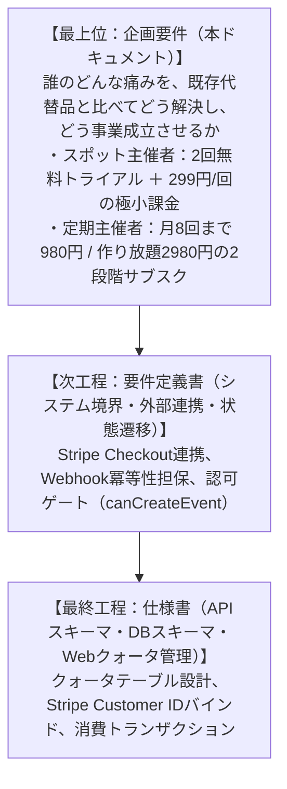
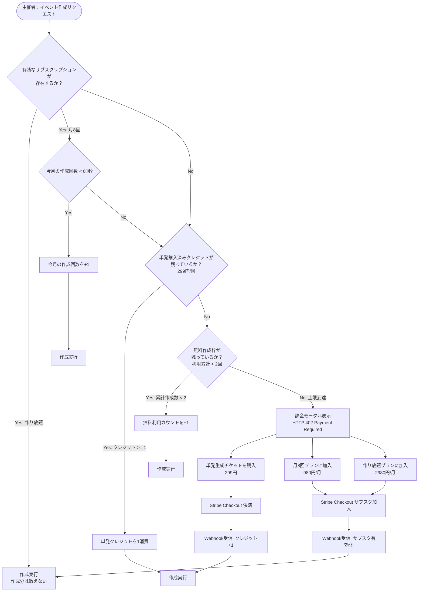

# 機能別企画要件定義書

## イベント主催者向け 利用枠（クォータ）管理＆課金決済基盤（Usage Quota & Monetization Engine）

### 1. 目的と位置づけ（階層構造）

本ドキュメントは、イベント告知ページ生成機能における「無料体験を通じた主催者の獲得」と「単発購入・月額サブスクリプションによる収益化」を両立するための目的関数と業務境界を定義する。

---

### 2. 企画要件コア5項目

#### 2.1. ターゲットの解像度と現状の代替手段

##### ペルソナと行動コンテキスト

* **ペルソナA（スポット幹事・年数回開催）:**
  * 歓送迎会、同窓会、年1〜2回のオフ会を主催する個人幹事。
  * 「月額課金だと解約忘れが不安」「1回だけサクッと使いたい」「無料枠で試してから判断したい」。
* **ペルソナB（定期イベント主催者・月2回以上開催）:**
  * バーの店主、定期ワークショップ講師、読書会・コミュニティ主催者。飯フェス、タコパ、ライブ、占い、撮影会などを繰り返し開く個人・小規模チームもここに入る。
  * 告知ページ作成や集計を毎月ルーティンで行っており、都度払いは手間。「月額1,000円以内なら固定費として許容できる」。

##### 現状の代替手段（As-Is）とペインポイント

* **大手イベントプラットフォーム（Peatix等）:**
  * 無料イベントは無料だが、機能がリッチすぎて設定項目が多く、ページ作成に30分以上かかる。有料チケット販売時の手数料が高い。
* **Googleフォーム＋手動告知:**
  * 告知ページとしてのデザイン性が低く、参加意欲を高めにくい。
* **完全買い切り型ツール / 月額制SaaS:**
  * 単発購入の選択肢がなく月額数千円〜のプランのみで、ライト層の離脱を招く。

---

#### 2.2. 独自の提供価値（Core Value Proposition）

1. **「完全リスクゼロの2回無料トライアル」:**
   * 電話番号の確認後、クレジットカード登録なしで2回までフル機能でイベント告知ページを生成・公開可能。無料 2 回は確認済み電話番号 1 件につき 1 会員へ紐付く。
   * まず価値（Time-to-Publish 30秒・告知ページのクオリティ）を体感させ、利用継続意向を高める。
2. **「スポット・定期双方を逃さないハイブリッド課金構造」:**
   * 3回目以降の利用時、主催者の開催頻度に応じて「単発生成（299円）」「月8回まで（980円/月）」「作り放題（2,980円/月）」から自由に選択可能。
   * 「月4回以上」なら月8回プラン、「月10回以上」なら作り放題が経済的合理的になる価格グラデーションを設計する。
   * 月8回プランは暦月（JST）で数え、毎月 1 日 0 時にリセットする。上限に達した月は単発チケットで継続でき、作り放題へのアップグレードを案内する。
3. **「作成機能との完全疎結合（イベント作成認可ゲート）」:**
   * イベント作成リクエストの直前に `canCreateEvent(userId)` ゲートを挟むだけのシンプルな境界設計とし、将来的な年額プランやプロモコード追加に耐えうる拡張性を担保。

---

#### 2.3. 利用枠判定・認可ゲートフロー（Gate Flow）

イベント作成リクエスト発生時の認可判定およびクォータ消費の優先順位フローは以下の通りとする。

加入済みの会員は無料枠へは戻らない。月8回プランで上限に達した月は、単発クレジットが残っていればそれを使い、無ければ 402 で作り放題へのアップグレードを促す。

---

#### 2.4. 成功指標（KPI / ガードレール指標）

| 指標カテゴリ | 指標名 | 目標値 | 計測定義 / 意図 |
| :---- | :---- | :---- | :---- |
| **トライアル転換** | 2回完走率 | **50%以上** | 初回イベント作成者のうち、2回目の無料枠まで使い切った割合 |
| **有料化率（CVR）** | 有料化転換率（Free-to-Paid） | **15%以上** | 無料枠上限到達（3回目作成試行）ユーザーのうち、単発またはサブスクを購入した割合 |
| **プラン比率** | サブスク選択率 | **40%以上** | 有料購入ユーザーのうち、月8回プランまたは作り放題を選択した割合 |
| **経済性** | ユニット粗利益率 | **96%以上** | 決済代行手数料（Stripe 3.6%）控除後の粗利益率 |
| **健全性** | 決済完了離脱率 | **5%未満** | 課金モーダルから決済完了までの途中離脱率 |

---

#### 2.5. ユニットエコノミクス仮説

* **単発決済（299円/回）:**
  * 売上: 299円
  * Stripe決済手数料（3.6%）: 10.76円
  * プラットフォーム粗利: **約288円（粗利率 96.4%）**
* **月8回プラン（980円/月）:**
  * 売上: 980円/月（最大8回まで）
  * Stripe決済手数料（3.6%）: 35.28円
  * プラットフォーム粗利: **約944円/月（粗利率 96.4%）**
* **作り放題プラン（2,980円/月）:**
  * 売上: 2,980円/月（無制限）
  * Stripe決済手数料（3.6%）: 107.28円
  * プラットフォーム粗利: **約2,872円/月（粗利率 96.4%）**
* ※イベントページのデータ保持および配信コスト（インフラ原価）は1イベントあたり数円未満のため、高い営業利益率を維持可能。

---

#### 2.6. やらないことリスト（Non-Goals）

1. **複雑な階層型プランの提供:**
   * 「ベーシック」「プロ」「エンタープライズ」のような多段階プランは採用しない。無料（累計2回）・単発299円・月8回980円・作り放題2980円の4択に絞る（選択麻痺の防止）。
   * 月8回と作り放題の差は「回数」だけにし、機能差は設けない。
2. **従量後払い（月末締め翌月請求）:**
   * 未払いリスク・与信管理のコストを排除するため、完全前払い（Pre-paid）方式を採用。
3. **独自決済画面（自前カードフォーム）の構築:**
   * PCI DSS準拠の負担およびカード情報漏洩リスクをゼロにするため、決済処理はStripe Hosted Checkoutに委譲する。
4. **イベント参加費の決済代行・チケット販売:**
   * 主催者の作成枠課金に特化し、参加者からの参加費徴収機能は本機能のスコープ外とする。

---

### 3. 想定される3つの自己反証と構造的批判

#### 批判1: 単発299円の存在によるサブスクリプション（月8回980円）の共食い（Cannibalization）

* **内容:** 単発299円が手軽すぎるため、月3〜4回開催する定期主催者も「必要なときだけ単発で払えばいい」と判断し、サブスクリプションに加入しなくなるのではないか。
* **対抗仮説（損益分岐点の可視化とプレミアム体験）:**
  * 損益分岐点を「月4回以上（299円 × 4回 = 1,196円 ＞ 980円）」に設計。月10回以上なら作り放題（299円 × 10回 = 2,990円 ＞ 2,980円）が得になる。
  * 課金モーダルにおいて「月に4回以上開催するなら月8回プラン、10回以上なら作り放題が断然おトク」という比較表示を明記。
  * サブスク加入者には将来的に「過去イベント無制限アーカイブ」「ロゴ非表示（ホワイトラベル）」などの主催者向け付加価値を優先提供し、上位プランへの誘導圧力を高める。

#### 批判2: 複数アカウント作成（捨てメアド）による「無料トライアル2回」の無限ループ悪用

* **内容:** メールアドレス認証のみの場合、別のアドレスで再登録すれば永久に無料で2回ずつ使い続けられるのではないか。
* **採用した対抗:**
  * 会員行と利用枠は、電話番号の SMS 確認が終わるまで作らない。
  * 確認済み電話番号（E.164）は会員 1 行に一意である。メールや Google が違っても、同じ番号なら同じ会員へ手段を足し、無料枠は増やさない。
  * 無料枠の消費は、確認済み電話番号を持つ会員にだけ許可する。
  * 未ログインのゲスト公開は利用枠の外である。ゲストへ同じ 2 回制限を掛けるかは、共通編レビューの未決事項とする。

#### 批判3: Webhook遅延による「決済したのにイベントが作れない」UX破綻

* **内容:** Stripeでの決済完了後、Webhookの受信に遅延が発生した場合、主催者がリダイレクト先で「まだ作れません（無料枠上限）」とブロックされ、重大なクレームに繋がる。
* **対抗仮説（Optimistic Redirect + Session Retrieve）:**
  * Stripe Checkoutからの完了リダイレクト時、URLクエリパラメータ（`session_id`）を受け取り、フロントエンド/BFF経由で同期的にStripe APIを直接照会して即座にクォータを反映。
  * Webhookは非同期整合性（バックグラウンドの確実な同期）のセーフティネットとして二重運用する。

---

### 4. 【参考】難易度順の参照フレームワーク

* **Step 1（基礎原理）: Patrick Campbell et al.『Price Intelligently / SaaS Pricing Strategy』**
  * *視座:* バリューメトリクス（価値の単位＝イベント作成数）に基づいた価格設定。ライトユーザーとヘビーユーザーの価格弾力性の違いを吸収するハイブリッド価格モデルの基礎。
* **Step 2（実装・実践）: Stripe Developer Guides『Designing Robust Subscriptions and Idempotent Webhooks』**
  * *視座:* 決済処理における冪等性（Idempotency Key）、リトライ耐性、および状態遷移の同期・非同期ハイブリッド制御。
* **Step 3（最先端の限界）: Zuora Central Platform Architecture & Revenue Recognition Standard (ASC 606)**
  * *視座:* プリペイドクレジットの有効期限管理、サブスクリプションの中途解約・ダウングレード時の日割り（Proration）計算と収益認識基準。

---

### 5. 次工程（システム要件定義書）に向けた確認・ヒアリング事項

本企画要件定義書を元に、次工程「システム要件定義書（決済シーケンス・クォータテーブル・Webhook）」を策定するにあたり、以下の3点について方針を確認させてください。

1. **決済プラットフォームの選定:**
   * Stripeの利用を基本想定として問題ないか（またはSquare、KOMOJU等別の希望があるか）。
2. **単発クレジットのまとめ買い要否:**
   * 単発は「1回（299円）」のみで十分か、あるいは「3回分チケット（799円）」などのまとめ買い・バルク購入を初期から設けるか。
3. **共同幹事における枠消費ルール:**
   * 複数幹事でイベントを管理する場合、枠を消費するのは「イベントの筆頭作成者（オーナー）」のみでよいか。

---

### 6. 価格キャンペーン（追加要件）

販売価格を管理コンソールから期間限定で制御できるようにする。詳細は [価格キャンペーン要件定義書](pricing_campaign_requirements.md) に定める。

- **狙い:** 新規主催者の獲得（0 円での試用）と、繁忙期の単発購入の後押し（期間限定割引）。
- **対象:** 単発チケット（定価 299 円）と2つの定額プラン（月8回 980 円 / 作り放題 2,980 円）。単発だけ、定額だけ、単発と定額の両方、定額2階層の一方だけを選べる。
- **0 円の扱い:** 単発はアプリ内で 1 回分を付与する。月額は Stripe の 100% クーポンを使い、カード登録を必須にして無料期間の終了後に自動で有料へ切り替える。
- **適用範囲:** 新規の申込のみ。購入済みの単発・加入済みの月額は遡って値引きしない。
- **重複:** 優先度が高いもの 1 つだけを適用する。
- **割引期間:** 月額は加入からキャンペーン終了までを 1 か月単位で切り上げ、最低 1 サイクルは割引を適用する。
- **停止:** 新規申込のみ停止し、購入済みの割引は期間満了まで継続する。
- **通知:** 0 円月額の終了前に、3 日前と 1 日前の 2 回メールで知らせ、自動課金と解約導線を明示する。あわせて利用規約（`/terms`）に自動更新・通知・返金の条件を記載する。
- **KPI:** キャンペーン経由の単発成立数、月額転換率、無料期間終了後の継続率、通知後の解約率。
- **ガードレール:** 0 円付与の不正取得（複数アカウント）を電話番号確認と回数上限で抑える。値引きが 1 円も発生しない設定は登録できない。