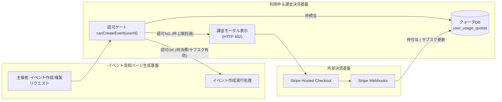
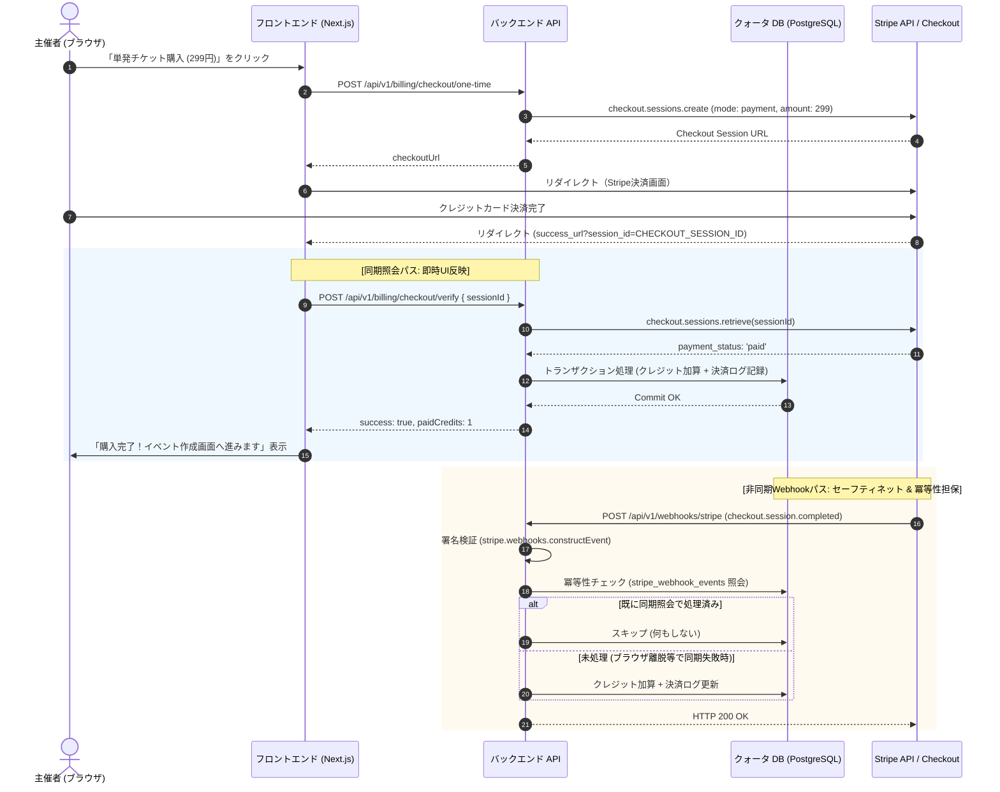
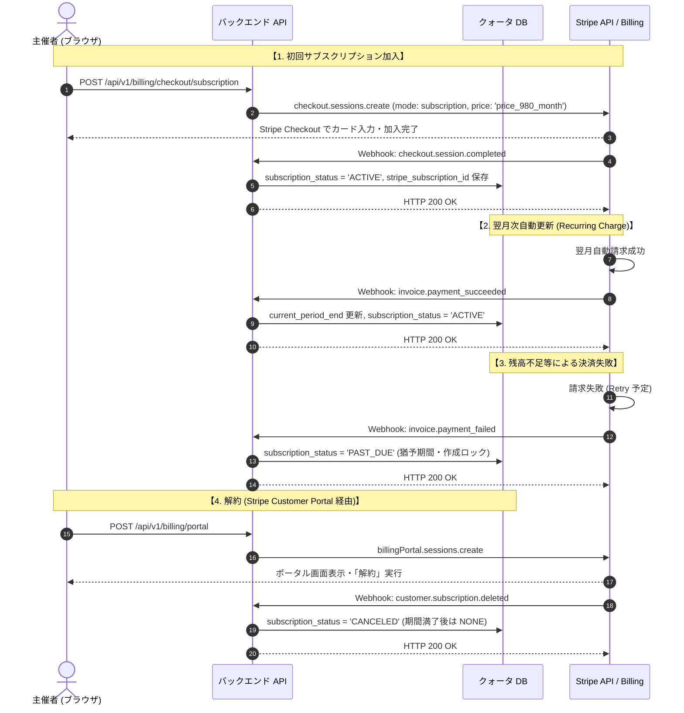
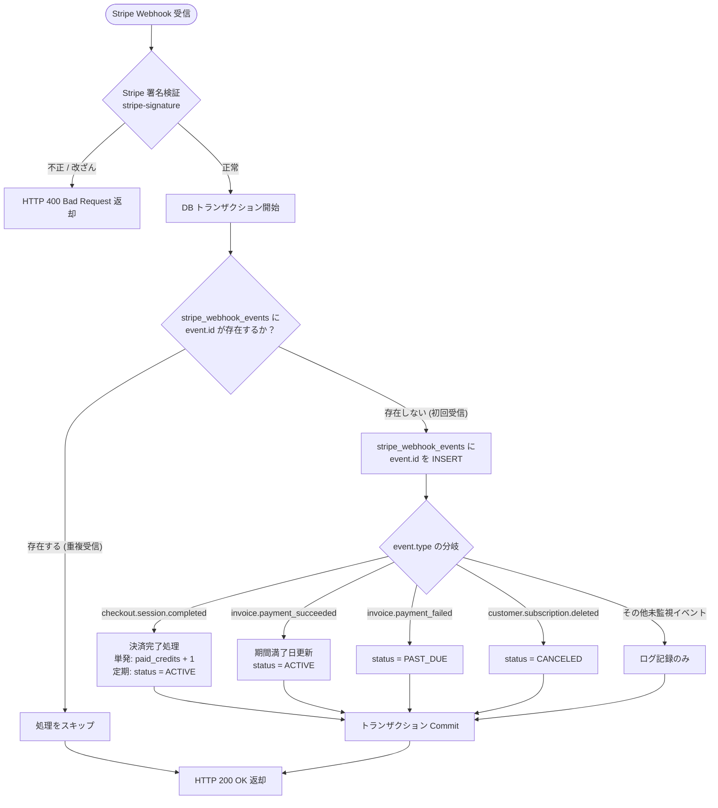

# システム要件定義書

## イベント主催者向け 利用枠（クォータ）管理＆課金決済基盤（Stripe連携・クォータDB・Webhook）

### 1. 文書概要とシステム境界

本ドキュメントは、「利用枠（クォータ）管理＆課金決済基盤 機能別企画要件定義書」に基づき、Stripe Hosted Checkout、Webhookイベントハンドリング、クォータテーブル設計、およびイベント作成認可ゲートのシステム要件・アーキテクチャを定義する。

#### 1.1. システム間境界（疎結合インターフェース）

本基盤は「イベント告知ページ生成・出欠管理基盤」と疎結合に接続し、イベント作成リクエストの直前に配置される認可ゲート `canCreateEvent(userId)` を通じてのみ連携する。



---

### 2. クォータ判定ルールと消費仕様

主催者がイベント作成・複製を要求した際、以下の優先順位に従って判定および枠消費を行う。

#### 2.1. クォータ判定・消費の優先順位

1. **第1優先：月額サブスクリプション（980円/月）**
   - 判定条件: `subscription_status == 'ACTIVE'` かつ `current_period_end > NOW()`
   - 処理: 作成を即時認可。枠（クレジット）は消費しない（無制限利用）。
2. **第2優先：単発購入済みクレジット（299円/回）**
   - 判定条件: `paid_credits >= 1`
   - 処理: `paid_credits` を 1 デクリメント（消費）し、作成を認可。
3. **第3優先：無料トライアル枠（累計2回まで）**
   - 判定条件: `free_event_count < 2` かつ、その会員の `phone_verified_at` が入っていること。
   - 処理: `free_event_count` を 1 インクリメントし、作成を認可。
   - 電話番号が未確認のときは HTTP 403（`PHONE_REQUIRED`）。枠は減らさない。
4. **上限到達（未認可）**
   - 判定条件: 上記すべてに該当しない場合。
   - 処理: HTTP 402 Payment Required を返却し、フロントエンドに課金モーダルを表示。料金の説明そのものは公開ページ SCR-PUB-06（`/service`）に置く。そのページでは購入を始めない。

無料 2 回の主体は会員行ではなく、確認済み電話番号である。同じ番号で別メールや別 Google アカウントから入っても、会員行は増えず、枠も増えない。

#### 2.2. 共同幹事の枠消費ルール

- **イベントの筆頭作成者（オーナー）のみが枠を消費する。**
- 招待された共同幹事（Co-organizer）が同一イベントの編集、閲覧、参加者管理を行う際、共同幹事自身のクォータは一切消費されない。

---

### 3. Stripe 連携シーケンス図（Mermaid）

#### 3.1. 単発購入（299円）シーケンス：同期照会 & Webhook 二重化

Stripe Checkout 完了後のリダイレクト時に即時セッション検証を行い、Webhook 遅延による UX 摩擦（画面リロード時の未反映）を防止する。



---

#### 3.2. 月額サブスクリプション（980円/月）ライフサイクルシーケンス

初回加入、月次自動更新、決済失敗、解約の一連のステート遷移を管理する。



---

#### 3.3. Webhook 冪等性（Idempotency）制御フロー

ネットワーク不調による Stripe からの重複送信（Retry）に対し、二重クレジット付与や多重更新を完全に遮断する。



---

### 4. データベース物理設計（クォータ・課金関連テーブル）

#### 4.1. テーブル一覧

| テーブル名 | 論理名 | 役割・責務 |
| :---- | :---- | :---- |
| `user_usage_quotas` | ユーザー利用枠クォータ | 主催者ごとの無料作成数、単発クレジット残数、サブスク状態を一元管理 |
| `billing_transactions` | 課金決済トランザクション | Stripe決済（単発/定期）の監査ログ、金額、セッションID履歴 |
| `stripe_webhook_events` | Webhook冪等性管理ログ | 処理済みStripe Event IDを記録し二重処理を物理遮断 |
| `pricing_campaigns` | 価格キャンペーン | 期間・対象・割引率・優先度・停止日時。定価は変更しない |
| `pricing_campaign_coupons` | キャンペーン用 Stripe クーポン | 版・割引月数ごとのクーポン ID |
| `pricing_campaign_audits` | キャンペーン監査ログ | 作成・編集・停止の操作者と前後値 |
| `billing_notices` | 終了前通知の送信記録 | 0 円月額の 3 日前・1 日前の案内。`UNIQUE(user_id, kind, period_end)` |

---

#### 4.2. テーブル物理定義

##### ① `user_usage_quotas`（ユーザー利用枠テーブル）

```sql
CREATE TYPE subscription_status_enum AS ENUM (
    'NONE',       -- 未加入
    'ACTIVE',     -- 有効（利用可能）
    'PAST_DUE',   -- 決済失敗・猶予期間中（作成不可）
    'CANCELED',   -- 解約済み（期間満了後は実質NONE）
    'INCOMPLETE'  -- 初回決済処理中
);

CREATE TABLE user_usage_quotas (
    user_id UUID PRIMARY KEY REFERENCES users(id) ON DELETE CASCADE,
    free_event_count INT NOT NULL DEFAULT 0 CHECK (free_event_count >= 0),
    paid_credits INT NOT NULL DEFAULT 0 CHECK (paid_credits >= 0),
    subscription_status subscription_status_enum NOT NULL DEFAULT 'NONE',
    current_period_end TIMESTAMPTZ NULL,
    stripe_customer_id VARCHAR(255) UNIQUE NULL,
    stripe_subscription_id VARCHAR(255) UNIQUE NULL,
    created_at TIMESTAMPTZ NOT NULL DEFAULT NOW(),
    updated_at TIMESTAMPTZ NOT NULL DEFAULT NOW()
);

CREATE INDEX idx_user_usage_quotas_customer ON user_usage_quotas(stripe_customer_id);

CREATE INDEX idx_user_usage_quotas_subscription ON user_usage_quotas(stripe_subscription_id);
```

##### ② `billing_transactions`（決済履歴テーブル）

```sql
CREATE TYPE payment_type_enum AS ENUM ('ONE_TIME', 'SUBSCRIPTION');

CREATE TYPE payment_status_enum AS ENUM ('PENDING', 'SUCCEEDED', 'FAILED', 'REFUNDED');

CREATE TABLE billing_transactions (
    id UUID PRIMARY KEY DEFAULT gen_random_uuid(),
    user_id UUID NOT NULL REFERENCES users(id) ON DELETE CASCADE,
    payment_type payment_type_enum NOT NULL,
    payment_status payment_status_enum NOT NULL DEFAULT 'PENDING',
    amount INT NOT NULL CHECK (amount >= 0),
    currency VARCHAR(3) NOT NULL DEFAULT 'jpy',
    stripe_checkout_session_id VARCHAR(255) UNIQUE NULL,
    stripe_payment_intent_id VARCHAR(255) UNIQUE NULL,
    stripe_invoice_id VARCHAR(255) NULL,
    created_at TIMESTAMPTZ NOT NULL DEFAULT NOW(),
    updated_at TIMESTAMPTZ NOT NULL DEFAULT NOW()
);

CREATE INDEX idx_billing_tx_user ON billing_transactions(user_id);

CREATE INDEX idx_billing_tx_session ON billing_transactions(stripe_checkout_session_id);
```

##### ③ `stripe_webhook_events`（Webhook冪等性制御テーブル）

```sql
CREATE TABLE stripe_webhook_events (
    stripe_event_id VARCHAR(255) PRIMARY KEY,
    event_type VARCHAR(255) NOT NULL,
    processed_at TIMESTAMPTZ NOT NULL DEFAULT NOW()
);
```

---

#### 4.3. Prisma ORM スキーマ定義 (`schema.prisma` 抜粋)

```text
enum SubscriptionStatus {
  NONE
  ACTIVE
  PAST_DUE
  CANCELED
  INCOMPLETE
}

enum PaymentType {
  ONE_TIME
  SUBSCRIPTION
}

enum PaymentStatus {
  PENDING
  SUCCEEDED
  FAILED
  REFUNDED
}

model UserUsageQuota {
  userId               String             @id @map("user_id") @db.Uuid
  freeEventCount       Int                @default(0) @map("free_event_count")
  paidCredits          Int                @default(0) @map("paid_credits")
  subscriptionStatus   SubscriptionStatus @default(NONE) @map("subscription_status")
  currentPeriodEnd     DateTime?          @map("current_period_end") @db.Timestamptz
  stripeCustomerId     String?            @unique @map("stripe_customer_id") @db.VarChar(255)
  stripeSubscriptionId String?            @unique @map("stripe_subscription_id") @db.VarChar(255)
  createdAt            DateTime           @default(now()) @map("created_at") @db.Timestamptz
  updatedAt            DateTime           @updatedAt @map("updated_at") @db.Timestamptz
  user User @relation(fields: [userId], references: [id], onDelete: Cascade)
  @@index([stripeCustomerId])
  @@index([stripeSubscriptionId])
  @@map("user_usage_quotas")
}

model BillingTransaction {
  id                      String        @id @default(dbgenerated("gen_random_uuid()")) @db.Uuid
  userId                  String        @map("user_id") @db.Uuid
  paymentType             PaymentType   @map("payment_type")
  paymentStatus           PaymentStatus @default(PENDING) @map("payment_status")
  amount                  Int
  currency                String        @default("jpy") @db.VarChar(3)
  stripeCheckoutSessionId String?       @unique @map("stripe_checkout_session_id") @db.VarChar(255)
  stripePaymentIntentId   String?       @unique @map("stripe_payment_intent_id") @db.VarChar(255)
  stripeInvoiceId         String?       @map("stripe_invoice_id") @db.VarChar(255)
  createdAt               DateTime      @default(now()) @map("created_at") @db.Timestamptz
  updatedAt               DateTime      @updatedAt @map("updated_at") @db.Timestamptz
  user User @relation(fields: [userId], references: [id], onDelete: Cascade)
  @@index([userId])
  @@index([stripeCheckoutSessionId])
  @@map("billing_transactions")
}

model StripeWebhookEvent {
  stripeEventId String   @id @map("stripe_event_id") @db.VarChar(255)
  eventType     String   @map("event_type") @db.VarChar(255)
  processedAt   DateTime @default(now()) @map("processed_at") @db.Timestamptz
  @@map("stripe_webhook_events")
}
```

---

### 5. Webhook イベントハンドリング仕様

#### 5.1. 受信エンドポイント基本情報

- **エンドポイント:** `POST /api/v1/webhooks/stripe`
- **リクエスト形式:** Raw Body (Buffer)
- **認証方式:** `stripe-signature` ヘッダーによる HMAC-SHA256 署名検証。失敗時の応答本文に検証ライブラリのメッセージは入れない

#### 5.2. 対象イベントと処理マトリクス

| Stripe イベント種別 | 発火トリガー | バックエンド処理内容 |
| :---- | :---- | :---- |
| `checkout.session.completed` | 単発299円 または サブスク初回のCheckout完了 | 署名検証のあと、`paid`、通貨 `jpy`、単発 299 円または月額 980 円、月額 Price、`livemode`、`metadata.userId`、保存済みの Stripe 顧客 ID が一致するときだけ付与する。単発は `paid_credits + 1`。月額は `ACTIVE` と期間終了。金額が無いときは付与しない |
| `invoice.payment_succeeded` | サブスクリプションの初回または月次更新 | 顧客またはサブスク ID から会員を特定し、Price と 980 円と `jpy` が一致するとき `ACTIVE` と `current_period_end` を更新する。初回は Checkout の行へ請求書 ID を足す。2 回目以降は `billing_transactions` に支払済みの行を増やす |
| `invoice.payment_failed` | サブスクリプションの請求失敗 | `subscription_status = PAST_DUE`。同じ請求書 ID の履歴を失敗にする。既に支払済みの行は失敗へ戻さない |
| `customer.subscription.updated` | 契約状態の変化 | `active` は Price が月額 Price のときだけ `ACTIVE`。`past_due` は `PAST_DUE`。`incomplete` と `trialing` は `INCOMPLETE`。それ以外は `CANCELED` |
| `customer.subscription.deleted` | サブスクリプションの解約完了 | `subscription_status = CANCELED`。以後の作成は単発クレジットまたは無料枠へ戻る |
| `charge.refunded` | 全額返金 | 履歴を `REFUNDED` にする。単発で未使用クレジットが残っていれば 1 つ戻す。月額なら `CANCELED`。一部返金では枠を変えない。公開済みイベントは自動では消さない |
| `charge.dispute.created` | 異議申立 | 履歴を `DISPUTED` にし、全額返金と同じ枠の戻しを一度だけ行う |

---

### 6. バックエンド API 実装仕様

#### 6.1. 単発チケット購入セッション作成

- **URL:** `POST /api/v1/billing/checkout/one-time`
- **認可:** 認証済み主催者（JWT セッション）
- **補足:** ボディは空でよい。`Idempotency-Key` があるときは同じ会員の連打で Checkout を二重に作らない。`STRIPE_PRICE_ID_ONE_TIME` があるときはその固定 Price を使い、無いときは 299 円の都度 Price を作る。付与時はどちらも 299 円であることを確認する。
- **リクエスト Body:**

```json
{}
```

- **レスポンス (200 OK):**

```json
{
  "checkoutUrl": "[STRIPE_HOSTED_CHECKOUT_URL]"
}
```

#### 6.2. 月額使い放題サブスク加入セッション作成

- **URL:** `POST /api/v1/billing/checkout/subscription`
- **認可:** 認証済み主催者（JWT セッション）
- **リクエスト Body:**

```json
{}
```

- **レスポンス (200 OK):**

```json
{
  "checkoutUrl": "[STRIPE_HOSTED_CHECKOUT_URL]"
}
```

#### 6.3. 同期セッション検証（リダイレクト時即時反映）

- **URL:** `POST /api/v1/billing/checkout/verify`
- **認可:** 認証済み主催者（JWT セッション）
- **リクエスト Body:**

```json
{
  "sessionId": "cs_test_sample_session_id"
}
```

- **レスポンス (200 OK):**

```json
{
  "success": true,
  "paymentType": "ONE_TIME",
  "quota": {
    "freeEventCount": 2,
    "paidCredits": 1,
    "subscriptionStatus": "NONE"
  }
}
```

#### 6.4. クォータ照会 API

- **URL:** `GET /api/v1/organizer/quota`
- **認可:** 認証済み主催者（JWT セッション）
- **レスポンス (200 OK):**

```json
{
  "freeEventCount": 2,
  "freeLimit": 2,
  "remainingFree": 0,
  "paidCredits": 1,
  "subscriptionStatus": "ACTIVE",
  "currentPeriodEnd": "2026-11-19T00:00:00.000Z",
  "canCreate": true
}
```

#### 6.5. イベント作成認可ミドルウェア・ロジック (`assertCanCreateEvent`)

```ts
import { prisma } from '@/lib/prisma';
import { ProblemDetailException } from '@/lib/exceptions';

export async function assertCanCreateEvent(userId: string) {
  const quota = await prisma.userUsageQuota.findUnique({
    where: { userId },
  });
  if (!quota) {
    throw new ProblemDetailException({
      status: 404,
      title: 'Quota Not Found',
      detail: '主催者の利用枠情報が存在しません。',
    });
  }
  const now = new Date();
  // 1. サブスクリプション有効チェック
  if (
    quota.subscriptionStatus === 'ACTIVE' &&
    quota.currentPeriodEnd &&
    quota.currentPeriodEnd > now
  ) {
    return { type: 'SUBSCRIPTION_UNLIMITED', consume: async () => {} };
  }
  // 2. 単発クレジットチェック
  if (quota.paidCredits >= 1) {
    return {
      type: 'PAID_CREDIT',
      consume: async () => {
        await prisma.userUsageQuota.update({
          where: { userId },
          data: { paidCredits: { decrement: 1 } },
        });
      },
    };
  }
  // 3. 無料トライアルチェック (2回まで)
  if (quota.freeEventCount < 2) {
    return {
      type: 'FREE_TRIAL',
      consume: async () => {
        await prisma.userUsageQuota.update({
          where: { userId },
          data: { freeEventCount: { increment: 1 } },
        });
      },
    };
  }
  // 4. 上限超過
  throw new ProblemDetailException({
    status: 402,
    title: 'Payment Required',
    detail: '無料トライアル枠（2回）が上限に達しています。単発チケット（299円）または月額プラン（980円）をご利用ください。',
    pricingOptions: {
      oneTimePrice: 299,
      subscriptionMonthlyPrice: 980,
    },
  });
}
```

---

### 7. 非機能要件・セキュリティ要件

1. **二重課金・二重付与防止（Idempotency）:**
   - Webhook ハンドラーは `stripe_webhook_events` テーブルへの INSERT をトランザクション先頭で実行し、主キー競合（`stripe_event_id` 重複）が発生した場合は即座にコミットして HTTP 200 を返す。
2. **カード情報の非保持化:**
   - カード番号や CVV は自社サーバーを一切経由せず、すべて Stripe のホスティング環境（Stripe Hosted Checkout / Stripe Elements）上で安全にトークン化。PCI DSS SAQ A 準拠を維持。
3. **署名検証の強制:**
   - `POST /api/v1/webhooks/stripe` では必ず `STRIPE_WEBHOOK_SECRET` を用いた署名検証を実施。不正なリクエストや改ざんペイロードは直ちに HTTP 400 で遮断。
4. **環境変数定義 (`.env.example` 追記項目):**

```bash
# Stripe 決済設定
STRIPE_SECRET_KEY="sk_test_..."
STRIPE_PUBLISHABLE_KEY="pk_test_..."
STRIPE_WEBHOOK_SECRET="whsec_..."
STRIPE_PRICE_ID_MONTHLY_980="price_..."
STRIPE_PRICE_ID_ONE_TIME="price_..."
# 0円月額の終了前案内（3日前・1日前）を送るバッチの合言葉
BILLING_NOTICE_SECRET="replace-with-a-long-random-string"
```

---

### 8. 価格キャンペーン（追加仕様）

販売価格の期間制御、0 円販売、無料期間の自動課金、終了前通知の詳細は [価格キャンペーン要件定義書](pricing_campaign_requirements.md) を正とする。ここでは課金基盤としての要点だけを示す。

#### 8.1. 価格の解決

1. `pricing_campaigns` から `isEnabled = true`、`stoppedAt IS NULL`、`startsAt <= now < endsAt` の行を取る。
2. 対象（`ONE_TIME` / `SUBSCRIPTION` / `BOTH`）が一致するものに絞る。
3. `priority DESC, createdAt DESC, id DESC` の先頭 1 件を採用する。
4. 請求額は `min(定価, max(10, ceil(定価 × (100 - 割引率) / 100 / 10) × 10))`。割引率 100% のみ 0 円。
5. 定価は `plans.ts` の `ONE_TIME_PRICE_JPY = 299`、`SUBSCRIPTION_PRICE_JPY = 980` を維持する。

#### 8.2. 0 円の単発チケット

- Stripe セッションを作らず、`billing_transactions` に `amount = 0`、`listAmount = 299`、`discountAmount = 299`、`appliedPercent = 100` を `SUCCEEDED` で記録し、`paid_credits` を 1 増やす。
- 電話番号確認済みの会員だけが対象。`users` 行を `FOR UPDATE` でロックし、キャンペーンごとの上限回数（既定 1 回）を超えない。
- `requestKey`（`Idempotency-Key`）の `UNIQUE` 制約で二重付与を防ぐ。

#### 8.3. 0 円の月額プラン

- `STRIPE_PRICE_ID_MONTHLY_980` の Price は変えず、Stripe クーポンで割り引く。
  - 100%: `percent_off = 100`
  - 100% 未満: `amount_off = 980 - 請求額`、`currency = "jpy"`
  - 共通: `duration = "repeating"`、`duration_in_months = 加入から終了までの切り上げ月数`
- `payment_method_collection: "always"` でカードを登録させ、無料期間の終了後は Stripe が通常価格で自動請求する。
- 加入確定時に `user_usage_quotas.discount_ends_at` を記録する。これが通知の基準日時になる。

#### 8.4. 金額検証の変更

- 旧実装の `amount === 299` / `amount === 980` の固定比較を廃止する。
- 申込時に作った `PENDING` の `billing_transactions.amount` と、Checkout Session / Invoice の金額を突き合わせる。
- 0 円の初回請求は `payment_status = "no_payment_required"` を通す。
- 月額の更新請求は、`amount_paid <= 980` かつ、980 円未満ならクーポン（`invoice.discount` または `total_discount_amounts`）が付いていることを条件にする。

#### 8.5. 終了前通知

- `discount_ends_at` が 3 日以内の `ACTIVE` 契約を対象に、残り 24 時間以内なら 1 日前、それ以外は 3 日前の案内を送る。
- `billing_notices` の一意制約で同じ無料期間に 1 回だけ送る。
- 実行は `POST /api/v1/internal/billing/notices`（`BILLING_NOTICE_SECRET`）または `npm run billing:notices`。1 日 1 回の cron を想定する。

#### 8.6. 停止・編集

- 停止は `isEnabled = false`、`stoppedAt = now()`。新規申込だけが止まり、既存購入者のクーポンは Stripe 側の期間満了まで有効。
- 価格に関わる編集は `version` を上げ、新しいクーポンを作る。既存の `billing_transactions` の `appliedPercent` は変えない。
- 作成・編集・停止は `pricing_campaign_audits` に前後値と操作者を残す。

#### 8.7. 画面と利用規約

- 管理画面は `/console/pricing`（SCR-ADM-05）。`requireAdmin` で保護する。
- 料金ページと購入モーダルは `/api/v1/public/pricing` または `billing/quota` の `pricing` を読み、割引中は定価を取り消し線で併記する。
- 利用規約 `/terms`（SCR-PUB-10）に、0 円月額の自動更新、終了日の 3 日前・1 日前の通知、解約と返金の条件を明記する。