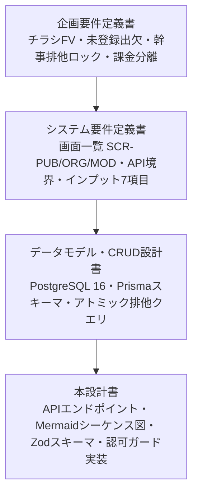
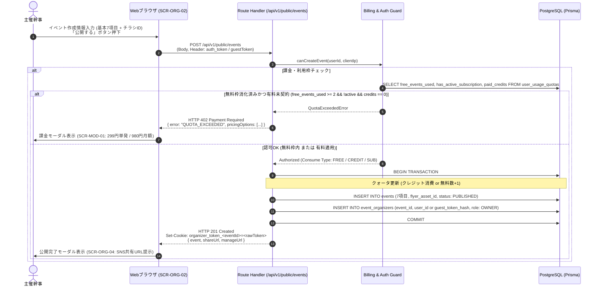
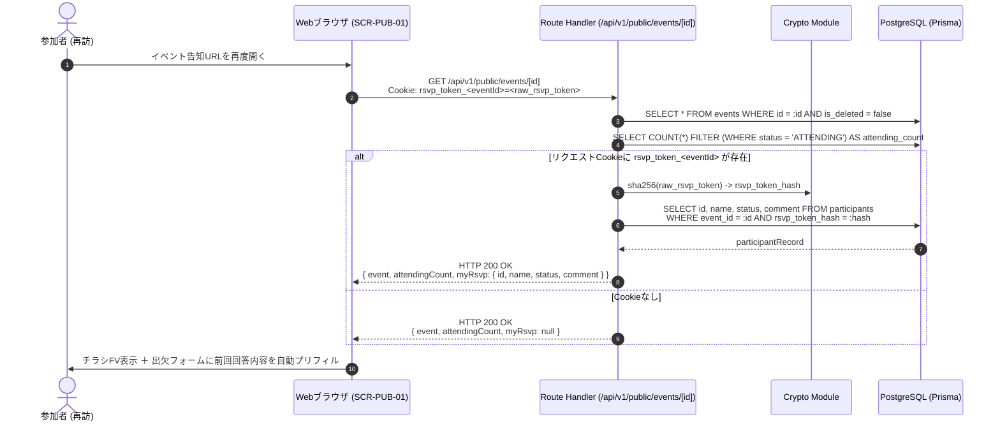
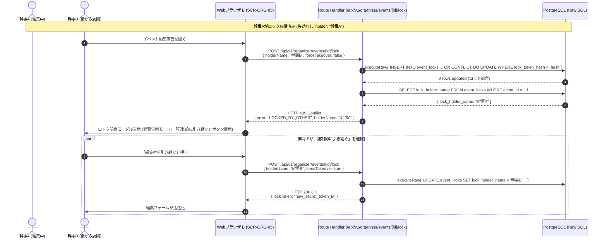
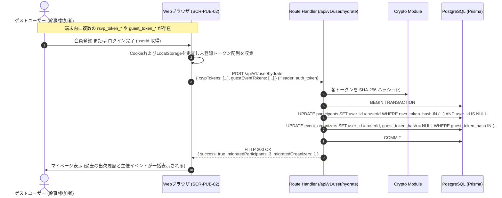

# バックエンドAPI実装仕様書

## チラシファースト型 イベント紹介ページ生成＆出欠管理基盤（Next.js App Router & PostgreSQL）

## 1. 全体アーキテクチャ・設計方針

本ドキュメントは、システム要件定義書およびデータモデル設計書に基づき、Next.js App Router（Route Handlers）および PostgreSQL（Prisma ORM）によるバックエンドAPIの完全な実装仕様を定義する。



### 1.1. 基本方針

1. **ハイブリッド認証・認可アーキテクチャ:**
   * **未登録参加者:** 端末Cookie（`rsvp_token_<eventId>`）のSHA-256ハッシュ照合によるゼロフリクション出欠。
   * **ゲスト幹事:** 作成時に発行された暗号化トークン（ヘッダー `X-Organizer-Token` または Cookie）によるリソース認可。
   * **認証済み会員幹事:** ローカルHS256署名 JWT（Cookie `auth_token` または Bearer Token）による認可。
2. **PostgreSQL固有のアトミック排他編集ロック（Pessimistic Lock）:**
   * 共同幹事の同時編集事故（Lost Update）を防ぐため、`INSERT ... ON CONFLICT (event_id) DO UPDATE WHERE lock_token_hash = :hash` を実行し、DBレベルで厳密な排他制御を担保する。ロックは時間で失効せず、保持者が解放するか他の幹事が引き継ぐまで保持される。
3. **課金基盤との疎結合認可ゲート:**
   * イベント作成リクエスト受付時に `canCreateEvent(userId)` ゲートを評価し、上限超過時は HTTP 402 Payment Required と課金プラン一覧を返却する。
4. **RFC 7807 準拠のエラーレスポンス:**
   * すべてのエラーレスポンスを `application/problem+json` 構造に統一し、フロントエンド側での統一的なエラーハンドリングを保証する。

---

## 2. エンドポイント一覧カタログ

| エンドポイント | メソッド | 対象画面ID | 認証・認可 | 概要 |
| :---- | :---: | :---- | :---- | :---- |
| `/api/v1/geo/postal-codes/[code]` | `GET` | `SCR-ORG-02` | 不要 | 郵便番号から都道府県・市区町村・町域を引く（zipcloud プロキシ） |
| `/api/v1/public/events` | `POST` | `SCR-ORG-02` | 任意（会員/ゲスト） | イベント新規作成（課金認可チェック連携） |
| `/api/v1/public/events/[id]` | `GET` | `SCR-PUB-01` | 不要（Cookie照会） | 一般公開イベント情報取得（自出欠自動照会含む） |
| `/api/v1/public/events/[id]/rsvp` | `POST` | `SCR-PUB-01` | 不要（Cookie発行） | 未登録出欠登録および更新 |
| `/api/v1/public/events/[id]/rsvp` | `DELETE` | `SCR-PUB-01` | Cookie必須 | 出欠の取り消し（キャンセル） |
| `/api/v1/organizer/events` | `GET` | `SCR-ORG-01` | 幹事（会員/ゲスト） | 主催イベント一覧取得（出欠数集計含む） |
| `/api/v1/organizer/events/[id]` | `GET` | `SCR-ORG-05` | 幹事（会員/ゲスト） | 幹事用イベント詳細取得 |
| `/api/v1/organizer/events/[id]` | `PUT` | `SCR-ORG-05` | 幹事＋有効ロック | イベント情報更新（排他ロック保護） |
| `/api/v1/organizer/events/[id]` | `DELETE` | `SCR-ORG-01` | 主催幹事（OWNER） | イベントの論理削除 |
| `/api/v1/organizer/events/[id]/lock` | `POST` | `SCR-ORG-05` | 幹事（会員/ゲスト） | 排他ロック取得・延長（再確認）・強制引き継ぎ |
| `/api/v1/organizer/events/[id]/lock` | `DELETE` | `SCR-ORG-05` | ロック保持幹事 | 排他ロックの明示的解放 |
| `/api/v1/organizer/events/[id]/participants` | `GET` | `SCR-ORG-06` | 幹事（会員/ゲスト） | 参加者一覧・出欠ステータス・コメント詳細閲覧 |
| `/api/v1/organizer/events/[id]/invitations` | `POST` | `SCR-ORG-07` | 主催幹事（OWNER） | 共同幹事招待コード発行 |
| `/api/v1/invitations/[code]` | `GET` | `SCR-ORG-07` | 任意（要受諾） | 共同幹事招待コード検証＆幹事権限付与 |
| `/api/v1/organizer/events/[id]/clone` | `POST` | `SCR-ORG-01` | 幹事（会員/ゲスト） | 過去イベントの複製作成 |
| `/api/v1/billing/quota` | `GET` | `SCR-MOD-01` | 会員必須 | 利用枠・残クレジット・サブスク状態照会 |
| `/api/v1/user/hydrate` | `POST` | `SCR-PUB-02` | 会員必須 | 端末内ゲストトークン履歴の会員アカウント統合 |
| `/api/v1/auth/local` | `POST` | `SCR-PUB-02` | 不要 | ローカル会員登録・ログイン（JWT発行） |

---

## 3. 主要処理シーケンス図（Mermaid）

### 3.1. イベント作成＆課金認可ゲート（canCreateEvent）



---

### 3.2. 参加者：登録ゼロ出欠登録＆Cookie発行

```mermaid
sequenceDiagram
    autonumber
    actor Guest as 参加者
    participant Client as Webブラウザ (SCR-PUB-01)
    participant Route as Route Handler (/api/v1/public/events/[id]/rsvp)
    participant Crypto as Crypto Module
    participant DB as PostgreSQL (Prisma)
    Guest->>Client: チラシFV閲覧、出欠トグル選択(参加/不参加)、<br/>氏名・追加コメント入力、「回答する」押下
    Client->>Route: POST /api/v1/public/events/[id]/rsvp<br/>{ name, status, comment } (Cookieなし)
    Route->>Crypto: generateSecureToken(32) -> raw_rsvp_token
    Route->>Crypto: sha256(raw_rsvp_token) -> rsvp_token_hash
    Route->>DB: INSERT INTO participants (event_id, rsvp_token_hash, name, status, comment, ip_hash)
    DB-->>Route: participantRecord
    Route-->>Client: HTTP 201 Created<br/>Set-Cookie: rsvp_token_<eventId>=<raw_rsvp_token>; Max-Age=30days; HttpOnly; SameSite=Lax<br/>{ success: true, myRsvp: { id, name, status, comment } }
    Client->>Guest: 回答完了トースト表示 (フォームが「回答済み・変更可能」状態へ遷移)
```

---

### 3.3. 参加者：端末Cookie再訪による出欠自動照会



---

### 3.4. 共同幹事：排他編集排他ロック取得・再確認・Takeover競合



---

### 3.5. 会員昇格・データ統合トランザクション（Hydration）



---

## 4. 共通ミドルウェア・認可ガード仕様

### 4.1. 暗号化ユーティリティ (`src/lib/crypto.ts`)

```ts
import { createHash, randomBytes } from "crypto";

export function sha256(input: string): string {
  return createHash("sha256").update(input).digest("hex");
}

export function generateSecureToken(length: number = 32): string {
  return randomBytes(length).toString("hex");
}
```

### 4.2. 認可ガード (`src/lib/guards.ts`)

```ts
import { NextRequest } from "next/server";
import { prisma } from "@/lib/prisma";
import { verifyLocalToken } from "@/lib/auth";
import { sha256 } from "@/lib/crypto";

export interface AuthContext {
  userId: string | null;
  guestTokenHash: string | null;
  role: "OWNER" | "CO_HOST" | null;
}

export async function resolveAuthContext(req: NextRequest, eventId?: string): Promise<AuthContext> {
  let userId: string | null = null;
  let guestTokenHash: string | null = null;
  // 1. JWT 会員認証チェック
  const authCookie = req.cookies.get("auth_token")?.value;
  const authHeader = req.headers.get("Authorization")?.replace("Bearer ", "");
  const token = authCookie || authHeader;
  if (token) {
    const verified = await verifyLocalToken(token);
    if (verified) userId = verified.userId;
  }
  // 2. ゲスト幹事トークンチェック
  if (eventId) {
    const guestToken = req.headers.get("X-Organizer-Token") || req.cookies.get(`org_token_${eventId}`)?.value;
    if (guestToken) {
      guestTokenHash = sha256(guestToken);
    }
  }
  // 3. ロール特定
  let role: "OWNER" | "CO_HOST" | null = null;
  if (eventId && (userId || guestTokenHash)) {
    const organizer = await prisma.eventOrganizer.findFirst({
      where: {
        eventId,
        OR: [
          ...(userId ? [{ userId }] : []),
          ...(guestTokenHash ? [{ guestTokenHash }] : []),
        ],
      },
    });
    if (organizer) role = organizer.role as "OWNER" | "CO_HOST";
  }
  return { userId, guestTokenHash, role };
}

export async function assertOrganizer(req: NextRequest, eventId: string): Promise<AuthContext> {
  const ctx = await resolveAuthContext(req, eventId);
  if (!ctx.role) {
    throw new Error("FORBIDDEN_ORGANIZER");
  }
  return ctx;
}

export async function assertLockHolder(eventId: string, lockToken: string): Promise<void> {
  const lockTokenHash = sha256(lockToken);
  const lock = await prisma.eventLock.findUnique({
    where: { eventId },
  });
  if (!lock || lock.lockTokenHash !== lockTokenHash || lock.expiresAt <= new Date()) {
    throw new Error("LOCK_CONFLICT");
  }
}
```

---

## 5. APIエンドポイント詳細仕様

### 5.1. `POST /api/v1/public/events`（イベント新規作成）

主催者が入力7項目とチラシIDを指定して新規イベントを作成する。

* **認証:** 任意（ログイン時は会員作成、未ログイン時はゲスト幹事トークン発行）
* **課金判定:** 会員はクォータ（無料2回/定期購入/単発クレジット）を消費。

#### リクエストスキーマ (Zod)

```ts
const time = z.string().regex(/^([01]\d|2[0-3]):[0-5]\d$/, "HH:mm 形式で入力してください");

export const CreateEventSchema = z.object({
  title: z.string().min(1, "催しの名前を入力してください").max(100),
  schedules: z.array(z.object({
    eventDate: z.string().regex(/^\d{4}-\d{2}-\d{2}$/, "日付形式(YYYY-MM-DD)が不正です"),
    startTime: time,
    endTime: time,
  }).refine((row) => row.startTime !== row.endTime, "終了時刻は開始時刻と別にしてください")).min(1).max(8),
  pricePlans: z.array(z.object({
    name: z.string().min(1, "プラン名を入力してください").max(50),
    audience: z.enum(["ANY", "MALE", "FEMALE"]).default("ANY"),
    amount: z.number().int().min(0).max(9_999_999),
    note: z.string().max(100).nullable().optional(),
  })).min(1).max(8),
  // 構造化住所。すべて空なら従来の location を使う。
  postalCode: z.string().regex(/^\d{7}$/).nullable().optional(),
  prefecture: z.string().max(20).nullable().optional(),
  city: z.string().max(100).nullable().optional(),
  town: z.string().max(100).nullable().optional(),
  addressLine: z.string().max(200).nullable().optional(),
  building: z.string().max(150).nullable().optional(),
  venueName: z.string().max(150).nullable().optional(),
  location: z.string().max(255).optional(),
  rainPolicy: z.enum(["RAIN_OR_SHINE", "CANCEL_ON_RAIN", "POSTPONE_ON_RAIN", "INDOOR"]),
  capacity: z.number().int().positive().nullable().optional(),
  flyerAssetId: z.string().uuid().nullable().optional(),
});
```

#### レスポンス仕様

* **201 Created:**

```json
{
  "event": {
    "id": "e8a93b4c-9f82-4c28-9721-6b8c4d29a581",
    "title": "金曜夜のアコースティックライブ",
    "sortDate": "2026-11-20",
    "schedules": [
      {
        "id": "11111111-1111-4111-8111-111111111111",
        "eventDate": "2026-11-20",
        "startTime": "19:00",
        "endTime": "21:30",
        "eventTime": "19:00〜21:30"
      }
    ],
    "pricePlans": [
      {
        "id": "33333333-3333-4333-8333-333333333333",
        "name": "一般",
        "audience": "ANY",
        "amount": 3000,
        "note": "1ドリンク付",
        "price": "3,000円（1ドリンク付）"
      }
    ],
    "location": "Cafe & Bar Moonlight 東京都新宿区西新宿1-2-3",
    "postalCode": "1600023",
    "prefecture": "東京都",
    "city": "新宿区",
    "town": "西新宿",
    "addressLine": "1-2-3",
    "building": null,
    "venueName": "Cafe & Bar Moonlight",
    "rainPolicy": "RAIN_OR_SHINE",
    "capacity": 30,
    "status": "PUBLISHED",
    "flyerAsset": {
      "id": "f5b82c1a-9a8b-4c7d-8e9f-0123456789ab",
      "imageUrl": "/uploads/flyers/acoustic_live.webp",
      "lqipDataUrl": "data:image/webp;base64,UklGRl...",
      "aspectRatio": "9:16"
    }
  },
  "guestOrganizerToken": "9b1deb4d-3b7d-4bad-9bdd-2b0d7b3dcb6d",
  "publicUrl": "/events/e8a93b4c-9f82-4c28-9721-6b8c4d29a581",
  "manageUrl": "/organizer/events/e8a93b4c-9f82-4c28-9721-6b8c4d29a581"
}
```

* **402 Payment Required:**

```json
{
  "type": "https://api.event-platform.local/probs/quota-exceeded",
  "title": "Payment Required",
  "status": 402,
  "detail": "無料トライアル（2回）を消化しました。以降の生成には有料プランが必要です。",
  "pricingOptions": [
    { "type": "SINGLE", "name": "単発生成チケット", "price": 299, "currency": "JPY" },
    { "type": "SUBSCRIPTION", "name": "月額使い放題プラン", "price": 980, "currency": "JPY", "interval": "month" }
  ]
}
```

---

### 5.2. `GET /api/v1/public/events/[id]`（公開情報取得・Cookie自動照会）

一般公開ページ表示時に利用。参加者個人情報は伏せ、確定数のみを返却。端末Cookieが存在すれば自身の出欠回答を添付する。

* **リクエストCookie:** `rsvp_token_<id>`（任意）
* **レスポンス仕様 (200 OK):**

```json
{
  "id": "e8a93b4c-9f82-4c28-9721-6b8c4d29a581",
  "title": "金曜夜のアコースティックライブ",
  "sortDate": "2026-11-20",
  "schedules": [
    { "id": "11111111-1111-4111-8111-111111111111", "eventDate": "2026-11-20", "eventTime": "19:00〜21:30" }
  ],
  "pricePlans": [
    { "id": "33333333-3333-4333-8333-333333333333", "name": "プランA", "price": "3,000円（1ドリンク付）" }
  ],
  "location": "Cafe & Bar Moonlight, 新宿区",
  "rainPolicy": "RAIN_OR_SHINE",
  "capacity": 30,
  "status": "PUBLISHED",
  "attendingCount": 18,
  "flyerAsset": {
    "imageUrl": "/uploads/flyers/acoustic_live.webp",
    "lqipDataUrl": "data:image/webp;base64,UklGRl...",
    "aspectRatio": "9:16"
  },
  "myRsvp": {
    "id": "p1a2b3c4-1111-2222-3333-444455556666",
    "name": "佐藤",
    "status": "ATTENDING",
    "comment": "楽しみにしています！少し遅れるかもしれません。"
  }
}
```

---

### 5.3. `POST /api/v1/public/events/[id]/rsvp`（未登録出欠登録・変更）

アカウント不要で回答可能。回答後、30日間有効なHttpOnly Cookieを発行する。

#### リクエストスキーマ (Zod)

```ts
export const SubmitRsvpSchema = z.object({
  name: z.string().min(1, "名前を入力してください").max(50),
  status: z.enum(["ATTENDING", "DECLINED"]),
  // 出席では必須。費用プランの audience と一致している必要がある。
  gender: z.enum(["MALE", "FEMALE"]).optional(),
  comment: z.string().max(500).optional(),
  scheduleId: z.string().uuid().optional(),
  pricePlanId: z.string().uuid().optional(),
});
```

#### 処理フロー

出席（`ATTENDING`）では `gender`・`scheduleId`・`pricePlanId` が必須で、日時とプランはそのイベントの候補である。費用プランの `audience` は参加者の性別と一致するか `ANY` でなければ 400（`PRICE_PLAN_GENDER_MISMATCH`）。欠席では日時とプランを NULL にする。

1. Cookieに `rsvp_token_<id>` がある場合、そのSHA-256ハッシュに該当する `participants` レコードをUPDATE。
2. Cookieがない場合、新規トークン（NanoID 32文字）を発行し、ハッシュとともにINSERT。
3. レスポンスヘッダーに `Set-Cookie: rsvp_token_<id>=<token>; Path=/; Max-Age=2592000; HttpOnly; SameSite=Lax; Secure` をセット。

---

### 5.3b. `GET /api/v1/geo/postal-codes/[code]`（郵便番号検索）

作成フォームの「住所を検索」から呼ぶ。上流は zipcloud（`POSTAL_CODE_API_URL` で差し替え可）。

* **認証:** 不要
* **パス:** `code` は数字7桁（ハイフン・全角数字は正規化して受理）
* **キャッシュ:** プロセス内 24 時間。成功レスポンスは `Cache-Control: public, max-age=604800`
* **レート制限:** 同一 IP で 1 分 30 回まで。超過は 429

```json
{
  "postalCode": "1600023",
  "results": [
    { "prefecture": "東京都", "city": "新宿区", "town": "西新宿" }
  ]
}
```

* 該当なし: 404（`この郵便番号の住所が見つかりませんでした。番地から手入力してください。`）
* 上流障害: 502（住所は手入力できるため、作成は止めない）
* 形式不正: 400

---

### 5.4. `GET /api/v1/organizer/events`（主催イベント一覧）

主催者がこれまでに作成・担当したイベント一覧を取得する。

* **認可:** ログイン会員 または ゲスト幹事トークン所持
* **並び:** 最も早い開催日（`sortDate`）の昇順。日付検索はいずれかの開催日が一致したイベントを返す。
* **レスポンス仕様 (200 OK):**

```json
{
  "events": [
    {
      "id": "e8a93b4c-9f82-4c28-9721-6b8c4d29a581",
      "title": "金曜夜のアコースティックライブ",
      "sortDate": "2026-11-20",
      "schedules": [
        {
          "id": "11111111-1111-4111-8111-111111111111",
          "eventDate": "2026-11-20",
          "startTime": "19:00",
          "endTime": "21:30",
          "eventTime": "19:00〜21:30"
        }
      ],
      "pricePlans": [
        {
          "id": "33333333-3333-4333-8333-333333333333",
          "name": "一般",
          "audience": "MALE",
          "amount": 3000,
          "note": "1ドリンク付",
          "price": "3,000円（1ドリンク付）"
        },
        {
          "id": "44444444-4444-4444-8444-444444444444",
          "name": "一般",
          "audience": "FEMALE",
          "amount": 2500,
          "note": "1ドリンク付",
          "price": "2,500円（1ドリンク付）"
        }
      ],
      "location": "Cafe & Bar Moonlight 東京都新宿区西新宿1-2-3",
      "rainPolicy": "RAIN_OR_SHINE",
      "capacity": 30,
      "status": "PUBLISHED",
      "role": "OWNER",
      "stats": {
        "attendingCount": 18,
        "declinedCount": 2,
        "totalResponses": 20
      },
      "flyerThumbnailUrl": "/uploads/flyers/acoustic_live_thumb.webp",
      "createdAt": "2026-10-18T10:00:00Z"
    }
  ]
}
```

---

### 5.5. `POST /api/v1/organizer/events/[id]/lock`（排他ロック取得・延長・引き継ぎ）

複数幹事による同時編集を防ぐための排他ロックを管理する。

#### リクエストスキーマ (Zod)

```ts
export const AcquireLockSchema = z.object({
  holderName: z.string().min(1).max(50),
  currentLockToken: z.string().optional(),
  forceTakeover: z.boolean().default(false),
});
```

#### SQLアトミック実行ロジック

```ts
export async function handleAcquireLock(eventId: string, body: z.infer<typeof AcquireLockSchema>, ctx: AuthContext) {
  const newLockToken = generateSecureToken(32);
  const newLockTokenHash = sha256(newLockToken);
  const currentHash = body.currentLockToken ? sha256(body.currentLockToken) : "";
  if (body.forceTakeover) {
    await prisma.$executeRaw`
      INSERT INTO event_locks (event_id, locked_by_user_id, locked_by_token_hash, lock_holder_name, lock_token_hash, updated_at)
      VALUES (${eventId}::uuid, ${ctx.userId}::uuid, ${ctx.guestTokenHash}, ${body.holderName}, ${newLockTokenHash}, NOW())
      ON CONFLICT (event_id) DO UPDATE SET
        locked_by_user_id = EXCLUDED.locked_by_user_id,
        locked_by_token_hash = EXCLUDED.locked_by_token_hash,
        lock_holder_name = EXCLUDED.lock_holder_name,
        lock_token_hash = EXCLUDED.lock_token_hash,
        updated_at = NOW();
    `;
    return { lockToken: newLockToken };
  }
  const result = await prisma.$executeRaw`
    INSERT INTO event_locks (event_id, locked_by_user_id, locked_by_token_hash, lock_holder_name, lock_token_hash, updated_at)
    VALUES (${eventId}::uuid, ${ctx.userId}::uuid, ${ctx.guestTokenHash}, ${body.holderName}, ${newLockTokenHash}, NOW())
    ON CONFLICT (event_id) DO UPDATE SET
      locked_by_user_id = EXCLUDED.locked_by_user_id,
      locked_by_token_hash = EXCLUDED.locked_by_token_hash,
      lock_holder_name = EXCLUDED.lock_holder_name,
      lock_token_hash = EXCLUDED.lock_token_hash,
      updated_at = NOW()
    WHERE event_locks.lock_token_hash = ${currentHash};
  `;
  if (result === 0) {
    const currentLock = await prisma.eventLock.findUniqueOrThrow({ where: { eventId } });
    return { error: "LOCKED_BY_OTHER", holderName: currentLock.lockHolderName };
  }
  return { lockToken: newLockToken };
}
```

---

### 5.6. `PUT /api/v1/organizer/events/[id]`（イベント編集・保存）

排他ロック保持者のみがイベント情報を更新できる。

* **ヘッダー要件:** `X-Lock-Token: <lockToken>`
* **処理フロー:**
  1. `assertOrganizer(req, id)` で幹事権限を検証。
  2. `assertLockHolder(id, lockToken)` でロック権限を検証。
  3. 基本7項目を更新。
  4. 更新成功後、ロックを解放（`DELETE FROM event_locks`）。

---

### 5.7. `GET /api/v1/organizer/events/[id]/participants`（参加者詳細一覧）

幹事専用画面で、参加者の氏名、出欠ステータス、追加コメント、回答日時を一覧取得する。

* **レスポンス仕様 (200 OK):**

```json
{
  "eventId": "e8a93b4c-9f82-4c28-9721-6b8c4d29a581",
  "summary": {
    "capacity": 30,
    "attendingCount": 18,
    "declinedCount": 2
  },
  "participants": [
    {
      "id": "p1a2b3c4-1111-2222-3333-444455556666",
      "name": "佐藤 健",
      "status": "ATTENDING",
      "comment": "楽しみにしています！少し遅れるかもしれません。",
      "createdAt": "2026-10-18T11:20:00Z",
      "updatedAt": "2026-10-18T11:20:00Z"
    },
    {
      "id": "p2b3c4d5-2222-3333-4444-555566667777",
      "name": "鈴木（2名）",
      "status": "ATTENDING",
      "comment": null,
      "createdAt": "2026-10-18T11:45:00Z",
      "updatedAt": "2026-10-18T11:45:00Z"
    }
  ]
}
```

---

### 5.8. `POST /api/v1/organizer/events/[id]/clone`（イベント複製）

過去イベントの入力項目およびチラシ参照を引き継ぎ、新規イベント（DRAFT状態）を作成する。

* **処理内容:**
  * タイトルに  `(コピー)` を付与。
  * 出欠データ、ロック情報、共同幹事情報はリセット。
  * 実行者を新しいイベントの `OWNER` として登録。

---

### 5.9. `POST /api/v1/user/hydrate`（アカウント統合・昇格）

未登録状態で端末に蓄積された出欠トークンやゲスト幹事トークンを、新規登録した会員アカウントに一括紐付けする。

#### リクエストスキーマ (Zod)

```ts
export const HydrateSchema = z.object({
  rsvpTokens: z.array(z.string()),
  guestEventTokens: z.array(z.string()),
});
```

#### 処理トランザクション

```ts
export async function handleHydrate(userId: string, body: z.infer<typeof HydrateSchema>) {
  return await prisma.$transaction(async (tx) => {
    let migratedParticipants = 0;
    let migratedOrganizers = 0;
    if (body.rsvpTokens.length > 0) {
      const hashes = body.rsvpTokens.map((t) => sha256(t));
      const res = await tx.participant.updateMany({
        where: { rsvpTokenHash: { in: hashes }, userId: null },
        data: { userId },
      });
      migratedParticipants = res.count;
    }
    if (body.guestEventTokens.length > 0) {
      const hashes = body.guestEventTokens.map((t) => sha256(t));
      const res = await tx.eventOrganizer.updateMany({
        where: { guestTokenHash: { in: hashes }, userId: null },
        data: { userId, guestTokenHash: null },
      });
      migratedOrganizers = res.count;
    }
    return { success: true, migratedParticipants, migratedOrganizers };
  });
}
```

---

## 6. RFC 7807 準拠エラーハンドリング仕様

すべてのAPIエラーは、以下の統一JSON構造（`application/problem+json`）で返却する。

```ts
export interface ProblemDetails {
  type: string;
  title: string;
  status: number;
  detail: string;
  instance?: string;
  [key: string]: any;
}
```

| HTTPコード | エラー識別子 (type) | 発生事由 |
| :---: | :---- | :---- |
| **400** | `probs/validation-error` | 入力パラメータのZodスキーマ検証違反 |
| **401** | `probs/unauthorized` | 有効な認証情報（JWT/トークン）の欠落 |
| **402** | `probs/quota-exceeded` | 無料作成枠消化（2回）に伴う課金誘導 |
| **403** | `probs/forbidden` | 他人のイベントの編集や削除試行 |
| **404** | `probs/not-found` | 存在しないイベント、または論理削除済み |
| **409** | `probs/lock-conflict` | 他幹事による排他ロック保持中（編集中） |
| **500** | `probs/internal-error` | DB接続断などの内部障害 |

