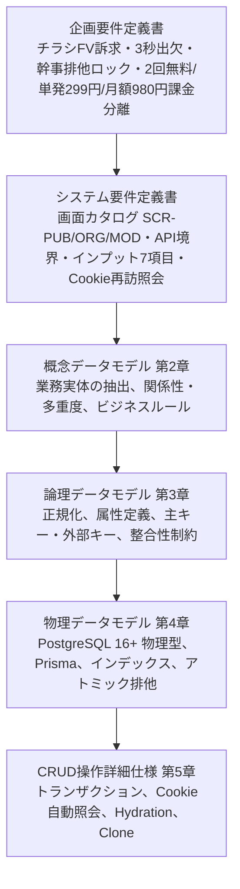
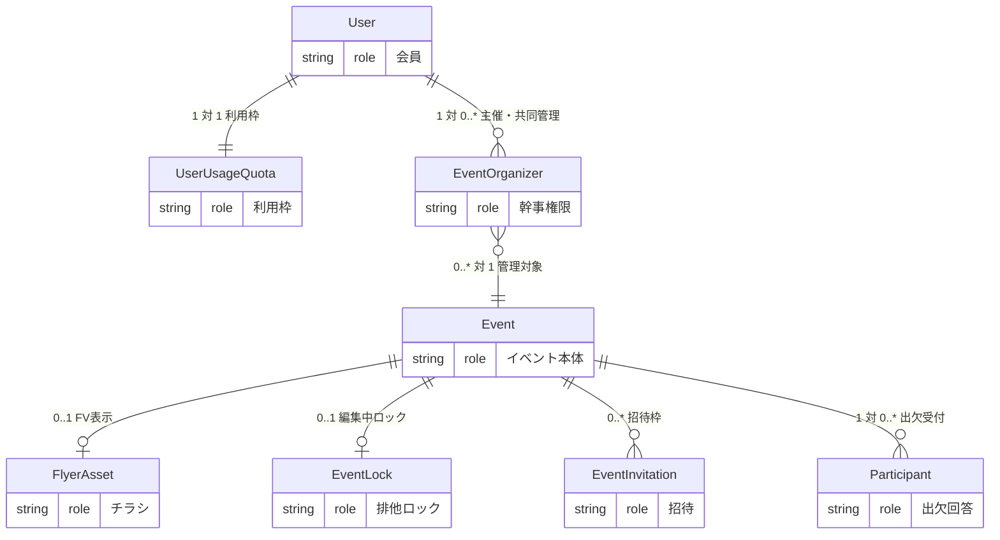

# データモデル設計書＆CRUD仕様書

## チラシファースト型 イベント紹介ページ生成＆出欠管理基盤（概念・論理・物理・CRUD統合）

## 1. 全体アーキテクチャ・設計方針

本ドキュメントは、企画要件定義書およびシステム要件定義書に基づき、イベント管理プラットフォームのデータ構造を「概念データモデル（Conceptual Data Model）」「論理データモデル（Logical Data Model）」「物理データモデル（Physical Data Model）」の3階層で定義し、各エンティティのCRUD（Create / Read / Update / Delete）詳細操作仕様を策定する。



### 1.1. 4大設計基本方針

1. **ハイブリッド・アイデンティティ（段階的会員化）のデータ吸収:**
   * 「未登録（端末Cookie依存）」「ゲスト幹事（暗号化トークン所持）」「認証済み会員（User ID保持）」という3つの利用形態を、テーブル構造を複雑化させずに単一のスキーマ体系で一貫して保持する。
2. **暗号学的トークンハッシュ化によるゼロトラスト設計:**
   * ゲスト幹事トークン、出欠照会トークン、共同幹事招待コードは、DB内に平文で保存せず、すべてSHA-256ハッシュ値として保存する。URL推測攻撃やDBダンプ流出時のなりすましを防止する。
3. **PostgreSQL固有のアトミック排他制御（Pessimistic Lease Lock）:**
   * 共同幹事の同時編集事故（Lost Update）を防ぐため、外部キャッシュ（Redis等）を用いずともPostgreSQLの `ON CONFLICT DO UPDATE WHERE lock_token_hash = :hash` 構文を活用し、DB単体で厳密な原子性（Atomicity）を担保する。ロックは時間で失効しない。
4. **マネタイズ基盤（課金クォータ）との疎結合認可ゲート:**
   * 無料枠（累計2回）、単発クレジット（299円/回）、月額定期購入（980円/月）の状態管理を別テーブル（`user_usage_quotas`）に分離し、イベント作成トランザクションの入口で `canCreateEvent(userId)` ゲートとして評価する。

---

## 2. 概念データモデル（Conceptual Data Model）

業務世界の関心事（ビジネスエンティティ）と、その間に存在する関係性を高水準に定義する。

### 2.1. コア概念（Entities）の抽出と役割

* **ユーザー（User / 認証済み会員）:**
  * プラットフォームにメールアドレス・パスワードで登録した会員。自身が作成・参加したイベントを永続的に一元管理できる。
* **利用枠・課金クォータ（UserUsageQuota）:**
  * 主催者のイベント作成権限（無料消化回数、単発クレジット、有効サブスクリプション）を管理するマネタイズ実体。
* **イベント（Event / 催し物本体）:**
  * 主催者が告知・集客を行う催しの実体。催し名、日時、場所、費用、雨天対応、定員などの属性を持つ。
* **チラシ画像アセット（FlyerAsset）:**
  * 別機能（チラシ生成機能）で生成された、9:16のポスター画像成果物。イベントのファーストビュー（FV）を構成する。チラシが存在しないイベントも許容される。
* **幹事権限（EventOrganizer）:**
  * イベントと主催者を結びつける多対多のリレーション実体。主催幹事（OWNER）および共同幹事（CO_HOST）のロールを保持する。
* **参加者・出欠（Participant）:**
  * イベントに対して出欠意思（参加/不参加）を表明した参加者の実体。会員登録不要で登録でき、端末Cookieトークンによって紐付けられる。
* **排他編集ロック（EventLock）:**
  * イベントの編集画面で発生する複数幹事の同時編集競合を防止する排他ロック実体。
* **共同幹事招待（EventInvitation）:**
  * 既存幹事が他のメンバーを共同幹事として迎えるためのワンタイム招待実体。

### 2.2. 概念ER図（Conceptual ER Diagram）



### 2.3. 主要な概念境界とビジネスルール

1. **チラシ生成機能との疎結合（参照モデル）:**
   * イベント本体はチラシ生成機能を内包せず、生成済みアセットの識別子のみを参照する。チラシ画像が存在しない場合（標準テンプレート適用）でもイベントは成立する。
2. **参加者リストの秘匿性境界（Organizer Isolation）:**
   * 出欠回答（氏名・ステータス・コメント）の詳細リストは、対象イベントの `EventOrganizer` 権限を持つアクターのみが取得可能であり、一般公開画面からは集計数（COUNT）のみが開示される。
3. **段階的アイデンティティ（Progressive Identity）:**
   * 参加者は会員IDを持たずに `Participant` レコードを作成可能。後に会員登録した際、端末トークンをキーとして会員エンティティに昇格・統合される。

---

## 3. 論理データモデル（Logical Data Model）

概念モデルを正規化し、主キー（PK）、外部キー（FK）、属性、データ型、カーディナリティ、整合性制約を定義する。

### 3.1. 正規化プロセス（第1〜第3正規形の検証）

#### 第1正規形（1NF）の達成

* **検証:** すべての属性が単一の不可分な値（アトミック値）を持つこと。
* **対応:** 開催日時は `event_schedules`（日付と時間の組）、費用は `event_price_plans`（プラン名と費用文の組）の子テーブルに分ける。1行にカンマ区切りで複数値を詰めない。雨天対応やステータスは ENUM とする。一覧用の最も早い開催日だけを `events.sort_date` に重複して持つ。

#### 第2正規形（2NF）の達成

* **検証:** すべての非キー属性が主キー全体に完全関数従属すること（部分関数従属の排除）。
* **対応:** 幹事とイベントの多対多リレーションにおいて、複合主キーによる部分従属を避けるため、サロゲートキー（UUID）を持つ `EventOrganizer` エンティティとして独立分離した。

#### 第3正規形（3NF）の達成

* **検証:** 非キー属性間に推移的関数従属が存在しないこと（推移従属の排除）。
* **対応:**
  * 課金状態（無料枠消化数、サブスク状態、クレジット）はユーザー属性に直接埋め込まず、`UserUsageQuota` に分離（ユーザーの基本情報変更が課金情報に影響を与えない）。
  * チラシ画像のURLやアスペクト比は、イベントテーブルに直接持たず `FlyerAsset` エンティティに分離。
  * 出欠人数などの集計値（COUNT）は、更新時の不整合を防ぐため物理カラムとしてキャッシュ保持せず、クエリ実行時の集計として導出する（インデックスで性能を担保）。

### 3.2. 論理エンティティ定義とリレーションシップ

```mermaid
erDiagram
    Users ||--|| UserUsageQuotas : "1:1"
    Users |o--o{ EventOrganizers : "1:N user_idはNullable"
    Users |o--o{ Participants : "0..1:N"
    Events ||--o{ EventOrganizers : "event_id"
    Events ||--o{ Participants : "event_id"
    Events ||--o| EventLocks : "1:0..1"
    Events ||--o{ EventInvitations : "1:N"
    Events }o--o| FlyerAssets : "flyer_asset_id"
    Users {
        uuid user_id PK
        varchar email UK
        string name
        string password_hash
        timestamptz created_at
        timestamptz updated_at
    }
    UserUsageQuotas {
        uuid quota_id PK
        uuid user_id FK UK
        int free_events_used
        bool has_active_subscription
        int paid_credits
    }
    EventOrganizers {
        uuid organizer_id PK
        uuid event_id FK
        uuid user_id FK "Nullable"
        string guest_token_hash UK "Nullable"
        string role
        timestamptz created_at
    }
    Participants {
        uuid participant_id PK
        uuid event_id FK
        uuid user_id FK "Nullable"
        string rsvp_token_hash UK
        string name
        string status
        string comment
        uuid schedule_id FK "Nullable。出席時の日時"
        uuid price_plan_id FK "Nullable。出席時のプラン"
        string ip_hash
        timestamptz created_at
        timestamptz updated_at
    }
    Events {
        uuid event_id PK
        uuid flyer_asset_id FK "Nullable"
        string title
        date sort_date "最も早い開催日"
        string location
        string rain_policy
        int capacity
        string status
        bool is_deleted
    }
    EventSchedules {
        uuid id PK
        uuid event_id FK
        date event_date
        string event_time
        int sort_order
    }
    EventPricePlans {
        uuid id PK
        uuid event_id FK
        string name "プラン名"
        string price
        int sort_order
    }
    EventLocks {
        uuid event_id PK "FK"
        uuid locked_by_user_id FK "Nullable"
        string lock_token_hash UK
        string locked_by_token_hash
        string lock_holder_name
        timestamptz expires_at
        timestamptz updated_at
    }
    EventInvitations {
        uuid invitation_id PK
        uuid event_id FK
        string invite_code_hash UK
        timestamptz expires_at
        bool is_revoked
        timestamptz created_at
    }
    FlyerAssets {
        uuid flyer_asset_id PK
        string external_flyer_id
        string image_url
        string lqip_data_url
        string aspect_ratio
        timestamptz created_at
    }
```

### 3.3. ドメイン定義・論理整合性制約マトリクス

| ドメイン名 / 列挙型 | 許容値 / 形式 | ビジネスルール・制約定義 |
| :---- | :---- | :---- |
| **`RainPolicy`** | `RAIN_OR_SHINE`, `CANCEL_ON_RAIN`, `POSTPONE_ON_RAIN`, `INDOOR` | 雨天決行／雨天中止／雨天順延／屋内開催 |
| **`EventStatus`** | `DRAFT`, `PUBLISHED`, `CLOSED` | 下書き／公開中（出欠受付）／開催終了（受付停止） |
| **`OrganizerRole`** | `OWNER`, `CO_HOST` | OWNER: 作成者（単一）/ CO_HOST: 招待された共同幹事 |
| **`RsvpStatus`** | `ATTENDING`, `DECLINED` | ATTENDING: 参加確定 / DECLINED: 不参加 |
| **`CapacityRule`** | `INTEGER` または `NULL` | NULLの場合は定員無制限。指定時は 1 以上の整数（CHECK制約） |
| **`QuotaRule`** | `free_events_used <= 2` | 無料枠利用は累計2回まで。以降は有料プランの認可が必要 |
| **`LockRule`** | 解放または引き継ぎまで保持 | 排他ロックは時間で失効しない。保持者が解放するか、他の幹事が引き継ぐまで保持される |

---

## 4. 物理データモデル（Physical Data Model）

PostgreSQL 16+ および Prisma ORM を前提とした物理スキーマ仕様を規定する。

### 4.1. 物理ER図（Entity-Relationship Diagram）

```mermaid
erDiagram
    users ||--|| user_usage_quotas : "1 対 1"
    users ||--o{ event_organizers : "1 対 0..*"
    event_organizers }o--|| events : "0..* 対 1"
    flyer_assets |o--|| events : "0..1 対 1"
    events ||--o| event_locks : "1 対 0..1"
    events ||--o{ event_invitations : "1 対 0..*"
    events ||--o{ event_schedules : "1 対 1..8"
    events ||--o{ event_price_plans : "1 対 1..8"
    events ||--o{ participants : "1 対 0..*"
    event_schedules ||--o{ participants : "選択した日時"
    event_price_plans ||--o{ participants : "選択したプラン"
    users {
        uuid id PK
        string email UK
        string name
        string password_hash
        timestamptz created_at
        timestamptz updated_at
    }
    user_usage_quotas {
        uuid id PK
        uuid user_id FK UK
        int free_events_used "INT2"
        bool has_active_subscription
        int paid_credits "INT4"
        timestamptz created_at
        timestamptz updated_at
    }
    event_organizers {
        uuid id PK
        uuid event_id FK
        uuid user_id FK "Nullable"
        string guest_token_hash UK
        string role "VARCHAR(20)"
        timestamptz created_at
    }
    events {
        uuid id PK
        string title "VARCHAR(100)"
        date sort_date "最も早い開催日"
        string location "VARCHAR(150)"
        string rain_policy "VARCHAR(20)"
        int capacity "Nullable"
        uuid flyer_asset_id FK "Nullable"
        string status "VARCHAR(20)"
        bool is_deleted
        timestamptz created_at
        timestamptz updated_at
    }
    flyer_assets {
        uuid id PK
        string external_flyer_id
        string image_url
        string lqip_data_url
        string aspect_ratio
        timestamptz created_at
    }
    event_locks {
        uuid event_id PK "FK"
        uuid locked_by_user_id FK "Nullable"
        string locked_by_token_hash
        string lock_holder_name "VARCHAR(50)"
        string lock_token_hash UK "VARCHAR(64)"
        timestamptz expires_at
        timestamptz updated_at
    }
    event_invitations {
        uuid id PK
        uuid event_id FK
        string invite_code_hash UK "VARCHAR(64)"
        timestamptz expires_at
        bool is_revoked
        timestamptz created_at
    }
    participants {
        uuid id PK
        uuid event_id FK
        uuid user_id FK "Nullable"
        string rsvp_token_hash UK "VARCHAR(64)"
        string name "VARCHAR(50)"
        string status "VARCHAR(20)"
        string comment "Nullable"
        string ip_hash "Nullable"
        timestamptz created_at
        timestamptz updated_at
    }
```

### 4.2. Prisma スキーマ完全定義 (`schema.prisma`)

```text
datasource db {
  provider = "postgresql"
  url      = env("DATABASE_URL")
}

generator client {
  provider = "prisma-client-js"
}

enum RainPolicy {
  RAIN_OR_SHINE     // 雨天決行
  CANCEL_ON_RAIN    // 雨天中止
  POSTPONE_ON_RAIN  // 雨天順延
  INDOOR            // 屋内開催
}

enum EventStatus {
  DRAFT       // 下書き
  PUBLISHED   // 公開中（受付中）
  CLOSED      // 終了・締切
}

enum OrganizerRole {
  OWNER    // 主催幹事（作成者）
  CO_HOST  // 共同幹事
}

enum RsvpStatus {
  ATTENDING // 参加
  DECLINED  // 不参加
}

// -------------------------------------------------------------
// 1. ユーザー＆認証基盤
// -------------------------------------------------------------
model User {
  id           String   @id @default(uuid()) @db.Uuid
  email        String   @unique @db.VarChar(255)
  name         String   @db.VarChar(50)
  passwordHash String   @map("password_hash") @db.VarChar(255)
  createdAt    DateTime @default(now()) @map("created_at") @db.Timestamptz
  updatedAt    DateTime @updatedAt @map("updated_at") @db.Timestamptz
  organizers   EventOrganizer[]
  participants Participant[]
  quota        UserUsageQuota?
  locks        EventLock[]
  @@map("users")
}

// -------------------------------------------------------------
// 2. 利用枠・課金管理（マネタイズ境界）
// -------------------------------------------------------------
model UserUsageQuota {
  id                     String   @id @default(uuid()) @db.Uuid
  userId                 String   @unique @map("user_id") @db.Uuid
  freeEventsUsed         Int      @default(0) @map("free_events_used") @db.SmallInt
  hasActiveSubscription  Boolean  @default(false) @map("has_active_subscription")
  paidCredits            Int      @default(0) @map("paid_credits") @db.Integer
  createdAt              DateTime @default(now()) @map("created_at") @db.Timestamptz
  updatedAt              DateTime @updatedAt @map("updated_at") @db.Timestamptz
  user User @relation(fields: [userId], references: [id], onDelete: Cascade)
  @@map("user_usage_quotas")
}

// -------------------------------------------------------------
// 3. チラシ画像アセット（チラシ生成機能との疎結合連携）
// -------------------------------------------------------------
model FlyerAsset {
  id              String   @id @default(uuid()) @db.Uuid
  externalFlyerId String?  @map("external_flyer_id") @db.VarChar(100)
  imageUrl        String   @map("image_url") @db.Text
  lqipDataUrl     String?  @map("lqip_data_url") @db.Text
  aspectRatio     String   @default("9:16") @map("aspect_ratio") @db.VarChar(10)
  createdAt       DateTime @default(now()) @map("created_at") @db.Timestamptz
  events Event[]
  @@map("flyer_assets")
}

// -------------------------------------------------------------
// 4. イベント本体
// -------------------------------------------------------------
model Event {
  id           String      @id @default(uuid()) @db.Uuid
  title        String      @db.VarChar(100)
  sortDate     DateTime    @map("sort_date") @db.Date
  location     String      @db.VarChar(150)
  rainPolicy   RainPolicy  @default(RAIN_OR_SHINE) @map("rain_policy")
  capacity     Int?        @db.Integer
  flyerAssetId String?     @map("flyer_asset_id") @db.Uuid
  status       EventStatus @default(DRAFT)
  isDeleted    Boolean     @default(false) @map("is_deleted")
  createdAt    DateTime    @default(now()) @map("created_at") @db.Timestamptz
  updatedAt    DateTime    @updatedAt @map("updated_at") @db.Timestamptz
  flyerAsset   FlyerAsset?       @relation(fields: [flyerAssetId], references: [id], onDelete: SetNull)
  schedules    EventSchedule[]
  pricePlans   EventPricePlan[]
  organizers   EventOrganizer[]
  participants Participant[]
  lock         EventLock?
  invitations  EventInvitation[]
  @@index([status, isDeleted, sortDate])
  @@map("events")
}

// -------------------------------------------------------------
// 5. 幹事権限テーブル（会員幹事 ＆ ゲスト幹事ハイブリッド）
// -------------------------------------------------------------
model EventOrganizer {
  id             String        @id @default(uuid()) @db.Uuid
  eventId        String        @map("event_id") @db.Uuid
  userId         String?       @map("user_id") @db.Uuid
  guestTokenHash String?       @unique @map("guest_token_hash") @db.VarChar(64)
  role           OrganizerRole @default(CO_HOST)
  createdAt      DateTime      @default(now()) @map("created_at") @db.Timestamptz
  event Event @relation(fields: [eventId], references: [id], onDelete: Cascade)
  user  User? @relation(fields: [userId], references: [id], onDelete: Cascade)
  @@unique([eventId, userId])
  @@index([userId])
  @@map("event_organizers")
}

// -------------------------------------------------------------
// 6. 出欠・参加者レコード（未登録出欠 ＆ 会員出欠ハイブリッド）
// -------------------------------------------------------------
model Participant {
  id            String     @id @default(uuid()) @db.Uuid
  eventId       String     @map("event_id") @db.Uuid
  userId        String?    @map("user_id") @db.Uuid
  rsvpTokenHash String     @unique @map("rsvp_token_hash") @db.VarChar(64)
  name          String     @db.VarChar(50)
  status        RsvpStatus
  comment       String?    @db.Text
  ipHash        String?    @map("ip_hash") @db.VarChar(64)
  createdAt     DateTime   @default(now()) @map("created_at") @db.Timestamptz
  updatedAt     DateTime   @updatedAt @map("updated_at") @db.Timestamptz
  event Event @relation(fields: [eventId], references: [id], onDelete: Cascade)
  user  User? @relation(fields: [userId], references: [id], onDelete: SetNull)
  @@index([eventId, status])
  @@index([userId])
  @@map("participants")
}

// -------------------------------------------------------------
// 7. 排他編集ロック
// -------------------------------------------------------------
model EventLock {
  eventId            String   @id @map("event_id") @db.Uuid
  lockedByUserId     String?  @map("locked_by_user_id") @db.Uuid
  lockedByTokenHash  String?  @map("locked_by_token_hash") @db.VarChar(64)
  lockHolderName     String   @map("lock_holder_name") @db.VarChar(50)
  lockTokenHash      String   @unique @map("lock_token_hash") @db.VarChar(64)
  updatedAt          DateTime @updatedAt @map("updated_at") @db.Timestamptz
  event Event @relation(fields: [eventId], references: [id], onDelete: Cascade)
  user  User? @relation(fields: [lockedByUserId], references: [id], onDelete: SetNull)
  @@map("event_locks")
}

// -------------------------------------------------------------
// 8. 共同幹事招待
// -------------------------------------------------------------
model EventInvitation {
  id             String   @id @default(uuid()) @db.Uuid
  eventId        String   @map("event_id") @db.Uuid
  inviteCodeHash String   @unique @map("invite_code_hash") @db.VarChar(64)
  expiresAt      DateTime @map("expires_at") @db.Timestamptz
  isRevoked      Boolean  @default(false) @map("is_revoked")
  createdAt      DateTime @default(now()) @map("created_at") @db.Timestamptz
  event Event @relation(fields: [eventId], references: [id], onDelete: Cascade)
  @@index([eventId, isRevoked, expiresAt])
  @@map("event_invitations")
}
```

### 4.3. 物理テーブル詳細設計表

#### `events`（イベント本体テーブル）

| カラム名 | 物理型 | NULL | 初期値 | 制約 | 説明 |
| :---- | :---- | :---: | :---- | :---- | :---- |
| `id` | UUID | NO | `gen_random_uuid()` | PK | イベント公開識別子 |
| `title` | VARCHAR(100) | NO | - | - | 催しの名称 |
| `sort_date` | DATE | NO | - | - | 開催候補のうち最も早い日。一覧の並びと日付インデックス |
| `location` | VARCHAR(150) | NO | - | - | 開催場所 |
| `rain_policy` | VARCHAR(20) | NO | 'RAIN_OR_SHINE' | ENUM | 雨天対応（決行/中止/順延/屋内） |
| `capacity` | INTEGER | YES | NULL | CHECK(>0) | 想定上限人数（定員） |
| `flyer_asset_id` | UUID | YES | NULL | FK | チラシ画像参照（SetNull） |
| `status` | VARCHAR(20) | NO | 'DRAFT' | ENUM | 公開状態（DRAFT/PUBLISHED/CLOSED） |
| `rsvp_deadline` | TIMESTAMPTZ | YES | NULL | - | 申し込み期限。日本時間で入力。この時刻以降は新規出欠と変更を止める。空なら期限なし。`CLOSED` にはしない |
| `is_deleted` | BOOLEAN | NO | FALSE | - | 論理削除フラグ |
| `created_at` | TIMESTAMPTZ | NO | `NOW()` | - | 作成日時 |
| `updated_at` | TIMESTAMPTZ | NO | `NOW()` | - | 更新日時 |

#### `participants`（参加者・出欠テーブル）

| カラム名 | 物理型 | NULL | 初期値 | 制約 | 説明 |
| :---- | :---- | :---: | :---- | :---- | :---- |
| `id` | UUID | NO | `gen_random_uuid()` | PK | 出欠レコードID |
| `event_id` | UUID | NO | - | FK | 対象イベントID（Cascade） |
| `user_id` | UUID | YES | NULL | FK | 会員ID（未登録時NULL、SetNull） |
| `rsvp_token_hash` | VARCHAR(64) | NO | - | UNIQUE | 端末Cookie照会用トークンのSHA-256 |
| `name` | VARCHAR(50) | NO | - | - | 参加者氏名（ニックネーム可） |
| `status` | VARCHAR(20) | NO | - | ENUM | ATTENDING / DECLINED |
| `comment` | TEXT | YES | NULL | - | 追加コメント欄 |
| `schedule_id` | UUID | YES | NULL | FK | 出席時に選んだ開催日時。欠席と候補削除時は NULL（SetNull） |
| `price_plan_id` | UUID | YES | NULL | FK | 出席時に選んだ費用プラン。欠席と候補削除時は NULL（SetNull） |
| `ip_hash` | VARCHAR(64) | YES | NULL | - | スパム防止用IPハッシュ |
| `created_at` | TIMESTAMPTZ | NO | `NOW()` | - | 回答日時 |
| `updated_at` | TIMESTAMPTZ | NO | `NOW()` | - | 変更日時 |

#### `receipts`（参加費の領収書）

出席者1人につき1件。再発行は同じ行を上書きする。金額は幹事が入力する整数円で、参加費の決済は持たない。

| カラム名 | 物理型 | NULL | 初期値 | 制約 | 説明 |
| :---- | :---- | :---: | :---- | :---- | :---- |
| `id` | UUID | NO | `gen_random_uuid()` | PK | 領収書ID |
| `participant_id` | UUID | NO | - | UNIQUE, FK | 対象の出席者（Cascade） |
| `event_id` | UUID | NO | - | FK | 対象イベント（Cascade） |
| `addressee` | VARCHAR(100) | NO | - | - | 宛名 |
| `amount` | INTEGER | NO | - | CHECK(>0) | 金額（円） |
| `description` | VARCHAR(100) | NO | - | - | 但し書き |
| `issuer_name` | VARCHAR(100) | NO | - | - | 発行者名 |
| `issued_at` | TIMESTAMPTZ | NO | `NOW()` | - | 発行日時 |

#### `event_schedules`（開催日時）

1イベントにつき 1〜8 件。件数の上限は API で検証する。

| カラム名 | 物理型 | NULL | 初期値 | 制約 | 説明 |
| :---- | :---- | :---: | :---- | :---- | :---- |
| `id` | UUID | NO | `gen_random_uuid()` | PK | 開催日時ID |
| `event_id` | UUID | NO | - | FK | 対象イベント（Cascade） |
| `event_date` | DATE | NO | - | - | 開催日 |
| `event_time` | VARCHAR(50) | NO | - | - | 開催時間 |
| `sort_order` | INTEGER | NO | - | - | 表示順（0始まり） |

#### `event_price_plans`（費用プラン）

1イベントにつき 1〜8 件。プラン名は同じ対象の中で一意（`(event_id, audience, name)`）。男女別の費用では、男性用と女性用の2件で1組とし、2件として数える。1組の2件は同じプラン名を持ち、画面のプラン名入力は組で1回だけ行う。金額と補足は2件で別々に持てる。

| カラム名 | 物理型 | NULL | 初期値 | 制約 | 説明 |
| :---- | :---- | :---: | :---- | :---- | :---- |
| `id` | UUID | NO | `gen_random_uuid()` | PK | 費用プランID |
| `event_id` | UUID | NO | - | FK | 対象イベント（Cascade） |
| `name` | VARCHAR(50) | NO | - | UNIQUE(event_id, audience, name) | プラン名（例: プランA） |
| `audience` | VARCHAR(10) | NO | `ANY` | ENUM | `ANY`（共通）/ `MALE`（男性用）/ `FEMALE`（女性用） |
| `amount` | INTEGER | NO | 0 | CHECK(>=0) | 金額（円）。0は無料 |
| `note` | VARCHAR(100) | YES | NULL | - | 「1ドリンク付」などの補足 |
| `price` | VARCHAR(50) | YES | NULL | - | 旧・費用文。移行の取りこぼし確認用で、新規・更新では書き込まない |
| `sort_order` | INTEGER | NO | - | - | 表示順（0始まり） |

#### `event_locks`（排他編集排他ロックテーブル）

| カラム名 | 物理型 | NULL | 初期値 | 制約 | 説明 |
| :---- | :---- | :---: | :---- | :---- | :---- |
| `event_id` | UUID | NO | - | PK, FK | 対象イベントID（Cascade） |
| `locked_by_user_id` | UUID | YES | NULL | FK | ロック取得会員ID |
| `locked_by_token_hash` | VARCHAR(64) | YES | NULL | - | ゲスト幹事トークンハッシュ |
| `lock_holder_name` | VARCHAR(50) | NO | - | - | 編集中表示名（「田中さん」等） |
| `lock_token_hash` | VARCHAR(64) | NO | - | UNIQUE | ロック保持検証用シークレットハッシュ |
| `updated_at` | TIMESTAMPTZ | NO | `NOW()` | - | 取得・再確認・引き継ぎの日時 |

---

## 5. CRUD操作詳細仕様（マトリクス＆トランザクション）

### 5.1. CRUDマトリクス（アクター × 操作権限 × エンティティ）

| エンティティ | アクター | C (作成) | R (参照) | U (更新) | D (削除) | 認可・条件規則 |
| :---- | :---- | :---: | :---: | :---: | :---: | :---- |
| **`events`** | 主催幹事 | ○ | ○ | ○ | ○ | `canCreateEvent` 認可、更新時は有効なロック必須 |
|  | 共同幹事 | × | ○ | ○ | × | 編集可能だが削除・複製権限は制限 |
|  | 参加者 | × | ○ | × | × | 公開情報＋参加確定数集計のみ閲覧可 |
| **`participants`** | 参加者 | ○ | ○ | ○ | ○ | 登録ゼロ可。Cookieの `rsvp_token` 一致で自回答のみ照会・変更 |
|  | 幹事（全員） | × | ○ | × | × | 専用管理画面にて全員の氏名・ステータス・コメントを閲覧 |
| **`event_locks`** | 幹事（全員） | ○ | ○ | ○ | ○ | アトミッククエリにより単一幹事のみ取得。時間では失効しない |

---

### 5.2. Events（イベント本体）CRUD 詳細仕様

#### 【Create】イベント新規作成（課金認可ゲート連携）

* **アクター:** 主催幹事（会員 または ゲスト）
* **前提条件:** 課金クォータの認可チェック。
  * 会員: `has_active_subscription == true` または `paid_credits > 0` または `free_events_used < 2`
  * ゲスト: クッキーに紐づく過去作成累計が 2回未満
* **トランザクション内容:**
  1. クォータをチェック＆更新（クレジット消費、または無料消化数インクリメント）。
  2. チラシ画像が指定されている場合、`flyer_assets` を取得または作成してIDをバインド。
  3. `events` テーブルに基本7項目をINSERT。
  4. `event_organizers` テーブルに作成者を OWNER ロールとしてINSERT。ゲスト作成時は生成した `guest_token` のSHA-256ハッシュを格納。
* **TypeScript (Prisma) トランザクション実装:**

```ts
const result = await prisma.$transaction(async (tx) => {
  // 1. 会員クォータ判定＆消費
  if (userId) {
    const quota = await tx.userUsageQuota.findUniqueOrThrow({ where: { userId } });
    if (!quota.hasActiveSubscription) {
      if (quota.paidCredits > 0) {
        await tx.userUsageQuota.update({
          where: { userId },
          data: { paidCredits: { decrement: 1 } },
        });
      } else if (quota.freeEventsUsed < 2) {
        await tx.userUsageQuota.update({
          where: { userId },
          data: { freeEventsUsed: { increment: 1 } },
        });
      } else {
        throw new Error("QUOTA_EXCEEDED"); // 課金モーダル表示へ誘導
      }
    }
  }
  // 2. イベント本体作成
  const event = await tx.event.create({
    data: {
      title: input.title,
      eventDate: new Date(input.eventDate),
      eventTime: input.eventTime,
      price: input.price,
      location: input.location,
      rainPolicy: input.rainPolicy,
      capacity: input.capacity,
      flyerAssetId: input.flyerAssetId || null,
      status: "PUBLISHED",
    },
  });
  // 3. 主催幹事ロール付与
  await tx.eventOrganizer.create({
    data: {
      eventId: event.id,
      userId: userId || null,
      guestTokenHash: guestTokenHash || null,
      role: "OWNER",
    },
  });
  return event;
});
```

#### 【Read】イベント情報の参照（一般公開 vs 主催者一覧）

* **一般公開用参照 (`GET /api/v1/public/events/[id]`):**
  * `WHERE id = :id AND is_deleted = false AND status = 'PUBLISHED'`
  * 取得項目: タイトル、開催日、時間、費用、場所、雨天対応、定員、チラシURL、**現在の参加確定人数（`COUNT(*) FILTER (WHERE status = 'ATTENDING')`）**。
  * ※参加者の個人情報やコメントは一切返却しない。
* **主催者ダッシュボード一覧参照 (`GET /api/v1/organizer/events`):**
  * 幹事自身の `userId` または `guestTokenHash` に紐づくイベント一覧。
  * 各イベントの基本7項目、公開ステータス、定員、**参加数（ATTENDING）および不参加数（DECLINED）の集計値**を結合返却。

#### 【Update】イベント情報の変更（排他ロック保護）

* **アクター:** 主催幹事 または 共同幹事
* **認可条件:**
  1. `assertOrganizer(eventId)`: 対象イベントの幹事権限があること。
  2. `assertLockHolder(eventId, lockToken)`: 送信された `lock_token` のハッシュが `event_locks.lock_token_hash` と一致すること。ロックは時間で失効しない。
* **処理仕様:** 基本7項目およびチラシ参照をUPDATE。

#### 【Delete】イベントの削除

* **削除ポリシー:** 誤操作防止および出欠履歴保護のため、原則 **論理削除（`is_deleted = true`）** を適用。

---

### 5.3. Participants（出欠・参加者）CRUD 詳細仕様

#### 【Create】未登録出欠登録（Zero-Friction RSVP）

* **アクター:** 参加者（会員登録不要）
* **入力項目:** 参加可否 (`status`: ATTENDING/DECLINED)、名前 (`name`)、追加コメント (`comment`)。
* **処理仕様:**
  1. サーバー側で推測困難なランダム文字列 `raw_rsvp_token`（NanoID 32文字）を生成。
  2. `rsvp_token_hash = SHA256(raw_rsvp_token)` を算出。
  3. `participants` テーブルにINSERT。
  4. レスポンスヘッダーに `Set-Cookie: rsvp_token_<eventId>=<raw_rsvp_token>; HttpOnly; Secure; SameSite=Lax; Max-Age=2592000` を付与（30日間有効）。

#### 【Read】端末再訪時の出欠自動照会

* **トリガー:** 参加者が公開イベントページにアクセス。
* **照会ロジック:**
  1. Cookieから `rsvp_token_<eventId>` を取得。
  2. ハッシュ値を算出し、`SELECT * FROM participants WHERE event_id = :eventId AND rsvp_token_hash = :hash` を実行。
  3. 回答が存在する場合、公開イベントデータに `myRsvp: { id, name, status, comment }` を添付し、画面の出欠フォームに自動プリフィル。

#### 【Update】出欠回答の変更

* **認可条件:** Cookie内の `rsvp_token` のハッシュが一致すること（名前の一致ではなくトークンの一致でのみ更新認可）。
* **処理仕様:** `status`, `name`, `comment`, `updated_at` をUPDATE。

---

### 5.4. EventLocks（排他編集排他ロック）CRUD 詳細仕様

PostgreSQLのアトミック操作を活用し、分散環境でも外部キャッシュなしで競合を完全に遮断する。

#### 【Create / Update】排他ロックの取得・再確認

* **アクター:** 編集画面を開いた幹事
* **SQL仕様 (Raw SQL):**

```sql
INSERT INTO event_locks (
  event_id,
  locked_by_user_id,
  locked_by_token_hash,
  lock_holder_name,
  lock_token_hash,
  updated_at
) VALUES (
  :eventId,
  :userId,
  :tokenHash,
  :holderName,
  :newLockTokenHash,
  NOW()
)
ON CONFLICT (event_id) DO UPDATE
SET
  locked_by_user_id    = EXCLUDED.locked_by_user_id,
  locked_by_token_hash = EXCLUDED.locked_by_token_hash,
  lock_holder_name     = EXCLUDED.lock_holder_name,
  lock_token_hash      = EXCLUDED.lock_token_hash,
  updated_at           = NOW()
WHERE
  event_locks.lock_token_hash = :currentLockTokenHash;  -- 自身の再確認だけを許可
```

* **競合ハンドリング:**
  * 更新行数が 0 だった場合、他幹事が有効なロックを保持中。
  * APIは **HTTP 409 Conflict** を返し、現在の保持者名（`lock_holder_name`）と残り有効秒数を返却する。

#### 【Update (Takeover)】緊急時の強制引き継ぎ

* **SQL仕様:** `WHERE` 句の制約をバイパスし、無条件に `lock_token_hash` と `holderName` を自身に上書き更新する。

#### 【Delete】ロックの明示的解放

* **トリガー:** 保存完了、編集キャンセル、画面離脱（`sendBeacon`）。
* **SQL仕様:** `DELETE FROM event_locks WHERE event_id = :eventId AND lock_token_hash = :lockTokenHash;`

---

### 5.5. アカウント統合（Account Merging / Hydration）トランザクション

未登録状態で出欠登録やイベント作成を行っていたゲストユーザーが会員登録（またはログイン）した際、端末Cookie内のトークン履歴を会員アカウントに紐付ける。

```ts
export async function hydrateAccount(
  userId: string,
  rsvpTokens: string[],
  guestEventTokens: string[]
) {
  return await prisma.$transaction(async (tx) => {
    // 1. 端末内の出欠トークンハッシュを計算して会員IDをバインド
    if (rsvpTokens.length > 0) {
      const rsvpHashes = rsvpTokens.map((t) => sha256(t));
      await tx.participant.updateMany({
        where: {
          rsvpTokenHash: { in: rsvpHashes },
          userId: null,
        },
        data: {
          userId: userId,
        },
      });
    }
    // 2. 端末内のゲスト幹事トークンハッシュを計算して会員IDをバインド
    if (guestEventTokens.length > 0) {
      const guestHashes = guestEventTokens.map((t) => sha256(t));
      await tx.eventOrganizer.updateMany({
        where: {
          guestTokenHash: { in: guestHashes },
          userId: null,
        },
        data: {
          userId: userId,
          guestTokenHash: null, // 会員昇格に伴いゲストトークンを無効化
        },
      });
    }
    return { success: true };
  });
}
```

---

### 5.6. イベント複製（Clone）トランザクション

主催者が過去のイベント資産を再利用し、ワンクリックで新規イベントを作成する。

```ts
export async function cloneEvent(sourceEventId: string, currentUserId: string) {
  return await prisma.$transaction(async (tx) => {
    // 1. コピー元のイベント情報取得
    const source = await tx.event.findUniqueOrThrow({
      where: { id: sourceEventId, isDeleted: false },
      include: { flyerAsset: true },
    });
    // 2. 新規イベントレコード作成（出欠・ロック情報は引き継がない）
    const newEvent = await tx.event.create({
      data: {
        title: `${source.title} (コピー)`,
        eventDate: source.eventDate,
        eventTime: source.eventTime,
        price: source.price,
        location: source.location,
        rainPolicy: source.rainPolicy,
        capacity: source.capacity,
        flyerAssetId: source.flyerAssetId,
        status: "DRAFT",
      },
    });
    // 3. 複製実行者をオーナーとして登録
    await tx.eventOrganizer.create({
      data: {
        eventId: newEvent.id,
        userId: currentUserId,
        role: "OWNER",
      },
    });
    return newEvent;
  });
}
```