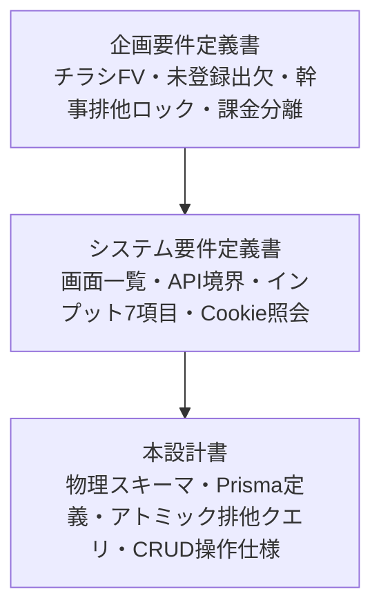

# データベース物理設計・CRUD仕様書

## チラシファースト型 イベント紹介ページ生成＆出欠管理基盤（Flyer-Driven Event Page & Frictionless RSVP）

## 1. 全体アーキテクチャ・設計方針

本ドキュメントは、システム要件定義書および企画要件定義書に基づき、リレーショナルデータベース（PostgreSQL 16+）における物理テーブル構造、データ整合性制約、および各エンティティのCRUD（Create / Read / Update / Delete）詳細操作仕様を定義する。



### 1.1. 基本方針

1. **ハイブリッド認証のデータモデル吸収:**
   * 「未登録（端末Cookie依存）」「ゲスト幹事（トークン保持）」「認証済み会員（User ID保持）」の3層状態を単一のスキーマで破綻なく表現する。
2. **セキュリティ＆暗号学的トークンハッシュ化:**
   * ゲスト幹事トークン、出欠照会トークン、共同幹事招待コードは、DB内に平文で保存せず、すべてSHA-256ハッシュ値として保存する。URL推測攻撃やDBダンプ流出時のなりすましを防止する。
3. **PostgreSQL固有のアトミック排他制御（Pessimistic Lease Lock）:**
   * 共同幹事の同時編集事故を防ぐため、外部キャッシュ（Redis等）を用いずともPostgreSQLの `ON CONFLICT DO UPDATE WHERE lock_token_hash = :hash` 構文を活用し、DBレベルで厳密な原子性（Atomicity）を担保する。ロックは時間で失効しない。
4. **段階的会員化（Account Merging / Hydration）のトランザクション保証:**
   * 匿名状態で行われた出欠登録やイベント作成履歴を、後から会員登録したアカウントにワンショットで安全に紐付けるデータ統合トランザクションを定義する。

---

## 2. ER図（Entity-Relationship Diagram）

```mermaid
erDiagram
    Users ||--|| UserUsageQuotas : "1 対 1"
    Users ||--o{ EventOrganizers : "1 対 0..*"
    EventOrganizers }o--|| Events : "0..* 対 1"
    FlyerAssets |o--|| Events : "0..1 対 1"
    Events ||--o| EventLocks : "1 対 0..1"
    Events ||--o{ EventInvitations : "1 対 0..*"
    Events ||--o{ Participants : "1 対 0..*"
    Users {
        uuid id PK
        string email UK
        string name
        string password_hash
        timestamptz created_at
    }
    UserUsageQuotas {
        uuid id PK
        uuid user_id FK UK
        int free_events_used "最大2"
        bool has_active_subscription
        int paid_credits
    }
    EventOrganizers {
        uuid id PK
        uuid event_id FK
        uuid user_id FK "Nullable"
        string guest_token_hash UK
        string role "OWNER / CO_HOST"
        timestamptz created_at
    }
    Events {
        uuid id PK
        string title "VARCHAR(100)"
        date sort_date
        string location "VARCHAR(255) 表示用に合成"
        string postal_code "VARCHAR(7) Nullable"
        string prefecture "VARCHAR(20) Nullable"
        string city "VARCHAR(100) Nullable"
        string town "VARCHAR(100) Nullable"
        string address_line "VARCHAR(200) Nullable"
        string building "VARCHAR(150) Nullable"
        string venue_name "VARCHAR(150) Nullable"
        string rain_policy
        int capacity "Nullable"
        uuid flyer_asset_id FK "Nullable"
        string status "DRAFT / PUBLISHED / CLOSED"
        bool is_deleted
        timestamptz created_at
        timestamptz updated_at
    }
    EventSchedules {
        uuid id PK
        uuid event_id FK
        date event_date
        string event_time "VARCHAR(50) 表示用に合成"
        string start_time "VARCHAR(5) Nullable"
        string end_time "VARCHAR(5) Nullable"
        int sort_order
    }
    EventPricePlans {
        uuid id PK
        uuid event_id FK
        string name "VARCHAR(50)"
        string audience "ANY / MALE / FEMALE"
        int amount "円。0 は無料"
        string note "VARCHAR(100) Nullable"
        string price "VARCHAR(50) Nullable 旧データ用"
        int sort_order
    }
    FlyerAssets {
        uuid id PK
        string external_flyer_id
        string image_url
        string lqip_data_url
        string aspect_ratio
        timestamptz created_at
    }
    EventLocks {
        uuid event_id PK "FK"
        uuid locked_by_user_id FK "Nullable"
        string locked_by_token_hash
        string lock_holder_name "VARCHAR(50)"
        string lock_token_hash UK "VARCHAR(64)"
        timestamptz expires_at
        timestamptz updated_at
    }
    EventInvitations {
        uuid id PK
        uuid event_id FK
        string invite_code_hash UK "VARCHAR(64)"
        timestamptz expires_at
        bool is_revoked
        timestamptz created_at
    }
    Participants {
        uuid id PK
        uuid event_id FK
        uuid user_id FK "Nullable"
        string rsvp_token_hash UK "VARCHAR(64)"
        string name "VARCHAR(50)"
        string gender "MALE / FEMALE, Nullable"
        string status "ATTENDING / DECLINED"
        string comment "Nullable"
        string ip_hash "Nullable"
        timestamptz created_at
        timestamptz updated_at
    }
```

---

## 3. Prisma スキーマ完全定義 (`schema.prisma`)

```text
datasource db {
  provider = "postgresql"
  url      = env("DATABASE_URL")
}

generator client {
  provider = "prisma-client-js"
}

enum RainPolicy {
  RAIN_OR_SHINE     // 雨天決行
  CANCEL_ON_RAIN    // 雨天中止
  POSTPONE_ON_RAIN  // 雨天順延
  INDOOR            // 屋内開催
}

enum EventStatus {
  DRAFT       // 下書き
  PUBLISHED   // 公開中
  CLOSED      // 終了・締切
}

enum EventVisibility {
  PUBLIC    // ホーム公開
  UNLISTED  // 紹介制。新規の既定
}

enum OrganizerRole {
  OWNER    // 主催幹事（作成者）
  CO_HOST  // 共同幹事
}

enum RsvpStatus {
  ATTENDING // 参加
  DECLINED  // 不参加
}

// -------------------------------------------------------------
// 1. ユーザー＆認証基盤
// -------------------------------------------------------------
model User {
  id           String   @id @default(uuid()) @db.Uuid
  email        String   @unique @db.VarChar(255)
  name         String   @db.VarChar(50)
  passwordHash String   @map("password_hash") @db.VarChar(255)
  createdAt    DateTime @default(now()) @map("created_at") @db.Timestamptz
  updatedAt    DateTime @updatedAt @map("updated_at") @db.Timestamptz
  organizers   EventOrganizer[]
  participants Participant[]
  quota        UserUsageQuota?
  locks        EventLock[]
  @@map("users")
}

// -------------------------------------------------------------
// 2. 利用枠・課金管理（マネタイズ境界）
// -------------------------------------------------------------
model UserUsageQuota {
  id                     String   @id @default(uuid()) @db.Uuid
  userId                 String   @unique @map("user_id") @db.Uuid
  freeEventsUsed         Int      @default(0) @map("free_events_used") @db.SmallInt
  hasActiveSubscription  Boolean  @default(false) @map("has_active_subscription")
  paidCredits            Int      @default(0) @map("paid_credits") @db.Integer
  createdAt              DateTime @default(now()) @map("created_at") @db.Timestamptz
  updatedAt              DateTime @updatedAt @map("updated_at") @db.Timestamptz
  user User @relation(fields: [userId], references: [id], onDelete: Cascade)
  @@map("user_usage_quotas")
}

// -------------------------------------------------------------
// 3. チラシ画像アセット（チラシ生成機能との疎結合連携）
// -------------------------------------------------------------
model FlyerAsset {
  id              String   @id @default(uuid()) @db.Uuid
  externalFlyerId String?  @map("external_flyer_id") @db.VarChar(100) // チラシ生成機能のアセットID
  imageUrl        String   @map("image_url") @db.Text
  lqipDataUrl     String?  @map("lqip_data_url") @db.Text             // 低解像度プレビュー
  aspectRatio     String   @default("9:16") @map("aspect_ratio") @db.VarChar(10)
  createdAt       DateTime @default(now()) @map("created_at") @db.Timestamptz
  events Event[]
  @@map("flyer_assets")
}

// -------------------------------------------------------------
// 4. イベント本体
// -------------------------------------------------------------
model Event {
  id           String      @id @default(uuid()) @db.Uuid
  title        String      @db.VarChar(100)
  sortDate     DateTime    @map("sort_date") @db.Date
  location     String      @db.VarChar(255)
  postalCode   String?     @map("postal_code") @db.VarChar(7)
  prefecture   String?     @db.VarChar(20)
  city         String?     @db.VarChar(100)
  town         String?     @db.VarChar(100)
  addressLine  String?     @map("address_line") @db.VarChar(200)
  building     String?     @db.VarChar(150)
  venueName    String?     @map("venue_name") @db.VarChar(150)
  rainPolicy   RainPolicy  @default(RAIN_OR_SHINE) @map("rain_policy")
  capacity     Int?        @db.Integer
  flyerAssetId String?     @map("flyer_asset_id") @db.Uuid
  status       EventStatus @default(DRAFT)
  /// 将来のメディアサイト向けの予約列。いまのアプリは常に UNLISTED。
  visibility   EventVisibility @default(UNLISTED)
  isDeleted    Boolean     @default(false) @map("is_deleted")
  createdAt    DateTime    @default(now()) @map("created_at") @db.Timestamptz
  updatedAt    DateTime    @updatedAt @map("updated_at") @db.Timestamptz
  flyerAsset   FlyerAsset?       @relation(fields: [flyerAssetId], references: [id], onDelete: SetNull)
  organizers   EventOrganizer[]
  participants Participant[]
  lock         EventLock?
  invitations  EventInvitation[]
  schedules    EventSchedule[]
  pricePlans   EventPricePlan[]
  @@index([status, isDeleted, sortDate])
  @@map("events")
}

// 開催日時。開始・終了を分けて持ち、eventTime は表示用に合成する。
model EventSchedule {
  id        String   @id @default(uuid()) @db.Uuid
  eventId   String   @map("event_id") @db.Uuid
  eventDate DateTime @map("event_date") @db.Date
  eventTime String   @map("event_time") @db.VarChar(50)
  startTime String?  @map("start_time") @db.VarChar(5)
  endTime   String?  @map("end_time") @db.VarChar(5)
  sortOrder Int      @map("sort_order")
  event     Event    @relation(fields: [eventId], references: [id], onDelete: Cascade)
  @@index([eventId, sortOrder])
  @@map("event_schedules")
}

// 費用プラン。audience で男女別、amount は整数の円（0 は無料）。
model EventPricePlan {
  id        String        @id @default(uuid()) @db.Uuid
  eventId   String        @map("event_id") @db.Uuid
  name      String        @db.VarChar(50)
  audience  PriceAudience @default(ANY)
  amount    Int           @default(0) @db.Integer
  note      String?       @db.VarChar(100)
  price     String?       @db.VarChar(50) // 旧データ用。新規・更新では書き込まない
  sortOrder Int           @map("sort_order")
  event     Event         @relation(fields: [eventId], references: [id], onDelete: Cascade)
  @@unique([eventId, audience, name])
  @@index([eventId, sortOrder])
  @@map("event_price_plans")
}

// -------------------------------------------------------------
// 5. 幹事リレーション（会員幹事 ＆ ゲスト幹事ハイブリッド）
// -------------------------------------------------------------
model EventOrganizer {
  id             String        @id @default(uuid()) @db.Uuid
  eventId        String        @map("event_id") @db.Uuid
  userId         String?       @map("user_id") @db.Uuid
  guestTokenHash String?       @unique @map("guest_token_hash") @db.VarChar(64) // 未登録幹事用トークン(SHA-256)
  role           OrganizerRole @default(CO_HOST)
  createdAt      DateTime      @default(now()) @map("created_at") @db.Timestamptz
  event Event @relation(fields: [eventId], references: [id], onDelete: Cascade)
  user  User? @relation(fields: [userId], references: [id], onDelete: Cascade)
  @@unique([eventId, userId])
  @@index([userId])
  @@map("event_organizers")
}

// -------------------------------------------------------------
// 6. 出欠・参加者レコード（未登録出欠 ＆ 会員出欠ハイブリッド）
// -------------------------------------------------------------
model Participant {
  id            String     @id @default(uuid()) @db.Uuid
  eventId       String     @map("event_id") @db.Uuid
  userId        String?    @map("user_id") @db.Uuid
  rsvpTokenHash String     @unique @map("rsvp_token_hash") @db.VarChar(64) // 端末Cookie照会用(SHA-256)
  name          String     @db.VarChar(50)
  gender        Gender?
  status        RsvpStatus
  comment       String?    @db.Text
  ipHash        String?    @map("ip_hash") @db.VarChar(64)
  createdAt     DateTime   @default(now()) @map("created_at") @db.Timestamptz
  updatedAt     DateTime   @updatedAt @map("updated_at") @db.Timestamptz
  event Event @relation(fields: [eventId], references: [id], onDelete: Cascade)
  user  User? @relation(fields: [userId], references: [id], onDelete: SetNull)
  @@index([eventId, status])
  @@index([userId])
  @@map("participants")
}

// -------------------------------------------------------------
// 7. 排他編集ロック
// -------------------------------------------------------------
model EventLock {
  eventId            String   @id @map("event_id") @db.Uuid
  lockedByUserId     String?  @map("locked_by_user_id") @db.Uuid
  lockedByTokenHash  String?  @map("locked_by_token_hash") @db.VarChar(64)
  lockHolderName     String   @map("lock_holder_name") @db.VarChar(50)
  lockTokenHash      String   @unique @map("lock_token_hash") @db.VarChar(64)
  updatedAt          DateTime @updatedAt @map("updated_at") @db.Timestamptz
  event Event @relation(fields: [eventId], references: [id], onDelete: Cascade)
  user  User? @relation(fields: [lockedByUserId], references: [id], onDelete: SetNull)
  @@map("event_locks")
}

// -------------------------------------------------------------
// 8. 共同幹事招待
// -------------------------------------------------------------
model EventInvitation {
  id             String   @id @default(uuid()) @db.Uuid
  eventId        String   @map("event_id") @db.Uuid
  inviteCodeHash String   @unique @map("invite_code_hash") @db.VarChar(64)
  expiresAt      DateTime @map("expires_at") @db.Timestamptz
  isRevoked      Boolean  @default(false) @map("is_revoked")
  createdAt      DateTime @default(now()) @map("created_at") @db.Timestamptz
  event Event @relation(fields: [eventId], references: [id], onDelete: Cascade)
  @@index([eventId, isRevoked, expiresAt])
  @@map("event_invitations")
}
```

---

## 4. テーブル物理設計書

### 4.1. `users`（会員テーブル）

| カラム名 | 物理型 | NULL | デフォルト値 | 制約 | 説明 |
| :---- | :---- | :---: | :---- | :---- | :---- |
| `id` | UUID | NO | `gen_random_uuid()` | PK | ユーザー内部識別子 |
| `email` | VARCHAR(255) | NO | - | UNIQUE | メールアドレス（ログインID） |
| `name` | VARCHAR(50) | NO | - | - | 表示名 / 幹事名 |
| `password_hash` | VARCHAR(255) | NO | - | - | bcryptハッシュ済みパスワード |
| `created_at` | TIMESTAMPTZ | NO | `NOW()` | - | レコード作成日時 |
| `updated_at` | TIMESTAMPTZ | NO | `NOW()` | - | レコード更新日時 |

### 4.2. `user_usage_quotas`（利用枠・課金管理テーブル）

| カラム名 | 物理型 | NULL | デフォルト値 | 制約 | 説明 |
| :---- | :---- | :---: | :---- | :---- | :---- |
| `id` | UUID | NO | `gen_random_uuid()` | PK | レコードID |
| `user_id` | UUID | NO | - | FK, UNIQUE | 会員ID（Cascade削除） |
| `free_events_used` | SMALLINT | NO | 0 | CHECK(>=0) | 無料作成の累計消化回数（上限2回） |
| `has_active_subscription` | BOOLEAN | NO | FALSE | - | 月額980円サブスク加入中フラグ |
| `paid_credits` | INTEGER | NO | 0 | CHECK(>=0) | 単発購入済み作成クレジット（299円/回） |
| `created_at` | TIMESTAMPTZ | NO | `NOW()` | - | 作成日時 |
| `updated_at` | TIMESTAMPTZ | NO | `NOW()` | - | 更新日時 |

### 4.3. `flyer_assets`（チラシ画像アセットテーブル）

| カラム名 | 物理型 | NULL | デフォルト値 | 制約 | 説明 |
| :---- | :---- | :---: | :---- | :---- | :---- |
| `id` | UUID | NO | `gen_random_uuid()` | PK | アセットID |
| `external_flyer_id` | VARCHAR(100) | YES | NULL | - | 別機能（チラシ生成）の参照キー |
| `image_url` | TEXT | NO | - | - | 最適化済みWebP画像URL（CDN） |
| `lqip_data_url` | TEXT | YES | NULL | - | Blur-up用超軽量Base64プレビュー |
| `aspect_ratio` | VARCHAR(10) | NO | '9:16' | - | アスペクト比 |
| `created_at` | TIMESTAMPTZ | NO | `NOW()` | - | 作成日時 |

### 4.4. `events`（イベント本体テーブル）

| カラム名 | 物理型 | NULL | デフォルト値 | 制約 | 説明 |
| :---- | :---- | :---: | :---- | :---- | :---- |
| `id` | UUID | NO | `gen_random_uuid()` | PK | 公開用イベント識別子 |
| `title` | VARCHAR(100) | NO | - | - | 催しの名前 |
| `sort_date` | DATE | NO | - | - | 開催候補のうち最も早い日。並び替えと期限判定に使う |
| `location` | VARCHAR(255) | NO | - | - | 表示用の開催場所。構造化住所から合成する |
| `postal_code` | VARCHAR(7) | YES | NULL | - | 郵便番号（数字7桁） |
| `prefecture` | VARCHAR(20) | YES | NULL | - | 都道府県 |
| `city` | VARCHAR(100) | YES | NULL | - | 市区町村 |
| `town` | VARCHAR(100) | YES | NULL | - | 町域 |
| `address_line` | VARCHAR(200) | YES | NULL | - | 丁目・番地・号 |
| `building` | VARCHAR(150) | YES | NULL | - | 建物名・階数 |
| `venue_name` | VARCHAR(150) | YES | NULL | - | 会場名 |
| `rain_policy` | VARCHAR(20) | NO | 'RAIN_OR_SHINE' | ENUM | 雨天対応（決行/中止/順延/屋内） |
| `capacity` | INTEGER | YES | NULL | CHECK(>0) | 想定上限人数（定員） |
| `flyer_asset_id` | UUID | YES | NULL | FK | チラシ画像アセット（SetNull） |
| `status` | VARCHAR(20) | NO | 'DRAFT' | ENUM | 公開状態（DRAFT/PUBLISHED/CLOSED） |
| `rsvp_deadline` | TIMESTAMPTZ | YES | NULL | - | 申し込み期限。この時刻以降は新規出欠と変更を止める。空なら期限なし |
| `is_deleted` | BOOLEAN | NO | FALSE | - | 論理削除フラグ |
| `created_at` | TIMESTAMPTZ | NO | `NOW()` | - | 作成日時 |
| `updated_at` | TIMESTAMPTZ | NO | `NOW()` | - | 更新日時 |

### 4.4b. `event_schedules`（開催日時。1〜8件）

| カラム名 | 物理型 | NULL | デフォルト値 | 制約 | 説明 |
| :---- | :---- | :---: | :---- | :---- | :---- |
| `id` | UUID | NO | `gen_random_uuid()` | PK | 開催候補ID |
| `event_id` | UUID | NO | - | FK | 対象イベントID（Cascade） |
| `event_date` | DATE | NO | - | - | 開催日 |
| `event_time` | VARCHAR(50) | NO | - | - | 表示用に合成した開催時間（例: 19:00〜21:30、22:00〜翌02:00） |
| `start_time` | VARCHAR(5) | YES | NULL | - | 開始時刻（HH:mm）。旧データはNULL |
| `end_time` | VARCHAR(5) | YES | NULL | - | 終了時刻（HH:mm）。開始より前なら翌日扱い |
| `sort_order` | INTEGER | NO | - | - | 表示順 |

開始と終了が同じ時刻の組み合わせは API が 400 で拒否する。

### 4.4c. `event_price_plans`（費用プラン。1〜8件）

| カラム名 | 物理型 | NULL | デフォルト値 | 制約 | 説明 |
| :---- | :---- | :---: | :---- | :---- | :---- |
| `id` | UUID | NO | `gen_random_uuid()` | PK | プランID |
| `event_id` | UUID | NO | - | FK | 対象イベントID（Cascade） |
| `name` | VARCHAR(50) | NO | - | UNIQUE(event_id, audience) | プラン名 |
| `audience` | VARCHAR(10) | NO | 'ANY' | ENUM | ANY（共通）/ MALE / FEMALE |
| `amount` | INTEGER | NO | 0 | CHECK(>=0) | 金額（円）。0は無料 |
| `note` | VARCHAR(100) | YES | NULL | - | 「1ドリンク付」などの補足 |
| `price` | VARCHAR(50) | YES | NULL | - | 旧・費用文。移行の取りこぼし確認用で、新規・更新では書き込まない |
| `sort_order` | INTEGER | NO | - | - | 表示順 |

出席の回答は、参加者の性別と `audience` が一致する（または `ANY` の）プランだけを選べる。

### 4.5. `event_organizers`（幹事権限テーブル）

| カラム名 | 物理型 | NULL | デフォルト値 | 制約 | 説明 |
| :---- | :---- | :---: | :---- | :---- | :---- |
| `id` | UUID | NO | `gen_random_uuid()` | PK | 幹事レコードID |
| `event_id` | UUID | NO | - | FK | 対象イベントID |
| `user_id` | UUID | YES | NULL | FK | 会員幹事のUser ID |
| `guest_token_hash` | VARCHAR(64) | YES | NULL | UNIQUE | ゲスト幹事トークンのSHA-256ハッシュ |
| `role` | VARCHAR(20) | NO | 'CO_HOST' | ENUM | OWNER（主催者）/ CO_HOST（共同） |
| `created_at` | TIMESTAMPTZ | NO | `NOW()` | - | 付与日時 |

### 4.6. `participants`（参加者・出欠テーブル）

| カラム名 | 物理型 | NULL | デフォルト値 | 制約 | 説明 |
| :---- | :---- | :---: | :---- | :---- | :---- |
| `id` | UUID | NO | `gen_random_uuid()` | PK | 出欠レコードID |
| `event_id` | UUID | NO | - | FK | 対象イベントID |
| `user_id` | UUID | YES | NULL | FK | 会員ID（未登録時はNULL） |
| `rsvp_token_hash` | VARCHAR(64) | NO | - | UNIQUE | 端末照会用トークンのSHA-256ハッシュ |
| `name` | VARCHAR(50) | NO | - | - | 参加者氏名（ニックネーム可） |
| `gender` | VARCHAR(10) | YES | NULL | ENUM | MALE / FEMALE。出席時に必須。旧データはNULL |
| `status` | VARCHAR(20) | NO | - | ENUM | ATTENDING（参加）/ DECLINED（不参加） |
| `comment` | TEXT | YES | NULL | - | 追加コメント欄 |
| `ip_hash` | VARCHAR(64) | YES | NULL | - | 連打・スパム防止用IPハッシュ |
| `created_at` | TIMESTAMPTZ | NO | `NOW()` | - | 登録日時 |
| `updated_at` | TIMESTAMPTZ | NO | `NOW()` | - | 変更日時 |

### 4.7. `event_locks`（排他編集排他ロックテーブル）

| カラム名 | 物理型 | NULL | デフォルト値 | 制約 | 説明 |
| :---- | :---- | :---: | :---- | :---- | :---- |
| `event_id` | UUID | NO | - | PK, FK | 対象イベントID（1イベント1ロック） |
| `locked_by_user_id` | UUID | YES | NULL | FK | ロック取得会員ID（会員時） |
| `locked_by_token_hash` | VARCHAR(64) | YES | NULL | - | ロック取得幹事トークンハッシュ（ゲスト時） |
| `lock_holder_name` | VARCHAR(50) | NO | - | - | 編集中表示名（例: "田中さん"） |
| `lock_token_hash` | VARCHAR(64) | NO | - | UNIQUE | 保持権検証用シークレットハッシュ |
| `updated_at` | TIMESTAMPTZ | NO | `NOW()` | - | 取得・再確認・引き継ぎの日時 |

### 4.8. `event_invitations`（共同幹事招待テーブル）

| カラム名 | 物理型 | NULL | デフォルト値 | 制約 | 説明 |
| :---- | :---- | :---: | :---- | :---- | :---- |
| `id` | UUID | NO | `gen_random_uuid()` | PK | 招待レコードID |
| `event_id` | UUID | NO | - | FK | 対象イベントID |
| `invite_code_hash` | VARCHAR(64) | NO | - | UNIQUE | 招待URLに含まれるコードのSHA-256 |
| `expires_at` | TIMESTAMPTZ | NO | - | - | 招待有効期限（発行から7日間等） |
| `is_revoked` | BOOLEAN | NO | FALSE | - | 手動失効フラグ |
| `created_at` | TIMESTAMPTZ | NO | `NOW()` | - | 発行日時 |

---

## 5. CRUD操作詳細仕様（マトリクス＆トランザクション）

### 5.1. Events（イベント本体）CRUD

#### 【Create】イベント新規作成（課金認可チェック連携）

* **アクター:** 主催幹事（会員 または ゲスト）
* **前提条件:** 課金認可ゲート判定（会員の場合：`hasActiveSubscription == true` または `paidCredits > 0` または `freeEventsUsed < 2`）。
* **トランザクション内容:**
  1. 会員の場合、クォータをチェック＆更新（クレジット消費、または無料利用カウント+1）。
  2. チラシ画像が指定されている場合、`flyer_assets` を取得または作成してIDをバインド。
  3. `events` テーブルに基本7項目（title, event_date, event_time, price, location, rain_policy, capacity）をINSERT。
  4. `event_organizers` テーブルに作成者を OWNER ロールとしてINSERT。ゲスト作成時は生成した `guest_token` のSHA-256ハッシュを格納。
* **Prismaクエリ例:**

```ts
const result = await prisma.$transaction(async (tx) => {
  // 1. 会員クォータ消費（会員の場合）
  if (userId) {
    const quota = await tx.userUsageQuota.findUniqueOrThrow({ where: { userId } });
    if (!quota.hasActiveSubscription) {
      if (quota.paidCredits > 0) {
        await tx.userUsageQuota.update({
          where: { userId },
          data: { paidCredits: { decrement: 1 } },
        });
      } else if (quota.freeEventsUsed < 2) {
        await tx.userUsageQuota.update({
          where: { userId },
          data: { freeEventsUsed: { increment: 1 } },
        });
      } else {
        throw new Error("QUOTA_EXCEEDED"); // 課金モーダル表示へ誘導
      }
    }
  }
  // 2. イベント作成
  const event = await tx.event.create({
    data: {
      title: input.title,
      // 住所は構造化して保存し、location は表示用に合成する。
      location: composeLocation(input),
      postalCode: input.postalCode || null,
      prefecture: input.prefecture || null,
      city: input.city || null,
      town: input.town || null,
      addressLine: input.addressLine || null,
      building: input.building || null,
      venueName: input.venueName || null,
      rainPolicy: input.rainPolicy,
      capacity: input.capacity,
      flyerAssetId: input.flyerAssetId || null,
      status: "PUBLISHED",
      schedules: {
        create: input.schedules.map((row, sortOrder) => ({
          eventDate: new Date(row.eventDate),
          startTime: row.startTime,
          endTime: row.endTime,
          eventTime: composeEventTime(row.startTime, row.endTime),
          sortOrder,
        })),
      },
      pricePlans: {
        create: input.pricePlans.map((row, sortOrder) => ({
          name: row.name,
          audience: row.audience,
          amount: row.amount,
          note: row.note,
          sortOrder,
        })),
      },
    },
  });
  // 3. 主催幹事レコード作成
  await tx.eventOrganizer.create({
    data: {
      eventId: event.id,
      userId: userId || null,
      guestTokenHash: guestTokenHash || null,
      role: "OWNER",
    },
  });
  return event;
});
```

#### 【Read】イベント情報の参照（一般公開用 vs 主催者一覧用）

* **参加者向け公開取得 (`GET /api/v1/public/events/[id]`):**
  * 条件: `id = :id AND is_deleted = false AND status IN ('PUBLISHED', 'CLOSED')`。一覧・検索は提供しないため、URL を知っている人だけが開く。
  * 取得項目: タイトル、開催日、時間、費用、場所、雨天対応、定員、チラシ情報、**現在の参加承認人数集計（COUNT）**。
  * 個人情報（参加者氏名リストや他幹事情報）は一切含めない。
* **主催者ダッシュボード一覧取得 (`GET /api/v1/organizer/events`):**
  * 条件: 自身の `userId` または所持する `guestTokenHash` に紐づくイベント一覧。
  * 取得項目: 基本7項目、公開ステータス、定員、**参加確定人数（ATTENDING）、不参加人数（DECLINED）のリアルタイム集計**。
  * ソート順: `event_date ASC`（直近開催順）または `created_at DESC`。

#### 【Update】イベント情報の変更（排他ロック保護）

* **アクター:** 主催幹事 または 共同幹事
* **認可条件:**
  1. `assertOrganizer(eventId)`: 対象イベントの幹事権限があること。
  2. `assertLockHolder(eventId, lockToken)`: 送信された `lock_token` のハッシュが `event_locks` の `lock_token_hash` と一致すること。ロックは時間で失効しない。
* **処理内容:**
  * イベント情報（タイトル、日時、費用、場所、雨天対応、定員）をUPDATE。
  * 更新成功後、ロックの明示的解放（DELETE FROM event_locks）または延長を行う。

#### 【Delete】イベントの削除

* **削除ポリシー:** 誤操作防止および出欠履歴の整合性保護のため、原則 **論理削除（`is_deleted = true`）** を適用。
* **物理削除:** テストデータや法的削除請求（GDPR等）時のみカスケード削除（`onDelete: Cascade`）で関連レコードを一括削除。

---

### 5.2. Participants（出欠・参加者）CRUD

#### 【Create】未登録出欠登録（Zero-Friction RSVP）

* **アクター:** 参加者（会員登録不要）
* **入力項目:** 参加可否 (`status`: ATTENDING/DECLINED)、名前 (`name`)、追加コメント (`comment`)。
* **処理仕様:**
  1. サーバー側で暗号学的に安全なランダム文字列 `raw_rsvp_token`（NanoID 32文字）を生成。
  2. `rsvp_token_hash = SHA256(raw_rsvp_token)` を算出。
  3. `participants` テーブルにINSERT。
  4. クライアントにHTTPレスポンスを返すと同時に、`Set-Cookie: rsvp_token_<eventId>=<raw_rsvp_token>; HttpOnly; Secure; SameSite=Lax; Max-Age=2592000` を付与（30日間保持）。
* **SQL実行イメージ:**

```sql
INSERT INTO participants (
  id, event_id, user_id, rsvp_token_hash, name, status, comment, ip_hash, created_at, updated_at
) VALUES (
  gen_random_uuid(), :eventId, :userId, :rsvpTokenHash, :name, :status, :comment, :ipHash, NOW(), NOW()
) RETURNING id, status, name, comment;
```

#### 【Read】端末再訪時の出欠自動照会

* **トリガー:** 参加者が `GET /api/v1/public/events/[id]` にアクセス。
* **照会ロジック:**
  1. リクエストCookieから `rsvp_token_<eventId>` を抽出。
  2. トークンが存在する場合、そのSHA-256ハッシュを計算。
  3. `SELECT * FROM participants WHERE event_id = :eventId AND rsvp_token_hash = :hash` を実行。
  4. レコードが存在すれば、公開イベント情報と合わせて `myRsvp: { id, name, status, comment }` を返却（画面の出欠フォームに自動プリフィル）。

#### 【Update】出欠回答の変更

* **アクター:** 以前に回答済みの参加者
* **認可条件:** リクエストCookie内の `rsvp_token` のハッシュが一致すること（名前の一致ではなくトークンの一致でのみ更新認可）。
* **処理仕様:**
  * `status`, `name`, `comment`, `updated_at` をUPDATE。
  * 主催者側の参加人数集計はリアルタイムに再計算される。

#### 【Delete】出欠の取り消し・キャンセル

* **処理仕様:** 出欠ステータスを `DECLINED` に更新（論理的キャンセル）、または参加者レコードの物理削除。

---

### 5.3. EventLocks（排他編集制御）CRUD

PostgreSQLのアトミック操作を活用し、複数幹事による同時更新の競合を完全に防ぐ。

#### 【Create / Update】排他ロックの取得・再確認

* **アクター:** 編集画面を開いた幹事
* **SQL仕様:**
  * 既存ロックが存在しない場合は新規挿入。
  * 自身がすでにロックを保持している場合は、トークンが一致するので更新され、保持が続く。
  * ロックは時間で失効しない。解放されるか、明示的に引き継がれるまで保持される。

```sql
INSERT INTO event_locks (
  event_id,
  locked_by_user_id,
  locked_by_token_hash,
  lock_holder_name,
  lock_token_hash,
  updated_at
) VALUES (
  :eventId,
  :userId,
  :tokenHash,
  :holderName,
  :newLockTokenHash,
  NOW()
)
ON CONFLICT (event_id) DO UPDATE
SET
  locked_by_user_id    = EXCLUDED.locked_by_user_id,
  locked_by_token_hash = EXCLUDED.locked_by_token_hash,
  lock_holder_name     = EXCLUDED.lock_holder_name,
  lock_token_hash      = EXCLUDED.lock_token_hash,
  updated_at           = NOW()
WHERE
  event_locks.lock_token_hash = :currentLockTokenHash;  -- 保持者本人の再確認だけを許可
```

* **競合ハンドリング:**
  * 上記クエリによる更新行数が 0 だった場合、他幹事が有効なロックを保持中と判定。
  * APIは **HTTP 409 Conflict** を返し、レスポンスに現在の保持者名（`lock_holder_name`）を含めてフロントに返却する。残り秒数は無い。

#### 【Update (Takeover)】緊急時の強制引き継ぎ

* **アクター:** 放置されたロックを強制解除したい共同幹事
* **SQL仕様:**
  * `WHERE` 句の条件をバイパスし、無条件に `lock_token_hash` と `holderName` を自身に上書きする。
  * 前の保持者がハートビートを送信した際は `lock_token_hash` 不一致となり、クライアント側で「編集権が引き継がれました」とモーダルを表示して編集不可（Read-Only）に落とす。

#### 【Delete】ロックの明示的解放

* **トリガー:** 「保存完了」「編集キャンセル」「画面離脱（`beforeunload` / `sendBeacon`）」。
* **SQL仕様:**

```sql
DELETE FROM event_locks
WHERE event_id = :eventId AND lock_token_hash = :lockTokenHash;
```

---

### 5.4. アカウント統合（Account Merging / Hydration）トランザクション

未登録状態で出欠登録やイベント作成を行っていたゲストユーザーが、会員登録（またはログイン）した際、端末Cookie内のトークン履歴を会員アカウントに紐付ける。

```ts
export async function hydrateAccount(userId: string, rsvpTokens: string[], guestEventTokens: string[]) {
  return await prisma.$transaction(async (tx) => {
    // 1. 端末内の出欠トークンハッシュを計算して会員IDをバインド
    if (rsvpTokens.length > 0) {
      const rsvpHashes = rsvpTokens.map((t) => sha256(t));
      await tx.participant.updateMany({
        where: {
          rsvpTokenHash: { in: rsvpHashes },
          userId: null, // 未紐付けのものに限定
        },
        data: {
          userId: userId,
        },
      });
    }
    // 2. 端末内のゲスト幹事トークンハッシュを計算して会員IDをバインド
    if (guestEventTokens.length > 0) {
      const guestHashes = guestEventTokens.map((t) => sha256(t));
      await tx.eventOrganizer.updateMany({
        where: {
          guestTokenHash: { in: guestHashes },
          userId: null,
        },
        data: {
          userId: userId,
          guestTokenHash: null, // 会員IDに昇格したためゲストトークンを破棄
        },
      });
    }
    return { success: true };
  });
}
```

---

### 5.5. イベント複製（Clone）トランザクション

主催者が過去のイベント資産を再利用し、ワンクリックで新規イベントを作成する。

```ts
export async function cloneEvent(sourceEventId: string, currentUserId: string) {
  return await prisma.$transaction(async (tx) => {
    // 1. コピー元のイベント情報取得
    const source = await tx.event.findUniqueOrThrow({
      where: { id: sourceEventId, isDeleted: false },
      include: { flyerAsset: true, schedules: true, pricePlans: true },
    });
    // 2. 新規イベントレコード作成（タイトルに「(コピー)」を付与、出欠・ロック情報は引き継がない）
    const newEvent = await tx.event.create({
      data: {
        title: `${source.title} (コピー)`,
        sortDate: source.sortDate,
        location: source.location,
        postalCode: source.postalCode,
        prefecture: source.prefecture,
        city: source.city,
        town: source.town,
        addressLine: source.addressLine,
        building: source.building,
        venueName: source.venueName,
        rainPolicy: source.rainPolicy,
        capacity: source.capacity,
        flyerAssetId: source.flyerAssetId, // チラシ画像はそのまま参照
        status: "DRAFT",                   // 初期状態は下書き
        schedules: {
          create: source.schedules.map((row) => ({
            eventDate: row.eventDate,
            startTime: row.startTime,
            endTime: row.endTime,
            eventTime: row.eventTime,
            sortOrder: row.sortOrder,
          })),
        },
        pricePlans: {
          create: source.pricePlans.map((row) => ({
            name: row.name,
            audience: row.audience,
            amount: row.amount,
            note: row.note,
            sortOrder: row.sortOrder,
          })),
        },
      },
    });
    // 3. 複製実行者をオーナーとして登録
    await tx.eventOrganizer.create({
      data: {
        eventId: newEvent.id,
        userId: currentUserId,
        role: "OWNER",
      },
    });
    return newEvent;
  });
}
```

---

## 6. インデックス戦略と整合性制約

| テーブル名 | インデックス対象カラム | 種別 | 目的・用途 |
| :---- | :---- | :---- | :---- |
| `events` | `(status, is_deleted, event_date)` | B-Tree | 公開イベント一覧・直近開催ソートの高速化 |
| `event_organizers` | `(event_id, user_id)` | UNIQUE | 同一会員の二重幹事登録防止 |
| `event_organizers` | `guest_token_hash` | UNIQUE | ゲスト幹事のトークン直接特定（高速認可） |
| `event_organizers` | `user_id` | B-Tree | 会員マイページでの「主催イベント一覧」取得 |
| `participants` | `rsvp_token_hash` | UNIQUE | Cookieからの回答高速照会（未登録者特定） |
| `participants` | `(event_id, status)` | B-Tree | イベントごとの出欠集計（COUNT）および参加者一覧表示 |
| `participants` | `user_id` | B-Tree | 会員マイページでの「参加イベント一覧」取得 |
| `event_locks` | `lock_token_hash` | UNIQUE | ロック保持権限の即時検証 |
| `event_invitations` | `invite_code_hash` | UNIQUE | 招待URLアクセス時のワンタイムコード高速検証 |
| `event_invitations` | `(event_id, is_revoked, expires_at)` | B-Tree | 有効な招待コードの検索・失効判定 |

