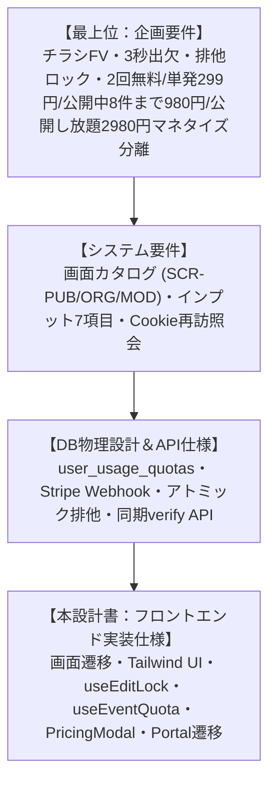

# フロントエンド画面・コンポーネント実装設計書（`front_implementation_spec.md`）

## チラシファースト型 イベント紹介ページ生成・出欠管理 ＆ 利用枠・課金決済基盤（Next.js App Router / React / Tailwind CSS / Stripe）

## 1. 全体アーキテクチャ・設計方針

本ドキュメントは、「機能別企画要件定義書」「システム要件定義書」「統合データベース物理設計書（DBschema.md）」「バックエンドAPI実装仕様書」に基づき、Next.js 14（App Router）、React 18、TypeScript、Tailwind CSSによるフロントエンド画面・UIコンポーネント・カスタムフックの実装仕様を定義する。

特に、**無料枠上限（2回）検知からの課金モーダル起動**、**Stripe Hosted Checkout への遷移**、**決済完了後の同期セッション検証（即時枠反映）**、および **Stripe Customer Portal（サブスク解約・カード変更）遷移** のフロントエンド挙動を完全統合して規定する。



### 1.1. 5大設計原則

1. **Flyer-First & Peek UI (視覚訴求とCTAの共存):**  
   - スマホのファーストビュー（FV）でチラシ画像（A4 縦 210:297）を美しくカード状に埋め込みつつ（`max-height: 65vh`）、画面下部に出欠フォームの頭部が自然に見える「Peek UI」および追従型「Sticky CTAバー」を実装し、FV直帰率35%以下・スクロール誘導を担保。  
2. **Zero-Friction RSVP (極小摩擦の出欠体験):**  
   - 参加者はアカウント作成不要。氏名・出欠トグル（参加/不参加）・追加コメントを入力するだけで3秒回答。端末Cookie（`rsvp_token`）をフックし、再訪時は自回答を自動プリフィル・上書き変更可能とする。  
   - 定員に達した催しでは「参加」を出さず、「参加要望」と「不参加」の2択にする（`status = WAITLISTED`）。要望は氏名とコメントだけを受け、日時・費用プランは聞かない。送信後は待ち順（1始まり）を表示する。席を確保済みの出席者は満員でも出席のまま変更できる。幹事は名簿の「参加要望」から待ち順に承認する。満員判定はサーバーで `events` の行ロックを取って行い、画面の状態が古いときは断らず参加要望へ読み替える。  
   - 出席の日時と費用プランは、候補が1件だけならラジオを出さず、その値をそのまま送る。選ばせるのは候補が2件以上のときだけである。  
3. **Robust Exclusive Lock UX (競合時の可視化):**  
   - 複数幹事の同時編集事故を防ぐため、期限を持たない排他ロック、30秒ごとの保持確認、他幹事編集中モーダル、および緊急時の「強制引き継ぎ（Takeover）」を完全なUI/UXとして実装。  
   - ロックを保持している本人の画面には、排他の状態や残り時間を表示しない。競合する幹事にだけ、保持者名を出す。  
4. **Seamless Checkout & Optimistic Verify (摩擦ゼロの決済・即時反映):**  
   - 無料枠（2回）消化時にバックエンドから返却される HTTP 402（Quota Exceeded）を検知し、課金選択モーダル（SCR-MOD-01）を起動。  
   - Stripe Hosted Checkout での支払い完了後、リダイレクトURL（`?session_id=...`）を検知してフロントエンドから同期的セッション検証（`POST /api/v1/billing/checkout/verify`）を直ちに実行。Webhookの非同期遅延を待たずに即時でイベント作成を再開できるUXを実現。  
5. **Self-Service Billing Portal (自己解決型サブスク管理):**  
   - 支払いが発生するのは、筆頭幹事が公開または複製で利用枠を使うときだけである。参加者の出欠では課金しない。会員かどうかは問わない。共同幹事も枠を消費しない。  
   - 「プラン・カード管理」は主催者ダッシュボードに置く。同じボタンをマイページにも置く。開く契約は、その会員が筆頭幹事として持つ利用枠であり、出欠の対価ではない。Stripe Customer Portal の完了後は、どちらの画面から開いても主催一覧へ戻る。

### 1.2. レスポンシブの基準（スマホが先）

参加者はスマホで開き、主催者の PC は従とする。画面は幅 390px を基準に組み、広い画面向けの差分だけを `min-width` で足す。既定（メディアクエリの外）はスマホの見た目とし、`max-width` は狭い画面だけを詰める指定と、`min-width` の対にだけ使う。

- 段は `640` / `768` / `900` / `1024`（`min-width`）と `360` / `400` / `480` / `540`（`max-width`）だけ。`max-width` には `min-width` の 1px 手前（`639` / `767` / `899` / `1023`）も対として許す。
- 表に無い値は `tests/unit/style-breakpoints.test.mjs` が止める。段を増やすときは同テストと `src/styles/index.css` の注記を同じ PR で直す。
- モックは 390 / 1280 の 2 幅で撮る（[ui-review/mock-sync.md](ui-review/mock-sync.md)）。390px で崩れないことを、1280px で崩れないことの代わりにしない。
- 押せる的は 44×44px 以上、ボタンの文字は 15px 以上。`--sm` は左右の余白だけを詰める指定で、高さと文字を下げない（`--tap-target` / `--font-action`。正は `src/styles/tokens.css`）。入力欄もスマホでは 16px にして、iOS の自動拡大を避ける。例外は画面下に固定する帯（`.action-dock`）だけで、一覧を隠さないよう 40px・14px まで詰める（`--tap-target-dock` / `--font-action-dock`）。帯の外のボタンは 44px・15px のまま。
- 主操作（朱のボタン）は 1 画面に 1 つ。進む操作は画面の下（固定の帯か本文の最後）に置き、見出しの右は戻る・プレビューなどの補助だけにする。

### 1.3. 操作の置き場所と文言

画面の種類ごとに、操作を置く場所を決める。迷ったら「その画面で進める操作はどれか 1 つ」を先に決め、残りを補助として下げる。

| 画面の種類 | 進む操作 | 見出しの右 | 行・カードの中 |
| :--- | :--- | :--- | :--- |
| 入力・確認（作成、編集、プレビュー、プロフィール） | 画面下の固定帯（保存・公開） | 戻る、プレビューだけ | 削除などの破壊的操作のみ |
| 一覧・ダッシュボード | 下部帯か見出しの右のどちらか 1 つ | 絞り込み、並び順など道具 | 補助のみ。1 段に 2 つまで |
| 詳細・名簿 | 本文の最後 | 補助のみ | 行の操作は補助のみ |

- 案内の帯（`alert--compact`）は、スマホでは文の下にボタンを幅いっぱい置き、640px 以上で右端に戻す。
- 節の見出し（`section__head`）は、スマホでは見出し→注記→操作の縦積み、640px 以上で操作を右に寄せる。
- 行とカードの操作が 3 つ以上になるときは、折りたたみへ移すか 2×2 に折り返す。1 段に 3 つ以上並べない。
- 隣り合う操作は 8px 以上空ける。本文の中のリンク（`text-link`）を操作の代わりに使わない。

文言は、スマホで片手のまま読まれる前提で書く。

| 対象 | 目安 |
| :--- | :--- |
| ボタン | 10 文字以内。動詞で終える（「既読にする」「保存する」）。行の中は名詞 1 語まで（「名簿」「編集」） |
| 注記・補足（`help` / `screen-note`） | 30 文字以内 |
| リード（`page-lead`） | 40 文字以内 |
| 文 | 1 文 1 用件。読点は 2 つまで |

- 同じ説明を 2 か所に書かない。帯と本文、行と注記で同じことを言わない。
- 括弧の補足を増やさない。条件が 3 つ以上あるなら、その画面に要るかを見直す。
- 実装の言葉（トークン、セッション、ポータル、課金プラン、自動遷移）を使わない。利用者が見るものの名前に言い換える。
- 名詞は「イベント」「主催者」「共同主催者」に統一する。同じものを画面ごとに言い換えない。
- 省略記号は `…`。処理中は「保存しています…」の形にそろえる。
- 通知の本文のように、サーバーが作って画面に出す文言も同じ規則に従う（`src/modules/notifications/lib/rsvp-notification.ts`）。

---

## 2. 画面ルーティング・画面一覧・画面遷移図（Mermaid）

### 2.1. ルーティングテーブル

| パス | 画面ID | 対象アクター | 認可・アクセス条件 | 概要 |
| :---- | :---- | :---- | :---- | :---- |
| `/` | SCR-PUB-00 | 全員 | 誰でも可 | ホーム。サービス名は `SITE.name`、eyebrow は対象を具体例で示す（`ご飯会、ライブ、一日店長、撮影会、合コン、マルシェ etc.. 主催者様へ`）、見出しは `SITE.taglineLines`（「イベントのチラシと」「告知&出欠ウェブページ、」「5分で簡単作成。」の 3 分割。どの幅も 3 行のまま、文字サイズだけを幅で上げる）。LP として扱い、共通ヘッダーは出さない。墨地のヒーローを画面の上端から始め、メインの上端の余白も 0 にする（`siteChrome("/")` の `flushTop`）。ログインの入口は、ヒーローに「主催者ログイン」と「参加者ログイン」を並べ、フッターにも両方を置く。主操作は「無料ではじめる」（`SITE.cta.createEventFree`）で、無料の条件（最初の2回）はボタンの直下に `.hero__note`（`SITE.cta.freeNote`「最初の2回は無料。」。米印は画面だけに出し、読み上げには含めない）で 1 行だけ添える。ボタンの列は「無料ではじめる」（`btn--primary`）と「サンプルを見る」（`SITE.nav.sample`、SCR-PUB-16、`btn--outline`）の 2 つを 1 段に並べ、サンプルは新しいタブで開く（`target="_blank"`）。その下に「主催者ログイン」・「参加者ログイン」の 2 本を 1 段で置く。料金への導線はヒーローに置かない（フッターの「サービスと料金」が持つ）。短い紹介と使い方、告知URLは主催者から受け取る案内。紹介は告知・出欠・集計・売上・運営（主催者と共同主催）・日程（カレンダー）の6つ。イベントの一覧・検索は置かない。料金の比較は `/service` |
| `/service` | SCR-PUB-06 | 見込み客 / 全員 | 誰でも可 | サービスと料金。無料2回、単発299円、月額で8件まで公開980円、公開し放題2980円（いずれも税込）。実施中のキャンペーンがあれば販売価格と定価を併記する。支払いは始めない |
| `/terms` | SCR-PUB-10 | 全員 | 誰でも可 | 利用規約。料金、期間限定キャンペーン、0円単発の条件、0円の定額プランの自動更新、終了日の3日前・1日前の通知、解約と返金を定める |
| `/sample` | SCR-PUB-16 | 見込み客 / 全員 | 誰でも可 | 告知ページの見本の一覧。DB を使わない静的ルートである。催しの型（外ごはん・マーケット・子ども連れ・アウトドア・ナイト）の5件を、チラシの実物と 1 文で並べる。共通ヘッダーは出さず（`siteChrome("/sample")`）、上端の余白も落とす。代わりに上端の帯（`SampleBand`）を固定し、札「サンプル」・説明「実際に作った告知ページです」（640px 以上）・主操作「無料ではじめる」を出す。末尾にも同じ主操作と、サンプルは架空である旨の注記を置く。`SITE.nav.sample` が `SITE.nav.createEvent` と同じく作成画面を指す。ホームのヒーローから開く |
| `/sample/[slug]` | SCR-PUB-17 | 見込み客 / 全員 | 誰でも可（`generateStaticParams` の5件のみ。他は404） | 見本の告知ページ。SCR-PUB-01 と同じ `PosterHero`・`EventMetaCard`・`DynamicRsvpBox` で、チラシから出欠までを同じ順に並べる。出欠フォームは `preview` で描き、入力も送信もできない（フォームの上に「見本のため送信できません。」の 1 行）。イベントごとにテーマ（`themeId`）を変え、紙面の色と書体の違いも確かめられる。主催者・共同主催者は `userId: null` にして公開プロフィールへのリンクにしない。共通ヘッダーは出さず、上端の余白も落とす。帯は 1 段（高さ 53px）で、札「サンプル」・説明「実際に作った告知ページです」（640px 以上）・「← 一覧」（一覧へ戻る）・「無料ではじめる」を出す。帯は本文の列（`--width-page`）にそろえ、`vw` を使わない。`noindex`。値は `src/app/sample/samples.ts` が持ち、`scripts/seed-ui-demo.mjs` のデモ催しと揃えてある |
| `/events/[id]` | SCR-PUB-01 | 参加者 / 全員 | 誰でも可（Cookie自動照会） | チラシFV埋め込み告知・未登録出欠登録画面。共通ヘッダーは出さない（`siteChrome("/events/…")`）。チラシを画面の上端から始める（`flushTop`）。満員なら「出席」を出さず「参加要望」に切り替え、送信後に待ち順を出す。イベントがテーマ（`themeId`）を持つときは、ページ全体をそのテーマで描く（未設定なら今の見た目のまま）。対象世代（`targetGeneration`）があれば、メタ情報に「対象」の行を出す。出欠フォームの直下に主催者勧誘カード（`OrganizerInviteCard`）を置く。幹事本人と主催イベント持ちの会員には出さない。画面下の追従バー（スマホのみ）の下段に、ホーム（`/`）へ送る帯「あなたもイベントを開きませんか」を置く。出す条件は勧誘カードと同じ（`showsOrganizerInvite`）。面は薄い山吹（`--pop-warm-tint`）で塗り、罫線と 12px の字だけで区切る。字は差し色（`--color-primary-text`）1 色で、hover でも変えない（スマホに hover が無く、端末で見え方が変わるため）。左右と下端は画面の端まで届かせ、上下の余白は持たない（帯は 1 行ぶんの 18px）。メタ情報の直下に LINE 共有ボタン（`LineShareButton`）を置き、告知URLを利用者自身のLINEから送れる。押すたびに注意書き（`LineShareDialog`）を出し、個人アカウントからの送信・停止されうること・本サービスが責任を負わないことを伝えてから開く。タッチ端末のみ表示する。ログインと作成の入口は本文とフッターが持つ |
| `/organizer/events` | SCR-ORG-01 | 主催幹事 / 共同幹事 | 会員JWT または ゲスト幹事Cookie | 主催イベント一覧。冒頭 `h1` は画面名。役割の札（主催者）とリード文は置かない（役割は共通ヘッダーと節が示す）。出欠集計・クォータ残数。冒頭の操作は置かず、「下書き一覧」（件数つき）と「イベント新規作成」を画面下に固定する帯（`.action-dock`）へ移す。390px では 2 つで 1 段にして作成を広く取り、640px 以上では右寄せにする。帯は一覧の上にずっと乗るので、ボタンだけ 40px・14px に詰める（`--tap-target-dock` / `--font-action-dock`）。帯のぶん、本文とフッターの下に余白を残す。公開ページ・プロフィール・売上・契約は主催者の節と SCR-PUB-03 に任せる。要約の札は置かない（公開中の件数と上限はヘッダー直下の `QuotaStatusBanner` が「月額プランで公開中のイベント 7 / 8 件」の形で示す。合算の参加者数はカードの数字と重なるので出さない）。一覧の見出しは「一覧」だけにし、説明文は置かない。見出しの下に絞り込みを置く（状態「すべて / 公開中のみ / 受付停止のみ」、開催日の開始日と終了日、過去の催しを除く）。その隣に、開催日の昇順降順を切り替えるアイコンのボタンを置く（既定は新しい順。アイコンの向きでいまの並びを示し、読み上げは押した先の並びを述べる）。640px 未満では状態と開催日を「絞り込む」ボタン（効いている条件の数を添える）から開くモーダルに畳み、過去の催しを除くだけを外に残す。モーダルは選んだ時点では反映せず、「この条件で絞り込む」で確定して閉じ、背景を押すと元の条件のまま閉じる。640px 以上は畳まず、4 つと並び順のボタンを 1 行に並べる。絞り込みと並べ替えは画面側で行い（`src/modules/events/lib/event-filters.ts`）、10 件ずつページに割って件数の範囲と前後ページを `pager` に出す。同じ開催日の催しは作った新しい順のまま並べる。条件か並び順を変えたら 1 ページ目へ戻し、0 件になったら「条件を戻す」を出す。公開中と受付停止だけを出し、下書きは「下書き一覧」（SCR-ORG-15）へ分ける。カードはチラシを左の細い列に置き、催し名と札をその右へ流す（スマホでも縦に積まない）。告知ページはチラシを押すと新しいウィンドウで開く（一覧を離れずに共有先を確かめられる。下書きのチラシは公開ページが無いので絵のまま）。カードの操作は「出欠」「LINEで共有」「編集」「コピー作成」の 4 つで、「LINEで共有」はタッチ端末だけに出す（`LineShareButton`。下書きには出さない）。スマホは 2×2、カードが 1 枚で全幅になる 640〜899px は 4 つを 1 段、一覧が 2 列になる 900px 以上は 2×2 にする（右寄せの縦罫線は折り返しで崩れるので使わない）。編集は一覧で最も使う操作なので、既定から朱で塗った `btn--accent` にする（ホバーでは濃くなるだけで、塗りの有無は変えない）。状態と役割の札は名簿の行と同じ `small` で出し、枠と丸みを持たせない（押せる `.btn` は枠・塗り・丸みを持つので、形で見分けられる）。共有URLと「公開を一時停止」「削除する」を「共有と設定」に畳んで操作の下に置く。一時停止は確認を挟まず `close` を送り、停止中のカードは「公開を再開」（`reopen`）に変える。削除だけ SCR-MOD-03 で確認する。ヘッダー直下のサブタブ（主催一覧 / カレンダー / 売上 / 下書き / プロフィール）で SCR-ORG-13・SCR-ORG-11 と行き来する。ヘッダーのナビにはカレンダーと売上を足さない |
| `/organizer/calendar` | SCR-ORG-13 | 主催幹事 / 共同幹事 | 会員JWT または ゲスト幹事Cookie | カレンダー。冒頭 `h1` は画面名。JST の今月を初期表示にし、日曜始まりの月グリッドと、その月の催し一覧を縦に並べる。一覧は日付の昇順で、日付ごとに見出しを置く。日付のセルを押すと一覧のその日へ寄せ、帯（催し名）を押したときは詳細のモーダルだけを開いて画面は動かさない。開催日が複数ある催しは、すべての日付に1件ずつ出す。月は `?month=YYYY-MM` に持ち、前月・次月・今月で移動する。予定からは下書きなら SCR-ORG-05、それ以外は SCR-ORG-06 へ進む。公開中の予定は、一覧から LINE 共有ボタンで告知URLを送れる（SCR-PUB-01 と同じ注意書きを出す）。外部カレンダー連携（`.ics`・購読URL）は持たない |
| `/organizer/profile` | SCR-ORG-14 | 主催幹事（会員） | 会員JWT必須。催しが0件は 403 `NOT_ORGANIZER`、ゲスト幹事は 403 `REGISTER_REQUIRED` | 公開プロフィール編集。公開/非公開、アイコン画像、ページの見た目（標準＋9テーマ）、肩書き（60文字）、自己紹介（400文字）、活動エリア、ジャンル（3つまで）、X・Instagram、実績の表示可否。操作（「保存する」「プレビュー」「公開中ページを開く」）は h1 とリードの下に置き、スマホでは画面下に固定する。保存前に SCR-PUB-14 と同じ見た目（テーマ込み）でプレビューする。本文は `PUT /api/v1/organizer/profile`、画像は `POST /api/v1/organizer/profile/avatar`。表示名は SCR-PUB-11 で変える |
| `/organizer/revenue` | SCR-ORG-11 | 主催幹事 | 会員JWT必須（ゲスト幹事は 403 `REGISTER_REQUIRED`） | 売上。冒頭 `h1` は画面名。見込み売上・領収書発行額・差額・平均単価を `RevenueSummaryLedger` の帳票風の行で出し、期間の絞り込み、イベント別の一覧を続ける。行から SCR-ORG-12 へ進む。ヘッダー直下のサブタブで SCR-ORG-01・SCR-ORG-13 と行き来する |
| `/organizer/events/[id]/revenue` | SCR-ORG-12 | 主催幹事 | 会員JWT必須（名簿と同じ 403 `REGISTER_REQUIRED`） | 売上の内訳。冒頭 `h1` は画面名、催し名はリード。プラン別・開催回別の人数と小計、プラン未選択の案内 |
| `/organizer/events/new` | SCR-ORG-02 | 主催幹事（会員） | 会員JWT必須（未ログインは入力内容を退避してログインへ） | 新規イベント作成（インプット7項目・申し込み期限・チラシ生成・Checkout戻り検知）。冒頭 `h1` は画面名。入力を5ステップのアコーディオンに分け、開いているステップの入力欄だけを出す（12.3）。最後の操作はステップの外側（`form-final`）に置き、必須の残り数を添える。スマホ（640px 未満）ではこの帯を画面下に固定し、帯の高さぶん本文とフッターの下に余白を残す（音声ボタンとパネルも帯の上へ逃がす）。会員は「下書き保存」と「プレビューを見る」の2つで、保存してから SCR-ORG-16 へ進む。スマホの「プレビューを見る」は保存の前に、ここまでの内容を告知ページと同じ部品・同じテーマのモーダルで確かめ、モーダルの「下書き保存してプレビューへ」で SCR-ORG-16 へ進む。広い画面は従来どおり直接 SCR-ORG-16 へ進む。未ログインのときは「ログインして公開/下書き保存」（`btn--primary`）の 1 つだけを出し、必須の入力を確かめてから入力を `sessionStorage` に退避し、`registerUrl(next)` で `/auth/register?mode=register` へ送る（認証画面は新規登録とログインを1枚で扱い、既存会員は画面側でログインへ切り替える）。押した時点では公開と下書き保存のどちらも決まっていないため、ボタンは分けない。戻ってきたら退避した内容を復元し、会員と同じ「下書き保存」「プレビューを見る」で続きを選ぶ。入力内容は公開の直前に告知ページのプレビューで確かめられるため、未ログインの間に公開まで進める経路は持たない（`visibility` は常に `UNLISTED`）。`?ref=<イベントID>` を読み、作成本文の `referrerEventId` に載せる。`?draftId=` で下書きを復元し、保存のたびに URL へ残す。右下にマイクボタンを固定し、押すと音声入力のパネルを出して、そのまま録音を始める。直前に入力欄を選んでいればその欄から、無ければ上から順に空欄を強調して 1 欄ずつ録音し、確定したら「自動遷移」がオンなら次の空欄へ進んで録音を続け、オフなら同じ欄に留まる（既定はオン）。「任意の項目も聞く」は既定でオンで、雨天時の方針・定員・申し込み期限も巡回に含める。郵便番号を話すと 7 桁で住所を引き、都道府県・市区町村・町域を入れてから次（番地）へ進む。入力できる欄が尽きたら「入力完了！」を出し、3秒後に音声モードを終了する。強調は DOM フォーカスではなく `data-voice-target` で行い、日付・時刻の OS ピッカーを開かない。音声モードの間は、いま聞いている欄のまわりだけをくり抜いて画面全体を半透明の黒で覆い、それ以外の操作を止める（`src/modules/events/components/VoiceInputDock.tsx`） |
| `/organizer/events/drafts` | SCR-ORG-15 | 主催幹事 / 共同幹事 | 会員JWT | 下書き一覧。冒頭 `h1` は画面名。自分の `DRAFT` だけを出す（`GET /api/v1/organizer/events` を画面側で絞る）。各カードから SCR-ORG-16 のプレビュー、SCR-ORG-05 の編集、削除（SCR-MOD-03）へ進む。下書きの間は枠を消費しない旨を書く。主催一覧へ戻る導線を置く |
| `/organizer/events/[id]/preview` | SCR-ORG-16 | 主催幹事 / 共同幹事 | 幹事JWT（`GET /api/v1/organizer/events/[id]`）。公開は筆頭幹事の会員のみ | 下書きのプレビュー。`noindex`。公開操作は共通ヘッダー直下の全幅バー（パネルではない）から行う。チラシ以降は SCR-PUB-01 と同じ `PosterHero`・`EventMetaCard`・出欠フォームで見た目を確かめ、出欠は操作できない。選んだテーマ（`themeId`）と対象世代も反映する。参加履歴・主催者勧誘カードは出さない。「公開する」で `POST /api/v1/organizer/events/[id]/publish` を呼び、成功したら告知ページへ移る。枠不足は 402 で SCR-MOD-01（戻り先はこの画面）。オーナー以外には公開ボタンを出さず、その旨を書く。公開済みの ID を開いたときは告知ページへのリンクを出す |
| `/organizer/register-required` | SCR-ORG-10 | 既存のゲスト幹事 | ゲスト幹事 Cookie、または未ログイン（`eventId` はクエリ） | 公開直後の案内。新規作成からは到達しない（作成は会員のみ）。以前に未登録で作ったイベントを持つ端末の受け皿として残す。共有 URL とコピー、`?mode=register` 付きの会員登録、ログイン。名簿・リマインド・領収書・招待は登録後であることを書く。登録済みの幹事は管理画面へ、第三者・不正な ID には案内を出さない。`noindex` |
| `/organizer/events/[id]/edit` | SCR-ORG-05 | 幹事（排他ロック保持） | 幹事権限 ＋ 排他ロック所持。未登録の幹事は作成から24時間以内 | イベント編集。複製した下書きだけ `PUBLISHED` にできる。保存後はロックを解放して主催一覧へ戻る。冒頭 `h1` は画面名、催し名はリード。ロックを保持している本人の画面には、排他の状態や残り時間を出さない。403 `REGISTER_REQUIRED` は `/organizer/register-required` へ送る。冒頭に筆頭幹事だけ表示する幹事パネル（`CoHostPanel`）を置き、主催 / 共同主催の一覧、招待URLの発行、共同主催者の解除を行う。解除はその場で確認を出し、実行後に一覧を読み直す |
| `/events/[id]/receipt` | SCR-PUB-04 | 参加者本人 | 出欠 Cookie または会員 | 自分の参加費領収書。共通ヘッダーは出さない。フッターは残し、上端の余白は普段どおり |
| `/organizer/events/[id]/receipts/[participantId]` | SCR-ORG-09 | 幹事（会員のみ） | 幹事権限 ＋ 会員登録 | 幹事向け領収書。印刷しない冒頭 `h1` は画面名。催し名と宛名はリード。未登録の幹事は 403 `REGISTER_REQUIRED` |
| `/organizer/events/[id]/participants` | SCR-ORG-06 | 幹事（会員のみ） | 幹事権限 ＋ 会員登録 | 参加者名簿。冒頭 `h1` は画面名。催し名はリード。出欠の集計（参加・参加要望・不参加）、CSV、参加者へのリマインドと文面コピー、参加者ページのプレビューと共有リンクのコピー、領収書発行。参加要望は待ち順に並べ、承認で出席日時と費用プランを選ぶ。未登録の幹事は 403 `REGISTER_REQUIRED` |
| `/invitations/[code]` | SCR-ORG-07 | 招待されたメンバー | 招待コード有効期限内 | 共同幹事受諾。冒頭 `h1` は画面名。催し名はリード |
| `/mypage` | SCR-PUB-03 | 主催幹事（ログイン会員） | 会員JWT必須 | 主催者マイページ。主催イベントの要約（直近3件）と「すべて見る」→ `/organizer/events`、クォータ残数、公開プロフィールの状態と編集・閲覧の導線を出す。契約（プラン・カード管理）はこの画面には置かず、共通ヘッダーの頭文字のメニューが受ける（「利用枠と契約」の節は持たない）。冒頭の札は「プラン公開」「チケット公開」の2つにし、月額プランから公開した件数（帯の `N / 8` と同じ数え方）と、単発チケット・無料枠から公開した件数に分ける。2 つは面の色と数字の色を分け（月額プランは差し色、チケットは無彩色）、格子も 5 列ではなく 2 列にする。参加の人数と受付停止の件数は出さない（参加は直近の催しの行と名簿、受付停止は主催一覧の絞り込みが受ける）。集計の直後に「新着」（`id="notifications"`）を置き、参加表明と参加要望を新しい順に 4 件まで出す（`GET /api/v1/notifications?limit=5`）。5 件以上あるときは一覧の下に「通知一覧を見る」を出し、全件は通知一覧（SCR-PUB-15、`/notifications`）が受ける。行は名簿（SCR-ORG-06）へのリンクで、押すとその 1 件を既読にして移る。未読の行には題の下に「既読にする」（`PATCH /api/v1/notifications` `{ ids: [id] }`）を置き、題のリンクと押し間違えないよう入れ子にしない。見出しの右に「すべて既読にする」（`{ all: true }`）。未読は行の左に点、種別は「出席」「参加要望」のバッジ。日時は秒を落として `formatDateTimeMinuteJa`（`2026/10/31 10:15`）で出す。見出しに説明文（`section__note`）は置かない。0 件なら「まだ参加表明はありません」。主催者でない会員には節を出さず、問い合わせもしない。他の幹事のイベントへの参加履歴は出さない（`GET /api/v1/organizer/events`）。参加履歴は SCR-PUB-09 へ分離。節（`OrganizerTabs`）の先頭「ホーム」がこの画面で、開いているあいだは現在地になる。ログアウト（`POST /api/v1/auth/logout`） |
| `/notifications` | SCR-PUB-15 | 主催幹事（ログイン会員） | 会員JWT必須 | 通知一覧。主催者へのアプリ内通知（参加表明・参加要望）を新しい順に 50 件まで出す（`GET /api/v1/notifications?limit=50`）。マイページの「新着」は 4 件までなので、続きはこの画面が受ける。行の形・未読の点・種別のバッジ・秒を落とした日時はマイページと同じ部品（`NotificationRows`）を使い、この画面は並べる数だけを変える。未読の行には「既読にする」（`PATCH /api/v1/notifications` `{ ids: [id] }`）、見出しの右に「すべて既読にする」（`{ all: true }`）。50 件返ったときだけ「新しい 50 件まで表示しています。」を添える（ページ送りは持たない）。0 件なら「まだ参加表明はありません」。主催者の節（`OrganizerTabs`）と頭文字のメニューの「通知」はこの画面を指す。装飾は静かめ（`quiet`） |
| `/participant/login` | SCR-PUB-07 | 参加者（履歴を残したい人） | 未ログイン、または電話未確認の会員。管理者も可（purpose `PARTICIPANT`） | 参加者の会員登録・ログイン。`/auth/register` と同じ部品を使い、文言と着地だけを参加者向けにする。`?step=phone` が電話番号確認、`?step=login-code` がログイン確認番号。着地は `/participant`（`next` があればそのパス）。有効なセッションがあればフォームを出さずに着地へ送る（第9節） |
| `/participant` | SCR-PUB-08 | 参加者（ログイン会員） | 会員JWT必須 | 参加者ホーム。これからの参加、出席・欠席の件数、次のイベント、参加履歴への導線。主催者でもある会員には `/mypage` への切り替えを出す |
| `/participant/calendar` | SCR-PUB-12 | 参加者（ログイン会員） | 会員JWT必須 | 参加カレンダー（`GET /api/v1/user/calendar`）。出欠を答えた催しを、選んだ日程の日付に置く（未選択ならイベントの代表日）。出席・欠席・参加要望を出し、欠席は控えめに、参加要望はアンバーで表示する。月は `?month=YYYY-MM` に持ち、前月・次月・今月で移動する。一覧・検索は持たない |
| `/participant/history` | SCR-PUB-09 | 参加者（ログイン会員） | 会員JWT必須 | 参加履歴（`GET /api/v1/user/participations`）。出欠（出席・参加要望・欠席）・時期の絞り込み、ページ送り、領収書へのリンク。集計に参加要望を出す。主催イベントの情報は出さない |
| `/organizers/[userId]` | SCR-PUB-14 | 誰でも（未ログイン可）。催しは参加者（ログイン会員） | なし（公開）。催しは `GET /api/v1/public/organizers/[userId]/events` が未ログインに 403 `LOGIN_REQUIRED` | 主催者のページ。共通ヘッダーは出さない（`siteChrome("/organizers/…")`）。プロフィール（`GET /api/v1/public/organizers/[userId]`）の下に、カレンダーと一覧を縦に並べる。アイコン、名前、肩書き、自己紹介、活動エリア、ジャンル、X・Instagram（アイコン。新しいウィンドウで開く）、任意の実績。主催者が選んだテーマをページ全体に適用する。未作成・非公開なら名前とアイコンだけを出す（404 にしない）。催しが0件・退会済み・会員が無いときだけ 404。催しは未ログインでは飾りのカレンダーの上に白塗りを重ねて参加者ログインへ送り、月は `?month=YYYY-MM` に持つ（今月より前へは戻れない）。主催者は SCR-PUB-03 の「公開ページを見る」から同じ内容を確認できる。`noindex` |
| `/organizers/[userId]/events` | — | — | — | 画面ではない。統合したので `/organizers/[userId]` へ `permanentRedirect`（`?month` だけ引き継ぐ） |
| `/account` | SCR-PUB-11 | 主催者・参加者（ログイン会員） | 会員JWT必須 | アカウント設定。表示名、メールアドレス、電話番号、パスワード、退会を縦に並べる。冒頭 `h1` は「アカウント設定」。主催者と参加者で同じ画面を使う |
| `/account/email/verify` | SCR-PUB-11 | 確認リンクを開いた会員 | 確認トークン（ログインは不要） | 新しいメールアドレスの確定。成功したら `/account` へ戻す。無効・期限切れは理由を出す |
| `/auth/register` | SCR-PUB-02 | 未ログインの幹事 | 未ログイン、または電話未確認の会員。管理者は不可（HTTP 403 `ADMIN_CONSOLE_REQUIRED`） | 主催者のローカル会員登録と Google サインイン（`GET /api/v1/auth/google`）。パスワード登録は確認メール後に電話番号を確認する。`?step=phone` が電話番号確認。`?step=login-code` がログイン確認番号。着地は `/mypage`、`/organizer`、`/invitations`、`/events`、`/participant` だけ。管理者が資格情報を送ると `/console/login` へのリンクだけを出す。有効なセッションがあればフォームを出さずに着地へ送り（第9節）、`?switch=1` のときだけフォームを出す |
| `/auth/verify` | SCR-PUB-05 | 確認メールの受信者 | 確認トークン | パスワード登録のメール確認。成功後は電話番号確認へ進む。参加者入口から始めた登録は `?audience=participant` で `/participant/login?step=phone` へ送る。既に会員ならログインへ戻る |
| `/events` | — | — | — | 画面ではない。`/` へリダイレクトする |
| `/organizer/events/[id]` | — | — | — | 画面ではない。`/organizer/events/[id]/edit`（SCR-ORG-05）へリダイレクトする |
| `/console` | SCR-ADM-04 | プラットフォーム管理者 | `platformRole = ADMIN` | 管理者ホーム。冒頭 `h1` は画面名。ログイン後の着地。会員、イベント、決済、料金への入口 |
| `/console/login` | SCR-ADM-00 | プラットフォーム管理者 | 公開ナビに出さない。`noindex` | 管理者ログイン。冒頭 `h1` は画面名。パスワードのあと確認番号。確認済み電話が必須。成功後は `/console` |
| `/console/users` | SCR-ADM-01 | プラットフォーム管理者 | `platformRole = ADMIN` | 会員検索・権限変更。冒頭 `h1` は画面名 |
| `/console/events` | SCR-ADM-02 | プラットフォーム管理者 | `platformRole = ADMIN` | イベント検索。冒頭 `h1` は画面名。内容は変えない |
| `/console/payments` | SCR-ADM-03 | プラットフォーム管理者 | `platformRole = ADMIN` | 利用枠の決済履歴。冒頭 `h1` は画面名。返金操作はしない |
| `/console/pricing` | SCR-ADM-05 | プラットフォーム管理者 | `platformRole = ADMIN` | 価格キャンペーンの作成・編集・停止。冒頭 `h1` は画面名。監査ログを残し、既存購入者の割引は変えない |

---

### 2.2. 画面一覧

次節の遷移図に登場する画面・モーダル・外部決済画面。ページのパスと認可は 2.1 を正とする。モーダルと外部画面は独自のパスを持たない。

| 区分 | 画面ID | 画面名 | パス / 出現箇所 | 概要 |
| :---- | :---- | :---- | :---- | :---- |
| 公開 | SCR-PUB-00 | ホーム | `/` | 5分でチラシと告知・出欠ウェブページを作れることの紹介と使い方。告知URLは主催者から受け取る旨の案内。一覧・検索は置かない |
| 公開 | SCR-PUB-06 | サービス・プラン紹介 | `/service` | チラシと出欠の説明、料金3種、作成と主催者ログインへのボタン。Stripe は開かない。割引中は販売価格と定価を併記する |
| 公開 | SCR-PUB-10 | 利用規約 | `/terms` | 料金、価格キャンペーン、0円単発、0円の定額プランの自動更新、3日前・1日前の通知、解約と返金 |
| 公開 | SCR-PUB-16 | サンプルの一覧 | `/sample` | 告知ページの見本 5 件を、チラシと 1 文で並べる。上端の帯に「サンプル」と主操作。DB を使わない |
| 公開 | SCR-PUB-17 | サンプルの告知ページ | `/sample/[slug]` | 告知ページと同じ部品・同じテーマで見本を出す。出欠は見た目だけで送れない。`noindex` |
| 公開 | SCR-PUB-01 | イベント告知・出欠画面 | `/events/[id]` | チラシFV埋め込み告知と、未登録の3秒出欠。共通ヘッダーは出さない。直下に主催者勧誘カード |
| 会員 | SCR-PUB-02 | 主催者の会員登録・ログイン | `/auth/register` | 幹事の入口。パスワード登録は確認メールのあと電話番号を確認する。ログインは確認番号（既定はSMS、予備はメール）。同じ確認済み電話番号なら既存会員へ結びつける。Google は確認済みメールだけ |
| 会員 | SCR-PUB-07 | 参加者の会員登録・ログイン | `/participant/login` | 履歴を残す参加者の入口。部品は SCR-PUB-02 と同じで、文言と着地だけを参加者向けにする。管理者も参加者としては入れる |
| 会員 | SCR-PUB-05 | メール確認 | `/auth/verify` | 確認メールのリンク。確認後は電話番号確認へ進む |
| 会員 | SCR-PUB-08 | 参加者ホーム | `/participant` | これからの参加、出席・欠席の件数、次のイベント、参加履歴への導線 |
| 会員 | SCR-PUB-12 | 参加カレンダー | `/participant/calendar` | 出欠を答えた催しを月グリッドに置く。出席・欠席・参加要望。日付を選ぶとその日の催しが出る |
| 会員 | SCR-PUB-09 | 参加履歴 | `/participant/history` | 出欠と領収書の一覧。出欠・時期で絞り込み、ページ送りする |
| 誰でも／会員 | SCR-PUB-14 | 主催者のページ | `/organizers/[userId]` | アイコン付きプロフィール（自己紹介・ジャンル・X/Instagram・実績）の下に、カレンダーと一覧。主催者のテーマをページ全体に適用。共通ヘッダーは出さない。非公開なら名前とアイコンだけを出す。未ログインでは飾りのカレンダーに白塗りを重ね、参加者ログインへ送る。満員は参加要望受付中 |
| 会員 | SCR-PUB-11 | アカウント設定 | `/account`（メール確認は `/account/email/verify`） | 表示名、メールアドレス、電話番号、パスワード、退会。変更の前に確認番号を出し、メールは新しいアドレスへのリンクで確定する。管理者は対象外 |
| 主催 | SCR-ORG-01 | 主催イベント一覧 | `/organizer/events` | 出欠集計、クォータ残数、編集・複製・招待。下書きは出さず、件数だけを「下書き一覧」に添える。`?registered=1` で登録完了トーストを出す |
| 主催 | SCR-PUB-03 | 主催者マイページ | `/mypage` | 主催イベントの要約（直近3件）と「すべて見る」、要約の札（プラン公開・チケット公開。色と文字色で分ける）、新着（参加表明・参加要望。4 件まで・未読つき・行ごとの「既読にする」・続きは通知一覧へ）、クォータ残数、ログアウト。公開プロフィールの状態。契約の入口（プラン・カード管理）は持たず、共通ヘッダーの頭文字のメニューが受ける。見出しの説明文は置かない。参加履歴は出さない |
| 主催 | SCR-PUB-15 | 通知一覧 | `/notifications` | 参加表明と参加要望を新しい順に 50 件まで。行ごとの「既読にする」と「すべて既読にする」。マイページの新着（4 件）の続きを受ける |
| 主催 | SCR-ORG-14 | 公開プロフィール編集 | `/organizer/profile` | 公開/非公開、アイコン画像、ページの見た目（9テーマ）、肩書き、自己紹介、エリア、ジャンル、X・Instagram、実績の表示可否。テーマ込みの保存前プレビュー。表示名はアカウント設定で変える |
| 主催 | SCR-ORG-13 | カレンダー | `/organizer/calendar` | 月グリッドと、今月の催し一覧（日付の昇順）。日付を押すと一覧のその日へ寄せる。複数の開催日をすべて出す。前月・次月・今月で移動する |
| 主催 | SCR-ORG-02 | 新規イベント作成 | `/organizer/events/new` | インプット7項目、申し込み期限、チラシ生成、Checkout 戻り検知。入力を5ステップのアコーディオンに分け、開いているステップの入力欄だけを出す。最後の操作はステップの外側（`form-final`）に置き、必須の残り数を添える。会員は「下書き保存」「プレビューを見る」の2つで保存してから SCR-ORG-16 へ進む。未ログインは同じ位置の「ログインして公開/下書き保存」1 つから入力を退避してログインへ送り、戻ったら復元して本人が続きを選ぶ。枠が無いときも `DRAFT` で退避し、`?draftId=` で復元する。`?ref=` を参照元として送る。定員のステップに「対象世代」（placeholder「20代から40代」）を置き、チラシのステップの先頭でイベントページのテーマを 9 つから選ぶ。テーマは告知ページの見た目と、チラシ画像生成の雰囲気へ渡る。スマホは `form-final` を画面下に固定し、「プレビューを見る」はモーダルで確認する |
| 主催 | SCR-ORG-10 | 公開直後の会員登録案内 | `/organizer/register-required` | 共有 URL のコピーと、会員登録・ログイン。名簿・リマインド・領収書・招待は登録後であることを伝える |
| 主催 | SCR-ORG-05 | イベント編集 | `/organizer/events/[id]/edit` | 排他ロック付きの編集。保存完了でロックを解放し、主催一覧へ戻る。下書きは公開状態を選べる（その場で公開も可）。チラシのステップの先頭でイベントページのテーマを選べる。「プレビュー」から SCR-ORG-16 を開ける。未登録の幹事は作成から24時間以内 |
| 主催 | SCR-ORG-15 | 下書き一覧 | `/organizer/events/drafts` | 自分の下書きだけを並べ、プレビュー・編集・削除を行う。下書きの間は枠を消費しない |
| 主催 | SCR-ORG-16 | 下書きのプレビュー | `/organizer/events/[id]/preview` | 告知ページと同じ見た目で確認し、その場で公開する。公開操作はヘッダー直下の全幅バー。出欠フォームの見た目は出すが操作できない。`noindex` |
| 公開 | SCR-PUB-04 | 参加者向け領収書 | `/events/[id]/receipt` | 自分の参加費領収書。共通ヘッダーは出さない。印刷できる |
| 主催 | SCR-ORG-09 | 幹事向け領収書 | `/organizer/events/[id]/receipts/[participantId]` | 出席者へ発行した領収書。再発行できる |
| 主催 | SCR-ORG-06 | 参加者名簿 | `/organizer/events/[id]/participants` | 出欠集計（参加・参加要望・不参加）とコメント詳細。売上サマリとプラン未選択の案内も出す。費用プラン列は申込時点の金額を出す。参加要望は待ち順に並べ、承認で出席へ上げる |
| 主催 | SCR-ORG-11 | 売上 | `/organizer/revenue` | 見込み売上・領収書発行額・差額・平均単価。全期間が初期値で、開催日で絞り込む。イベント別の一覧 |
| 主催 | SCR-ORG-12 | 売上の内訳 | `/organizer/events/[id]/revenue` | プラン別と開催回別の人数・小計。プラン未選択の案内 |
| 主催 | SCR-ORG-07 | 共同幹事受諾 | `/invitations/[code]` | 招待コードによる幹事権限のバインド |
| パネル | SCR-ORG-08 | チラシ生成 | SCR-ORG-02 / SCR-ORG-05 上 | 紙面の性格・背景を選び、7項目から生成する。生成結果のプレビューと手元の画像のアップロード。ダウンロード（画像・告知 QR 付き A4 PDF）は、チラシを載せたイベントが公開済みのときだけ出す。PDF は SCR-ORG-16 からも落とせる。過去チラシは SCR-ORG-03 で選ぶ |
| モーダル | SCR-ORG-03 | チラシ選択モーダル | SCR-ORG-02 / SCR-ORG-05 上 | 生成済み・アップロード済みチラシの選択と、7項目の流し込み。各チラシの画像ダウンロード（イベントに紐づかないため PDF は出さない）と、その場でのアップロード |
| モーダル | SCR-ORG-04 | 公開完了モーダル | 公開成功時（SCR-ORG-02 上） | 共有リンクと、管理画面への復帰。LINE共有は公開ページ・カレンダー・主催一覧に置く |
| モーダル | SCR-MOD-02 | 排他ロック競合モーダル | SCR-ORG-05 上（HTTP 409） | 保持者名を出し、選ぶのは 2 つだけ。「編集権を引き継ぐ」と「引き続き閲覧のみ」で、後者はロックを取らずに閉じて閲覧のみのまま画面に残る（閉じたあとは上部の注意帯から開き直せる）。閉じる道は右上の印・背景・下のボタンの 3 つ。ロックの再取得は裏で 15 秒ごとに試すので手動のボタンは置かない |
| モーダル | SCR-MOD-03 | 削除確認モーダル | SCR-ORG-01・SCR-ORG-15 上（筆頭幹事のみ） | 完全削除（`isDeleted`）の確認だけを持つ。出欠受付停止（`CLOSED`）と公開の再開（`reopen`）は確認を挟まずカードから実行する（戻せる操作のため） |
| モーダル | SCR-MOD-01 | 課金プランモーダル | 作成・編集・プレビュー・主催一覧・マイページ上（HTTP 402） | 単発299円 / 月額で8件まで公開980円 / 公開し放題2980円の選択と Checkout 起動。公開し放題は公開中のイベント数を数えないことを本文で示す。加入中の札には「現在のプラン」を出して押せなくする。割引中は販売価格と定価、期限を出す。0円の単発は「無料で受け取る」でその場で付与する。作成時は `draftId` を Checkout に引き継ぐ。公開中のイベントが8件で 402（`PUBLISHED_EVENTS_FULL`）のときは公開し放題を先頭に出す |
| 外部 | — | Stripe Hosted Checkout | Stripe ホスト画面 | カード決済とサブスク加入。成功時は `session_id` 付きで SCR-ORG-02 へ戻る |
| 外部 | — | Stripe Customer Portal | Stripe ホスト画面 | 筆頭幹事の解約とカード変更。SCR-PUB-03 から開き、完了後は SCR-PUB-03 へ戻る。参加者の出欠では開かない |
| 管理者 | SCR-ADM-00 | 管理者ログイン | `/console/login` | 公開ナビに出さない。パスワードのあと確認番号。確認済み電話が必須 |
| 管理者 | SCR-ADM-04 | 管理者ホーム | `/console` | ログイン後の着地。会員、イベント、決済への入口 |
| 管理者 | SCR-ADM-01 | 会員検索・権限変更 | `/console/users` | 名前・メールで検索し、他会員を管理者または会員にする |
| 管理者 | SCR-ADM-02 | イベント検索 | `/console/events` | 催し名・場所・幹事で検索する。下書きと削除済みを含む |
| 管理者 | SCR-ADM-03 | 利用枠の決済履歴 | `/console/payments` | 単発と定額の請求。失敗、返金、異議申立を含む。操作は検索だけ |
| 管理者 | SCR-ADM-05 | 料金キャンペーン | `/console/pricing` | 期間と対象を決めた割引・0円販売の作成、編集、停止。成立件数と売上を確認する |

---

### 2.3. 全体画面遷移図（Mermaid）

本図は、実装済みのルーティング（2.1）と画面一覧（2.2）を1枚にまとめたものである。黒丸は UML の開始点で、画面 ID を持たない。流入経路は、黒丸から着地画面への矢印に書く。実線は通常の遷移、破線は未ログイン時の迂回や条件付きの遷移を表す。画面に入ったあとの遷移の正は共通編第6節である。

```mermaid
graph TD
    classDef public fill:#E0F2FE,stroke:#0284C7,stroke-width:2px;
    classDef organizer fill:#FEF3C7,stroke:#D97706,stroke-width:2px;
    classDef modal fill:#FEE2E2,stroke:#DC2626,stroke-width:2px;
    classDef member fill:#DCFCE7,stroke:#16A34A,stroke-width:2px;
    classDef stripe fill:#F3E8FF,stroke:#9333EA,stroke-width:2px;
    classDef admin fill:#EDE9FE,stroke:#6D28D9,stroke-width:2px;
    classDef initial fill:#111111,stroke:#111111,color:#111111;

    S_UNKNOWN((●)):::initial
    S_PROSPECT((●)):::initial
    S_SHARE((●)):::initial
    S_REVISIT((●)):::initial
    S_RECEIPT((●)):::initial
    S_NEW((●)):::initial
    S_VERIFY((●)):::initial
    S_PAID((●)):::initial
    S_PORTAL_DONE((●)):::initial
    S_BACK((●)):::initial
    S_CO((●)):::initial
    S_MYPAGE((●)):::initial
    S_MAIL((●)):::initial
    S_ADM((●)):::initial

    subgraph attendee["公開画面・参加者"]
        direction TB
        PUB00["SCR-PUB-00: ホーム<br/>/"]:::public
        PUB06["SCR-PUB-06: サービス・プラン紹介<br/>/service"]:::public
        PUB10["SCR-PUB-10: 利用規約<br/>/terms"]:::public
        PUB16["SCR-PUB-16: サンプルの一覧<br/>/sample"]:::public
        PUB17["SCR-PUB-17: サンプルの告知ページ<br/>/sample/[slug]"]:::public
        PUB01["SCR-PUB-01: イベント告知・出欠画面<br/>/events/[id]"]:::public
        PUB04["SCR-PUB-04: 参加者向け領収書<br/>/events/[id]/receipt"]:::public
        PUB14["SCR-PUB-14: 主催者のページ<br/>/organizers/[userId]"]:::public
        PUB07["SCR-PUB-07: 参加者の会員登録・ログイン<br/>/participant/login"]:::member
        PUB08["SCR-PUB-08: 参加者ホーム<br/>/participant"]:::member
        PUB12["SCR-PUB-12: 参加カレンダー<br/>/participant/calendar"]:::member
        PUB09["SCR-PUB-09: 参加履歴<br/>/participant/history"]:::member
        PUB11["SCR-PUB-11: アカウント設定<br/>/account"]:::member
    end
    subgraph org["主催者"]
        direction TB
        PUB02["SCR-PUB-02: 主催者の会員登録・ログイン<br/>/auth/register"]:::organizer
        PUB05["SCR-PUB-05: メール確認<br/>/auth/verify"]:::member
        PUB03["SCR-PUB-03: 主催者マイページ<br/>/mypage"]:::organizer
        PUB15["SCR-PUB-15: 通知一覧<br/>/notifications"]:::organizer
        ORG01["SCR-ORG-01: 主催イベント一覧<br/>/organizer/events"]:::organizer
        ORG02["SCR-ORG-02: 新規イベント作成<br/>/organizer/events/new"]:::organizer
        ORG05["SCR-ORG-05: イベント編集<br/>/organizer/events/[id]/edit"]:::organizer
        ORG15["SCR-ORG-15: 下書き一覧<br/>/organizer/events/drafts"]:::organizer
        ORG16["SCR-ORG-16: 下書きのプレビュー<br/>/organizer/events/[id]/preview"]:::organizer
        ORG06["SCR-ORG-06: 参加者名簿<br/>/organizer/events/[id]/participants"]:::organizer
        ORG09["SCR-ORG-09: 幹事向け領収書<br/>/organizer/events/[id]/receipts/[participantId]"]:::organizer
        ORG11["SCR-ORG-11: 売上<br/>/organizer/revenue"]:::organizer
        ORG12["SCR-ORG-12: 売上の内訳<br/>/organizer/events/[id]/revenue"]:::organizer
        ORG13["SCR-ORG-13: カレンダー<br/>/organizer/calendar"]:::organizer
        ORG14["SCR-ORG-14: 公開プロフィール編集<br/>/organizer/profile"]:::organizer
        ORG07["SCR-ORG-07: 共同幹事受諾<br/>/invitations/[code]"]:::organizer
        ORG10["SCR-ORG-10: 公開直後の会員登録案内<br/>/organizer/register-required"]:::organizer
        ORG08["SCR-ORG-08: チラシ生成<br/>(SCR-ORG-02 / SCR-ORG-05 上のパネル)"]:::organizer
        ORG03["SCR-ORG-03: チラシ選択モーダル"]:::modal
        ORG04["SCR-ORG-04: 公開完了モーダル"]:::modal
        MOD02["SCR-MOD-02: 排他ロック競合モーダル<br/>(他者編集中 / Takeover)"]:::modal
        MOD03["SCR-MOD-03: 削除確認モーダル<br/>(筆頭幹事のみ)"]:::modal
        subgraph bill["課金（筆頭幹事の利用枠だけ）"]
            direction TB
            MOD01["SCR-MOD-01: 課金プランモーダル<br/>(299円単発 / 公開中8件まで980円 / 公開し放題2980円)"]:::modal
            ST_CHECK["Stripe Hosted Checkout<br/>(カード決済・サブスク加入)"]:::stripe
            ST_PORTAL["Stripe Customer Portal<br/>(筆頭幹事の解約・カード変更)"]:::stripe
        end
    end
    subgraph admin["プラットフォーム管理者（公開画面からのリンクは無い）"]
        direction TB
        ADM00["SCR-ADM-00: 管理者ログイン<br/>/console/login"]:::admin
        ADM04["SCR-ADM-04: 管理者ホーム<br/>/console"]:::admin
        ADM01["SCR-ADM-01: 会員検索・権限変更<br/>/console/users"]:::admin
        ADM02["SCR-ADM-02: イベント検索<br/>/console/events"]:::admin
        ADM03["SCR-ADM-03: 利用枠の決済履歴<br/>/console/payments"]:::admin
        ADM05["SCR-ADM-05: 価格キャンペーン<br/>/console/pricing"]:::admin
    end
    %% 流入（黒丸）
    S_UNKNOWN -->|Google検索・ブックマーク・SNS| PUB00
    S_PROSPECT -->|検索広告・比較記事・紹介| PUB06
    S_SHARE -->|共有URL（LINE・SNS）| PUB01
    S_REVISIT -->|告知URL| PUB01
    S_REVISIT -->|未ログイン| PUB00
    S_REVISIT -->|主催者として再訪| PUB03
    S_REVISIT -->|参加者として再訪| PUB08
    S_RECEIPT -->|告知または参加履歴の領収書| PUB04
    S_MAIL -->|確認メールのリンク| PUB05
    S_VERIFY -->|確認メールのリンク| PUB05
    S_NEW -->|新規幹事| PUB00
    S_PAID -->|Checkout の成功またはキャンセル| ORG02
    S_PORTAL_DONE -->|Portal 終了| ORG01
    S_BACK -->|未ログイン| PUB02
    S_BACK -->|ログイン済み、または管理ブックマーク| ORG01
    S_CO -->|招待URL| ORG07
    S_MYPAGE -->|主催一覧| ORG01
    S_MYPAGE -->|編集| ORG05
    S_MYPAGE -->|プロフィール| ORG14
    S_MYPAGE -->|契約管理| ST_PORTAL
    S_ADM -->|ブックマーク、または渡されたURL| ADM00

    %% 公開画面・参加者
    PUB00 -->|サービスと料金| PUB06
    PUB00 -->|サンプルを見る| PUB16
    PUB00 -->|無料ではじめる| ORG02
    PUB00 -->|主催者ログイン| PUB02
    PUB00 -->|参加者ログイン| PUB07
    PUB00 -->|利用規約| PUB10
    PUB16 -->|見本の告知ページ| PUB17
    PUB16 -->|無料ではじめる| ORG02
    PUB17 -->|← 一覧| PUB16
    PUB17 -->|無料ではじめる| ORG02
    PUB06 -->|イベント告知ページを作る| ORG02
    PUB06 -->|主催者ログイン| PUB02
    PUB06 -->|利用規約| PUB10
    PUB06 -->|ホームへ| PUB00
    PUB10 -->|サービスと料金| PUB06
    PUB10 -->|主催者マイページ| PUB03
    PUB10 -->|ホームへ| PUB00
    PUB01 -->|出欠の登録・変更・取消| PUB01
    PUB01 -->|自分の領収書| PUB04
    PUB04 -->|告知へ戻る| PUB01
    PUB01 -->|出欠履歴を会員に残す| PUB07
    PUB01 -->|出席の履歴| PUB09
    PUB01 -->|主催者名| PUB14
    PUB01 -->|主催者として開催する（?ref=）| ORG02
    PUB05 -->|確認完了: ?step=phone またはログイン| PUB02
    PUB05 -->|参加者入口から始めた登録| PUB07
    PUB02 -->|next なし: マイページ| PUB03
    PUB02 -->|"next=/organizer/events"| ORG01
    PUB02 -->|"next=/invitations/[code]"| ORG07
    PUB02 -->|管理者の資格情報: 403 管理者コンソール必須| ADM00
    PUB07 -->|着地: ?next があればそのパス| PUB08
    PUB07 -.->|"next=/events/[id]"| PUB01
    PUB08 -->|参加カレンダー| PUB12
    PUB08 -->|参加履歴| PUB09
    PUB08 -->|アカウント| PUB11
    PUB08 -->|催しを開く| PUB01
    PUB08 -->|主催者のページ| PUB14
    PUB08 -->|主催者として使う| ORG01
    PUB08 -->|主催者のマイページ| PUB03
    PUB12 -->|催しを開く| PUB01
    PUB12 -->|参加者ホームへ| PUB08
    PUB09 -->|催しを開く| PUB01
    PUB09 -->|自分の領収書| PUB04
    PUB09 -->|参加者ホームへ| PUB08
    PUB11 -->|主催者マイページ| PUB03
    PUB11 -->|参加者ホーム| PUB08
    PUB11 -.->|新しいメールアドレスの確認リンク| PUB11
    PUB11 -->|退会: セッション失効| PUB00
    PUB14 -->|催しを開く| PUB01
    PUB14 -->|参加者ホームへ| PUB08
    PUB14 -.->|未ログイン 403 LOGIN_REQUIRED| PUB07

    %% 主催者
    PUB03 -->|イベントをすべて見る| ORG01
    PUB03 -->|イベント告知ページを作る| ORG02
    PUB03 -->|イベントを編集| ORG05
    PUB03 -->|プロフィールを編集| ORG14
    PUB03 -->|公開ページを開く| PUB14
    PUB03 -->|契約管理| ST_PORTAL
    PUB03 -->|枠不足 HTTP 402| MOD01
    PUB03 -->|ログアウト| PUB00
    ORG01 -->|新規作成| ORG02
    ORG01 -->|編集・複製| ORG05
    ORG01 -->|下書き一覧| ORG15
    ORG01 -->|名簿| ORG06
    ORG01 -->|売上を見る| ORG11
    ORG01 -->|カレンダー| ORG13
    ORG01 -->|プロフィールを編集| ORG14
    ORG01 -->|公開ページを開く・プレビュー| PUB14
    ORG01 -->|筆頭幹事の契約管理| ST_PORTAL
    ORG01 -->|削除・受付停止| MOD03
    ORG01 -->|複製: 枠不足 HTTP 402| MOD01
    MOD03 -->|確定| ORG01
    ORG13 -->|主催一覧へ| ORG01
    ORG13 -->|予定を開く: 下書き| ORG05
    ORG13 -->|予定を開く: それ以外| ORG06
    ORG11 -->|イベントの内訳| ORG12
    ORG11 -->|主催一覧へ| ORG01
    ORG12 -->|名簿へ| ORG06
    ORG12 -->|売上へ| ORG11
    ORG14 -->|公開中ページを開く| PUB14
    ORG14 -->|主催一覧へ| ORG01
    ORG02 -->|チラシを生成| ORG08
    ORG05 -->|チラシを生成| ORG08
    ORG08 -->|作成フォームへ戻す| ORG02
    ORG08 -->|編集フォームへ戻す| ORG05
    ORG02 -->|過去チラシを選ぶ| ORG03
    ORG05 -->|過去チラシを選ぶ| ORG03
    ORG03 -->|作成へ戻る| ORG02
    ORG03 -->|編集へ戻る| ORG05
    ORG02 -->|下書き保存してプレビューを見る| ORG16
    ORG02 -->|未ログイン: 入力を退避して会員登録・ログイン| PUB02
    PUB02 -->|ログイン後に戻る（入力を復元）| ORG02
    ORG02 -->|公開時: 上限到達 HTTP 402（下書きを保存）| MOD01
    ORG02 -->|下書きを公開: 枠あり| ORG04
    ORG02 -->|下書きを公開: 枠なし 402| MOD01
    ORG15 -->|プレビュー| ORG16
    ORG15 -->|編集| ORG05
    ORG15 -->|削除| MOD03
    MOD03 -->|下書きを削除| ORG15
    ORG16 -->|公開: 枠あり| PUB01
    ORG16 -->|公開: 枠なし 402| MOD01
    ORG16 -->|編集に戻る| ORG05
    ORG16 -->|下書き一覧へ| ORG15
    ORG05 -->|プレビュー| ORG16
    ORG10 -->|登録済みの幹事| ORG01
    ORG10 -->|会員登録（?mode=register&next=）| PUB02
    ORG10 -->|ログイン（?mode=login&next=）| PUB02
    ORG04 -->|告知を開く| PUB01
    ORG04 -->|主催一覧へ戻る| ORG01
    ORG05 -.->|他幹事編集中 409 Conflict| MOD02
    MOD02 -->|強制引き継ぎ Takeover| ORG05
    MOD02 -->|引き続き閲覧のみ| ORG05
    ORG05 -->|保存完了 ロック解放| ORG01
    ORG05 -->|未登録 403 REGISTER_REQUIRED| ORG10
    ORG06 -->|領収書を発行・再発行| ORG09
    ORG09 -->|名簿へ戻る| ORG06
    ORG06 -->|編集へ戻る| ORG05
    ORG06 -->|売上の内訳| ORG12
    ORG06 -->|告知を開く| PUB01
    ORG07 -->|受諾完了| ORG01
    ORG07 -.->|未ログイン: ログインしてから受諾| PUB02

    %% 課金・Stripe
    MOD01 -->|単発299円 / 公開中8件まで980円 / 公開し放題2980円を選択| ST_CHECK
    MOD01 -->|閉じる（作成から）| ORG02
    MOD01 -->|閉じる（一覧・マイページから）| ORG01
    ST_CHECK -->|決済成功: redirect session_id| ORG02
    ST_CHECK -.->|決済キャンセル| ORG02
    ST_PORTAL -->|完了後に復帰| ORG01

    %% 管理者
    ADM00 -->|ADMIN かつパスワード一致| ADM04
    ADM04 -->|会員を探す| ADM01
    ADM04 -->|イベントを探す| ADM02
    ADM04 -->|決済を見る| ADM03
    ADM04 -->|価格を変える| ADM05
    ADM01 -->|ホームへ| ADM04
    ADM02 -->|ホームへ| ADM04
    ADM03 -->|ホームへ| ADM04
    ADM05 -->|ホームへ| ADM04
    ADM01 -->|他会員の platformRole を変更| ADM01
    ADM01 -->|イベントを探す| ADM02
    ADM02 -->|会員を探す| ADM01
    ADM01 -->|決済を見る| ADM03
    ADM03 -->|会員を探す| ADM01
    ADM02 -->|決済を見る| ADM03
    ADM03 -->|価格を変える| ADM05
    ADM05 -->|会員を探す| ADM01
    ADM05 -->|決済を見る| ADM03
    ADM02 -->|公開ページを開く| PUB01
    ADM04 -->|ログアウト| ADM00
    ADM01 -->|ログアウト| ADM00
    ADM02 -->|ログアウト| ADM00
    ADM03 -->|ログアウト| ADM00
    ADM05 -->|ログアウト| ADM00
```



会員登録の主目的は幹事である。主催者の入口（SCR-PUB-02）の着地は `next` で決まり、指定が無ければ主催者マイページ（SCR-PUB-03）である。SCR-ORG-10 から登録またはログインした幹事は `next=/organizer/events?registered=1` で主催一覧へ戻り、登録完了のトーストを受け取る。電話番号が未確認のまま主催一覧や作成を使おうとしたときは、`next=/organizer/events` または `next=/organizer/events/new` で元の画面へ戻る。招待の途中なら `next=/invitations/[code]` で受諾画面へ戻る。参加者の入口（SCR-PUB-07）は別で、着地は参加者ホーム（SCR-PUB-08）とし、`next` があればそのパスへ進む。出欠の回答に会員登録は要らない。完全な遷移は共通編第6節を正とする。

SCR-PUB-02 は会員（`MEMBER`）専用である。管理者（`ADMIN`）が資格情報を送ると HTTP 403（`ADMIN_CONSOLE_REQUIRED`）で拒否し、画面には管理者ログイン（SCR-ADM-00）へのリンクだけを出す。管理者は SCR-ADM-00 からしか入れない。Google のコールバックも管理者を SCR-ADM-00 へ戻す。管理者の着地は常に SCR-ADM-04 である。

確認メールのリンクは SCR-PUB-05 に着地する。確認が済むと SCR-PUB-02 の電話番号確認（`?step=phone`）へ進み、既に会員ならログインへ戻る。参加者の入口から始めた登録は `?audience=participant` で SCR-PUB-07 の電話番号確認へ進む。

主催者のページ（SCR-PUB-14）は、告知ページ（SCR-PUB-01）の主催者名、参加者ホーム（SCR-PUB-08）の参加カード、主催者マイページ（SCR-PUB-03）、公開プロフィール編集（SCR-ORG-14）から開く。共通ヘッダーは出さない。プロフィールと催しは同じ画面に置き、催しはカレンダーと一覧を縦に並べる。プロフィールは誰でも読めるが、催しは参加者のログインが要り、未ログインでは飾りのカレンダーに白塗りを重ねて SCR-PUB-07 へ送る。主催者が未作成・非公開のときと、催しが0件のときは、名前だけを出す（404 にしない）。会員が存在しない・退会済みのときだけ 404 とする。

アカウント（SCR-PUB-11）は、主催者画面と参加者画面の共通ヘッダーから開く。退会するとセッションが消え、`/?withdrawn=1` でホームへ戻る。メールアドレスの変更だけは、確認リンクの SCR-PUB-11（`/account/email/verify`）を経由してから `/account` へ戻る。

領収書は行き止まりではない。参加者は SCR-PUB-01 または SCR-PUB-09 から SCR-PUB-04 を開き、SCR-PUB-01 へ戻る。幹事は SCR-ORG-06 から SCR-ORG-09 を発行・再発行し、SCR-ORG-06 へ戻る。

`/events` と `/organizer/events/[id]` は独立した画面ではない。前者は `/` へ、後者は `/organizer/events/[id]/edit`（SCR-ORG-05）へリダイレクトする。

課金の塊へ入るのは、筆頭幹事の公開要求（HTTP 402）と、その会員の契約管理だけである。作成時の 402 では、入力を `status=DRAFT` で保存して `draftId` を Checkout の `metadata` に載せる。戻り先は `/organizer/events/new` で、`draftId` をクエリに保つ。Checkout の成功とキャンセルのどちらでも同じ画面へ戻り、`draftId` があればフォームを復元する。復元したフォームからの公開は `POST /api/v1/organizer/events/[id]/publish` を呼び、枠を1つ消費して `PUBLISHED` にする。会員の通常の流れでは、作成画面の「下書き保存」または「プレビューを見る」で `POST /api/v1/public/events`（1回目）／`POST /api/v1/organizer/events/[id]/draft`（2回目以降）に保存し、SCR-ORG-16 の「公開する」から publish を呼ぶ。プレビューからの 402 は、戻り先を `/organizer/events/<id>/preview` にして同じプレビューへ戻す。SCR-PUB-03 からポータルを開く線は、参加の支払いではなく、同じアカウントの主催者契約を開く。復帰先は SCR-ORG-01 である。複製の着地は編集画面であり、複製の時点で枠を消費済みなので公開では二重に引かない。0円の単発は Stripe へ行かず、その場で枠を付与して元の画面に留まる。

主催者マイページ（SCR-PUB-03）・主催一覧（SCR-ORG-01）・カレンダー（SCR-ORG-13）・売上（SCR-ORG-11）・公開プロフィール編集（SCR-ORG-14）は、ヘッダー直下の `OrganizerTabs`（ホーム・主催一覧・カレンダー・売上・公開プロフ）で行き来する。下書き（SCR-ORG-15）は節に置かず、主催一覧の下帯とヘッダーのドロップダウンから開く。カレンダーの予定からは、下書きなら SCR-ORG-05、それ以外は SCR-ORG-06 へ進む。売上から SCR-ORG-12 を開き、SCR-ORG-12 から名簿と売上へ戻る。未登録の幹事が名簿・売上・領収書を開くと SCR-ORG-10 へ送る。削除は SCR-MOD-03 で確認する。受付停止と公開の再開は確認を挟まず、SCR-ORG-01 のカードから実行する。

サービス・プラン紹介（SCR-PUB-06）は `src/app/service/page.tsx` である。金額は `src/modules/billing/lib/plans.ts` の定数を表示する。ボタンは作成画面とホームへ進む。Checkout は呼ばない。見込み客の着地は、検索広告、比較記事、知人の紹介、およびホームと公開ナビとフッターの「サービスと料金」である。確認メール、Checkout の戻り、Portal の終了、領収書のリンクは、共通編第3.1節の流入経路を正とする。

ホーム（SCR-PUB-00）の見出しは `SITE.taglineLines`「イベントのチラシと／告知&出欠ウェブページ、／5分で簡単作成。」で、どの幅も 3 行のまま、文字サイズだけを幅で上げる（2 行目が 13 文字で最も長いので、折り返さない上限で止める。`components.css` の `.hero__title`）。行数も DOM も幅で変えない。1 行に詰めた文は `SITE.tagline` が持つ。何を・どれだけの時間で作れるかを最初の文で言い切る。機能紹介は告知・出欠・集計・売上・運営（主催者と共同主催）・日程（カレンダー）の6つで、第1項の見出しは「チラシと告知ページが、5分でできる」とする。売上と共同主催の招待は会員登録した幹事の機能なので、それぞれの紹介文にその旨を1文添える。カレンダーは未登録の幹事も使えるため、会員限定の注記は付けない。ホームの主操作は「無料ではじめる」（`SITE.cta.createEventFree`）の1つに絞り、売上とカレンダーへの直接のCTAは置かない。無料の条件（最初の2回）はボタンに詰めず、`.hero__actions` の直下に `.hero__note`（`SITE.cta.freeNote`「最初の2回は無料。」。米印は画面だけに出し、読み上げには含めない）で 1 行だけ添える。ボタンは動詞 1 つで言い切り、条件は押す前に注記で読ませる形にする（一般的な告知 LP と同じ組み方）。ボタンの行き先は `SITE.nav.createEvent`、文言は `SITE.cta` を参照し、直書きしない。補助の入口は 2 段に分ける。上段は「無料ではじめる」の隣に「サンプルを見る」（`SITE.nav.sample`、SCR-PUB-16）を副のボタン（`btn--outline`）として並べ、新しいタブで開く。下段はログインの 2 本（主催者・参加者）。ボタンは 52px、ログインのリンクは 44px の押せる高さを確保し、幅が足りないときだけ折り返す（`.hero__buttons` / `.hero__links`）。末尾の CTA 帯は「まずは1つ、無料で作ってみる。」として費用の不安を先に消す。カレンダー（SCR-ORG-13）・売上（SCR-ORG-11）・公開プロフィール編集（SCR-ORG-14）・主催一覧（SCR-ORG-01）・主催者マイページ（SCR-PUB-03）の行き来は、ヘッダー直下の `OrganizerTabs` だけで行う。下書き（SCR-ORG-15）は節に置かず、主催一覧の下帯とヘッダーのドロップダウンから開く。ヘッダーのナビ（`Navbar.tsx` と `SITE.nav`）にはカレンダーと売上を足さない（主催者画面のバーは「イベント告知ページを作る」と頭文字の札だけにするため）。

サンプルの一覧（SCR-PUB-16）と告知ページ（SCR-PUB-17）は `src/app/sample/**` である。DB を読まず、`samples.ts` の固定データ 5 件だけを持つ。`generateStaticParams` で `/sample/autumn`・`/sample/market`・`/sample/halloween`・`/sample/bonfire`・`/sample/dj` をビルド時に書き出し、それ以外の slug は 404 にする。見本の告知ページは SCR-PUB-01 と同じ部品（`PosterHero`・`EventMetaCard`・`DynamicRsvpBox`）を使い、出欠は `preview` で描く。本物と取り違えないよう、上端の帯（`SampleBand`）とフォーム上の 1 行だけを足し、ほかの見た目は変えない。帯の「無料ではじめる」は作成画面（SCR-ORG-02）へ進む。共通ヘッダーは出さず、上端の余白も落とす（`siteChrome("/sample/…")` の `header: false` / `flushTop: true`）。

---

## 3. コンポーネント階層ツリー＆ディレクトリ構成

```text
src/
├── app/
│   ├── page.tsx                              # SCR-PUB-00 (ホーム。SITE.name とサービス紹介。一覧は置かない)
│   ├── service/page.tsx                      # SCR-PUB-06 (サービス・プラン紹介。支払いは始めない)
│   ├── terms/page.tsx                        # SCR-PUB-10 (利用規約)
│   ├── sample/
│   │   ├── layout.tsx                        # SCR-PUB-16 / 17 の共通の枠。上端の帯を置く
│   │   ├── page.tsx                          # SCR-PUB-16 (見本の一覧。DB を使わない)
│   │   ├── samples.ts                        # 見本 5 件の固定データ（slug・チラシ・テーマ）
│   │   ├── SampleBand.tsx                    # 見本であることと主操作を出す帯
│   │   ├── SampleEventView.tsx               # SCR-PUB-01 と同じ部品で見本を描く
│   │   └── [slug]/page.tsx                   # SCR-PUB-17 (見本の告知ページ。noindex)
│   ├── events/page.tsx                       # 画面ではない。/ へリダイレクトする
│   ├── events/[id]/
│   │   ├── page.tsx                          # SCR-PUB-01 (公開告知・出欠。期限後は新規と変更を止める)
│   │   └── receipt/page.tsx                  # SCR-PUB-04 (参加者向け領収書)
│   ├── organizers/[userId]/
│   │   ├── page.tsx                          # SCR-PUB-14 (主催者のページ。プロフィール＋カレンダー＋一覧)
│   │   └── events/page.tsx                   # 画面ではない。統合ページへ permanentRedirect する
│   ├── organizer/
│   │   ├── events/
│   │   │   ├── page.tsx                      # SCR-ORG-01 (主催イベント一覧・クォータ残数・ポータル)
│   │   │   ├── new/page.tsx                  # SCR-ORG-02 (新規作成・下書き保存・チラシ生成・Stripe戻り同期検知)
│   │   │   ├── drafts/page.tsx               # SCR-ORG-15 (下書き一覧。プレビュー・編集・削除)
│   │   │   └── [id]/
│   │   │       ├── page.tsx                  # 画面ではない。edit へリダイレクトする
│   │   │       ├── edit/page.tsx             # SCR-ORG-05 (イベント編集。保存後はロック解放して一覧へ)
│   │   │       ├── preview/page.tsx          # SCR-ORG-16 (下書きのプレビューと公開。page は noindex の器)
│   │   │       ├── participants/page.tsx     # SCR-ORG-06 (参加者名簿・領収書発行・売上サマリ)
│   │   │       ├── revenue/page.tsx          # SCR-ORG-12 (売上の内訳。プラン別・開催回別)
│   │   │       └── receipts/[participantId]/page.tsx # SCR-ORG-09 (幹事向け領収書)
│   │   ├── revenue/page.tsx                  # SCR-ORG-11 (売上。見込み・発行済・差額・イベント別)
│   │   ├── calendar/page.tsx                 # SCR-ORG-13 (カレンダー。月グリッドと今月の催し一覧)
│   │   ├── profile/page.tsx                  # SCR-ORG-14 (公開プロフィール編集・保存前プレビュー)
│   │   └── register-required/page.tsx        # SCR-ORG-10 (公開直後の会員登録案内・共有URLコピー)
│   ├── invitations/[code]/page.tsx           # SCR-ORG-07 (共同幹事受諾)
│   ├── participant/page.tsx                  # SCR-PUB-08 (参加者ホーム。これからの参加・件数)
│   ├── participant/calendar/page.tsx         # SCR-PUB-12 (参加カレンダー。出欠を選んだ日程に並べる)
│   ├── participant/history/page.tsx          # SCR-PUB-09 (参加履歴。出欠・時期の絞り込み)
│   ├── participant/login/page.tsx            # SCR-PUB-07 (参加者の会員登録・ログイン)
│   ├── mypage/page.tsx                       # SCR-PUB-03 (主催イベントの要約・クォータ・新着 4 件・公開プロフィールの状態。契約はヘッダーのメニュー)
│   ├── notifications/page.tsx                # SCR-PUB-15 (通知一覧。参加表明と参加要望を 50 件まで)
│   ├── account/page.tsx                      # SCR-PUB-11 (表示名・メール・電話・パスワード・退会)
│   ├── account/email/verify/page.tsx         # SCR-PUB-11 (新しいメールアドレスの確認リンクの着地)
│   ├── auth/register/page.tsx                # SCR-PUB-02 (ローカル登録・Googleサインイン・ログイン確認番号・電話番号確認・Hydration)
│   ├── auth/verify/page.tsx                  # SCR-PUB-05 (パスワード登録のメール確認)
│   └── console/
│       ├── page.tsx                          # SCR-ADM-04 (管理者ホーム。ログイン後の着地)
│       ├── login/page.tsx                    # SCR-ADM-00 (管理者ログイン。確認番号のあとホームへ)
│       ├── users/page.tsx                    # SCR-ADM-01 (会員検索・権限変更)
│       ├── events/page.tsx                   # SCR-ADM-02 (イベント検索)
│       ├── payments/page.tsx                 # SCR-ADM-03 (利用枠の決済履歴)
│       └── pricing/page.tsx                  # SCR-ADM-05 (価格キャンペーンの作成・編集・停止)
├── components/common/
│   ├── Navbar.tsx                    # 共通ヘッダー。決まった並びを描き、メニューの開閉を持つ（3.1）
│   ├── SiteChrome.tsx                # 公開ヘッダーとフッター。`/console` では隠す
│   ├── CalendarMonth.tsx             # 月グリッド（SCR-ORG-13 / SCR-PUB-12 / SCR-PUB-14 で共用）
│   ├── CalendarEventModal.tsx        # カレンダーの予定の詳細
│   └── Toast.tsx                     # トースト通知
├── lib/
│   ├── site.ts                       # サービス表示名と公開ナビの定数（`SITE.nav`・`SITE.role`）
│   ├── site-nav.ts                   # 共通ヘッダーの並びを会員の状態とパスから決める純関数
│   ├── site-chrome.ts                # 公開ヘッダー・フッターの有無をパスから決める純関数
│   ├── serializers.ts                # API 応答の整形（公開ページと主催者画面で共用）
│   ├── schemas.ts                    # Zod スキーマ（プロフィール・イベント・課金）
│   ├── problem.ts                    # RFC 7807 の読み書き
│   ├── calendar.ts                   # 月グリッドの共通計算
│   ├── prisma.ts                     # Prisma クライアント
│   └── http.ts / ids.ts / crypto.ts / mail.ts / sms.ts / postal-code.ts / exceptions.ts
├── modules/
│   ├── account/                      # SCR-PUB-11。AccountInfoPanel・PasswordPanel・PhoneChangePanel・WithdrawPanel・WithdrawnNotice
│   ├── admin/                        # SCR-ADM-00〜05。AdminChrome と会員ディレクトリ
│   ├── attendance/                   # SCR-PUB-01。DynamicRsvpBox・StickyRsvpBar・ParticipantListTable
│   ├── auth/                         # SCR-PUB-02 / 05 / 07。AuthEntryScreen・LoginChallengeForm・Hydration
│   ├── billing/                      # SCR-MOD-01。PricingModal・QuotaStatusBanner・StripePortalButton・plans/pricing/quota
│   ├── events/                       # SCR-PUB-01 / SCR-ORG-01 / 02 / 05。EventCard・EventForm・EventMetaCard・OrganizerInviteCard・PosterHero
│   ├── flyers/                       # SCR-ORG-08 / SCR-ORG-03。FlyerGeneratePanel・FlyerSelectModal・FlyerCandidateModal・FlyerUploadButton・lib/pdf（A4 PDF と QR）
│   ├── organizers/                   # SCR-ORG-01 / 05 / 13 / 14 と SCR-PUB-14
│   │   ├── components/OrganizerTabs.tsx         # ホーム / 主催一覧 / カレンダー / 売上 / 公開プロフ（ヘッダー直下のサブタブ）
│   │   ├── components/OrganizerProfileForm.tsx  # SCR-ORG-14（保存前プレビュー）
│   │   ├── components/OrganizerAvatarField.tsx  # SCR-ORG-14（アイコンの登録・削除。選ぶとすぐ保存）
│   │   ├── components/OrganizerProfileView.tsx  # SCR-PUB-14（プロフィール。公開ページとプロフィール編集のプレビューで共用）
│   │   ├── components/OrganizerPageView.tsx     # SCR-PUB-14（カレンダーと一覧・未ログインの骨組み）
│   │   ├── components/CalendarView.tsx          # SCR-ORG-13（月グリッドと今月の催し一覧）
│   │   ├── components/CoHostPanel.tsx           # SCR-ORG-05 の幹事パネル（招待URLの発行）
│   │   ├── components/EventLifecycleModal.tsx   # SCR-MOD-03（削除の確認）
│   │   ├── components/LockConflictModal.tsx     # SCR-MOD-02（排他ロック競合・Takeover）
│   │   ├── components/PublishSuccessModal.tsx   # SCR-ORG-04（公開完了・共有URL）
│   │   ├── components/LineShareButton.tsx       # LINE共有（タッチ端末のみ・毎回注意書き）
│   │   ├── components/LineShareDialog.tsx       # LINE共有の注意書きと同意
│   │   ├── hooks/useEditLock.ts                 # 排他ロック・保持確認・Takeover管理
│   │   └── lib/                                 # public-page・profile・profile-store・locks・invitations・calendar・names・share
│   ├── participants/                 # SCR-PUB-08 / 09 / 12。ParticipantCalendarView・participations・rsvp
│   ├── receipts/                     # SCR-PUB-04 / SCR-ORG-09。ReceiptSheet・ReceiptIssueModal
│   └── revenue/                      # SCR-ORG-11 / SCR-ORG-12。RevenueSummaryLedger・RevenueAllocationSection
├── types/                            # モジュールごとの型（`modules/*/types.ts` へ移設済み）

```

---

### 3.1. 共通ヘッダーのステークホルダー別出し分け

要件は共通編の第2.4.1節を正とする。並びは `src/lib/site-nav.ts` の `siteNavConfig()` が、`GET /api/v1/user/profile` の `isOrganizer`・`platformRole` と `usePathname()` だけで決める。`Navbar.tsx` は決まった並びを描くだけにして、状態が増えても分岐が部品に散らないようにする。ログインし直さずに役割を切り替えられる。

**ホーム（`/`）、告知ページ（`/events/…`）、主催者の公開ページ（`/organizers/…`）はヘッダーを出さない。** 系列は `src/lib/site-chrome.ts` の `siteChrome()` がパスだけで決め、`SiteChrome` が 1 回だけ呼ぶ。`/` は LP としてヒーローを画面の上端から始め（`main.page--flush`）、主催者と参加者の入口はヒーローに「主催者ログイン」と「参加者ログイン」を並べて持つ。`/events/[id]` は共有された催しに集中させるため共通ヘッダーを出さず、チラシを画面の上端から始める。領収書（`/events/[id]/receipt`）もヘッダーは出さないが、上端の余白は残す。`/organizers/[userId]` はプロフィールと催しに集中させるため共通ヘッダーを出さず、フッターは残す。`/console` はヘッダーもフッターも出さない。それ以外は下の表に従う。

| 状態 | 判定 | バーに並べる機能 | 頭文字のドロップダウン |
| :--- | :--- | :--- | :--- |
| 未ログイン | `profile` が 401、または読み込み中 | サービスと料金、イベント告知ページを作る、参加者ログイン、主催者ログイン | 出さない |
| 参加者（主催イベントなし） | ログイン済み、`platformRole === "MEMBER"`、`isOrganizer === false` | 参加者ホーム、参加カレンダー、参加履歴、主催者として使う | 名前、役割の札、アカウント、ログアウト |
| 主催者・参加者画面 | ログイン済み、`platformRole === "MEMBER"`、`isOrganizer === true`、パスが主催者画面以外 | 参加者ホーム、参加カレンダー、参加履歴、主催者マイページ | 名前、役割の札、アカウント、ログアウト |
| 主催者・主催者画面 | ログイン済み、`platformRole === "MEMBER"`、パスが `/mypage`、`/organizer`、`/invitations` | 何も置かない（節の移動は `OrganizerTabs`。作成は主催一覧の下帯と、マイページ・売上・カレンダーの本文が受ける） | 名前、役割の札、参加者ログイン、通知、下書き、アカウント、ログアウト（節を出さない画面では主催者マイページも） |
| アカウント設定 | ログイン済み、パスが `/account` | 何も置かない（本文が「主催者マイページへ／参加者ホームへ」を持つ） | 名前、役割の札、アカウント、ログアウト |
| 管理者 | ログイン済み、`platformRole === "ADMIN"`（ほかの条件より優先） | 管理コンソール | 名前、役割の札、ログアウト |

* いまどちらの画面にいるかは、ヘッダーの色と、ブランド名の下の 1 語で示す。`Navbar` は `viewerRole()` の結果を `data-viewer-role`（`participant` / `organizer` / `admin`）に付け、`src/styles/base.css` が地の色・下辺（3px）・札の色を役割ごとに塗る（参加者は青緑 `--pop-cool`、主催者は山吹 `--pop-warm`、管理者は墨）。色だけに頼らないよう、ブランド名の下に `viewerRoleCaption()`（「参加者の画面」「主催者の画面」「管理者の画面」）を同じ色の札で置く。未ログインは `data-viewer-role` を付けず、色も札も出さない。ドロップダウンの中の役割の札（`.site-user__role`）も同じ色にそろえる。
* ログイン中は、誰として入っているかを頭文字 1 文字の札（`.site-user__button`）で示す。札は全幅で常に出し、押すとドロップダウン（`.site-user-menu`）が開く。中に名前、役割の札（参加者／主催者／管理者）、行き先、ログアウトを収める。押す的は 44px を下回らせない。バーに名前を出さないので、390px でも 768〜1023px でもヘッダーが 1 段のまま収まる（スマホが先。広い画面向けの差分だけを `min-width` で足す）。
* 主催者の札には、未読の通知があれば**数の丸バッジ**（`.site-user__badge`）を頭文字の右上に重ねる。バッジは絶対配置で、ヘッダーの幅も高さも変えない（390px で横スクロールを出さない）。数字は 1〜9 はそのまま、10 以上は `9+`（`formatUnreadCount()`）。0 件のときは要素ごと出さない。色だけで伝えないよう、ボタンの `aria-label` に「未読 N 件」を入れる。ドロップダウンには「通知」（`/notifications`）を足し、同じ数を小さく添える。主催者として見ているあいだは、あわせて「プラン・カード管理」（`POST /api/v1/billing/portal` で Customer Portal を開く操作）を置く。マイページの「利用枠と契約」の節を畳んだため、契約の入口はここが受ける。未読数は `GET /api/v1/notifications?limit=1` を 60 秒ごと・タブ復帰時・画面移動時・`notifications:changed` で取り直す。参加者の札には出さない（通知は主催者にしか作られない）。
* 主催者画面では、バーのナビと開閉ボタンを出さない。節の移動はヘッダー直下の `OrganizerTabs`（ホーム・主催一覧・カレンダー・売上・公開プロフ）が持ち、参加者画面への切り替えはドロップダウンの「参加者ログイン」が持つ。同じ行き先を 3 か所に並べない。
* 主催者画面のバーには「イベント告知ページを作る」を置かない（`organizerConfig()` は `primary` を持たない）。毎日見る画面の上端に常時あると、節の「主催一覧」「カレンダー」「売上」と同じ重さで並び、いまどこにいるのかが読みにくい。作る場所は画面の役割で決める。主催一覧（SCR-ORG-01）は下帯の「新規作成」、マイページ（SCR-PUB-03）は「イベント告知ページを作る」（`SITE.nav.createEvent.label`）の主ボタン、売上（SCR-ORG-11）は見出しの右の「新規作成」、カレンダー（SCR-ORG-13）と下書き（SCR-ORG-15）は 0 件のときの案内が受ける。先頭の「ホーム」は `/mypage`（SCR-PUB-03）で、節のどの画面からでも戻れる。下書き（SCR-ORG-15）は催しの一覧の一種なので節には置かず、ドロップダウンが受ける（件数は主催一覧の帯が持つ）。ドロップダウンの「主催者マイページ」は、節を出さない作業画面（作成・編集・プレビュー・領収書・招待）でだけ出し、節があるあいだは「ホーム」と重ねない。判定は `showOrganizerTabs()` を使う。
* `OrganizerTabs` は 390px で 5 本が収まるよう、狭い画面を既定にして左右の余白を詰める（`min-width: 640px` で広い画面の余白に戻す）。「下書き」を節から外したのは、6 本にすると 390px で隠れるためである。
* 主催者画面の本文は `h1` から始める。役割はヘッダーの札と `OrganizerTabs` が示すので、見出しの上に「主催者」の札（`PageHeader` の `eyebrow`）を置かない。一覧の見出し（`SectionHead`）にも並び順の説明（`note`）を足さない。
* 管理者は主催者・参加者の機能を並べず、管理コンソールへの 1 本だけを持つ。管理コンソールへのリンクは、この状態のときだけ出す（未ログイン・参加者・主催者のヘッダーとフッターには置かない）。
* 主催者画面に参加履歴（SCR-PUB-09）を出さない。参加者画面に主催一覧・イベント作成・利用枠を出さない。切り替えはヘッダーの 1 本に集約し、各画面の本文に同じ行き先のボタンや参加履歴へのリンクを重ねない。
* リンクの文言とパスは `SITE.nav` から読む。`SITE.nav.organizerSwitch`、`SITE.nav.participantSwitch`、`SITE.nav.console`、`SITE.nav.account` を使う。イベント一覧を持たないため、`SITE.nav.eventSearch` は置かない。役割の札の文言は `SITE.role`、ログアウトは `SITE.action.logout` が持つ。
* アカウント（SCR-PUB-11）は、ドロップダウンに 1 本だけ出す。バーのナビには置かない（同じ行き先が 2 か所になり、現在地が読めなくなる）。`/account` 自身はバーのナビを出さない。主催者と参加者で同じ `/account` を開く。管理コンソールのバーには出さない。
* 表示中のリンクは `aria-current="page"` と `is-current` を付ける。`/participant` は配下の `/participant/calendar` と `/participant/history` と区別する。ドロップダウンの中も同じ。
* 管理コンソールへのリンクは、管理者（`platformRole === "ADMIN"`）のヘッダーにだけ出す。未ログイン・参加者・主催者のヘッダーとフッターには置かない。
* ログアウトは `POST /api/v1/auth/logout` を叩いてホームへ戻る。入口はドロップダウンの 1 か所だけにする（本文の画面見出しに同じボタンを重ねない）。管理者も同じ会員セッションなので、公開側の 1 本で足りる（`/console` の中は `AdminChrome` が自前のログアウトを持つ）。

---

## 4. 課金・クォータ・ポータル関連UIコンポーネント詳細実装

### 4.1. PricingModal.tsx（SCR-MOD-01: 課金プラン選択・Checkout遷移モーダル）

イベント作成時に HTTP 402（QUOTA_EXCEEDED）が発生した際、または主催者一覧でアップグレードを押した際に表示する。単発チケットと2つの定額プラン（月額で8件まで公開 / 公開し放題）を選ぶと、バックエンドから Stripe Hosted Checkout の URL を取得して画面遷移する。`quotes` があるときは販売価格と定価を併記し、期限とキャンペーン名を出す。単発が 0 円のときのボタンは「無料で受け取る」で、Stripe へは行かず、その場で付与する。0 円の定額プランはカード登録を必須にし、無料期間の終了後に自動で有料へ切り替わることを本文と `/terms` へのリンクで示す。公開中のイベントが8件で 402（`PUBLISHED_EVENTS_FULL`）になったときは、公開し放題を先頭に出す。

```tsx
"use client";

import Link from "next/link";
import { useState } from "react";
import {
  ONE_TIME_PRICE_JPY,
  SUBSCRIPTION_8_PRICE_JPY,
  SUBSCRIPTION_PUBLISHED_EVENT_LIMIT,
  SUBSCRIPTION_UNLIMITED_PRICE_JPY,
} from "@/modules/billing/lib/plans";
import type { PricingQuote } from "@/modules/events/types";

/** 申し込む定額プラン。DB の SubscriptionPlan から NONE を除いた形。 */
export type SubscriptionChoice = "MONTHLY_8" | "UNLIMITED";

interface PricingModalProps {
  isOpen: boolean;
  onClose: () => void;
  onSelectOneTime: () => Promise<unknown>;
  onSelectSubscription: (plan: SubscriptionChoice) => Promise<unknown>;
  /** いまの販売価格。無いときは定価で表示する。 */
  quotes?: {
    oneTime: PricingQuote;
    subscription8: PricingQuote;
    subscriptionUnlimited: PricingQuote;
  } | null;
  freeGrantRemaining?: number;
  onGranted?: () => void;
  /** 開いた画面。キャンセル時の文言を合わせる。 */
  context?: "create" | "edit" | "preview" | "list" | "mypage";
}

const CANCEL_LABEL: Record<NonNullable<PricingModalProps["context"]>, string> = {
  create: "キャンセルして作成に戻る",
  edit: "キャンセルして編集に戻る",
  preview: "キャンセルしてプレビューに戻る",
  list: "閉じる",
  mypage: "閉じる",
};

function endsAtLabel(iso: string | null): string | null {
  if (!iso) return null;
  return new Intl.DateTimeFormat("ja-JP", {
    timeZone: "Asia/Tokyo",
    month: "numeric",
    day: "numeric",
    hour: "2-digit",
    minute: "2-digit",
  }).format(new Date(iso));
}

function PriceBlock({ quote, fallback }: { quote: PricingQuote | null; fallback: number }) {
  const charged = quote?.chargedPrice ?? fallback;
  const list = quote?.listPrice ?? fallback;
  const discounted = charged < list;
  const deadline = endsAtLabel(quote?.campaignEndsAt ?? null);

  return (
    <div>
      {discounted && (
        <p className="eyebrow" style={{ color: "var(--color-primary-text)" }}>
          {quote?.discountKind === "FREE" ? "全額無料" : `${quote?.discountPercent}%OFF`}
          {quote?.campaignName ? ` ・ ${quote.campaignName}` : ""}
        </p>
      )}
      <p className="stat__value">
        ¥{charged.toLocaleString("ja-JP")}
        {discounted && (
          <span
            style={{
              marginLeft: "0.5rem",
              fontSize: "0.875rem",
              color: "var(--color-text-faint)",
              textDecoration: "line-through",
            }}
          >
            ¥{list.toLocaleString("ja-JP")}
          </span>
        )}
      </p>
      {discounted && deadline && (
        <p className="help">
          {quote?.campaignEndsAt ? `${endsAtLabel(quote.campaignEndsAt)} まで` : ""}
          {quote?.target === "ONE_TIME" ? "" : "（加入から割引月数ぶん適用）"}
        </p>
      )}
    </div>
  );
}

export function PricingModal({
  isOpen,
  onClose,
  onSelectOneTime,
  onSelectSubscription,
  quotes,
  freeGrantRemaining,
  onGranted,
  context = "create",
}: PricingModalProps) {
  const [loadingPlan, setLoadingPlan] = useState<"SINGLE" | SubscriptionChoice | null>(null);
  const [error, setError] = useState<string | null>(null);

  if (!isOpen) return null;

  const oneTime = quotes?.oneTime ?? null;
  const subscription8 = quotes?.subscription8 ?? null;
  const subscriptionUnlimited = quotes?.subscriptionUnlimited ?? null;
  const isFree = oneTime?.chargedPrice === 0;
  const freeExhausted = isFree && freeGrantRemaining === 0;

  const handleOneTime = async () => {
    setLoadingPlan("SINGLE");
    setError(null);
    try {
      const result = await onSelectOneTime();
      if (result === "GRANTED") {
        onGranted?.();
        onClose();
        return;
      }
      if (result === "LIMITED") {
        setError("このキャンペーンでの受け取りは上限に達しています。単発チケットか月額プランをご利用ください。");
      } else if (result === "PHONE_REQUIRED") {
        setError("0円で受け取るには電話番号の確認が必要です。");
      }
      setLoadingPlan(null);
    } catch (cause) {
      setError(cause instanceof Error ? cause.message : "単発購入セッション作成に失敗しました");
      setLoadingPlan(null);
    }
  };

  const handleSubscription = async (plan: SubscriptionChoice) => {
    setLoadingPlan(plan);
    setError(null);
    try {
      await onSelectSubscription(plan);
    } catch (cause) {
      setError(cause instanceof Error ? cause.message : "サブスクリプションセッション作成に失敗しました");
      setLoadingPlan(null);
    }
  };

  return (
    <div className="modal" style={{ display: "flex" }}>
      <button type="button" className="modal__backdrop" aria-label="閉じる" onClick={onClose} />
      <div className="dialog" role="dialog" aria-modal="true">
        <h3 className="dialog__title">課金プラン選択</h3>
        <p className="dialog__body">継続して告知ページを作るには、次のいずれかを選びます。</p>
        <div className="stack" style={{ marginTop: "1.25rem" }}>
          <article className="card">
            <h4 className="card__title">単発チケット</h4>
            <PriceBlock quote={oneTime} fallback={ONE_TIME_PRICE_JPY} />
            <p className="card__body">
              1回分。スポット開催に。
              {isFree && ` おひとり${oneTime?.freePerUserLimit ?? 1}回まで無料です。`}
            </p>
            <button
              type="button"
              onClick={() => void handleOneTime()}
              disabled={loadingPlan !== null || freeExhausted}
              className="btn btn--block"
            >
              {loadingPlan === "SINGLE"
                ? "処理中..."
                : freeExhausted
                  ? "このキャンペーンは受け取り済みです"
                  : isFree
                    ? "無料で受け取る"
                    : "単発で購入する"}
            </button>
          </article>
          <article className="card">
            <p className="eyebrow">公開中のイベントを同時に{SUBSCRIPTION_PUBLISHED_EVENT_LIMIT}件まで</p>
            <h4 className="card__title">月額で{SUBSCRIPTION_PUBLISHED_EVENT_LIMIT}件まで公開プラン</h4>
            <PriceBlock quote={subscription8} fallback={SUBSCRIPTION_8_PRICE_JPY} />
            <p className="card__body">
              公開中のイベントを同時に{SUBSCRIPTION_PUBLISHED_EVENT_LIMIT}件まで掲載できます。開催が終わったものと一時停止したものは数えません。
              {subscription8?.chargedPrice === 0
                ? " 無料期間の終了後は、登録したカードへ自動で請求します。"
                : ""}
            </p>
            <button
              type="button"
              onClick={() => void handleSubscription("MONTHLY_8")}
              disabled={loadingPlan !== null || currentPlan === "MONTHLY_8"}
              className="btn btn--block"
            >
              {currentPlan === "MONTHLY_8"
                ? "現在のプラン"
                : loadingPlan === "MONTHLY_8"
                  ? "Stripeへ接続中..."
                  : subscription8?.chargedPrice === 0
                    ? "0円で定期購入を始める"
                    : `月額で${SUBSCRIPTION_PUBLISHED_EVENT_LIMIT}件まで公開プランを始める`}
            </button>
          </article>
          <article className="card" style={{ borderTop: "3px solid var(--color-primary)" }}>
            <p className="eyebrow">公開中の件数を数えない</p>
            <h4 className="card__title">公開し放題</h4>
            <PriceBlock quote={subscriptionUnlimited} fallback={SUBSCRIPTION_UNLIMITED_PRICE_JPY} />
            <p className="card__body">
              公開中のイベント数を数えません。教室や常設の催しなど、同時に多く掲載する人向けです。
              {subscriptionUnlimited?.chargedPrice === 0
                ? " 無料期間の終了後は、登録したカードへ自動で請求します。"
                : ""}
            </p>
            <button
              type="button"
              onClick={() => void handleSubscription("UNLIMITED")}
              disabled={loadingPlan !== null || currentPlan === "UNLIMITED"}
              className="btn btn--primary btn--block"
            >
              {currentPlan === "UNLIMITED"
                ? "現在のプラン"
                : loadingPlan === "UNLIMITED"
                  ? "Stripeへ接続中..."
                  : subscriptionUnlimited?.chargedPrice === 0
                    ? "0円で定期購入を始める"
                    : "定期購入で公開し放題"}
            </button>
          </article>
        </div>
        {error && <p className="alert alert--error" style={{ marginTop: "1rem" }}>{error}</p>}
        <p className="help" style={{ marginTop: "1rem" }}>
          0円の定額プランは無料期間の終了後に自動で有料へ切り替わります。終了の3日前と1日前にメールでお知らせします。詳しくは
          <Link href="/terms" className="text-link">
            利用規約
          </Link>
          をご確認ください。
        </p>
        <div className="dialog__actions">
          <button type="button" onClick={onClose} disabled={loadingPlan !== null} className="btn btn--ghost btn--block">
            {CANCEL_LABEL[context]}
          </button>
        </div>
      </div>
    </div>
  );
}
```

---

### 4.2. VerifyPaymentBanner.tsx（Stripe Checkout完了後の即時同期検証バナー）

Stripe Checkout 完了後にリダイレクトされた際（URLに `?session_id=...` が存在）、バックエンドの `POST /api/v1/billing/checkout/verify` を即時呼び出し、画面をリロードすることなく枠を即時反映させます。

応答の `draftId` と `returnTo` は `onVerified` に渡します。3秒後に `session_id` を落として、開いていた画面のまま留まります。`draftId` があれば `?draftId=` を残すので、作成画面（SCR-ORG-02）は下書きを復元できます。復帰先をこの部品で固定しないのは、作成画面と編集画面の両方に置くためです。

```tsx
"use client";
import React, { useEffect, useState } from "react";
import { CheckCircle2, Loader2, AlertCircle } from "lucide-react";
import { usePathname, useRouter, useSearchParams } from "next/navigation";

/** `POST /api/v1/billing/checkout/verify` の応答のうち、画面が使う部分。 */
export interface VerifyPaymentResult {
  draftId?: string | null;
  returnTo?: string | null;
  paymentType?: string;
}

interface VerifyPaymentBannerProps {
  onVerified?: (result: VerifyPaymentResult) => void;
}
export const VerifyPaymentBanner: React.FC<VerifyPaymentBannerProps> = ({ onVerified }) => {
  const searchParams = useSearchParams();
  const router = useRouter();
  const pathname = usePathname();
  const sessionId = searchParams.get("session_id");
  const draftIdParam = searchParams.get("draftId");
  const [status, setStatus] = useState<"IDLE" | "VERIFYING" | "SUCCESS" | "ERROR">("IDLE");
  const [errorMessage, setErrorMessage] = useState<string | null>(null);
  useEffect(() => {
    if (!sessionId || status !== "IDLE") return;
    const verify = async () => {
      setStatus("VERIFYING");
      try {
        const res = await fetch("/api/v1/billing/checkout/verify", {
          method: "POST",
          headers: { "Content-Type": "application/json" },
          body: JSON.stringify({ sessionId }),
        });
        if (!res.ok) {
          const errData = await res.json();
          throw new Error(errData.detail || "決済の確認に失敗しました。");
        }
        const data = (await res.json()) as VerifyPaymentResult;
        setStatus("SUCCESS");
        onVerified?.(data);
        // 3秒後に session_id を落とし、復元する下書きだけを残す。戻り先は開いていた画面。
        setTimeout(() => {
          const draftId = data.draftId ?? draftIdParam;
          router.replace(draftId ? `${pathname}?draftId=${draftId}` : pathname);
        }, 3000);
      } catch (err: any) {
        console.error("Session verification failed", err);
        setStatus("ERROR");
        setErrorMessage(err.message);
      }
    };
    verify();
  }, [sessionId, status, onVerified, router, pathname, draftIdParam]);
  if (status === "IDLE" || !sessionId) return null;
  return (
    <div className="mb-6 rounded-2xl p-4 transition-all">
      {status === "VERIFYING" && (
        <div className="flex items-center space-x-3 rounded-xl bg-indigo-500/10 p-4 border border-indigo-500/20 text-indigo-300">
          <Loader2 className="h-5 w-5 animate-spin text-indigo-400 shrink-0" />
          <p className="text-xs font-semibold sm:text-sm">
            Stripeでの決済完了を確認しています。そのまま少々お待ちください...
          </p>
        </div>
      )}
      {status === "SUCCESS" && (
        <div className="flex items-center space-x-3 rounded-xl bg-emerald-500/10 p-4 border border-emerald-500/20 text-emerald-300">
          <CheckCircle2 className="h-5 w-5 text-emerald-400 shrink-0" />
          <p className="text-xs font-semibold sm:text-sm">
            お支払いが確認できました！作成枠が付与されました。イベントの公開を完了してください。
          </p>
        </div>
      )}
      {status === "ERROR" && (
        <div className="flex items-center space-x-3 rounded-xl bg-rose-500/10 p-4 border border-rose-500/20 text-rose-300">
          <AlertCircle className="h-5 w-5 text-rose-400 shrink-0" />
          <p className="text-xs font-semibold sm:text-sm">
            {errorMessage || "決済の確認が完了できませんでした。少し時間をおいて再読み込みしてください。"}
          </p>
        </div>
      )}
    </div>
  );
};
```

---

### 4.3. StripePortalButton.tsx（Stripe Customer Portal 遷移ボタン）

筆頭幹事のサブスクリプション解約とカード変更に使う。置き場所は共通ヘッダーの頭文字のメニューだけで、マイページの「利用枠と契約」の節は持たない。開くのは同じ会員が持つ主催者契約であり、出欠の支払いではない。復帰先は主催一覧である。行き先ではなく操作なので `<button>` で出し、字と幅はメニューのリンク（`.site-user-menu__link`）にそろえる（`.site-user-menu__link--button`）。

```tsx
"use client";

import { useState } from "react";
import { readProblem } from "@/lib/problem";

export function StripePortalButton() {
  const [isLoading, setIsLoading] = useState(false);
  const [error, setError] = useState<string | null>(null);

  const handleOpenPortal = async () => {
    setIsLoading(true);
    setError(null);
    try {
      const res = await fetch("/api/v1/billing/portal", { method: "POST" });
      if (!res.ok) throw new Error(await readProblem(res));
      const data = (await res.json()) as { portalUrl?: string };
      if (data.portalUrl) window.location.href = data.portalUrl;
    } catch (cause) {
      setError(cause instanceof Error ? cause.message : "カスタマーポータルを開けませんでした。");
    } finally {
      setIsLoading(false);
    }
  };

  return (
    <>
      <button
        type="button"
        className="site-user-menu__link site-user-menu__link--button"
        onClick={() => void handleOpenPortal()}
        disabled={isLoading}
      >
        {isLoading ? "接続中..." : "プラン・カード管理"}
      </button>
      {error && (
        <p className="site-user-menu__note" role="alert">
          {error}
        </p>
      )}
    </>
  );
}
```

---

### 4.4. QuotaStatusBanner.tsx（クォータ残数＆プラン状態表示バー）

主催者一覧画面（SCR-ORG-01）のヘッダー直下に配置し、現在の利用可能状態を一目で提示する。加入中は階層（月額で8件まで公開 / 公開し放題）を出し、月額で8件まで公開プランでは「月額プランで公開中のイベント 5 / 8 件」の形で、公開中の件数と上限を出す（残りは引いて読めるので書かない）。公開し放題では「公開し放題に加入中です。公開中のイベント 5 件（上限はありません）。」と、件数だけを出す。未加入では「公開中のイベント 3 件。無料トライアル残り 1回」の形で、公開中の件数を先に出す（0 件のときは出さない）。件数は開催日が今日以降で、自分が筆頭幹事のものだけを数える。自動更新・解約の条件は一覧の案内では繰り返さない（契約の画面が持つ）。上限に達したときは公開し放題への変更と、公開の一時停止・削除を促す。適用中の割引があるときは、無料期間または割引率と終了日時、終了後は加入階層の定価（980 円 / 2,980 円）を自動で請求すること、終了の3日前と1日前にメールで知らせることを出す。0円の単発チケットが受け取れるときは、その残り回数と受取ボタンを出す。

```tsx
"use client";

import Link from "next/link";
import type { UserQuota } from "@/modules/events/types";
import { SUBSCRIPTION_PUBLISHED_EVENT_LIMIT } from "@/modules/billing/lib/plans";

interface QuotaStatusBannerProps {
  quota: UserQuota | null;
  onOpenPricing: () => void;
  nextPath?: string;
}

function dateLabel(iso: string): string {
  return new Intl.DateTimeFormat("ja-JP", {
    timeZone: "Asia/Tokyo",
    year: "numeric",
    month: "numeric",
    day: "numeric",
    hour: "2-digit",
    minute: "2-digit",
  }).format(new Date(iso));
}

function subscribedMessage(quota: UserQuota, discountLabel: string | null): string {
  const price = quota.subscriptionPlan === "MONTHLY_8" ? "980円" : "2,980円";
  // 日付入りの割引は、いつまで何円で使えるかが要るので残す。通常の自動更新は
  // 一覧の見出しでは繰り返さない（解約の条件は契約の画面が持つ）。
  const detail = discountLabel
    ? `${discountLabel}。終了後は月額${price}を自動で請求します（終了の3日前と1日前にメールでお知らせします）。`
    : "";
  if (quota.subscriptionPlan === "MONTHLY_8") {
    const count = quota.publishedEventCount ?? 0;
    const limit = quota.publishedEventLimit ?? SUBSCRIPTION_PUBLISHED_EVENT_LIMIT;
    const remaining = Math.max(0, quota.remainingPublished ?? 0);
    const head =
      remaining === 0
        ? `月額プランで公開中のイベントが${limit}件に達しました。終わったイベントを削除するか、公開を一時停止するか、公開し放題（2,980円）へ変更してください。`
        : `月額プランで公開中のイベント ${count} / ${limit} 件`;
    return `${head}${detail}`;
  }
  const count = quota.publishedEventCount ?? 0;
  return `公開し放題に加入中です。公開中のイベント ${count} 件（上限はありません）。${detail}`;
}

export function QuotaStatusBanner({ quota, onOpenPricing, nextPath = "/organizer/events" }: QuotaStatusBannerProps) {
  if (!quota) return null;
  const needsPhone = quota.planType === "FREE_TRIAL" && quota.phoneVerified === false;
  const isSubscribed = quota.subscriptionStatus === "ACTIVE";
  const discount = quota.discount;
  const discountLabel = discount
    ? `${discount.percent >= 100 ? "無料期間" : `${discount.percent}%割引`}（${dateLabel(discount.endsAt)} まで）`
    : null;
  const freeTicketAvailable = (quota.freeGrantRemaining ?? 0) > 0 && quota.pricing?.oneTime.chargedPrice === 0;

  const tone =
    quota.subscriptionStatus === "PAST_DUE" || !quota.canCreate || needsPhone
      ? "alert--warning"
      : isSubscribed
        ? "alert--info"
        : "alert--success";

  const message = needsPhone
    ? "無料枠を使うには電話番号の確認が必要です。"
    : quota.subscriptionStatus === "PAST_DUE"
      ? "お支払いに問題があります。カードを更新してください。"
      : isSubscribed
        ? subscribedMessage(quota, discountLabel)
        : `${
            quota.publishedEventCount
              ? `公開中のイベント ${quota.publishedEventCount} 件。`
              : ""
          }無料トライアル残り ${quota.remainingFree}回${quota.paidCredits > 0 ? `（単発クレジット ${quota.paidCredits}回）` : ""}${
            freeTicketAvailable ? ` ・ 0円チケットがあと${quota.freeGrantRemaining}回受け取れます` : ""
          }`;

  // 公開し放題は 402 が起きないので、プランを勧めるボタンを出さない。
  const showUpgradeButton = !isSubscribed || quota.subscriptionPlan === "MONTHLY_8";

  return (
    <div className={`alert ${tone} alert--compact`}>
      <p>
        {message}{" "}
        {needsPhone && (
          <Link href={`/auth/register?step=phone&next=${encodeURIComponent(nextPath)}`} className="btn btn--outline btn--sm">
            電話番号を確認する
          </Link>
        )}
        {isSubscribed && discount && (
          <Link href="/terms" className="text-link">
            解約と自動更新の条件
          </Link>
        )}
      </p>
      {showUpgradeButton && (
        <button type="button" onClick={onOpenPricing} className="btn btn--primary btn--sm">
          {freeTicketAvailable ? "0円チケットを受け取る" : "公開し放題プランを見る"}
        </button>
      )}
    </div>
  );
}
```

---

## 5. 課金＆クォータ統合カスタムフック (`useEventQuota.ts`)

クォータ情報の取得、Stripe Hosted Checkout の呼び出し、および Customer Portal へのリダイレクトを一元管理する。料金モーダルを開くたびに `GET /api/v1/billing/quota` を取り直し、最新の販売価格と0円チケットの残り回数を反映する。0円の単発は付与結果を受けて枠を読み直し、呼び出し元が公開を再試行できるようにする。

課金を開いた画面の文脈は `CheckoutIntent` として持ち回る。`draftId` と `returnTo` を `openPricingModal(intent)` で預かり、`POST /api/v1/billing/checkout/one-time` と `POST /api/v1/billing/checkout/subscription` の本文に載せる。`returnTo` の既定は `/organizer/events/new` である。電話番号が要るときの戻り先も同じ値を使う。

```tsx
"use client";

import { useCallback, useEffect, useRef, useState } from "react";
import type { UserQuota } from "@/modules/events/types";
import { problemMessage, readProblemBody } from "@/lib/problem";
import { phoneVerifyUrl } from "@/lib/auth-links";

export type OneTimeCheckoutResult = "GRANTED" | "LIMITED" | "REDIRECT" | "PHONE_REQUIRED";

/** 申し込む定額プラン。 */
export type SubscriptionChoice = "MONTHLY_8" | "UNLIMITED";

/** 課金を開いた画面と、購入後に復元する下書き。 */
export interface CheckoutIntent {
  draftId?: string;
  returnTo?: string;
}

const DEFAULT_RETURN_TO = "/organizer/events/new";

function checkoutBody(intent?: CheckoutIntent): string {
  return JSON.stringify(intent ?? {});
}

export function useEventQuota() {
  const [quota, setQuota] = useState<UserQuota | null>(null);
  const [isLoading, setIsLoading] = useState(true);
  const [isPricingModalOpen, setIsPricingModalOpen] = useState(false);
  // モーダルを開いた画面の文脈。購入後の戻り先と、復元する下書きを引き継ぐ。
  const intentRef = useRef<CheckoutIntent | undefined>(undefined);

  const fetchQuota = useCallback(async () => {
    try {
      const res = await fetch("/api/v1/billing/quota");
      if (res.ok) {
        const data = (await res.json()) as UserQuota;
        setQuota(data);
      } else {
        setQuota(null);
      }
    } catch (error) {
      console.error("クォータ取得に失敗しました", error);
    } finally {
      setIsLoading(false);
    }
  }, []);

  useEffect(() => {
    void fetchQuota();
  }, [fetchQuota]);

  const openPricingModal = useCallback(
    (intent?: CheckoutIntent) => {
      intentRef.current = intent;
      // 開くたびに最新の販売価格を取り直す。
      void fetchQuota();
      setIsPricingModalOpen(true);
    },
    [fetchQuota],
  );

  /**
   * 0円キャンペーン中は Stripe へ行かず、その場で1回分が付与される。
   * 付与されたら枠を読み直して、作成画面がそのまま再試行できるようにする。
   */
  const startOneTimeCheckout = useCallback(
    async (override?: CheckoutIntent): Promise<OneTimeCheckoutResult> => {
      const intent = override ?? intentRef.current;
      const res = await fetch("/api/v1/billing/checkout/one-time", {
        method: "POST",
        headers: {
          "Content-Type": "application/json",
          "Idempotency-Key": crypto.randomUUID(),
        },
        body: checkoutBody(intent),
      });
      if (!res.ok) {
        const problem = await readProblemBody(res);
        if (problem.error === "PHONE_REQUIRED") {
          window.location.href = phoneVerifyUrl(intent?.returnTo ?? DEFAULT_RETURN_TO);
          return "PHONE_REQUIRED";
        }
      throw new Error(problemMessage(problem, "単発決済セッション作成に失敗しました"));
    }
    const data = (await res.json()) as {
      checkoutUrl?: string;
      granted?: boolean;
      limited?: boolean;
    };
    if (data.limited) {
      await fetchQuota();
      return "LIMITED";
    }
    if (data.granted) {
      await fetchQuota();
      return "GRANTED";
    }
    if (data.checkoutUrl) {
      window.location.href = data.checkoutUrl;
      return "REDIRECT";
    }
    throw new Error("単発決済セッション作成に失敗しました");
  }, [fetchQuota]);

  const startSubscriptionCheckout = useCallback(async (plan: SubscriptionChoice, override?: CheckoutIntent) => {
    const intent = override ?? intentRef.current;
    const res = await fetch("/api/v1/billing/checkout/subscription", {
      method: "POST",
      headers: {
        "Content-Type": "application/json",
        "Idempotency-Key": crypto.randomUUID(),
      },
      body: JSON.stringify({ ...(intent ?? {}), plan }),
    });
    if (!res.ok) {
      throw new Error(problemMessage(await readProblemBody(res), "サブスクセッション作成に失敗しました"));
    }
    const data = (await res.json()) as { checkoutUrl?: string };
    if (data.checkoutUrl) {
      window.location.href = data.checkoutUrl;
    }
  }, []);

  const openCustomerPortal = useCallback(async () => {
    const res = await fetch("/api/v1/billing/portal", { method: "POST" });
    if (!res.ok) throw new Error("ポータルセッション作成に失敗しました");
    const data = (await res.json()) as { portalUrl?: string };
    if (data.portalUrl) {
      window.location.href = data.portalUrl;
    }
  }, []);

  return {
    quota,
    isLoading,
    isPricingModalOpen,
    openPricingModal,
    closePricingModal: () => setIsPricingModalOpen(false),
    refreshQuota: fetchQuota,
    startOneTimeCheckout,
    startSubscriptionCheckout,
    openCustomerPortal,
  };
}
```

---

## 6. TypeScript 型定義 (`src/types/event.ts` 抜粋)

```ts
export type SubscriptionStatus = "NONE" | "ACTIVE" | "PAST_DUE" | "CANCELED" | "INCOMPLETE";
export type SubscriptionPlan = "NONE" | "MONTHLY_8" | "UNLIMITED";
export interface UserQuota {
  freeEventCount: number;
  freeLimit: number;
  remainingFree: number;
  paidCredits: number;
  subscriptionStatus: SubscriptionStatus;
  subscriptionPlan: SubscriptionPlan;
  /**
   * 公開中のイベント数。開催日が今日以降で、自分が筆頭幹事のもの。
   * 月額で8件まで公開プランでは枠の判定と同じく定額から公開したものだけを数える。
   */
  publishedEventCount: number;
  publishedEventLimit: number;
  /** あと何件公開できるか。公開し放題と未加入は null。 */
  remainingPublished: number | null;
  currentPeriodEnd: string | null;
  canCreate: boolean;
  planType: "FREE_TRIAL" | "PAID_CREDIT" | "SUBSCRIPTION_MONTHLY_8" | "SUBSCRIPTION_UNLIMITED" | "NONE";
}
export interface PricingOption {
  type: "SINGLE" | "SUBSCRIPTION_8" | "SUBSCRIPTION_UNLIMITED";
  name: string;
  price: number;
  listPrice: number;
  discountPercent: number;
  campaignName: string | null;
  currency: string;
  interval?: "month";
  eventLimit?: number;
}
```

---

## 7. フロントエンド検証マトリクス＆テスト計画表

| テストID | 検証項目 | 操作シナリオ | 期待結果 |
| :---- | :---- | :---- | :---- |
| **FE-BILL-01** | **課金モーダル起動** | 2回無料枠消化済みの主催者が新規作成で「公開」をクリック | HTTP 402を検知し、`PricingModal` が画面遷移なしで即座にポップアップすること |
| **FE-BILL-02** | **単発購入Checkout遷移** | `PricingModal` で「単発で購入する (299円)」をクリック | ローディング表示後、Stripe Hosted Checkout 画面へ正常にリダイレクトされること |
| **FE-BILL-03** | **定額プランCheckout遷移** | `PricingModal` で「月額で8件まで公開プランを始める (980円/月)」または「定期購入で公開し放題 (2980円/月)」をクリック | Stripe Hosted Checkout（Subscriptionモード）へ、選んだ階層の Price で正常にリダイレクトされること。`metadata.plan` が `MONTHLY_8` / `UNLIMITED` であること |
| **FE-BILL-03b** | **公開中の上限表示** | 月額で8件まで公開プランで公開中が8件のときに主催一覧を開き、さらに公開しようとする | `QuotaStatusBanner` が「月額プランで公開中のイベントが8件に達しました」を出し、`PricingModal` は公開し放題を先頭に出すこと。402 の `error` が `PUBLISHED_EVENTS_FULL` であること |
| **FE-BILL-04** | **同期セッション検証** | Stripe決済完了後、`?session_id=...` 付きで新規作成画面へ復帰 | `VerifyPaymentBanner` が即座に `verify` API を叩き、枠加算を確認して作成が認可されること。応答の `draftId` が URL に残り、開いていた画面から動かないこと |
| **FE-BILL-05** | **Customer Portal遷移** | 主催一覧、またはマイページで「プラン・カード管理」をクリック | Stripe Customer Portal へリダイレクトされ、筆頭幹事の解約・カード変更画面が表示されること。出欠画面からは開かない |
| **FE-BILL-06** | **ポータルからの復帰** | Customer Portal で「戻る」を実行 | マイページから開いた場合も `/organizer/events` へ戻り、最新の契約ステータスが再取得・反映されること |
| **FE-BILL-07** | **枠不足の下書き退避と復元** | 無料枠を使い切った会員が新規作成で「公開」を押し、Checkout を完了して戻る | HTTP 402 の時点で `status=DRAFT` のイベントが1件だけできていること。`draftId` が Checkout に渡り、戻ると `/organizer/events/new?draftId=...` でフォームが復元されること。復元後に公開すると `PUBLISHED` になり、枠が1つだけ減ること |
| **FE-BILL-08** | **複製下書きの二重課金防止** | 複製した下書きを編集画面から公開する | 公開時には枠が減らないこと（複製時に消費済み）。`POST /api/v1/organizer/events/[id]/publish` を二度呼んでも枠が減らないこと |
| **FE-BILL-09** | **未ログインでは作れない** | 未ログインで作成画面を埋め、「ログインして公開/下書き保存」を押す | ボタンが 1 つだけであること。必須が埋まっていれば入力が `sessionStorage` に退避され、`/auth/register?mode=register&next=/organizer/events/new` へ送られること。ログイン後に戻ると入力とチラシが復元され、「下書き保存」「プレビューを見る」に変わっていること。`DRAFT` もイベントも作られないこと |
| **FE-BILL-10** | **Checkout の戻り先の制限** | `returnTo` に外部 URL を渡して Checkout を作る | 400 で拒否され、Stripe のセッションが作られないこと |
| **FE-ADM-01** | **秘匿ログイン** | 公開ナビとフッターに管理コンソールのリンクが無い状態で `/console/login` を直接開く | 公開ヘッダーを出さず、管理者ログインだけを表示すること |
| **FE-ADM-02** | **非管理者の拒否** | 一般会員のメールとパスワードでログインする | 同じ失敗メッセージのまま `/console/login` に留まること |
| **FE-ADM-03** | **会員検索と権限変更** | 管理者ホームから会員を開き、名前またはメールで検索して他会員を管理者にする | 一覧が絞り込まれ、保存後に権限表示が変わること。自分の行は保存できないこと |
| **FE-ADM-06** | **ログイン後の管理者ホーム** | 管理者でログインする | `/console` の管理者ホームが開き、会員・イベント・決済へ進めること |
| **FE-ADM-04** | **イベント検索** | 管理者で催し名、場所、または幹事を検索する | 下書きと削除済みを含む一致行が表示され、告知 URL がある行だけリンクになること |
| **FE-ADM-05** | **決済履歴** | 管理者で会員のメール、または Stripe の ID を検索する | 単発と定額の行が日時順に出ること。返金ボタンは無いこと |
| **FE-ADM-07** | **管理画面の画面名** | `/console`、`/console/users`、`/console/events`、`/console/payments`、`/console/login` を開く | 冒頭 `h1` がそれぞれ管理者ホーム、会員検索・権限変更、イベント検索、利用枠の決済履歴、管理者ログインであること。共通バーは「管理コンソール」とナビだけであること |
| **FE-ORG-01** | **幹事画面の画面名** | 主催一覧、新規作成、編集、名簿、幹事領収書、共同幹事受諾を開く | 冒頭 `h1` が画面名であること。催し名は `h1` にせずリードに出すこと |
| **FE-ORG-02** | **公開状態** | 新規イベント作成を開き、続けて複製した下書きの編集を開く | 新規作成に公開状態の選択が無く、`visibility` は `UNLISTED` で保存されること。編集では下書きのときだけ「公開中」を選べ、公開済みでは状態を変えられないこと |
| **FE-ORG-03** | **男女別の対象は固定** | 「男女別の費用を設定する」を入れて費用プランを見る | 各行の「対象」が選択欄ではなく「男性」「女性」の固定表示であること。チェックを入れる前の共通プランが男性用・女性用の組に分かれること。プラン名の入力欄が組に1つだけで、金額と補足は行ごとにあること |
| **FE-ORG-04** | **男女別の追加と削除** | 男女別で「プランを追加」を押し、続けて「組を削除」を押す | 追加で男性用・女性用が1組増えること。削除で組の2件が同時に消え、片方だけ残らないこと。最後の1組では削除ボタンが無効であること。組のプラン名を変えると、男性用・女性用の両方へ同じ名前が入り、金額は変わらないこと |
| **FE-ORG-05** | **既存の男女別イベントの編集** | 男性用・女性用の組を持つイベントを開く | 対象が現在の値で固定表示され、金額・補足と組のプラン名を保存しても 409 `PRICING_LOCKED` にならないこと。出席者がいても対象を書き換えられないこと。組の中で名前が食い違っているときは警告が出て、プラン名を入れ直すと両方に反映されること |
| **FE-ORG-08** | **売上の導線と範囲** | 主催一覧で「売上を見る」を押し、続けてヘッダー直下のサブタブで「主催一覧」へ戻る | ヘッダーの並びが変わらないこと。売上の `h1` が「売上」で、初期表示が全期間であること。ゲスト幹事（会員未登録）で開くと 403 `REGISTER_REQUIRED` になり、会員登録の案内が出ること |
| **FE-ORG-09** | **売上の金額の固定** | 出席者がいるイベントで費用プランの金額を編集し、売上を開く直す | 申込済み参加者の見込み売上が編集前の金額のままで、平均単価と差額が再計算されること |
| **FE-ORG-10** | **売上サマリの読みやすさ** | `/organizer/revenue`、`/organizer/events/[id]/revenue`、`/organizer/events/[id]/participants` を 360px と 1024px で開く | 3画面のサマリが同じ見た目であること。金額が右揃えで折り返さず、注記が 1 行に収まること。差額の行に式を出さず、`※` の脚注が 1 回だけ出ること。負の差額が `−1,000円` と表示されること |
| **FE-ORG-13** | **主催者カレンダー** | `/organizer/calendar` を開き、前月・次月・今月で移動してから日付を選ぶ | 初期表示が JST の今月で今日が選ばれていること。`h1` が「カレンダー」であること。開催日が複数ある催しがすべての日付に出ること。月外の日は押せず予定も出ないこと。`?month=YYYY-MM` が URL に残り、再読み込みしても同じ月が開くこと。予定の行から下書きは編集、それ以外は出欠確認へ進めること。900px 未満では予定一覧が月の下に来ること |
| **FE-ORG-14** | **公開直後の登録の着地** | SCR-ORG-10 で「会員登録」または「ログイン」を押して完了する | `/organizer/events?registered=1` へ戻り、「登録が完了しました」のトーストが1回だけ出ること。`registered` は表示後に URL から消えること |
| **FE-ORG-15** | **主催者マイページの要約** | 主催イベントを5件持つ会員で `/mypage` を開く | 主催イベントが直近3件だけ出て、「すべて見る」が `/organizer/events` を指すこと。利用枠の残数と公開プロフィールの状態が出ること。参加履歴（`/participant/history`）への導線が無いこと |
| **FE-ORG-16** | **下書きの公開ボタン** | 下書きの編集画面と主催一覧を開く | 編集画面では「公開する」で `POST /api/v1/organizer/events/[id]/publish` を呼び、枠が無ければ `PricingModal` が出ること。一覧の下書きカードは、チラシも「LINEで共有」も公開ページへ繋がないこと（チラシは絵のまま） |
| **FE-ORG-17** | **チラシのダウンロードとアップロード** | 作成画面で手元の JPEG をアップロードし、「過去のチラシから選ぶ」を開く。公開後に編集画面の「画像でダウンロード」「PDFでダウンロード」を押す | アップロード後にプレビューが出て、作成フォームの `flyerAssetId` がそのチラシになること。下書きの間はダウンロードのボタンが出ず、公開後に出ること。画像が `チラシ-{催し名}.jpg`、PDF が `チラシ-{催し名}.pdf` の名前で保存され、どちらも回数（quota）を減らさないこと。PDF が A4 縦 1 ページで、右下に告知ページの QR と URL があること。選択モーダルにアップロードしたチラシが並び、各カードから画像だけダウンロードできること。PNG・WebP も同じように扱え、GIF や 8MB 超はエラーになること |
| **FE-PUB-00** | **サービス名** | 公開画面のヘッダーとフッター | 表示が `SITE.name`（いまは `EventKreater`）であること |
| **FE-PUB-01** | **未ログインの導線** | 未ログインでホーム、`/service`、フッターを見る | ホームには共通ヘッダーが無く、ヒーローに「主催者ログイン」（`/auth/register`）と「参加者ログイン」（`/participant/login`）が並んでいること。フッターにも同じ 2 本があること。`/service` のヘッダーには「参加者ログイン」と「主催者ログイン」の 2 本があり、頭文字の札・役割の札・ログアウトが無いこと。管理者ログインへのリンクはどこにも無いこと |
| **FE-PUB-02** | **参加者のヘッダー** | 主催イベントを持たない会員でログインし、`/participant` を開く | ヘッダーが青緑（`--pop-cool`）で塗られ、下辺が 3px の同色になり、ブランド名の下に「参加者の画面」の札が出ること（`data-viewer-role="participant"`）。ヘッダーのナビが「参加者ホーム」「参加カレンダー」「参加履歴」「主催者として使う」だけで、「イベント告知ページを作る」「主催一覧」「イベントを探す」「アカウント」が無いこと。「主催者として使う」の着地が `/organizer/events` であること。名前の頭文字の札が全幅でバーに出て、押すとドロップダウンが開き、名前・「参加者」の札・「アカウント」・「ログアウト」が並ぶこと。Esc と外側のクリックで閉じること |
| **FE-PUB-03** | **主催者のヘッダー切り替え** | 主催者で `/organizer/events` を開き、続けて `/participant` を開く | 主催者画面ではヘッダーが山吹（`--pop-warm`）で塗られ、ブランド名の下に「主催者の画面」の札が出ること（`data-viewer-role="organizer"`）。参加者画面へ移ると青緑に変わり、札が「参加者の画面」になること。主催者画面のバーはブランド名（下に「主催者の画面」の札）と頭文字の札だけで、ナビ・開閉ボタン・「イベント告知ページを作る」が無いこと（作成は主催一覧の下帯「新規作成」とマイページの主ボタンが受ける）。節の移動はヘッダー直下の `OrganizerTabs`（ホーム・主催一覧・カレンダー・売上・公開プロフ）だけが持ち、同じ行き先がバーに重ならないこと。`/mypage` では「ホーム」が現在地になること。札を押すと「参加者ログイン」「通知」「下書き」「アカウント」「ログアウト」が並び（節を出さない作成・編集・プレビューでは「主催者マイページ」も並ぶ）、役割の札が「主催者」であること。参加者画面では「参加者ホーム」「参加カレンダー」「参加履歴」「主催者マイページ」がバーに並び、札を押すと役割の札が「参加者」で「通知」「アカウント」「ログアウト」が出ること |
| **FE-PUB-04** | **現在地の表示** | `/participant/calendar`、`/participant/history`、`/organizer/events` を開く | それぞれ「参加カレンダー」「参加履歴」「主催一覧」だけに `aria-current="page"` と `is-current` が付き、`/participant` の「参加者ホーム」には付かないこと |
| **FE-PUB-15** | **管理者のヘッダー** | `platformRole = ADMIN` の会員で `/service` と `/participant` を開く | ヘッダーが墨で塗られ、ブランド名の下に「管理者の画面」の札が出ること（`data-viewer-role="admin"`）。どちらもヘッダーが「管理コンソール」（`/console`）とログアウトだけで、参加者ホーム・参加カレンダー・参加履歴・主催一覧・イベント告知ページを作るが無いこと。役割の札が「管理者」になること |
| **FE-PUB-16** | **ログアウト** | ログイン中にヘッダーのログアウトを押す | `/` へ戻り、頭文字の札・役割の札・ログアウトが消えて未ログインの並び（サービスと料金・参加者ログイン・主催者ログイン）になること |
| **FE-PUB-05** | **ホームに一覧が無い** | 未ログインで `/` を開く | サービス紹介・使い方・作成CTAだけがあり、イベントカード、キーワード入力、日付検索、件数表示が無いこと。`/events` は `/` へリダイレクトすること |
| **FE-PUB-06** | **告知URLのOGPとnoindex** | `/events/[id]` の HTML を取得する | `og:title` が催し名、`og:description` が開催日と場所、`og:image` がチラシ画像であること。`robots` が `noindex` であること |
| **FE-PUB-13** | **参加カレンダーの日付** | 複数の日程を持つ催しに出欠し、選んだ日程と別の日に `/participant/calendar` を開く | 出欠で選んだ日程のセルにだけ催し名の帯が出て、選んでいない日程には出ないこと。日程を選ばずに答えた催しは代表日のセルに出ること。セルは3件までを出し、4件以上は2件＋`+N` の3行に収めること。出席と欠席の両方が一覧に出て、欠席は控えめな色の帯になること。帯をタップすると催し名の全文と「イベント告知ページへ」のリンクを持つモーダルが開くこと |
| **FE-AUTH-01** | **確認メール待ち** | 新しいメールとパスワードで会員登録する | ログインせず、確認メールを送った旨だけを表示すること。同じメールでも既登録とは表示しないこと |
| **FE-AUTH-02** | **メール確認** | 確認リンクを開き、確認を完了する | 新規は `/auth/register?step=phone` へ進むこと。未確認のパスワードではログインできないこと |
| **FE-AUTH-03** | **電話番号確認** | 確認コードを送り、正しい 6 桁を入力する | 会員セッションができ、許可した `next` へ進むこと。同じ番号の既存会員なら新しい行を作らないこと |
| **FE-AUTH-04** | **無料枠の電話必須** | 電話未確認の会員が無料枠だけで公開する | HTTP 403 を検知し、電話番号確認へ進むこと。料金モーダルは開かないこと |
| **FE-AUTH-05** | **ログイン確認番号** | パスワードまたは Google でログインする | セッションの前に確認番号画面が開くこと。電話があるときはSMS、届かないときはメールへ切り替えられること |
| **FE-AUTH-06** | **管理者の入口** | `/auth/register` のログインに管理者のメールとパスワードを入れる | 確認番号へ進まず、「管理者アカウントは /console/login からのみログインできます。」と `管理者ログインへ` のボタンを出すこと |
| **FE-AUTH-07** | **ロック予告** | 確認番号を 3 回間違える | 赤い案内は「確認番号が正しくありません。」のまま、黄色い案内で「あと7回でアカウントがロックされます。」を 1 回だけ出すこと |
| **FE-AUTH-08** | **ログイン失敗の残り回数** | パスワードを 1 回間違える | 赤い案内のあとに「このメールアドレスのログインは15分に10回までです。あと9回できます。」が出ること |
| **FE-AUTH-09** | **ログイン上限** | パスワードを 10 回間違え、さらに入力する | 「…の回数が上限に達しました。このメールアドレスのログインは15分に10回までです。HH:MMごろに再度お試しください。」が出ること。時刻は応答の `retryAt` のローカル時刻であること |
| **FE-AUTH-10** | **SMS 送信上限** | 確認番号を 5 回送り、6 回目を送る | 「確認番号のSMS送信は1時間に5回までです。HH:MMごろに再度お試しください。」が出ること |
| **FE-AUTH-11** | **電話コードの使い切り** | 電話番号の確認コードを 10 回間違える | 「確認コードを10回間違えたため、このコードは無効になりました。もう一度送信してください。」と、目立つ「確認コードを送り直す」ボタンが出ること |
| **FE-AUTH-12** | **上限の二重表示なし** | 確認番号を 3 回間違える | 黄色い予告が 1 つだけ出て、赤い案内に回数の文が混ざらないこと |
| **FE-AUTH-13** | **上限の事前表示** | 上限のある操作の画面を開く | 常時の事前表示はしない。失敗した時点で、上限・残り回数・再試行可能時刻が必ず出ること |
| **FE-AUTH-14** | **ログイン済みの入口** | 電話番号確認済みの会員で `/auth/register?next=/organizer/events` を開く | パスワードの入力欄もSMSの確認番号も出ず、`/organizer/events` へ着地すること。`/participant/login` では `/participant` へ着地し、セッションの無いブラウザでは従来どおりフォームが出ること |
| **FE-AUTH-15** | **確認番号の再送** | 確認番号の画面で「確認番号を再送する」を押し、続けて 60 秒以内にもう一度押す | 宛先のマスク付きで「確認番号を再送しました。」が出ること。ボタンは残り秒数付きで押せず、60 秒後に押せること。送り直したあと、前の確認番号では入れず新しい番号だけが通ること |

---

## 8. 管理コンソール（SCR-ADM-00 / 04 / 01 / 02 / 03 / 05）

公開ヘッダーとフッターは `src/components/common/SiteChrome.tsx` がパス `/console` で隠す。サービス名と公開クロムの文言は `src/lib/site.ts` の定数テーブル `SITE` が正である。`SITE.name`（仮置き `EventKreater`）をヘッダー、フッター、ルートの `metadata.title` が読む。未ログイン時の導線は `SITE.nav.participantLogin`（「参加者ログイン」、`/participant/login`）と `SITE.nav.organizerLogin`（「主催者ログイン」、`/auth/register`）の 2 本である。ログイン後の出し分けは第3.1節の表に従う。ナビゲーションとフッターに管理コンソールへのリンクは置かない（管理者のヘッダーだけが持つ）。`src/app/robots.ts` は `/console` をクロール拒否し、`src/app/console/layout.tsx` は `noindex` を出す。

| 画面 | ファイル | 振る舞い |
| :---- | :---- | :---- |
| SCR-ADM-00 | `src/app/console/login/page.tsx` | 冒頭 `h1` は「管理者ログイン」。確認番号中も同じ。`POST /api/v1/admin/session`。パスワード成功後は確認番号。確認後に `/console`。既に管理者セッションがあるときも同じ遷移。失敗文は API の `detail` をそのまま出す |
| SCR-ADM-04 | `src/app/console/page.tsx` | 冒頭 `h1` は「管理者ホーム」。`GET /api/v1/admin/session`。401 はログインへ戻す。403 は「このページは利用できません。」だけを出す。会員、イベント、決済への入口 |
| SCR-ADM-01 | `src/app/console/users/page.tsx` | 冒頭 `h1` は「会員検索・権限変更」。`GET /api/v1/admin/users`。401 はログインへ戻す。403 は「このページは利用できません。」だけを出す。権限の保存は `PATCH /api/v1/admin/users/[id]`。`actorId` と一致する行は変更できない |
| SCR-ADM-02 | `src/app/console/events/page.tsx` | 冒頭 `h1` は「イベント検索」。`GET /api/v1/admin/events`。`publicPath` がある行だけ告知ページへリンクする |
| SCR-ADM-03 | `src/app/console/payments/page.tsx` | 冒頭 `h1` は「利用枠の決済履歴」。`GET /api/v1/admin/payments`。会員名、メール、Stripe のセッション ID・請求書 ID・PaymentIntent ID で検索する。状態は手続き中、支払済み、失敗、返金済み、異議申立 |
| SCR-ADM-05 | `src/app/console/pricing/page.tsx` | 冒頭 `h1` は「料金キャンペーン」。`GET/POST /api/v1/admin/pricing-campaigns`、`PATCH /api/v1/admin/pricing-campaigns/[id]`、`POST /api/v1/admin/pricing-campaigns/[id]/stop`。作成・編集フォームは名前、対象（単発／月額で8件まで公開／公開し放題／定額2階層／両方）、割引の種類、割引率、開始・終了（JST）、優先度、0円の上限回数を持つ。入力中の割引率から単発と2つの定額の販売価格を即時プレビューする。停止は確認ダイアログを出し、既存購入者の割引が続くことを明記する |

ログイン後の共通バーは `src/modules/admin/components/AdminChrome.tsx` である。「管理コンソール」と、ホーム、会員、イベント、決済、料金のナビだけを出す。画面名は各ページの `h1` である。ログアウトは `DELETE /api/v1/admin/session` のあと `/console/login` へ戻す。ログアウト時はセッション行を失効させる。

幹事ページの冒頭 `h1` も画面名である。SCR-ORG-01 は「主催イベント一覧」、SCR-ORG-02 は「新規イベント作成」、SCR-ORG-05 は「イベント編集」、SCR-ORG-06 は「参加者名簿」、SCR-ORG-09 は「幹事向け領収書」（印刷しない）、SCR-ORG-07 は「共同主催者の招待」。催し名はリードに置く。モーダルの見出しは「チラシ選択」「公開完了」「編集中のイベントです」「課金プラン選択」「イベントの削除確認」（下書きは「下書きの削除確認」）である。

公開告知ページ（SCR-PUB-01）は、基本情報カード（`EventMetaCard`）の先頭に「主催」と「共同主催」の行を置く。公開 API の `organizers.owner` と `organizers.coHosts` をそのまま表示し、共同主催が0人のときは行を出さない。名前が未設定のゲスト幹事は「主催者」「共同主催者」とだけ出す。メールアドレスとユーザーIDは公開 API に含めない。

## 9. 会員登録（SCR-PUB-02 / SCR-PUB-05）

`src/app/auth/register/page.tsx` は登録とログインを同じページに置く。パスワード登録の成功ではセッションを作らず、確認メールを送った旨だけを出す。既に登録済みのメールでも同じ文面にする。未確認のままログインしたときは、確認メールの再送を出せる。再送 API は `POST /api/v1/auth/verification` で、メールの有無にかかわらず同じ文面を返す。パスワードまたは Google のログイン成功では `?step=login-code` を開き、`LoginChallengeForm` で確認番号を入れる。確認 API は `POST /api/v1/auth/login-challenge/confirm` である。初期モードは `?mode=register` / `?mode=login` を優先し、指定が無ければ `next` の有無で決める（12.5）。SCR-ORG-10 からは `mode=register` と `next=/organizer/events?registered=1` を付けて開く。

**ログイン済みのセッションがある入口**（`/auth/register`、`/participant/login`）は、フォームを出さずに着地へ送る。判定は `GET /api/v1/auth/session` で、Cookie の有無ではなく DB のセッションまで見る。判定中と移動中は「ログイン状態を確認しています」だけを出す。着地は `src/modules/auth/lib/auth-landing.ts` の `resolveSessionDestination` が決める。戻り先の指定があればそのパス、無ければ主催者の入口の管理者は `/console`、それ以外は入口ごとの既定（`/mypage` または `/participant`）である。電話番号が未確認なら、ログインは済んでいるので `?step=phone` だけを出す。`?switch=1` を付けたときは、共用端末で別の会員として入り直す意図とみなし、既存セッションで飛ばさない。確認番号の入力待ちのチャレンジが残っているとき（`GET /api/v1/auth/session` の `pendingChallenge` が真）も飛ばさない。

確認番号の画面（`?step=login-code`）は、`POST /api/v1/auth/login-challenge` に同じチャネルを渡すと送り直せる。画面は「確認番号を再送する」ボタンを出し、送信から 60 秒は残り秒数付きで押せない（`src/modules/auth/lib/resend.ts`）。送り直すと、前の確認番号は無効になる。5 回/時の送信上限はサーバが持ち、超えたときは `limitNotice` が上限と再試行時刻を出す。

確認ページは `src/app/auth/verify/page.tsx` である。クエリ `token` を `POST /api/v1/auth/verify` へ送り、成功したらアドレスバーからトークンを消し、新規は `/auth/register?step=phone` へ進む。

電話番号確認は同じ登録ページの `?step=phone` である。`POST /api/v1/auth/phone/start` でコードを送り、`POST /api/v1/auth/phone/confirm` で会員セッションを作る。同じ確認済み番号の会員があれば、新しい行は作らずその会員へ手段を足す。ログイン済みで電話未確認の会員も、この段階で番号を足す。確認済みかどうかは入口のセッション確認（`GET /api/v1/auth/session`）で受け取り、済んでいれば着地へ送る。ログイン済みの会員には「ログイン画面へ戻る」ではなく「あとで確認する」（着地へのリンク）を出す。戻るリンクのままだと、入口のスキップで同じ確認画面へ送り返される。

Google の同じ確認済みメールは、既存会員へ `googleSub` を結ぶ。会員が無ければ電話番号確認へ進む。`next` は `/mypage`、`/organizer`、`/invitations`、`/events` だけを許可する。

ログイン後、または電話番号確認後の履歴統合は `POST /api/v1/user/hydrate` である。サーバは httpOnly の `rsvp_token_*` と `org_token_*` だけを会員へ付ける。本文のトークンは無視する。新規登録で会員行がまだ無いときは、電話番号確認の完了後に紐付ける。

---

## 10. 価格キャンペーンと利用規約の表示

要件は [価格キャンペーン要件定義書](pricing_campaign_requirements.md) を正とする。フロントエンドでは次のように扱う。

### 10.1. 料金の取得元

| 画面 | 取得元 | 表示 |
| :---- | :---- | :---- |
| SCR-PUB-06 `/service` | サーバコンポーネントで `loadActiveCampaigns()` と `quoteAll()` を直接呼ぶ（`dynamic = "force-dynamic"`） | 販売価格を大きく、割引中は定価を打ち消し線で併記。期限とキャンペーン名を添える。単発・月額で8件まで公開・公開し放題の3枚を出す |
| SCR-MOD-01 課金プランモーダル | `useEventQuota()` が `GET /api/v1/billing/quota` の `pricing` を保持し、`quotes`（`oneTime` / `subscription8` / `subscriptionUnlimited`）として渡す | 同じく販売価格と定価、期限を出す。0円の単発は「無料で受け取る」 |
| SCR-ORG-01 / SCR-ORG-02 / SCR-PUB-03 | `QuotaStatusBanner` | 加入中は「月額プランで公開中のイベント 5 / 8 件」「公開し放題に加入中です。公開中のイベント 5 件（上限はありません）。」を出し、未加入は「公開中のイベント 3 件。無料トライアル残り 1回」（0 件なら件数を出さない）を出す。適用中の割引があるときだけ「無料期間（〜日時）」「終了後は加入階層の定価（980円 / 2,980円）を自動で請求」「終了の3日前と1日前にメールでお知らせ」を足す |
| SCR-ADM-05 `/console/pricing` | `GET /api/v1/admin/pricing-campaigns` | 一覧に成立件数、売上、割引総額を出す。フォームは入力中の割引率から販売価格を即時計算する |

### 10.2. `PricingModal` の props

```ts
interface PricingModalProps {
  isOpen: boolean;
  onClose: () => void;
  onSelectOneTime: () => Promise<unknown>;
  onSelectSubscription: (plan: "MONTHLY_8" | "UNLIMITED") => Promise<unknown>;
  quotes?: {
    oneTime: PricingQuote;
    subscription8: PricingQuote;
    subscriptionUnlimited: PricingQuote;
  } | null;
  freeGrantRemaining?: number;
  onGranted?: () => void;
  /** 開いた画面。キャンセル時の文言を合わせる。 */
  context?: "create" | "edit" | "preview" | "list" | "mypage";
}
```

`onSelectOneTime` は `"GRANTED" | "LIMITED" | "REDIRECT" | "PHONE_REQUIRED"` を返す。`GRANTED` のときは `onGranted()` を呼んでモーダルを閉じ、呼び出し元がトーストを出して利用枠を取り直す。`LIMITED` は「このキャンペーンは受け取り済みです」、`PHONE_REQUIRED` は電話番号確認への導線を出す。

`context` はキャンセルボタンの文言だけに使う。`create` は「キャンセルして作成に戻る」、`edit` は「キャンセルして編集に戻る」、`preview` は「キャンセルしてプレビューに戻る」、`list` と `mypage` は「閉じる」。作成画面の 402 では下書きが既に保存されているので、閉じても入力は失われない。

`onSelectSubscription(plan)` は選んだ階層を `POST /api/v1/billing/checkout/subscription` の `plan` に載せる。公開中のイベントが8件で 402 になったとき（`error = "PUBLISHED_EVENTS_FULL"`）は、公開し放題のカードを先頭に出して変更を促す。

### 10.3. `useEventQuota` の追加

- `openPricingModal(intent?)` は開くたびに `GET /api/v1/billing/quota` を取り直し、`intent`（`draftId` / `returnTo`）を保持する。
- `startOneTimeCheckout(intent?)` は保持した `intent` を本文に載せ、0 円付与の結果を返す。成功時に `fetchQuota()` を待ってから戻る。電話番号が要るときの戻り先も `intent.returnTo` である。
- `startSubscriptionCheckout(intent?)` も同じ本文を送る。API の `detail` をそのままエラー文に使う（二重契約の 409 など）。

### 10.4. 利用規約ページ（SCR-PUB-10）

- `src/app/terms/page.tsx` は静的ページ。目次、第1条〜第14条、問い合わせで構成する。
- 定価は `plans.ts` の定数を読み、0円販売・自動更新・通知の条件は文章で明記する。
- フッター（`SiteChrome`）、料金ページ、課金プランモーダル、`QuotaStatusBanner` からリンクする。
- 法的な文面はキャンペーン設定に依存させず、定価と一般条件だけを載せる。実際の販売価格は `/service` とモーダルが出す。

---

## 11. アカウント設定（SCR-PUB-11）

主催者と参加者は同じ `/account` を使う。主催者用・参加者用に画面を分けない。要件は共通編の第4.6節と、UC-17 を正とする。

### 11.1. 画面の構成

`src/app/account/page.tsx` はクライアントコンポーネントである。`GET /api/v1/user/profile` を読み、401 のときは `/auth/login?next=/account` へ送る。読み込み後、次の順で縦に並べる。

| 節 | コンポーネント | 内容 |
| :--- | :--- | :--- |
| アカウント情報 | `AccountInfoPanel` | 表示名の変更、メールアドレスの表示（マスク）と変更の開始 |
| 電話番号 | `PhoneChangePanel` | 下4桁の表示、新しい番号への確認コード送信と照合 |
| パスワード | `PasswordPanel` | 現在のパスワードまたは確認番号による変更。`hasPassword === false` のときは「パスワードを設定」 |
| 退会 | `WithdrawPanel` | 退会の説明、本人確認、`退会` の入力、実行 |

* 冒頭の `h1` は「アカウント」。リードに「主催者・参加者のどちらの立場でも同じ設定を使います。」を置く。
* 右上に、`isOrganizer` が真なら「主催者マイページへ」、偽なら「参加者ホームへ」のボタンを出す。
* メールアドレスの変更は、モーダルではなく同じ節の中の段階表示にする。現在の連絡先の確認番号 → 新しいアドレスの入力 → 送信完了、の3段階である。
* 電話番号の変更も同じ節の中で、新しい番号の入力 → 6桁の照合、の2段階にする。
* 退会は折りたたみ、または確認ダイアログで開く。実行ボタンは `退会` と入力するまで押せない。
* 生の電話番号とメールアドレスは画面に出さない。電話は `090****1234`、メールは `a***@example.com` の形にする。

### 11.2. API の使い方

| 操作 | 呼び出し | 画面の動き |
| :--- | :--- | :--- |
| 表示名の変更 | `PATCH /api/v1/user/profile` | 成功したら見出しの名前を差し替える。他の節は触らない |
| メール変更の開始 | `POST /api/v1/user/reauth` → `POST /api/v1/user/email` | 確認番号を送る。送信後は新しいアドレスの入力へ進む。成功したら「新しいアドレスへ確認リンクを送りました」と出し、`users.email` はまだ変わらないことを明記する |
| メール変更の確定 | `POST /api/v1/user/email/confirm` | `/account/email/verify?token=...` を開く。成功したら `/account` へ戻す |
| 電話番号の開始 | `POST /api/v1/user/phone` | パスワードを持つ会員はパスワード欄、持たない会員は確認番号欄を出す。成功したら6桁の入力へ進む |
| 電話番号の確定 | `POST /api/v1/user/phone/confirm` | 成功したら下4桁を差し替える |
| パスワードの変更 | `POST /api/v1/user/password` | 成功したら入力欄を空にし、「他の端末のログインを切りました」と出す |
| 退会 | `DELETE /api/v1/user` | 成功したら `/ ?withdrawn=1` へ遷移する。セッションは消えている |

エラーは `readProblem()` で `detail` を読み、その節の中に `alert alert--warning` で出す。409 `EMAIL_CONFLICT`、409 `PHONE_CONFLICT`、400 `PASSWORD_INVALID`、400 `REAUTH_REQUIRED`、403 `ADMIN_CANNOT_WITHDRAW`、502 `SUBSCRIPTION_CANCEL_FAILED` は、それぞれ利用者が次に取る行動が分かる文にする。

### 11.3. メール確認ページ

`src/app/account/email/verify/page.tsx` は `useSearchParams()` を使うため、`Suspense` で包む。`token` を `POST /api/v1/user/email/confirm` へ送る。

* 成功時は「メールアドレスを変更しました。」と、`/account` へのボタンを出す。ログイン中の端末から開いた場合は、そのまま `/account` を開ける。
* トークンが無い、期限切れ、使用済みのときは「確認リンクが無効か、期限が切れています。」と、`/account` でやり直す導線を出す。
* リンクは別端末で開くことがある。ログインしていない端末でも確定だけはできる。その旨を本文に書く。

### 11.4. 退会後の案内

退会するとセッションが消えるため、画面遷移ではなくクエリで結果を伝える。`src/app/page.tsx` は `?withdrawn=1` のとき `WithdrawnNotice` を出す。

* 文面は「退会が完了しました。ご利用ありがとうございました。同じ電話番号で登録し直すと、以前のアカウントを引き継ぎます。」とする。
* 無料枠の使い回しを防ぐため、引き継いでも消化済みの無料枠は戻らないことを、必要に応じて補足する。
* 退会済みの会員がログインを試みたときは、通常会員と同じ失敗文にそろえ、退会済みかどうかを推測させない。

### 11.5. 管理コンソールの表示

`src/app/console/users/page.tsx` は、退会済みの会員も検索結果に出す。

* `withdrawn === true` の行に「退会済み」のバッジを付ける。`deletedAt` も併記する。
* メールアドレスと電話番号はマスクして出す。退会済みの行は、メールアドレスが `deleted+...@deleted.invalid` になっているため、元のアドレスは出さない。
* 権限の変更は、退会済みの行でも行える。ただし退会済みを復帰させる操作は置かない。

## 12. 告知ページからの主催者勧誘（SCR-PUB-01 / SCR-ORG-02 / SCR-ORG-10）

参加者が集まる告知ページを、次の主催者の入口にする。新しい画面は SCR-ORG-10 だけで、ほかは既存画面への導線と出し分けである。

### 12.1. `OrganizerInviteCard`

`src/modules/events/components/OrganizerInviteCard.tsx`。`src/app/events/[id]/EventPageClient.tsx` の `DynamicRsvpBox` の直後に置く。

```tsx
interface OrganizerInviteCardProps {
  eventId: string;
  /** GET /api/v1/public/events/[id] の viewer。 */
  viewer: { loggedIn: boolean; isThisEventsOrganizer: boolean; hasOrganizerRole: boolean };
}
```

* `viewer.isThisEventsOrganizer || viewer.hasOrganizerRole` のとき `null` を返す。幹事本人（ゲスト幹事の端末 Cookie を含む）と、すでに主催イベントを持つ会員には出さない。
* 見出しは「あなたもイベントを作りませんか？」、リンクは `/organizer/events/new?ref=${encodeURIComponent(eventId)}` の 1 本だけ。料金や登録の説明はここに置かない。
* 催しが `CLOSED` でも出す。出欠の受付を止めても、次の主催者を拾う線は残す。
* 出し分けは API の `viewer` だけで決める。画面側で Cookie や会員情報を推測しない。

### 12.2. `GET /api/v1/public/events/[id]` の `viewer`

`src/app/api/v1/public/events/[id]/route.ts` が返す。`PublicEvent` 型（`src/modules/events/types.ts`）にも `viewer: PublicEventViewer` として持たせる。

* `loggedIn`: `auth_token` が有効か。
* `isThisEventsOrganizer`: `userId` がこのイベントの `event_organizers` に居るか、`org_token_<id>` / `X-Organizer-Token` の SHA-256 が幹事行に一致するか。
* `hasOrganizerRole`: 削除されていないイベントの幹事を 1 件以上持つか。会員は `userId` の全ロール、未登録は端末の `org_token_*` のハッシュが一致する `OWNER` 行で数える。共同幹事だけの端末は 0 件として扱い、勧誘カードを出す。

### 12.3. 新規作成画面の `ref` と公開後の分岐

`src/app/organizer/events/new/page.tsx`。`useSearchParams()` で `ref` を読むため `Suspense` の内側に置く。

入力は `src/modules/events/components/EventStepForm.tsx` の5ステップで出す。入力項目は編集画面（SCR-ORG-05）の一括フォームと同じで、部品は `src/modules/events/components/EventFormSections.tsx` を共有する。**一度に見せる入力欄を減らし、着手前の「入力が多い」という認知を下げる**のが目的である。

| # | ステップ | 入力 | 必須 | 完了の条件（`src/modules/events/lib/steps.ts`） |
| :--- | :--- | :--- | :--- | :--- |
| 1 | 催しの名前と開催日時 | `title`、`schedules` | 必須 | 名前が入り、全行の日付・開始・終了が埋まっている |
| 2 | 費用プラン | `pricePlans`（男女別の切り替えを含む） | 必須 | 全行にプラン名と 0 以上の整数の金額がある |
| 3 | 開催場所 | `venueName`・住所・`rainPolicy` | 必須 | `refineEventAddress` と同じ条件。住所を入れ始めたら都道府県・市区町村・番地まで、入れていなければ会場名か旧形式の場所 |
| 4 | 定員と申し込み期限 | `capacity`、`rsvpDeadline` | 任意 | 「51以上」を選んだときだけ人数が入っている |
| 5 | チラシの用意 | SCR-ORG-08 と SCR-ORG-03 | 任意 | チラシがあるか、無いままでも保存・公開できる |

* 開閉は `<ol>` とボタン（`aria-expanded` / `aria-controls`）で行い、閉じたステップの入力欄は描画しない。開いた見出しへフォーカスを移し、自動展開は `aria-live="polite"` で知らせる。
* 必須ステップが**新たに**埋まったときだけ、次の必須ステップを開いて今のステップを畳む（`isForward`）。過去のステップを開き直して編集しても、後ろのステップは開閉しない。
* 任意のステップ（4・5）は自動で開かない。「次へ」で明示的に進む。
* 各ステップに「次へ」「戻る」を置く。完了していない必須ステップがある間は「次へ」を押せない。
* 「51以上」を選んだことは保存値から分からない（空にすると無制限と同じになる）ため、選択の状態は画面が持つ（`src/modules/events/lib/capacity.ts`）。`?draftId=` の復元値が 51 以上なら「51以上」＋数値入力を初期表示する。
* `?draftId=` を復元したら、`resumeStepKey` で最初の未完了の必須ステップを開く。全部済んでいればステップ4を開く。
* 最後の操作はステップの外側（`form-final`）に置く。必須が残っていれば、押したときにそのステップを開いてエラーを出す。送信本文は `toEventRequest` で、API は変えない。会員は「下書き保存」と「プレビューを見る」（スマホはモーダルで確認）、未ログインは「ログインして公開/下書き保存」の 1 つだけを出す。チラシの有無で文言は変えない。
* ステップ3の会場名の下に「過去の会場から選ぶ」を置く（`src/modules/events/components/VenueSelectModal.tsx`）。開くと `GET /api/v1/venues` の候補を新しい順に並べ、選ぶと会場名・郵便番号・都道府県・市区町村・町域・番地・建物名をまとめて入れて閉じる。候補はこの端末とアカウントの過去イベントから作られ、他人の会場は出ない。各候補の「削除」は `DELETE /api/v1/venues/[id]` を呼び、その場で一覧から消す。候補が無いときは「イベントを下書き保存するか公開すると、次回からここに出ます」と案内する。編集画面（SCR-ORG-05）の同じセクションにも出る。
* 郵便番号欄（`src/modules/events/components/PostalCodeField.tsx`）は、7 桁がそろってから 350ms 待って自動で住所を引き、1 件なら都道府県・市区町村・町域を入れる（複数件は候補を出し、0 件は手入力を促す）。「住所を検索」と Enter も残す。同じコードは引き直さない。音声で郵便番号を入れたときも同じ検索（`src/modules/events/lib/postal-code-search.ts`）を通り、補完が終わってから次の欄を決める。音声・下書き・会場の復元で外から値が入ったときは、欄の表示だけを合わせて勝手に検索しない。

続いて `ref` の扱い。

1. `ref` があれば `toEventRequest(form, referrerEventId)` で `referrerEventId` を本文に載せる。
2. 電話番号の確認へ回るときは `next=/organizer/events/new?ref=<id>` を組み立て、`/auth/register?step=phone&next=...` に載せる。`QuotaStatusBanner` の `nextPath` にも同じ値を使う。
3. 201 の応答に `guestOrganizerToken` は入らない（未登録の幹事は作成できない）。`PublishSuccessModal` は作成画面では使わない。公開の完了は SCR-ORG-16 の「公開する」から告知ページへ移って知らせる。
4. 403 の `error` が `REGISTER_REQUIRED` なら、セッションが切れていた状態である。入力を `sessionStorage` に退避して `registerUrl(next)` へ送り、戻ってきたら復元する。作成は行われていないので、エラー文は出さない。
5. 402 のときは、入力を `POST /api/v1/public/events` に `status: "DRAFT"` で送り、下書きを 1 件だけ作る。返った `id` を `draftId` に入れ、`openPricingModal({ draftId, returnTo: nextPath })` で `PricingModal`（`context="create"`）を開く。下書きが作れなかったときは料金モーダルを出さず、エラーのトーストを出す。入力はそのまま画面に残す。
6. `?draftId=` で開いたときは `GET /api/v1/organizer/events/[id]` で下書きを読み、フォームへ戻す。読み込み中は送信を止める。失敗したらトーストで知らせ、空のフォームで編集を続けられるようにする。復元したフォームは公開状態を `DRAFT` のまま保持する。
7. `draftId` がある状態の下書き保存は `POST /api/v1/organizer/events/[id]/draft`、公開は `POST /api/v1/organizer/events/[id]/publish`（SCR-ORG-16）へ進む。

  1530|### 12.3.1. ログイン前の入力の退避（`src/modules/events/lib/pending-form.ts`）

未ログインで作成画面を開いても、入力と作成中のチラシは失わない。最後の操作を押した時点で、必須がすべて埋まっているかを確かめてから 1 件だけ `sessionStorage` に置き、`registerUrl(next)` で `/auth/register?mode=register` へ送る。新規の幹事が多数派なので登録から始め、既存会員は認証画面のラジオでログインへ切り替える。

* 保存するのは `form`・`flyerPreview`・`savedAt` の 3 つ。キーは `event:pending-form`。
* 戻ってきたら `takePendingForm()` で 1 度だけ取り出して消す。取り出したらトーストで「登録前に入力した内容を復元しました」と知らせる。読むのは `?draftId=` が無いときだけで、下書きの復元とは併用しない。
* 形の違う値と壊れた JSON は捨て、空のフォームで上書きしない。`sessionStorage` が触れない環境（プライベートモードなど）でも遷移は止めない。
* 復元のあとは会員と同じ 2 つのボタンになる。下書き保存かプレビューかは本人が選ぶ（押した側の意図は引き継がない）。

### 12.4. SCR-ORG-10（`/organizer/register-required`）

作成は会員だけが行えるようになったため、この画面は新規作成からは到達しない。以前に未登録で作ったイベントを持つ端末の受け皿として残す（`guestOrganizerToken` を持つ既存データの行き先）。

`src/app/organizer/register-required/page.tsx`。`useSearchParams()` を使うため `Suspense` で包む。同階層の `layout.tsx`（サーバーコンポーネント）で `robots: { index: false, follow: false }` を出す。画面がクライアントコンポーネントなので、`metadata` は layout に置く。

画面は次の状態を明示的に持つ。

| 状態 | 判定 | 表示 |
| :--- | :--- | :--- |
| `missing` | `eventId` が無い | 公開済みであることと会員登録の案内、主催一覧へのボタン |
| `loading` | 取得中 | スピナー |
| `guest` | `GET /api/v1/organizer/events/[id]` が 200 かつ `registered: false` | 共有 URL とコピー、公開ページを開く、会員登録・ログイン |
| `registered` | 同上で `registered: true` | `router.replace('/organizer/events/<id>')` |
| `forbidden` | 幹事向け API が 403 で、公開 API が 200 | 「このページは公開直後の幹事向けです」＋公開ページ・トップへのボタン。登録 CTA は出さない |
| `not-found` | `eventId` が UUID でない、または公開 API も 404 | 「イベントが見つかりません」＋トップへ |

* タイトルは幹事向け API の `event.title` を使う。別端末・第三者のときは `GET /api/v1/public/events/[id]` の `title` にフォールバックする。通信に失敗したときは汎用文言のまま、共有 URL だけは配れるようにする。
* `eventId` は `src/lib/ids.ts` の `isEventId` で UUID の形を確かめてからパスに載せる。幹事向け API は権限を先に見るため、不正な ID でも 403 になる。切り分けには公開 API の 404 を使う。
* 共有 URL のコピーは `navigator.clipboard.writeText` の失敗（http の公開・権限拒否）を握りつぶさない。失敗したら読み取り専用の入力欄を出し、全選択した状態にして手動コピーへ切り替える。成功表示は 2 秒で戻し、`aria-live="polite"` で知らせる。
* 会員登録は `/auth/register?mode=register&next=%2Forganizer%2Fevents%3Fregistered%3D1`、ログインは `mode=login` で同じ `next`。`next` は `src/lib/auth-links.ts` の `registerUrl` / `loginUrl` で組み立て、`encodeURIComponent` を画面側で書かない。着地は主催一覧で、`?registered=1` が付くので登録完了のトーストが出る。`mode` は `next` の有無より優先する（12.5）。
* 「編集は作成から24時間以内なら会員登録なしでもできる」と明記する。

### 12.5. `AuthEntryScreen` の `mode`

`src/modules/auth/lib/auth-mode.ts` の `resolveInitialAuthMode(mode, hasNext)` で初期モードを決める。`src/modules/auth/components/AuthEntryScreen.tsx` はこの関数を `useState` の初期化にだけ使う。

1. `?mode=register` なら登録、`?mode=login` ならログイン。
2. 指定が無ければ、`next` があればログイン、無ければ登録。

これまでは `next` があると必ずログインで始まっていたため、SCR-ORG-10 から来た新しい幹事が登録に辿り着けなかった。

### 12.6. 403 `REGISTER_REQUIRED` の扱い

`src/lib/problem.ts` に `REGISTER_REQUIRED`、`isRegisterRequired(body)`、`sendToRegisterRequired(eventId)` を置く。管理 API が 403 と `error: "REGISTER_REQUIRED"` を返したら、その場で `/organizer/register-required?eventId=<id>` へ `window.location.assign` する。

* 参加者名簿（`participants/page.tsx`）は読み込みで受けたら遷移し、「出欠の確認には会員登録が必要です」と出す。
* 幹事向け領収書（`receipts/[participantId]/page.tsx`）と `InviteOrganizerButton` も同じ。
* `useEditLock` のロック取得と保存は、403 `REGISTER_REQUIRED` を「作成から24時間を過ぎた」と伝えて遷移する。ロックの解放は常に通すため、遷移前でも保持しているロックは離せる。
* 遷移中も画面は固めない。`window.location.assign` の完了を待つだけにし、追加のフェッチを重ねない。

### 12.7. 参照元の保存

`src/lib/schemas.ts` の `CreateEventSchema` に `referrerEventId: z.string().uuid().nullish()` を足す。`src/modules/events/lib/events.ts` の `resolveReferrerEventId` が `isEligibleReferrer`（`src/modules/events/lib/referrer.ts`）で判定し、`is_deleted = false` かつ `status` が `PUBLISHED` / `CLOSED` のイベントだけを通す。見つからなければ `null` にして作成を続ける。`referrer_event_id` は自己参照の外部キーで、参照元が消えたら `NULL` に戻す。

### 12.8. 作成は会員だけが行える

`POST /api/v1/public/events` は `userId` が無ければ 403 `REGISTER_REQUIRED`（`type: probs/register-required`）を返す。画面はこのコードを見て入力を `sessionStorage` に退避し、`registerUrl(next)` へ送る（12.3.1）。

* 以前の「未登録でも1件だけ作れる」経路（`assertGuestCanCreate` と `createEventForGuest`）は削除した。未登録で作れると、出欠を見るのに結局登録が要るうえ、枠の消費と下書きの復元がゲストだけ別扱いになっていた。
* 既存のゲスト幹事（`guest_token_hash` を持つ `event_organizers`）の行は残す。ログイン時の `migrateGuestOrganizers` で会員へ付け替え、`/organizer/register-required`（SCR-ORG-10）はその受け皿として残す。
* 作成の応答の `guestOrganizerToken` は常に `null`。形を変えないのは、応答を読む古いクライアントを壊さないためである。

### 12.9. 登録後の引き継ぎ

`POST /api/v1/user/hydrate` は `src/modules/auth/lib/hydrate.ts` の `migrateGuestOrganizers` を呼ぶ。

* 端末の`org_token_*` に一致する `event_organizers`（`user_id` が空）を、ログインした会員へ付け替える。`guest_token_hash` は `NULL` にする。
* 付け替えた行のうち `OWNER` だった数だけ `user_usage_quotas.free_event_count` に足す。`FREE_EVENT_LIMIT` で頭打ちにする。登録によって無料枠が増えないようにするためである。
* `CO_HOST` は他人のイベントなので数えない。
* 既に会員側の行があるイベントは、端末側の行を消すだけで数えない。
* 既存会員のバックフィルはしない。この引き継ぎは今後の登録・ログインにだけ効く。

### 12.10. テスト

`vitest` を `devDependencies` に置き、`npm test` で `tests/**/*.test.ts` を回す。

* 単体: 会員登録画面の初期モード、24時間の編集猶予、参照元の適格判定、無料枠の合算、`REGISTER_REQUIRED` の判定、`isEventId`。
* 結合: `tests/integration/*.test.ts`。環境変数 `TEST_DATABASE_URL` があるときだけ実行し、`tests/setup/db.ts` が `DATABASE_URL` をテスト用 DB に差し替える。無い環境ではスキップされる。
* 結合テスト用 DB は `DATABASE_URL="<test-db>" npx prisma migrate deploy` で用意する。`db push` は部分ユニーク索引と `CHECK` 制約を作らないため、テスト用には使わない。開発用 DB を指したまま実行しない。

---

## 13. 売上ダッシュボード（SCR-ORG-11 / SCR-ORG-12 / SCR-ORG-06）

### 13.1. 画面と権限

| 画面 | ルート | 認可 | 内容 |
| :--- | :--- | :--- | :--- |
| SCR-ORG-11 売上 | `/organizer/revenue` | `requireOrganizerAccount`。未ログインは 401、ゲスト幹事は 403 `REGISTER_REQUIRED` | 期間の絞り込み、サマリ、イベント別の一覧 |
| SCR-ORG-12 売上の内訳 | `/organizer/events/[id]/revenue` | `assertRegisteredOrganizer`（名簿と同じ） | サマリ、主催者別（按分）、プラン別、開催回別 |
| SCR-ORG-06 参加者名簿 | `/organizer/events/[id]/participants` | `assertRegisteredOrganizer` | サマリ、プラン未選択の案内、名簿 |

403 の遷移は第12.6節と同じである。`/organizer/register-required?eventId=<id>` へ送る。売上は会員の幹事だけの機能であり、ゲスト幹事の Cookie では集計を返さない。

期間は開催日（`events.sort_date`）で絞る。`Range` は `ALL` / `MONTH` / `CUSTOM` の 3 つで、初期値は `ALL`（全期間）。`MONTH` は日本時間の月初から月末、`CUSTOM` は `from` と `to` を送る。どちらも両端を含む。

### 13.2. 指標の定義

集計は `src/modules/revenue/lib/revenue.ts` の純粋関数が持つ。画面は計算をしない。

| 指標 | 定義 | 分母・除外 |
| :--- | :--- | :--- |
| 見込み売上 `expectedRevenue` | `ATTENDING` かつ金額の分かる参加者の `price_amount` の合計 | 不参加とプラン未選択は含めない |
| 領収書発行額 `issuedRevenue` | そのイベントの `receipts.amount` の合計 | 決済や入金の記録ではない |
| 見込みとの差額 `unreconciled` | `expectedRevenue − issuedRevenue` | 負にもなる。**未回収額ではない** |
| 平均単価 `averagePerAttendee` | `round(expectedRevenue ÷ paidAttendingCount)` | 分母はプラン選択済みの出席者。0 人なら 0 |
| 出席 `attendingCount` | `ATTENDING` の人数 | — |
| プラン未選択 `unassignedPlanCount` | `ATTENDING` かつ `price_amount IS NULL` の人数 | 売上にも平均単価の分母にも入れない |
| あなたの取り分 `myShare` | 各イベントの按分で閲覧者自身の行になった見込み売上の合算 | SCR-ORG-11 だけ。未割当は含めない |

金額はすべて出欠確定時点のスナップショット（`participants.price_amount` / `price_plan_name` / `price_audience`）を読む。費用プランの金額や名前を後から編集しても、申込済みの売上は動かない。同じプランを選び直しているだけの更新では、`keepPriceSnapshot` が以前の金額を保つ。欠席にすると 3 列とも `NULL` に戻る。

名簿の `pricePlanLabel` と `pricePlanAmount` も同じスナップショットを優先する（`participantPriceDisplay`）。現在のプラン値へ戻すのは、スナップショットが無い行だけである。領収書の発行画面が使う既定額もこの値になる。

### 13.3. `RevenueSummaryLedger`（サマリの表示）

3画面で同じ markup をコピーしないよう、`src/modules/revenue/components/RevenueSummaryLedger.tsx` に集約する。props は `RevenueSummary` と、任意の `myShare` である。

```tsx
<RevenueSummaryLedger summary={totals} myShare={data.myShare} />
```

**構造。** `dl.revenue-ledger` の下に `div.revenue-ledger__row` を 4 つ置き、各行は `dt.revenue-ledger__label`、`dd.revenue-ledger__value`、`dd.revenue-ledger__note` で組む。`div` の直下に置けるのは `dt` と `dd` だけなので、注記を `<p>` にしてはならない。

**グリッド。** 1 列が既定で、`768px` 以上で 2 列（`column-gap: 2.5rem`）。行は `minmax(0, 1fr) auto` の 2 列で、ラベルを左、金額を右に置く。注記は `grid-column: 1 / -1` で金額の下へ回り込む。2 列のときは行がストレッチするので罫線が揃う。

**文字組み。** 影と枠を持たない帳票なので、階層はサイズ・太さ・字間だけで作る。

| 要素 | 指定 |
| :--- | :--- |
| ラベル | `0.8125rem` / `500` / `letter-spacing: 0.08em` / `--color-text-muted` |
| 金額 | `1.375rem` / `700` / `font-variant-numeric: tabular-nums` / `letter-spacing: -0.01em` / 右揃え / `white-space: nowrap` |
| 単位「円」 | `0.75rem` / `500` / `margin-left: 0.125rem` / `--color-text-subtle` |
| 注記 | `0.75rem` / `letter-spacing: 0.02em` / `--color-text-subtle` |
| 脚注 | `0.75rem` / `letter-spacing: 0.02em` / `line-height: 1.7` / `--color-text-faint` |
| 差額が負 | `--color-warning-deep` |

**注記の文言。** 短い名詞句に揃え、説明の文章は行に入れない。

| 行 | 注記 |
| :--- | :--- |
| 見込み売上 | `参加 4 人` |
| 領収書発行額 | `発行 1 件` |
| 見込みとの差額 | 注記を持たない（ラベルと金額だけで意味が通る） |
| 平均単価 | `プラン選択済み 1 人あたり` |
| あなたの取り分（`myShare` があるときだけ） | `按分後・見込み` |

差額の行に `見込み 8,000 − 発行 9,000` のような式は出さない。差額は脚注で 1 回だけ説明する。

```text
※差額は、領収書と突き合わせるためのものです。未回収額ではありません。
```

**金額の書式。** `toLocaleString("ja-JP")` に `円` を付ける。0 円は「0円」と書き、「無料」と言い換えない（`formatYen` は料金表用であり、売上には使わない）。負の数は ASCII のハイフンではなく `U+2212`（`−`）にする。桁幅が揃い、金額として読める。

**1 列表示での高さ。** 注記を持たない差額の行だけ約 21px 低くなる（実測: 83 / 83 / 62 / 83px）。罫線は連続するため崩れては見えないが、結果行が最も詰まって見える。行の高さを揃えたいときは、注記を足すのではなく余白で調整する。

### 13.4. プラン未選択の案内

`unassignedPlanCount > 0` のときだけ `alert alert--warning` を出す。

* SCR-ORG-11: 人数と、該当イベントへのリンクを箇条書きで出す。
* SCR-ORG-12: 人数と、そのイベントの名簿へのリンクを出す。
* SCR-ORG-06: 人数と、表の「費用プラン」を選ぶ旨を出す。

文言は「売上に含めていません」で統一する。未選択を売上へ按分したり、平均単価の分母に入れたりはしない。

### 13.5. 内訳の表

SCR-ORG-12 の `プラン別` と `開催回別` は `table.data` を使う。

* プラン別: プラン名、対象（`PRICE_AUDIENCE_LABELS`）、金額、人数、小計。金額はスナップショットなので「申込時点のもの」とヘッダに書く。同じプラン名でも金額が違えば別行になる。
* 開催回別: 日時、出席、小計。日時が消えた参加者は `日時なし` として最後の行に出す。日程を選んでいない出席者を代表日に寄せることはしない。

SCR-ORG-11 の `イベント別` は、催し名、開催日、状態、出席 / 欠席（未選択の人数を添える）、見込み、あなたの取り分、発行済み、差額を出す。行から SCR-ORG-12 へ進む。並びは開催日の昇順で、過去の催しは後ろへ送る。金額のセルは `td.num`（`font-variant-numeric: tabular-nums` / `white-space: nowrap`）にして、360px でも折り返さない。

### 13.6. テスト

* 単体（`tests/unit/revenue.test.ts`、27 件）: 4 指標の計算、不参加とプラン未選択の除外、無料プラン、0 除算、男女別の内訳、開催回別、`participantPriceDisplay`、`keepPriceSnapshot`。
* 単体（`tests/unit/allocation.test.ts`、25 件）: 均等割の bps、端数の寄せ先、割合方式・人数方式、未割当、0 除算、領収書、設定の過不足とエラーコード。
* 結合（`tests/integration/revenue.test.ts`、6 件）: プラン金額の編集後も申込済みの見込みが動かないこと、差額、不参加の除外、按分の保存と閲覧範囲、共同主催の解除。`TEST_DATABASE_URL` があるときだけ走る。
* 表示の確認は第7節 FE-ORG-08 / 09 / 10 / 15 に従う。

### 13.7. 按分（SCR-ORG-12）

共同主催がいるイベントでは、サマリの下に `RevenueAllocationSection` を置く。主催者が1人だけのイベントでは節ごと出さない（全額がその1人に入るため）。

**表。** `table.data` に、名前、立場、割合または人数、見込み、発行済みを出す。立場は `主催者` / `共同主催者`、未登録の幹事には `（未登録）` を添える。自分の行には `（あなた）` を付ける。金額と割合のセルは `td.num` にする。

**設定パネル。** 主催者（`canEdit`）には「配分を設定」ボタンを出す。モーダルは増やさず、その場でパネルを開く。

* 方式のラジオ: `割合で分ける` / `人数で分ける`。
* 各主催者の入力欄。割合は % 表示（小数第2位まで、内部は basis points）、人数は人。
* 合計の表示。割合は `合計 33.33%`、人数は `合計 12 / 18 人（未割当 6 人）`。入力中に即時で更新する。
* 公開範囲のラジオ: `全員に公開` / `各自の分だけ`。主催者は設定にかかわらず全員分を見られる旨を1文添える。
* 保存は `PUT /api/v1/organizer/events/[id]/revenue/allocation`。成功したら返った `allocation` で表を差し替える。409 は人数の合計が出席者数を超えたときで、本文の `detail` をそのまま出す。

**共同主催者の見え方。** `visibility = OWN_ONLY` のときは自分の行だけを出し、`他の N 人分は非表示です。` を添える。`ALL` のときは全員分を出す。絞り込みは API が行い、画面は返された `rows` をそのまま描く。

**未割当。** 人数方式で `unallocated.headcount > 0` のとき、表の下に `未割当 6 人・12,000円。売上から消えたわけではありません。` を出す。

**脚注。** `按分は集金の分担を決めるための表示です。送金や決済は行いません。` を1回だけ置く。

**端数。** 各人を切り捨て、余りは主催者へ寄せる。計算は `src/modules/revenue/lib/allocation.ts` に閉じ、画面では計算しない。出席者 0 人でも 0 除算せず全員 0 円にする。

**SCR-ORG-11。** `RevenueSummaryLedger` に `myShare` を渡し、「あなたの取り分」行を足す。`イベント別` の表にも「あなたの取り分」列を足す（見込みベース）。合計行は各イベントの按分の合算で、未割当は含めない。既存の4行の見た目は変えない。


---

## 14. 主催者のページ（SCR-PUB-14）

告知ページの「主催」欄から、その主催者のページ（SCR-PUB-14）を開く。1画面の上から、プロフィール、カレンダー、一覧の順に並べる。プロフィールは誰でも読めるが、催しの中身は参加者のログインを必須にする。プロフィールの本文は主催者が SCR-ORG-14 で書き、未作成・非公開なら名前だけを出す。

### 14.1. 画面と権限

| 項目 | 内容 |
| :---- | :---- |
| パス | `/organizers/[userId]`（`userId` は会員の UUID）。旧 `/organizers/[userId]/events` は `permanentRedirect` でここへ送る |
| アクター | プロフィールは誰でも（未ログイン可）。カレンダーと一覧は参加者（ログイン会員）。主催者も参加者として見られる |
| サーバー | `src/app/organizers/[userId]/page.tsx`（サーバーコンポーネント。DB を直接読む）。催しは `<Suspense>` で `OrganizerPageView`（クライアント）を包む |
| 認可 | プロフィールはなし（公開）。催しは `GET /api/v1/public/organizers/[userId]/events` が未ログインに 403 `LOGIN_REQUIRED` を返し、画面は骨組みだけをぼかして出す |
| 検索 | `metadata.robots` を `noindex, nofollow`。`src/app/robots.ts` の `disallow` に `/organizers/` を足す |
| 見つからない | 会員が無い、`users.deleted_at` が立っている、催しが0件のときは 404 と「主催者が見つかりません。」**プロフィール未作成・非公開では 404 にしない** |

未ログインでは、本物の催しを1件も返さない。画面は `.organizer-locked` の飾りのカレンダーを `aria-hidden` にし、白塗り（`.organizer-locked__notice`）の上に「催しの予定は参加者登録・ログイン後に閲覧できます」と出す。ボタンは `SITE.nav.participantLogin`（`?next=/organizers/[userId]` 付き）と参加者登録へのリンクである。DOM を見ても催しは分からない。共通ヘッダーは出さない。

### 14.2. 取得 API

**プロフィール:** `GET /api/v1/public/organizers/[userId]`。認証は要らない。非公開でも 200 を返し、`profile.isPublished` を false にして中身を null・空配列にする（DB の値をそのまま返さない）。アイコンの `avatarUrl` だけは非公開でも返す。

```json
{
  "userId": "uuid",
  "name": "表示名",
  "profile": {
    "isPublished": true,
    "headline": "渋谷で月いちの読書会",
    "bio": "自己紹介",
    "area": "東京都渋谷区",
    "tags": ["LEARNING", "LOCAL"],
    "links": [{ "kind": "X", "label": "X", "url": "https://x.com/example" }],
    "stats": { "eventCount": 12, "sinceYear": 2019 },
    "avatarUrl": "/api/v1/image-assets/{id}/image",
    "themeId": "parchment"
  }
}
```

`links` は X・Instagram の順で、未入力は飛ばす。Webサイトと LINE は DB に残っても公開しない。`tags` は固定リスト（`MUSIC` / `FOOD` / `LEARNING` / `SPORTS` / `LOCAL` / `BUSINESS` / `OTHER`）だけを残す。`stats` は `showStats` がオフなら null。`themeId` は非公開・未知の値なら null（標準の見た目）。

**催し:** `GET /api/v1/public/organizers/[userId]/events`。認証は `resolveOptionalUserId` を使い、Cookie が壊れていても 401 にはせず未ログインとして扱う。

```json
{
  "organizer": { "userId": "uuid", "name": "表示名" },
  "events": [
    {
      "id": "uuid",
      "title": "芋煮会",
      "sortDate": "2026-11-01",
      "schedules": [
        { "id": "uuid", "eventDate": "2026-11-01", "startTime": "10:00", "endTime": "12:00", "eventTime": "10:00〜12:00" }
      ],
      "pricePlans": [],
      "location": "河原",
      "capacity": 20,
      "attendingCount": 5,
      "remainingSeats": 15,
      "isFull": false,
      "acceptsWaitlist": false,
      "rsvpOpen": true,
      "status": "PUBLISHED",
      "flyerAsset": null,
      "flyerThumbnailUrl": null
    }
  ]
}
```

`attendingCount` は `ATTENDING` だけを数える。`WAITLISTED` は人数・残席・売上・領収書に数えない。`isFull` は定員と `ATTENDING` で判定し、`acceptsWaitlist` は満員かつ `rsvpOpen` のときだけ true である。

### 14.3. 掲載条件と並び

判定と並びは DB も Next.js も触らない純粋関数として `src/modules/organizers/lib/public-page.ts` に閉じる。API と画面で同じ関数を使う。

* `isPubliclyListed(event, today)`: `isDeleted` でない、`status === "PUBLISHED"`、`rsvpOpen`、今日以降の開催日がある、の4つを満たすものだけ載せる。満員でも載せる（参加要望を受け付けるため）。
* `upcomingSchedules` / `nextScheduleDate`: 今日以降の候補日と、その最も早い日。日付は `YYYY-MM-DD` の文字列で比べる。
* `sortOrganizerEvents`: 掲載対象だけに絞り、次に開催される日が近い順、同日は催し名の五十音順、最後は `id` で決める。元の配列は書き換えない。
* `groupOrganizerEventsByDate`: 候補日ごとに催しを置く。同じ日は時刻順、同時刻は催し名の五十音順、時刻未定は最後。
* `toOrganizerCellItem`: カレンダーの短冊。`isFull` なら `tone: "waitlist"`、そうでなければ `default`。詳細は `時刻 · 場所 · 参加/定員名`。
* `clampMonth(month, minMonth)`: 壊れた値と今月より前を今月へ寄せる。
* `organizerProfilePath(userId)`: `/organizers/${userId}`。
* `organizerProfileRedirectPath(userId, month)`: 旧 `/organizers/${userId}/events` からの転送先。`isMonthKey` を通った月だけをクエリに残す。

### 14.4. 画面の構成

画面は上から、プロフィール、カレンダー、一覧の順に並べる。タブは持たない。

**プロフィール:** `src/modules/organizers/components/OrganizerProfileView.tsx`。サーバーコンポーネントからも編集画面のプレビューからも同じ部品を使う。

* `.profile-head` にアイコン（`.profile-head__avatar`。`avatarUrl` があれば ``、無ければ名前の頭文字）、`h1`（主催者名）、肩書き、活動エリア、ジャンルの `.chip`、リンクの `.profile-links` を出す。リンクは X と Instagram のアイコンで、`target="_blank"` と `rel="noopener noreferrer nofollow"`。
* 自己紹介は `.profile-bio` で改行を保持する（`white-space: pre-wrap`）。
* アイコン画像は 64px で出し、`width` / `height` を付けて CLS を防ぐ。配信は 256px の WebP（`/api/v1/image-assets/{id}/image`）で、Next の画像最適化は通さない（二重の変換を避ける）。
* 実績は `showStats` がオンのときだけ「主催 N回」「YYYY年から」を出す。
* 未作成・非公開では「この主催者は、まだプロフィールを公開していません。」だけを出し、名前とアイコン（または頭文字）は残す。
* `preview` では非公開でも中身を描き、注意書きを添える。

**カレンダーと一覧:** `src/modules/organizers/components/OrganizerPageView.tsx`（クライアント）。

* タブは無い。`Section` の「カレンダー」と「一覧」を縦に置く。
* カレンダーは `CalendarMonthGrid` を使う。初期表示は JST の今月で、前月・次月・今月で移動する。前月は今月で止める（`clampMonth`）。月は `?month=YYYY-MM` に持つ。プレビューでは URL を変えない。
* 選んだ日の `h2` と催しの一覧を出す。催しが無い日と月には空の案内を出す。
* 一覧は「次に開催される日が近い順」の全件。催し名、今日以降の全開催日、費用、場所、参加人数と定員、充足率の `.meter` を出す。満員かつ `acceptsWaitlist` なら `badge--waitlist` の「参加要望受付中」、満員で受付終了なら `badge--declined` の「満員」、空きがあれば「残り N 名」を出す。
* どちらの表示からも催しは `/events/[id]` へ進む。ボタンの文言は満員なら「参加要望を出す」、それ以外は「出欠を答える」。
* 催しが0件のときは「これから開催される催しはありません。」だけを出す。

**ページのテーマ:** 主催者が選んだテーマは、プロフィールと催しの両方（ページ全体）に効く。`page.tsx` が `<SemanticThemeScope themeId={profile.themeId} page>` で 2 つを包む。

* テーマは `data-semantic-theme` 属性と静的な CSS（`src/styles/themes.css`）だけで適用する。公開ページにテーマ用のクライアント JS は載せず、ハイドレーション後の色替えもしない。
* `themeId` が null のときは `SemanticThemeScope` が children をそのまま返すので、DOM も見た目も現行のまま。
* 追加する CSS は 9 テーマで数 KB（1 枚の `themes.css`）。`backdrop-filter` とアニメーションは使わず、Web フォントも増やさない（明朝のテーマはシステムの明朝）。
* 全幅の地は `margin-inline: calc(50% - 50vw)` と内側の余白で作り、本文の読み幅（既定 42rem、テーマによって 38〜44rem）は `--st-content-width` で決める。

### 14.5. 主催者側の導線

* `GET /api/v1/organizer/events` は各イベントに `ownerUserId` を、レスポンスに `viewer: { userId, name }` を足す。`serializeOrganizerListItem` は筆頭幹事の `userId` を受け取る。
* `GET /api/v1/organizer/events` は各イベントに `quotaSource`（`SUBSCRIPTION` / `PAID_CREDIT` / `FREE_TRIAL` / null）も返す。公開ページの応答には含めない。`/mypage`（SCR-PUB-03）の要約はこれで「プラン公開」（`SUBSCRIPTION`）と「チケット公開」（単発チケット・無料枠）を分け、参加と受付停止の件数は出さない。2 つの札は面の色と数字の色を分け（`--plan` は差し色 `--color-primary-soft` / `--color-primary-text`、`--ticket` は同じ暖色の薄い黄 `--color-ticket-bg` / `--color-ticket-text`）、枠線と影はどちらにも置かない。格子は `.roster-summary--pairs` で 2 列にする。数え方は帯と同じく、開催日が今日以降で自分が筆頭幹事のものだけ（`src/modules/events/lib/published-counts.ts`）。
* `/organizer/events`（SCR-ORG-01）の操作は、一覧の上ではなく画面下に固定する帯（`.action-dock`）に置く。「下書き一覧」（件数つき）と「イベント新規作成」の 2 つだけにする。公開ページ・プロフィール・売上・契約の導線は主催者の節（`OrganizerTabs`）と SCR-PUB-03 が持つので、同じ行き先を重ねない。カードの「編集」「コピー作成」は見るだけの操作と混ぜず、右端に寄せて罫線で区切る。
* `/organizer/events`（SCR-ORG-01）の一覧は、状態・過去・開催日で絞り、10 件ずつページに割る。催しは年を跨いで溜まり続けるので、全件を 1 画面に並べない。絞り込みとページ割りは画面側で持ち（`src/modules/events/lib/event-filters.ts`）、一覧 API は全件を返すままにする（マイページとカレンダーが全件前提）。
* 押せるもの（`.btn`）と押せないもの（`.badge`）は形で分ける。管理画面（`deco--tape-quiet`）の札は、枠・丸み・影を持たない小さな色札とし、ボタンは枠・塗り・角丸を持つ。
* `/mypage`（SCR-PUB-03）に公開状態（公開中／非公開）と「プロフィールを編集」「公開ページを開く」を出す。`GET /api/v1/organizer/profile` が 403 のとき（催しが0件）は節ごと出さない。
* `/mypage` の集計の直後に「新着」（`<Section id="notifications">`）を置く。参加表明と参加要望を新しい順に 4 件まで並べ（`GET /api/v1/notifications?limit=5`）、未読の行の左に点を出す。行は名簿（SCR-ORG-06）へのリンクで、押すと `PATCH /api/v1/notifications` `{ ids: [...] }` でその 1 件を既読にしてから移る。未読の行には題の下に「既読にする」を置く（題のリンクの入れ子にしない）。見出しの右は「すべて既読にする」（`{ all: true }`）。5 件以上あるときは「通知一覧を見る」で SCR-PUB-15 へ送る。既読にしたら `notifications:changed` を `window` へ流し、ヘッダーのバッジをその場で消す。日時は秒を落として `formatDateTimeMinuteJa` を通す。0 件なら EmptyState「まだ参加表明はありません」。
* 主催者画面（`deco--tape-quiet`）の縦の余白は、`src/styles/tokens.css` の 3 段だけで組む。`--space-head`（見出しと中身）・`--space-block`（中身と操作）・`--space-row`（罫線で区切る行の上下）を `src/styles/deco/quiet.css` が `.section__head` / `.panel__actions` / `.kv__row` / `.rows__item` に当てる。画面ごとに `margin-top` を足さない（足すと、同じ見出しの下でも画面によって間が変わる）。導入（`deco--tape-shadow`）の余白は変えない。
* `/mypage` の主催イベントは直近3件だけを出す。並びは主催一覧と同じで、上部に「すべて見る」を置き `/organizer/events` へ送る。残りは主催一覧で見せる。参加履歴（`/participant/history`）は出さない。
* 告知ページの主催者名は、`userId` があるときだけ `/organizers/[userId]` へのリンクにする（`EventMetaCard`。名前だけをリンクにし、「さんの催しを見る」は添えない）。`serializePublicOrganizerList` は `userId` を返す。
* 参加者ホームの参加カードに「主催者のページ」を出し、`event.ownerUserId` があるときだけ `/organizers/[userId]` へリンクする（`serializeParticipation` / `participationInclude`）。

### 14.6. 公開プロフィールの編集（SCR-ORG-14）

| 項目 | 内容 |
| :---- | :---- |
| パス | `/organizer/profile` |
| 画面 | `src/app/organizer/profile/page.tsx`（サーバー）→ `OrganizerProfileForm`（クライアント） |
| 認可 | `requireOrganizerAccount`（未ログイン 401、ゲスト幹事 403 `REGISTER_REQUIRED`）＋ `assertOrganizerMember`（催し0件は 403 `NOT_ORGANIZER`） |
| 取得・保存 | `GET` / `PUT /api/v1/organizer/profile`。応答は `{ name, profile, stats, homePath, avatarUrl }`。画像だけは `POST` / `DELETE /api/v1/organizer/profile/avatar` で別に保存する |
| 入力 | 公開/非公開、アイコン画像、ページの見た目（標準＋9 テーマ）、肩書き60、自己紹介400、活動エリア50、ジャンル3つまで、X・Instagram、実績の表示可否 |
| プレビュー | 保存前の下書きを `profileContentFromDraft(draft, stats, avatarUrl)` で組み立て、`OrganizerProfileView` を `preview` で描く。`draft.themeId` を `SemanticThemeScope` で包み、公開後と同じ見た目で確かめられる（`page` は付けない。枠の中に収める） |
| 導線 | 主催者サブタブ、`/mypage`、`/organizer/events` |

表示名（`users.name`）はここでは変えない（SCR-PUB-11 のアカウント設定）。公開する URL は X（`x.com` / `twitter.com`）と Instagram（`instagram.com`）だけ。`https` のみ通す。API は後方互換のため Webサイトと LINE の欄も受け付けるが、編集画面と公開ページには出さない。`OrganizerProfileSchema`（`src/lib/schemas.ts`）が `.strict()` で、知らない項目を受け付けない。

画面は「公開ページに出る内容」の 1 枚の枠（`section.card.stack` ＋ `PanelHead`）に、**アイコン**、公開のチェック、**ページの見た目**、肩書きから実績までの入力をまとめる。公開/非公開の状態はチェックそのものが示すので、冒頭に同じことを言うパネルは置かない。

* アイコンは `OrganizerAvatarField`（クライアント）。80px の枠に現在の画像（無ければ頭文字）、`画像を選ぶ` / `画像を変える`、`削除`、`accept={UPLOAD_ACCEPT}` の隠し input を置く。4MB を超えるファイルは送る前に弾く。成功したら `avatarUrl` を差し替えてトーストを出し、失敗は `readProblem` の文言をその場に出す。「選ぶとすぐに保存されます」と補足する（本文の保存とは別のため）。
* ページの見た目は `ThemePicker`（クライアント）。用途グループ（落ち着き・明るい・元気・夜）の見出しとチップで「標準」＋9 テーマから選び、下に 1 枚の見本（見出し・本文・チップ・入力欄・ボタン・カレンダーの 1 マス）を出す。チップの丸は `data-semantic-theme` を付けた 3 色（地・面・差し色）の面で、画像を使わない。見本も `data-semantic-theme` を差し替えるだけなので、テーマごとの CSS を持たない。選択は `draft.themeId` を更新するだけで、保存は既存の「保存する」が行う。ステップ内では `variant="compact"`（カレンダーを省く）。
* 操作は枠の外・フォームの先頭の `btn-row profile-actions` に置き、「保存する」（`btn--primary`）を主、「プレビュー」（`btn--ghost btn--sm`）と「公開中ページを開く」（`btn--outline btn--sm`）を従にする。スマホでは `.profile-actions` を画面下に固定し（`.action-dock` と同じ帯の形）、本文とフッターの下に帯の高さぶんの余白を残す。640px 以上では固定をやめ、見出しの下の横並びに戻す。

### 14.7. テスト

* 単体（`tests/unit/public-organizer-page.test.ts`、34件）: 今日以降の絞り込み、次の開催日、掲載条件（下書き・締切・削除・過去日・満員）、並びと同点の決め方、候補日ごとのまとめ、短冊の色と詳細、月の下限、公開ページと旧 URL の転送先。
* 単体（`tests/unit/organizer-profile.test.ts`、42件）: リンクの順序と URL の検査、実績の数え方、下書きから表示への組み立て（テーマ・アイコンを含む）、ジャンルの正規化、自己紹介の省略、旧 URL の月の引き継ぎ、非公開の行がテーマと本文を隠してアイコンを残すこと、`OrganizerProfileSchema` の上限・URL・厳格さ・テーマ。
* 単体（`tests/unit/semantic-theme.test.ts`、11件）: ID の重複・件数・表示名とグループ、`themesInGroup` が全テーマを 1 回ずつ返すこと、`normalizeSemanticThemeId` が未知の値と null を落とすこと、`OrganizerProfileSchema` が 9 テーマと null を受け、未知の ID を弾くこと。
* 単体（`tests/unit/semantic-theme-css.test.ts`、7件）: 各テーマの CSS ブロックと必須 11 トークン、`themes.css` が `index.css` の最後にあること、ぼかし・アニメーションを使わないこと、全幅の面の作り方、入力欄と案内文が面を基準にしていること。
* 単体（`tests/unit/semantic-theme-quality.test.ts`、43件）: 9 テーマのコントラスト（本文 7:1、補足・差し色・状態色 4.5:1、押せる部品の境界 3:1）、参照した `--st-*` の既定値、定義した `--st-*` の参照、テーマ固有セレクタの禁止、5 軸で近すぎるテーマが無いこと。手順は `docs/ui-review/theme-review.md`。
* 結合（`tests/integration/public-organizer-page.test.ts`、8件）: 未ログインの 403 `LOGIN_REQUIRED`、存在しない・退会済みの 404、筆頭幹事と共同主催の掲載対象、開催日の文字列化、複数候補日の並び、満員と参加要望の数え方、締切済みの除外。`TEST_DATABASE_URL` があるときだけ走る。
* 結合（`tests/integration/organizer-profile.test.ts`、16件）: 未設定でも名前だけ返す、保存内容の公開、非公開に戻すと隠す、upsert が1行にまとまる、テーマの保存と公開 API への反映、テーマを外すと null に戻る、未知のテーマ 400、非公開ならテーマも隠す、催し0件・退会・不正な UUID の 404、未ログイン 401、催し0件の会員 403 `NOT_ORGANIZER`、http の URL 400、実績の表示可否、編集画面の応答。
* 結合（`tests/integration/organizer-avatar.test.ts`、8件）: PNG の WebP 化と 256px 角、公開 API の `avatarUrl`、差し替えで旧画像が 404、削除で参照とファイルが消える、画像でない本文 422、4MB 超 413、未ログイン 401、不正な UUID 404。`storage/images` の後片付けも行う。
* 表示の確認は第7節 FE-ORG-08 / 09 / 10 / 15 に従う。
