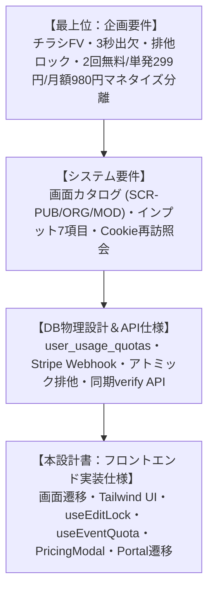

# フロントエンド画面・コンポーネント実装設計書（`front_implementation_spec.md`）

## チラシファースト型 イベント紹介ページ生成・出欠管理 ＆ 利用枠・課金決済基盤（Next.js App Router / React / Tailwind CSS / Stripe）

## 1. 全体アーキテクチャ・設計方針

本ドキュメントは、「機能別企画要件定義書」「システム要件定義書」「統合データベース物理設計書（DBschema.md）」「バックエンドAPI実装仕様書」に基づき、Next.js 14（App Router）、React 18、TypeScript、Tailwind CSSによるフロントエンド画面・UIコンポーネント・カスタムフックの実装仕様を定義する。

特に、**無料枠上限（2回）検知からの課金モーダル起動**、**Stripe Hosted Checkout への遷移**、**決済完了後の同期セッション検証（即時枠反映）**、および **Stripe Customer Portal（サブスク解約・カード変更）遷移** のフロントエンド挙動を完全統合して規定する。



### 1.1. 5大設計原則

1. **Flyer-First & Peek UI (視覚訴求とCTAの共存):**  
   - スマホのファーストビュー（FV）でチラシ画像（9:16）を美しくカード状に埋め込みつつ（`max-height: 65vh`）、画面下部に出欠フォームの頭部が自然に見える「Peek UI」および追従型「Sticky CTAバー」を実装し、FV直帰率35%以下・スクロール誘導を担保。  
2. **Zero-Friction RSVP (極小摩擦の出欠体験):**  
   - 参加者はアカウント作成不要。氏名・出欠トグル（参加/不参加）・追加コメントを入力するだけで3秒回答。端末Cookie（`rsvp_token`）をフックし、再訪時は自回答を自動プリフィル・上書き変更可能とする。  
3. **Robust Exclusive Lock UX (競合時の可視化):**  
   - 複数幹事の同時編集事故を防ぐため、期限を持たない排他ロック、30秒ごとの保持確認、他幹事編集中モーダル、および緊急時の「強制引き継ぎ（Takeover）」を完全なUI/UXとして実装。  
   - ロックを保持している本人の画面には、排他の状態や残り時間を表示しない。競合する幹事にだけ、保持者名を出す。  
4. **Seamless Checkout & Optimistic Verify (摩擦ゼロの決済・即時反映):**  
   - 無料枠（2回）消化時にバックエンドから返却される HTTP 402（Quota Exceeded）を検知し、課金選択モーダル（SCR-MOD-01）を起動。  
   - Stripe Hosted Checkout での支払い完了後、リダイレクトURL（`?session_id=...`）を検知してフロントエンドから同期的セッション検証（`POST /api/v1/billing/checkout/verify`）を直ちに実行。Webhookの非同期遅延を待たずに即時でイベント作成を再開できるUXを実現。  
5. **Self-Service Billing Portal (自己解決型サブスク管理):**  
   - 支払いが発生するのは、筆頭幹事が公開または複製で利用枠を使うときだけである。参加者の出欠では課金しない。会員かどうかは問わない。共同幹事も枠を消費しない。  
   - 「プラン・カード管理」は主催者ダッシュボードに置く。同じボタンをマイページにも置く。開く契約は、その会員が筆頭幹事として持つ利用枠であり、出欠の対価ではない。Stripe Customer Portal の完了後は、どちらの画面から開いても主催一覧へ戻る。

---

## 2. 画面ルーティング・画面一覧・画面遷移図（Mermaid）

### 2.1. ルーティングテーブル

| パス | 画面ID | 対象アクター | 認可・アクセス条件 | 概要 |
| :---- | :---- | :---- | :---- | :---- |
| `/` | SCR-PUB-00 | 全員 | 誰でも可 | ホーム。サービス名は `SITE.name`。未ログイン時のボタンは「主催者ログイン」。短い紹介と使い方、告知URLは主催者から受け取る案内。イベントの一覧・検索は置かない。料金の比較は `/service` |
| `/service` | SCR-PUB-06 | 見込み客 / 全員 | 誰でも可 | サービスと料金。無料2回、単発299円、月額980円。実施中のキャンペーンがあれば販売価格と定価を併記する。支払いは始めない |
| `/terms` | SCR-PUB-10 | 全員 | 誰でも可 | 利用規約。料金、期間限定キャンペーン、0円単発の条件、0円月額の自動更新、終了日の3日前・1日前の通知、解約と返金を定める |
| `/events/[id]` | SCR-PUB-01 | 参加者 / 全員 | 誰でも可（Cookie自動照会） | チラシFV埋め込み告知・未登録出欠登録画面。出欠フォームの直下に主催者勧誘カード（`OrganizerInviteCard`）を置く。幹事本人と主催イベント持ちの会員には出さない |
| `/organizer/events` | SCR-ORG-01 | 主催幹事 / 共同幹事 | 会員JWT または ゲスト幹事Cookie | 主催イベント一覧。冒頭 `h1` は画面名。出欠集計・クォータ残数・ポータル導線 |
| `/organizer/events/new` | SCR-ORG-02 | 主催幹事 | 任意（作成時スキップ可） | 新規イベント作成（インプット7項目・申し込み期限・チラシ生成・Checkout戻り検知）。冒頭 `h1` は画面名。公開状態は `PUBLISHED`、`visibility` は常に `UNLISTED`。`?ref=<イベントID>` を読み、作成本文の `referrerEventId` に載せる。未登録のまま公開したら `/organizer/register-required?eventId=` へ送る |
| `/organizer/register-required` | SCR-ORG-10 | 未登録の幹事 | ゲスト幹事 Cookie、または未ログイン（`eventId` はクエリ） | 公開直後の案内。共有 URL とコピー、`?mode=register` 付きの会員登録、ログイン。名簿・リマインド・領収書・招待は登録後であることを書く。登録済みの幹事は管理画面へ、第三者・不正な ID には案内を出さない。`noindex` |
| `/organizer/events/[id]/edit` | SCR-ORG-05 | 幹事（排他ロック保持） | 幹事権限 ＋ 排他ロック所持。未登録の幹事は作成から24時間以内 | イベント編集。複製した下書きだけ `PUBLISHED` にできる。保存後はロックを解放して主催一覧へ戻る。冒頭 `h1` は画面名、催し名はリード。ロックを保持している本人の画面には、排他の状態や残り時間を出さない。403 `REGISTER_REQUIRED` は `/organizer/register-required` へ送る |
| `/events/[id]/receipt` | SCR-PUB-04 | 参加者本人 | 出欠 Cookie または会員 | 自分の参加費領収書 |
| `/organizer/events/[id]/receipts/[participantId]` | SCR-ORG-09 | 幹事（会員のみ） | 幹事権限 ＋ 会員登録 | 幹事向け領収書。印刷しない冒頭 `h1` は画面名。催し名と宛名はリード。未登録の幹事は 403 `REGISTER_REQUIRED` |
| `/organizer/events/[id]/participants` | SCR-ORG-06 | 幹事（会員のみ） | 幹事権限 ＋ 会員登録 | 参加者名簿。冒頭 `h1` は画面名。催し名はリード。出欠の集計、CSV、参加者へのリマインドと文面コピー、参加者ページのプレビューと共有リンクのコピー、領収書発行。未登録の幹事は 403 `REGISTER_REQUIRED` |
| `/invitations/[code]` | SCR-ORG-07 | 招待されたメンバー | 招待コード有効期限内 | 共同幹事受諾。冒頭 `h1` は画面名。催し名はリード |
| `/mypage` | SCR-PUB-03 | 主催幹事（ログイン会員） | 会員JWT必須 | 主催者マイページ。**主催イベント一覧と契約管理だけ**を出し、他の幹事のイベントへの参加履歴は出さない（`GET /api/v1/organizer/events`）。参加履歴は SCR-PUB-09 へ分離。ログアウト（`POST /api/v1/auth/logout`） |
| `/participant/login` | SCR-PUB-07 | 参加者（履歴を残したい人） | 未ログイン、または電話未確認の会員。管理者も可（purpose `PARTICIPANT`） | 参加者の会員登録・ログイン。`/auth/register` と同じ部品を使い、文言と着地だけを参加者向けにする。`?step=phone` が電話番号確認、`?step=login-code` がログイン確認番号。着地は `/participant`（`next` があればそのパス） |
| `/participant` | SCR-PUB-08 | 参加者（ログイン会員） | 会員JWT必須 | 参加者ホーム。これからの参加、出席・欠席の件数、次のイベント、参加履歴への導線。主催者でもある会員には `/mypage` への切り替えを出す |
| `/participant/history` | SCR-PUB-09 | 参加者（ログイン会員） | 会員JWT必須 | 参加履歴（`GET /api/v1/user/participations`）。出欠・時期の絞り込み、ページ送り、領収書へのリンク。主催イベントの情報は出さない |
| `/account` | SCR-PUB-11 | 主催者・参加者（ログイン会員） | 会員JWT必須 | アカウント設定。表示名、メールアドレス、電話番号、パスワード、退会を縦に並べる。冒頭 `h1` は「アカウント設定」。主催者と参加者で同じ画面を使う |
| `/account/email/verify` | SCR-PUB-11 | 確認リンクを開いた会員 | 確認トークン（ログインは不要） | 新しいメールアドレスの確定。成功したら `/account` へ戻す。無効・期限切れは理由を出す |
| `/auth/register` | SCR-PUB-02 | 未ログインの幹事 | 未ログイン、または電話未確認の会員。管理者は不可（HTTP 403 `ADMIN_CONSOLE_REQUIRED`） | 主催者のローカル会員登録と Google サインイン（`GET /api/v1/auth/google`）。パスワード登録は確認メール後に電話番号を確認する。`?step=phone` が電話番号確認。`?step=login-code` がログイン確認番号。着地は `/mypage`、`/organizer`、`/invitations`、`/events`、`/participant` だけ。管理者が資格情報を送ると `/console/login` へのリンクだけを出す |
| `/auth/verify` | SCR-PUB-05 | 確認メールの受信者 | 確認トークン | パスワード登録のメール確認。成功後は電話番号確認へ進む。参加者入口から始めた登録は `?audience=participant` で `/participant/login?step=phone` へ送る。既に会員ならログインへ戻る |
| `/events` | — | — | — | 画面ではない。`/` へリダイレクトする |
| `/organizer/events/[id]` | — | — | — | 画面ではない。`/organizer/events/[id]/edit`（SCR-ORG-05）へリダイレクトする |
| `/console` | SCR-ADM-04 | プラットフォーム管理者 | `platformRole = ADMIN` | 管理者ホーム。冒頭 `h1` は画面名。ログイン後の着地。会員、イベント、決済、料金への入口 |
| `/console/login` | SCR-ADM-00 | プラットフォーム管理者 | 公開ナビに出さない。`noindex` | 管理者ログイン。冒頭 `h1` は画面名。パスワードのあと確認番号。確認済み電話が必須。成功後は `/console` |
| `/console/users` | SCR-ADM-01 | プラットフォーム管理者 | `platformRole = ADMIN` | 会員検索・権限変更。冒頭 `h1` は画面名 |
| `/console/events` | SCR-ADM-02 | プラットフォーム管理者 | `platformRole = ADMIN` | イベント検索。冒頭 `h1` は画面名。内容は変えない |
| `/console/payments` | SCR-ADM-03 | プラットフォーム管理者 | `platformRole = ADMIN` | 利用枠の決済履歴。冒頭 `h1` は画面名。返金操作はしない |
| `/console/pricing` | SCR-ADM-05 | プラットフォーム管理者 | `platformRole = ADMIN` | 価格キャンペーンの作成・編集・停止。冒頭 `h1` は画面名。監査ログを残し、既存購入者の割引は変えない |

---

### 2.2. 画面一覧

次節の遷移図に登場する画面・モーダル・外部決済画面。ページのパスと認可は 2.1 を正とする。モーダルと外部画面は独自のパスを持たない。

| 区分 | 画面ID | 画面名 | パス / 出現箇所 | 概要 |
| :---- | :---- | :---- | :---- | :---- |
| 公開 | SCR-PUB-00 | ホーム | `/` | 短いサービス紹介と使い方。告知URLは主催者から受け取る旨の案内。一覧・検索は置かない |
| 公開 | SCR-PUB-06 | サービス・プラン紹介 | `/service` | チラシと出欠の説明、料金3種、作成と主催者ログインへのボタン。Stripe は開かない。割引中は販売価格と定価を併記する |
| 公開 | SCR-PUB-10 | 利用規約 | `/terms` | 料金、価格キャンペーン、0円単発、0円月額の自動更新、3日前・1日前の通知、解約と返金 |
| 公開 | SCR-PUB-01 | イベント告知・出欠画面 | `/events/[id]` | チラシFV埋め込み告知と、未登録の3秒出欠。直下に主催者勧誘カード |
| 会員 | SCR-PUB-02 | 主催者の会員登録・ログイン | `/auth/register` | 幹事の入口。パスワード登録は確認メールのあと電話番号を確認する。ログインは確認番号（既定はSMS、予備はメール）。同じ確認済み電話番号なら既存会員へ結びつける。Google は確認済みメールだけ |
| 会員 | SCR-PUB-07 | 参加者の会員登録・ログイン | `/participant/login` | 履歴を残す参加者の入口。部品は SCR-PUB-02 と同じで、文言と着地だけを参加者向けにする。管理者も参加者としては入れる |
| 会員 | SCR-PUB-05 | メール確認 | `/auth/verify` | 確認メールのリンク。確認後は電話番号確認へ進む |
| 会員 | SCR-PUB-03 | 主催者マイページ | `/mypage` | 主催イベント一覧とログアウト。筆頭幹事の契約管理ボタン（出欠の対価ではない。復帰先は主催一覧）。参加履歴は出さない |
| 会員 | SCR-PUB-08 | 参加者ホーム | `/participant` | これからの参加、出席・欠席の件数、次のイベント、参加履歴への導線 |
| 会員 | SCR-PUB-09 | 参加履歴 | `/participant/history` | 出欠と領収書の一覧。出欠・時期で絞り込み、ページ送りする |
| 会員 | SCR-PUB-11 | アカウント設定 | `/account`（メール確認は `/account/email/verify`） | 表示名、メールアドレス、電話番号、パスワード、退会。変更の前に確認番号を出し、メールは新しいアドレスへのリンクで確定する。管理者は対象外 |
| 主催 | SCR-ORG-01 | 主催イベント一覧 | `/organizer/events` | 出欠集計、クォータ残数、編集・複製・招待、ポータル導線 |
| 主催 | SCR-ORG-02 | 新規イベント作成 | `/organizer/events/new` | インプット7項目、申し込み期限、チラシ生成、Checkout 戻り検知。公開状態は `PUBLISHED`。`?ref=` を参照元として送る |
| 主催 | SCR-ORG-10 | 公開直後の会員登録案内 | `/organizer/register-required` | 共有 URL のコピーと、会員登録・ログイン。名簿・リマインド・領収書・招待は登録後であることを伝える |
| 主催 | SCR-ORG-05 | イベント編集 | `/organizer/events/[id]/edit` | 排他ロック付きの編集。保存完了でロックを解放し、主催一覧へ戻る。未登録の幹事は作成から24時間以内 |
| 公開 | SCR-PUB-04 | 参加者向け領収書 | `/events/[id]/receipt` | 自分の参加費領収書。印刷できる |
| 主催 | SCR-ORG-09 | 幹事向け領収書 | `/organizer/events/[id]/receipts/[participantId]` | 出席者へ発行した領収書。再発行できる |
| 主催 | SCR-ORG-06 | 参加者名簿 | `/organizer/events/[id]/participants` | 出欠集計とコメント詳細 |
| 主催 | SCR-ORG-07 | 共同幹事受諾 | `/invitations/[code]` | 招待コードによる幹事権限のバインド |
| モーダル | SCR-ORG-03 | チラシ選択モーダル | SCR-ORG-02 上 | 生成済みチラシアセットの選択 |
| モーダル | SCR-ORG-04 | 公開完了モーダル | 公開成功時（SCR-ORG-02 上） | 共有リンクと、管理画面への復帰 |
| モーダル | SCR-MOD-02 | 排他ロック競合モーダル | SCR-ORG-05 上（HTTP 409） | 他幹事の編集中通知と、強制引き継ぎ（Takeover） |
| モーダル | SCR-MOD-01 | 課金プランモーダル | 公開時 HTTP 402 | 単発299円 / 月額980円の選択と Checkout 起動。割引中は販売価格と定価、期限を出す。0円の単発は「無料で受け取る」でその場で付与する |
| 外部 | — | Stripe Hosted Checkout | Stripe ホスト画面 | カード決済とサブスク加入。成功時は `session_id` 付きで SCR-ORG-02 へ戻る |
| 外部 | — | Stripe Customer Portal | Stripe ホスト画面 | 筆頭幹事の解約とカード変更。SCR-ORG-01 と SCR-PUB-03 から開き、完了後は SCR-ORG-01 へ戻る。参加者の出欠では開かない |
| 管理者 | SCR-ADM-00 | 管理者ログイン | `/console/login` | 公開ナビに出さない。パスワードのあと確認番号。確認済み電話が必須 |
| 管理者 | SCR-ADM-04 | 管理者ホーム | `/console` | ログイン後の着地。会員、イベント、決済への入口 |
| 管理者 | SCR-ADM-01 | 会員検索・権限変更 | `/console/users` | 名前・メールで検索し、他会員を管理者または会員にする |
| 管理者 | SCR-ADM-02 | イベント検索 | `/console/events` | 催し名・場所・幹事で検索する。下書きと削除済みを含む |
| 管理者 | SCR-ADM-03 | 利用枠の決済履歴 | `/console/payments` | 単発と月額の請求。失敗、返金、異議申立を含む。操作は検索だけ |
| 管理者 | SCR-ADM-05 | 料金キャンペーン | `/console/pricing` | 期間と対象を決めた割引・0円販売の作成、編集、停止。成立件数と売上を確認する |

---

### 2.3. 全体画面遷移図（Mermaid）

ホームは `/`（SCR-PUB-00）である。サービスと料金は `/service`（SCR-PUB-06）である。黒丸は UML の開始点で、画面 ID を持たない。流入経路は、黒丸から着地画面への矢印に書く。画面に入ったあとの遷移の正は共通編第6節である。

```mermaid
graph TD
    classDef public fill:#E0F2FE,stroke:#0284C7,stroke-width:2px;
    classDef organizer fill:#FEF3C7,stroke:#D97706,stroke-width:2px;
    classDef modal fill:#FEE2E2,stroke:#DC2626,stroke-width:2px;
    classDef member fill:#DCFCE7,stroke:#16A34A,stroke-width:2px;
    classDef stripe fill:#F3E8FF,stroke:#9333EA,stroke-width:2px;
    classDef admin fill:#EDE9FE,stroke:#6D28D9,stroke-width:2px;
    classDef initial fill:#111111,stroke:#111111,color:#111111;

    S_UNKNOWN((●)):::initial
    S_PROSPECT((●)):::initial
    S_SHARE((●)):::initial
    S_REVISIT((●)):::initial
    S_NEW((●)):::initial
    S_BACK((●)):::initial
    S_CO((●)):::initial
    S_MYPAGE((●)):::initial
    S_MAIL((●)):::initial
    S_ADM((●)):::initial

    subgraph attendee["参加者"]
        direction TB
        PUB00["SCR-PUB-00: ホーム<br/>/"]:::public
        PUB06["SCR-PUB-06: サービス・プラン紹介<br/>/service"]:::public
        PUB01["SCR-PUB-01: イベント告知・出欠画面<br/>/events/[id]"]:::public
        PUB04["SCR-PUB-04: 参加者向け領収書<br/>/events/[id]/receipt"]:::public
        PUB07["SCR-PUB-07: 参加者の会員登録・ログイン<br/>/participant/login"]:::member
        PUB08["SCR-PUB-08: 参加者ホーム<br/>/participant"]:::member
        PUB09["SCR-PUB-09: 参加履歴<br/>/participant/history"]:::member
        PUB03["SCR-PUB-03: 主催者マイページ<br/>/mypage"]:::member
    end
    subgraph org["主催者"]
        direction TB
        PUB02["SCR-PUB-02: 主催者の会員登録・ログイン<br/>/auth/register"]:::organizer
        PUB05["SCR-PUB-05: メール確認<br/>/auth/verify"]:::member
        ORG01["SCR-ORG-01: 主催イベント一覧<br/>/organizer/events"]:::organizer
        ORG02["SCR-ORG-02: 新規イベント作成<br/>/organizer/events/new"]:::organizer
        ORG05["SCR-ORG-05: イベント編集<br/>/organizer/events/[id]/edit"]:::organizer
        ORG06["SCR-ORG-06: 参加者名簿<br/>/organizer/events/[id]/participants"]:::organizer
        ORG09["SCR-ORG-09: 幹事向け領収書<br/>/organizer/events/[id]/receipts/[participantId]"]:::organizer
        ORG07["SCR-ORG-07: 共同幹事受諾<br/>/invitations/[code]"]:::organizer
        ORG03["SCR-ORG-03: チラシ選択モーダル"]:::modal
        ORG04["SCR-ORG-04: 公開完了モーダル"]:::modal
        MOD02["SCR-MOD-02: 排他ロック競合モーダル<br/>(他者編集中 / Takeover)"]:::modal
        subgraph bill["課金（筆頭幹事の利用枠だけ）"]
            direction TB
            MOD01["SCR-MOD-01: 課金プランモーダル<br/>(299円単発 / 980円サブスク)"]:::modal
            ST_CHECK["Stripe Hosted Checkout<br/>(カード決済・サブスク加入)"]:::stripe
            ST_PORTAL["Stripe Customer Portal<br/>(筆頭幹事の解約・カード変更)"]:::stripe
        end
    end
    subgraph admin["プラットフォーム管理者（公開画面からのリンクは無い）"]
        direction TB
        ADM00["SCR-ADM-00: 管理者ログイン<br/>/console/login"]:::admin
        ADM04["SCR-ADM-04: 管理者ホーム<br/>/console"]:::admin
        ADM01["SCR-ADM-01: 会員検索・権限変更<br/>/console/users"]:::admin
        ADM02["SCR-ADM-02: イベント検索<br/>/console/events"]:::admin
        ADM03["SCR-ADM-03: 利用枠の決済履歴<br/>/console/payments"]:::admin
    end
    %% 流入（黒丸）
    S_UNKNOWN -->|Google検索・ブックマーク・SNS| PUB00
    S_PROSPECT -->|検索広告・比較記事・紹介| PUB06
    S_MAIL -->|確認メールのリンク| PUB05
    PUB00 -->|作り方を知る| PUB06
    PUB06 -->|イベントを作る| ORG02
    S_SHARE -->|共有URL（LINE・SNS）| PUB01
    S_REVISIT -->|告知URL| PUB01
    S_REVISIT -->|未ログイン| PUB00
    S_REVISIT -->|ログイン済み| PUB03
    S_NEW -->|新規幹事| PUB00
    S_BACK -->|未ログイン| PUB02
    S_BACK -->|ログイン済み、または管理ブックマーク| ORG01
    S_CO -->|招待URL| ORG07
    S_MYPAGE -->|主催一覧| ORG01
    S_MYPAGE -->|編集| ORG05
    S_MYPAGE -->|契約管理| ST_PORTAL
    S_ADM -->|ブックマーク、または渡されたURL| ADM00
    %% 遷移線
    PUB00 -->|イベントを作る| ORG02
    PUB00 -->|主催者ログイン| PUB02
    PUB03 -->|参加履歴のイベントを開く| PUB01
    PUB03 -->|主催イベントの編集| ORG05
    PUB03 -->|ログアウト| PUB00
    PUB05 -->|確認完了: ?step=phone またはログイン| PUB02
    ORG01 -->|新規作成ボタン| ORG02
    ORG01 -.->|未ログイン 401| PUB02
    ORG02 -->|チラシを選択| ORG03
    ORG03 -->|アセット決定| ORG02
    ORG02 -->|公開リクエスト: 上限未達| ORG04
    ORG02 -->|公開リクエスト: 上限到達 HTTP 402| MOD01
    %% 課金・Stripe遷移
    MOD01 -->|単発299円 または 月額980円選択| ST_CHECK
    ST_CHECK -->|決済成功: redirect session_id| ORG02
    ORG01 -->|筆頭幹事の契約管理| ST_PORTAL
    PUB03 -->|同じ会員の筆頭幹事契約| ST_PORTAL
    ST_PORTAL -->|完了後に復帰| ORG01
    ORG04 -->|共有リンク| PUB01
    ORG04 -->|管理ダッシュボードへ| ORG01
    PUB01 -->|3秒出欠登録 Cookie付与| PUB01
    PUB01 -->|自分の領収書| PUB04
    PUB04 -->|告知へ戻る| PUB01
    PUB03 -->|自分の領収書| PUB04
    PUB01 -->|出欠履歴を会員に残す| PUB02
    PUB02 -->|next なし: マイページ| PUB03
    PUB02 -->|next=/organizer/events| ORG01
    PUB02 -->|"next=/invitations/[code]"| ORG07
    PUB02 -->|管理者の資格情報: 403 管理者コンソール必須| ADM00
    ORG01 -->|編集ボタン| ORG05
    ORG05 -.->|他幹事編集中 409 Conflict| MOD02
    MOD02 -->|強制引き継ぎ Takeover| ORG05
    ORG05 -->|保存完了 ロック解放| ORG01
    ORG01 -->|出欠確認ボタン| ORG06
    ORG01 -->|コピー作成| ORG05
    ORG01 -->|共同幹事を招待| ORG07
    ORG06 -->|編集へ戻る| ORG05
    ORG06 -->|領収書を発行・再発行| ORG09
    ORG09 -->|名簿へ戻る| ORG06
    ORG07 -->|受諾完了| ORG01
    ORG07 -->|未ログイン: ログインしてから受諾| PUB02
    ADM00 -->|ADMIN かつパスワード一致| ADM04
    ADM04 -->|会員を探す| ADM01
    ADM04 -->|イベントを探す| ADM02
    ADM04 -->|決済を見る| ADM03
    ADM01 -->|ホームへ| ADM04
    ADM02 -->|ホームへ| ADM04
    ADM03 -->|ホームへ| ADM04
    ADM01 -->|他会員の platformRole を変更| ADM01
    ADM01 -->|イベントを探す| ADM02
    ADM02 -->|会員を探す| ADM01
    ADM01 -->|決済を見る| ADM03
    ADM03 -->|会員を探す| ADM01
    ADM02 -->|決済を見る| ADM03
    ADM02 -->|公開ページを開く| PUB01
    ADM04 -->|ログアウト| ADM00
    ADM01 -->|ログアウト| ADM00
    ADM02 -->|ログアウト| ADM00
    ADM03 -->|ログアウト| ADM00
```



会員登録の主目的は幹事である。ログイン完了後の着地は `next` で決まり、指定が無ければマイページ（SCR-PUB-03）である。電話番号が未確認のまま主催一覧や作成を使おうとしたときは、`next=/organizer/events` または `next=/organizer/events/new` で元の画面へ戻る。招待の途中なら `next=/invitations/[code]` で受諾画面へ戻る。参加者が出欠履歴を残すときと、申込一覧を見るためのログインもマイページへ進む。出欠の回答に会員登録は要らない。完全な遷移は共通編第6節を正とする。

SCR-PUB-02 は会員（`MEMBER`）専用である。管理者（`ADMIN`）が資格情報を送ると HTTP 403（`ADMIN_CONSOLE_REQUIRED`）で拒否し、画面には管理者ログイン（SCR-ADM-00）へのリンクだけを出す。管理者は SCR-ADM-00 からしか入れない。Google のコールバックも管理者を SCR-ADM-00 へ戻す。管理者の着地は常に SCR-ADM-04 である。

確認メールのリンクは SCR-PUB-05 に着地する。確認が済むと SCR-PUB-02 の電話番号確認（`?step=phone`）へ進み、既に会員ならログインへ戻る。

領収書は行き止まりではない。参加者は SCR-PUB-01 または SCR-PUB-03 から SCR-PUB-04 を開き、SCR-PUB-01 へ戻る。幹事は SCR-ORG-06 から SCR-ORG-09 を発行・再発行し、SCR-ORG-06 へ戻る。

`/events` と `/organizer/events/[id]` は独立した画面ではない。前者は `/` へ、後者は `/organizer/events/[id]/edit`（SCR-ORG-05）へリダイレクトする。

課金の塊へ入るのは、筆頭幹事の公開要求（HTTP 402）と、その会員の契約管理だけである。SCR-PUB-03 からポータルを開く線は、参加の支払いではなく、同じアカウントの主催者契約を開く。復帰先は SCR-ORG-01 である。Checkout のあと作成画面へ戻り、枠がある状態で公開すると公開完了モーダルへ進む。複製の着地は編集画面である。

サービス・プラン紹介（SCR-PUB-06）は `src/app/service/page.tsx` である。金額は `src/modules/billing/lib/plans.ts` の定数を表示する。ボタンは作成画面とホームへ進む。Checkout は呼ばない。見込み客の着地は、検索広告、比較記事、知人の紹介、およびホームと公開ナビとフッターの「サービスと料金」である。確認メール、Checkout の戻り、Portal の終了、領収書のリンクは、共通編第3.1節の流入経路を正とする。

---

## 3. コンポーネント階層ツリー＆ディレクトリ構成

```text
src/
├── app/
│   ├── page.tsx                              # SCR-PUB-00 (ホーム。SITE.name とサービス紹介。一覧は置かない)
│   ├── service/page.tsx                      # SCR-PUB-06 (サービス・プラン紹介。支払いは始めない)
│   ├── events/[id]/page.tsx                   # SCR-PUB-01 (公開告知・出欠。期限後は新規と変更を止める)
│   ├── events/[id]/receipt/page.tsx           # SCR-PUB-04 (参加者向け領収書)
│   ├── organizer/
│   │   ├── events/
│   │   │   ├── page.tsx                       # SCR-ORG-01 (主催イベント一覧・クォータ残数・ポータル)
│   │   │   ├── new/page.tsx                   # SCR-ORG-02 (新規作成・チラシ生成・Stripe戻り同期検知)
│   │   │   ├── [id]/
│   │   │   │   ├── edit/page.tsx              # SCR-ORG-05 (イベント編集。保存後はロック解放して一覧へ)
│   │   │   │   ├── participants/page.tsx      # SCR-ORG-06 (参加者名簿・領収書発行)
│   │   │   │   └── receipts/[participantId]/page.tsx # SCR-ORG-09 (幹事向け領収書)
│   │   └── register-required/page.tsx         # SCR-ORG-10 (公開直後の会員登録案内・共有URLコピー)
│   ├── invitations/[code]/page.tsx            # SCR-ORG-07 (共同幹事受諾)
│   ├── mypage/page.tsx                        # SCR-PUB-03 (プロフィール・参加履歴・ログアウト・サブスク管理)
│   ├── auth/register/page.tsx                 # SCR-PUB-02 (ローカル登録・Googleサインイン・ログイン確認番号・電話番号確認・Hydration)
│   └── console/
│       ├── page.tsx                           # SCR-ADM-04 (管理者ホーム。ログイン後の着地)
│       ├── login/page.tsx                     # SCR-ADM-00 (管理者ログイン。確認番号のあとホームへ)
│       ├── users/page.tsx                     # SCR-ADM-01 (会員検索・権限変更)
│       ├── events/page.tsx                    # SCR-ADM-02 (イベント検索)
│       └── payments/page.tsx                  # SCR-ADM-03 (利用枠の決済履歴)
├── components/
│   ├── public/
│   │   ├── PosterHero.tsx                     # チラシFV埋め込み・LQIPブラー・Peek UI
│   │   ├── EventMetaCard.tsx                  # 7項目の実用アクション（カレンダー・地図等）
│   │   ├── DynamicRsvpBox.tsx                 # 未登録出欠フォーム 兼 再訪自動照会
│   │   ├── OrganizerInviteCard.tsx            # SCR-PUB-01 出欠フォーム直下の主催者勧誘（12.1）
│   │   └── StickyRsvpBar.tsx                  # モバイル画面下部追従CTAバー
│   ├── organizer/
│   │   ├── EventCard.tsx                      # 主催一覧の各イベントカード（出欠集計バー付）
│   │   ├── EventForm.tsx                      # 基本項目入力。開催日時と費用プランは1〜8件。男女別では対象を固定表示し、プラン名は組で共通、組単位で追加・削除
│   │   ├── QuotaStatusBanner.tsx              # クォータ残数表示・アップグレード導線
│   │   ├── StripePortalButton.tsx             # Stripe Customer Portal 遷移ボタン
│   │   ├── VerifyPaymentBanner.tsx            # Stripe Checkout戻り時の同期検証バナー
│   │   ├── FlyerGeneratePanel.tsx             # SCR-ORG-02/05 (POST /api/v1/flyers/generate)
│   │   ├── FlyerAssetPickerModal.tsx          # SCR-ORG-03 (チラシ選択)
│   │   ├── PublishSuccessModal.tsx            # SCR-ORG-04 (公開完了・共有URL)
│   │   ├── ParticipantListTable.tsx           # SCR-ORG-06 (出欠テーブル・フィルタ)
│   │   └── InviteOrganizerModal.tsx           # SCR-ORG-07 (招待URL発行)
│   ├── common/
│   │   ├── LockConflictModal.tsx              # 排他ロック競合・Takeover
│   │   ├── PricingModal.tsx                   # SCR-MOD-01 (課金プラン選択・Checkout起動)
│   │   ├── Navbar.tsx                         # 共通ヘッダー。役割と画面領域で機能を出し分ける（3.1）
│   │   ├── SiteChrome.tsx                     # 公開ヘッダーとフッター。`/console` では隠す
│   │   └── Toast.tsx                          # トースト通知
│   └── hooks/
│       ├── useEditLock.ts                     # 排他ロック・保持確認・Takeover管理
│       ├── useRsvp.ts                         # 出欠登録・Cookie照会・楽観的更新
│       ├── useEventQuota.ts                   # クォータ照会・Checkout起動・Portal遷移
│       └── useEventForm.ts                    # イベント作成/編集フォーム状態管理
├── lib/
│   └── site.ts                                # サービス表示と公開クロムの定数テーブル（仮置き name は EventKreater。ナビは SITE.nav）
├── modules/auth/components/LoginChallengeForm.tsx  # ログイン確認番号（SMS / メール）
└── types/
    └── event.ts                               # 型定義（Event, Participant, Lock, Quota等）
```

---

### 3.1. 共通ヘッダーのステークホルダー別出し分け

要件は共通編の第2.4.1節を正とする。`src/components/common/Navbar.tsx` は、`GET /api/v1/user/profile` の `isOrganizer` と `usePathname()` の 2 つだけで表示を決める。ログインし直さずに役割を切り替えられる。

| 状態 | 判定 | 並べる機能 |
| :--- | :--- | :--- |
| 未ログイン | `profile` が 401、または読み込み中 | サービスと料金、イベントを作る、参加者ログイン、主催者ログイン |
| 参加者（主催イベントなし） | ログイン済み、`isOrganizer === false` | 参加者ホーム、参加履歴、アカウント、主催者として使う |
| 主催者・参加者画面 | ログイン済み、`isOrganizer === true`、パスが主催者画面以外 | 参加者ホーム、参加履歴、アカウント、主催者マイページ |
| 主催者・主催者画面 | ログイン済み、パスが `/mypage`、`/organizer`、`/invitations` | 主催一覧、イベントを作る、主催者マイページ、アカウント、参加者として見る |

* 主催者画面に参加履歴（SCR-PUB-09）を出さない。参加者画面に主催一覧・イベント作成・利用枠を出さない。切り替えはヘッダーの 1 本に集約し、各画面の本文に同じ行き先のボタンや参加履歴へのリンクを重ねない。
* リンクの文言とパスは `SITE.nav` から読む。`SITE.nav.organizerSwitch`、`SITE.nav.participantSwitch`、`SITE.nav.account` を使う。イベント一覧を持たないため、`SITE.nav.eventSearch` は置かない。
* アカウント（SCR-PUB-11）は、主催者画面と参加者画面のどちらにも出す。主催者と参加者で同じ `/account` を開く。管理コンソールのバーには出さない。
* 表示中のリンクは `aria-current="page"` と `is-current` を付ける。`/participant` は配下の `/participant/history` と区別する。
* 管理コンソールへのリンクはどの状態でも出さない。

---

## 4. 課金・クォータ・ポータル関連UIコンポーネント詳細実装

### 4.1. PricingModal.tsx（SCR-MOD-01: 課金プラン選択・Checkout遷移モーダル）

イベント作成時に HTTP 402（QUOTA_EXCEEDED）が発生した際、または主催者一覧でアップグレードを押した際に表示する。単発チケットと月額プランを選ぶと、バックエンドから Stripe Hosted Checkout の URL を取得して画面遷移する。`quotes` があるときは販売価格と定価を併記し、期限とキャンペーン名を出す。単発が 0 円のときのボタンは「無料で受け取る」で、Stripe へは行かず、その場で付与する。0 円の月額はカード登録を必須にし、無料期間の終了後に自動で有料へ切り替わることを本文と `/terms` へのリンクで示す。

```tsx
"use client";

import Link from "next/link";
import { useState } from "react";
import { ONE_TIME_PRICE_JPY, SUBSCRIPTION_PRICE_JPY } from "@/modules/billing/lib/plans";
import type { PricingQuote } from "@/modules/events/types";

interface PricingModalProps {
  isOpen: boolean;
  onClose: () => void;
  onSelectOneTime: () => Promise<unknown>;
  onSelectSubscription: () => Promise<unknown>;
  /** いまの販売価格。無いときは定価で表示する。 */
  quotes?: { oneTime: PricingQuote; subscription: PricingQuote } | null;
  freeGrantRemaining?: number;
  onGranted?: () => void;
}

function endsAtLabel(iso: string | null): string | null {
  if (!iso) return null;
  return new Intl.DateTimeFormat("ja-JP", {
    timeZone: "Asia/Tokyo",
    month: "numeric",
    day: "numeric",
    hour: "2-digit",
    minute: "2-digit",
  }).format(new Date(iso));
}

function PriceBlock({ quote, fallback }: { quote: PricingQuote | null; fallback: number }) {
  const charged = quote?.chargedPrice ?? fallback;
  const list = quote?.listPrice ?? fallback;
  const discounted = charged < list;
  const deadline = endsAtLabel(quote?.campaignEndsAt ?? null);

  return (
    <div>
      {discounted && (
        <p className="eyebrow" style={{ color: "var(--color-primary-text)" }}>
          {quote?.discountKind === "FREE" ? "全額無料" : `${quote?.discountPercent}%OFF`}
          {quote?.campaignName ? ` ・ ${quote.campaignName}` : ""}
        </p>
      )}
      <p className="stat__value">
        ¥{charged.toLocaleString("ja-JP")}
        {discounted && (
          <span
            style={{
              marginLeft: "0.5rem",
              fontSize: "0.875rem",
              color: "var(--color-text-faint)",
              textDecoration: "line-through",
            }}
          >
            ¥{list.toLocaleString("ja-JP")}
          </span>
        )}
      </p>
      {discounted && deadline && (
        <p className="help">
          {quote?.campaignEndsAt ? `${endsAtLabel(quote.campaignEndsAt)} まで` : ""}
          {quote?.target === "SUBSCRIPTION" ? "（加入から割引月数ぶん適用）" : ""}
        </p>
      )}
    </div>
  );
}

export function PricingModal({
  isOpen,
  onClose,
  onSelectOneTime,
  onSelectSubscription,
  quotes,
  freeGrantRemaining,
  onGranted,
}: PricingModalProps) {
  const [loadingPlan, setLoadingPlan] = useState<"SINGLE" | "SUB" | null>(null);
  const [error, setError] = useState<string | null>(null);

  if (!isOpen) return null;

  const oneTime = quotes?.oneTime ?? null;
  const subscription = quotes?.subscription ?? null;
  const isFree = oneTime?.chargedPrice === 0;
  const freeExhausted = isFree && freeGrantRemaining === 0;

  const handleOneTime = async () => {
    setLoadingPlan("SINGLE");
    setError(null);
    try {
      const result = await onSelectOneTime();
      if (result === "GRANTED") {
        onGranted?.();
        onClose();
        return;
      }
      if (result === "LIMITED") {
        setError("このキャンペーンでの受け取りは上限に達しています。単発チケットか月額プランをご利用ください。");
      } else if (result === "PHONE_REQUIRED") {
        setError("0円で受け取るには電話番号の確認が必要です。");
      }
      setLoadingPlan(null);
    } catch (cause) {
      setError(cause instanceof Error ? cause.message : "単発購入セッション作成に失敗しました");
      setLoadingPlan(null);
    }
  };

  const handleSubscription = async () => {
    setLoadingPlan("SUB");
    setError(null);
    try {
      await onSelectSubscription();
    } catch (cause) {
      setError(cause instanceof Error ? cause.message : "サブスクリプションセッション作成に失敗しました");
      setLoadingPlan(null);
    }
  };

  return (
    <div className="modal" style={{ display: "flex" }}>
      <button type="button" className="modal__backdrop" aria-label="閉じる" onClick={onClose} />
      <div className="dialog" role="dialog" aria-modal="true">
        <h3 className="dialog__title">課金プラン選択</h3>
        <p className="dialog__body">継続して告知ページを作るには、次のどちらかを選びます。</p>
        <div className="stack" style={{ marginTop: "1.25rem" }}>
          <article className="card">
            <h4 className="card__title">単発チケット</h4>
            <PriceBlock quote={oneTime} fallback={ONE_TIME_PRICE_JPY} />
            <p className="card__body">
              1回分。スポット開催に。
              {isFree && ` おひとり${oneTime?.freePerUserLimit ?? 1}回まで無料です。`}
            </p>
            <button
              type="button"
              onClick={() => void handleOneTime()}
              disabled={loadingPlan !== null || freeExhausted}
              className="btn btn--block"
            >
              {loadingPlan === "SINGLE"
                ? "処理中..."
                : freeExhausted
                  ? "このキャンペーンは受け取り済みです"
                  : isFree
                    ? "無料で受け取る"
                    : "単発で購入する"}
            </button>
          </article>
          <article className="card" style={{ borderTop: "3px solid var(--color-primary)" }}>
            <p className="eyebrow">月4回以上でおトク</p>
            <h4 className="card__title">月額使い放題</h4>
            <PriceBlock quote={subscription} fallback={SUBSCRIPTION_PRICE_JPY} />
            <p className="card__body">
              生成無制限、共同幹事、複製。
              {subscription?.chargedPrice === 0
                ? " 無料期間の終了後は、登録したカードへ自動で請求します。"
                : ""}
            </p>
            <button
              type="button"
              onClick={() => void handleSubscription()}
              disabled={loadingPlan !== null}
              className="btn btn--primary btn--block"
            >
              {loadingPlan === "SUB"
                ? "Stripeへ接続中..."
                : subscription?.chargedPrice === 0
                  ? "0円で定期購入を始める"
                  : "定期購入で使い放題"}
            </button>
          </article>
        </div>
        {error && <p className="alert alert--error" style={{ marginTop: "1rem" }}>{error}</p>}
        <p className="help" style={{ marginTop: "1rem" }}>
          0円の月額は無料期間の終了後に自動で有料へ切り替わります。終了の3日前と1日前にメールでお知らせします。詳しくは
          <Link href="/terms" className="text-link">
            利用規約
          </Link>
          をご確認ください。
        </p>
        <div className="dialog__actions">
          <button type="button" onClick={onClose} disabled={loadingPlan !== null} className="btn btn--ghost btn--block">
            キャンセルして下書きに戻る
          </button>
        </div>
      </div>
    </div>
  );
}
```

---

### 4.2. VerifyPaymentBanner.tsx（Stripe Checkout完了後の即時同期検証バナー）

Stripe Checkout 完了後にリダイレクトされた際（URLに `?session_id=...` が存在）、バックエンドの `POST /api/v1/billing/checkout/verify` を即時呼び出し、画面をリロードすることなく枠を即時反映させます。

```tsx
"use client";
import React, { useEffect, useState } from "react";
import { CheckCircle2, Loader2, AlertCircle } from "lucide-react";
import { useRouter, useSearchParams } from "next/navigation";
interface VerifyPaymentBannerProps {
  onVerified: () => void;
}
export const VerifyPaymentBanner: React.FC<VerifyPaymentBannerProps> = ({ onVerified }) => {
  const searchParams = useSearchParams();
  const router = useRouter();
  const sessionId = searchParams.get("session_id");
  const [status, setStatus] = useState<"IDLE" | "VERIFYING" | "SUCCESS" | "ERROR">("IDLE");
  const [errorMessage, setErrorMessage] = useState<string | null>(null);
  useEffect(() => {
    if (!sessionId || status !== "IDLE") return;
    const verify = async () => {
      setStatus("VERIFYING");
      try {
        const res = await fetch("/api/v1/billing/checkout/verify", {
          method: "POST",
          headers: { "Content-Type": "application/json" },
          body: JSON.stringify({ sessionId }),
        });
        if (!res.ok) {
          const errData = await res.json();
          throw new Error(errData.detail || "決済の確認に失敗しました。");
        }
        setStatus("SUCCESS");
        onVerified();
        // 3秒後にクエリパラメータをURLから除去
        setTimeout(() => {
          router.replace("/organizer/events/new");
        }, 3000);
      } catch (err: any) {
        console.error("Session verification failed", err);
        setStatus("ERROR");
        setErrorMessage(err.message);
      }
    };
    verify();
  }, [sessionId, status, onVerified, router]);
  if (status === "IDLE" || !sessionId) return null;
  return (
    <div className="mb-6 rounded-2xl p-4 transition-all">
      {status === "VERIFYING" && (
        <div className="flex items-center space-x-3 rounded-xl bg-indigo-500/10 p-4 border border-indigo-500/20 text-indigo-300">
          <Loader2 className="h-5 w-5 animate-spin text-indigo-400 shrink-0" />
          <p className="text-xs font-semibold sm:text-sm">
            Stripeでの決済完了を確認しています。そのまま少々お待ちください...
          </p>
        </div>
      )}
      {status === "SUCCESS" && (
        <div className="flex items-center space-x-3 rounded-xl bg-emerald-500/10 p-4 border border-emerald-500/20 text-emerald-300">
          <CheckCircle2 className="h-5 w-5 text-emerald-400 shrink-0" />
          <p className="text-xs font-semibold sm:text-sm">
            お支払いが確認できました！作成枠が付与されました。イベントの公開を完了してください。
          </p>
        </div>
      )}
      {status === "ERROR" && (
        <div className="flex items-center space-x-3 rounded-xl bg-rose-500/10 p-4 border border-rose-500/20 text-rose-300">
          <AlertCircle className="h-5 w-5 text-rose-400 shrink-0" />
          <p className="text-xs font-semibold sm:text-sm">
            {errorMessage || "決済の確認が完了できませんでした。少し時間をおいて再読み込みしてください。"}
          </p>
        </div>
      )}
    </div>
  );
};
```

---

### 4.3. StripePortalButton.tsx（Stripe Customer Portal 遷移ボタン）

筆頭幹事のサブスクリプション解約とカード変更に使う。主催者ダッシュボード（`/organizer/events`）とマイページ（`/mypage`）に置く。マイページのボタンも出欠の支払いではなく、同じ会員が持つ主催者契約を開く。復帰先は主催一覧である。

```tsx
"use client";
import React, { useState } from "react";
import { CreditCard, ExternalLink, Loader2 } from "lucide-react";
interface StripePortalButtonProps {
  className?: string;
  variant?: "outline" | "ghost" | "default";
}
export const StripePortalButton: React.FC<StripePortalButtonProps> = ({
  className = "",
  variant = "outline",
}) => {
  const [isLoading, setIsLoading] = useState(false);
  const handleOpenPortal = async () => {
    setIsLoading(true);
    try {
      const res = await fetch("/api/v1/billing/portal", {
        method: "POST",
      });
      if (!res.ok) {
        throw new Error("カスタマーポータルの取得に失敗しました");
      }
      const data = await res.json();
      if (data.portalUrl) {
        window.location.href = data.portalUrl;
      }
    } catch (error) {
      console.error(error);
      alert("カスタマーポータルを開けませんでした。ログイン状態をご確認ください。");
    } finally {
      setIsLoading(false);
    }
  };
  const baseStyle =
    "inline-flex items-center justify-center rounded-xl text-xs font-semibold transition active:scale-95 disabled:opacity-50";
  const variants = {
    default: "bg-slate-700 text-white hover:bg-slate-600 px-3.5 py-2",
    outline: "border border-slate-700 bg-slate-800/80 text-slate-300 hover:bg-slate-700 px-3.5 py-2",
    ghost: "text-slate-400 hover:text-white px-2 py-1",
  };
  return (
    <button
      onClick={handleOpenPortal}
      disabled={isLoading}
      className={`${baseStyle} ${variants[variant]} ${className}`}
    >
      {isLoading ? (
        <>
          <Loader2 className="mr-1.5 h-3.5 w-3.5 animate-spin" />
          ポータルへ接続中...
        </>
      ) : (
        <>
          <CreditCard className="mr-1.5 h-3.5 w-3.5 text-indigo-400" />
          プラン・カード管理
          <ExternalLink className="ml-1 h-3 w-3 text-slate-500" />
        </>
      )}
    </button>
  );
};
```

---

### 4.4. QuotaStatusBanner.tsx（クォータ残数＆プラン状態表示バー）

主催者一覧画面（SCR-ORG-01）のヘッダー直下に配置し、現在の利用可能状態を一目で提示する。適用中の割引があるときは、無料期間または割引率と終了日時、終了後は月額980円を自動で請求すること、終了の3日前と1日前にメールで知らせることを出す。0円の単発チケットが受け取れるときは、その残り回数と受取ボタンを出す。

```tsx
"use client";

import Link from "next/link";
import type { UserQuota } from "@/modules/events/types";

interface QuotaStatusBannerProps {
  quota: UserQuota | null;
  onOpenPricing: () => void;
  nextPath?: string;
}

function dateLabel(iso: string): string {
  return new Intl.DateTimeFormat("ja-JP", {
    timeZone: "Asia/Tokyo",
    year: "numeric",
    month: "numeric",
    day: "numeric",
    hour: "2-digit",
    minute: "2-digit",
  }).format(new Date(iso));
}

export function QuotaStatusBanner({ quota, onOpenPricing, nextPath = "/organizer/events" }: QuotaStatusBannerProps) {
  if (!quota) return null;
  const needsPhone = quota.planType === "FREE_TRIAL" && quota.phoneVerified === false;
  const isSubscribed = quota.subscriptionStatus === "ACTIVE";
  const discount = quota.discount;
  const discountLabel = discount
    ? `${discount.percent >= 100 ? "無料期間" : `${discount.percent}%割引`}（${dateLabel(discount.endsAt)} まで）`
    : null;
  const freeTicketAvailable = (quota.freeGrantRemaining ?? 0) > 0 && quota.pricing?.oneTime.chargedPrice === 0;

  const tone =
    quota.subscriptionStatus === "PAST_DUE" || !quota.canCreate || needsPhone
      ? "alert--warning"
      : isSubscribed
        ? "alert--info"
        : "alert--success";

  const message = needsPhone
    ? "無料枠を使うには電話番号の確認が必要です。"
    : quota.subscriptionStatus === "PAST_DUE"
      ? "お支払いに問題があります。カードを更新してください。"
      : isSubscribed
        ? discountLabel
          ? `月額プラン加入中です。${discountLabel}。終了後は月額980円を自動で請求します（終了の3日前と1日前にメールでお知らせします）。`
          : "月額プラン加入中です。イベント生成は無制限です。"
        : `無料トライアル残り ${quota.remainingFree}回${quota.paidCredits > 0 ? `（単発クレジット ${quota.paidCredits}回）` : ""}${
            freeTicketAvailable ? ` ・ 0円チケットがあと${quota.freeGrantRemaining}回受け取れます` : ""
          }`;

  return (
    <div className={`alert ${tone}`} style={{ display: "flex", justifyContent: "space-between", gap: "1rem", flexWrap: "wrap" }}>
      <p>
        {message}{" "}
        {needsPhone && (
          <Link href={`/auth/register?step=phone&next=${encodeURIComponent(nextPath)}`} className="btn btn--outline btn--sm">
            電話番号を確認する
          </Link>
        )}
        {isSubscribed && discount && (
          <Link href="/terms" className="text-link">
            解約と自動更新の条件
          </Link>
        )}
      </p>
      {!isSubscribed && (
        <button type="button" onClick={onOpenPricing} className="btn btn--primary btn--sm">
          {freeTicketAvailable ? "0円チケットを受け取る" : "使い放題プランを見る"}
        </button>
      )}
    </div>
  );
}
```

---

## 5. 課金＆クォータ統合カスタムフック (`useEventQuota.ts`)

クォータ情報の取得、Stripe Hosted Checkout の呼び出し、および Customer Portal へのリダイレクトを一元管理する。料金モーダルを開くたびに `GET /api/v1/billing/quota` を取り直し、最新の販売価格と0円チケットの残り回数を反映する。0円の単発は付与結果を受けて枠を読み直し、呼び出し元が公開を再試行できるようにする。

```tsx
"use client";

import { useCallback, useEffect, useState } from "react";
import type { UserQuota } from "@/modules/events/types";
import { problemMessage, readProblemBody } from "@/lib/problem";

export type OneTimeCheckoutResult = "GRANTED" | "LIMITED" | "REDIRECT" | "PHONE_REQUIRED";

export function useEventQuota() {
  const [quota, setQuota] = useState<UserQuota | null>(null);
  const [isLoading, setIsLoading] = useState(true);
  const [isPricingModalOpen, setIsPricingModalOpen] = useState(false);

  const fetchQuota = useCallback(async () => {
    try {
      const res = await fetch("/api/v1/billing/quota");
      if (res.ok) {
        const data = (await res.json()) as UserQuota;
        setQuota(data);
      } else {
        setQuota(null);
      }
    } catch (error) {
      console.error("クォータ取得に失敗しました", error);
    } finally {
      setIsLoading(false);
    }
  }, []);

  useEffect(() => {
    void fetchQuota();
  }, [fetchQuota]);

  const openPricingModal = useCallback(() => {
    // 開くたびに最新の販売価格を取り直す。
    void fetchQuota();
    setIsPricingModalOpen(true);
  }, [fetchQuota]);

  /**
   * 0円キャンペーン中は Stripe へ行かず、その場で1回分が付与される。
   * 付与されたら枠を読み直して、作成画面がそのまま再試行できるようにする。
   */
  const startOneTimeCheckout = useCallback(async (): Promise<OneTimeCheckoutResult> => {
    const res = await fetch("/api/v1/billing/checkout/one-time", {
      method: "POST",
      headers: { "Idempotency-Key": crypto.randomUUID() },
    });
    if (!res.ok) {
      const problem = await readProblemBody(res);
      if (problem.error === "PHONE_REQUIRED") {
        window.location.href = "/auth/register?step=phone&next=/organizer/events/new";
        return "PHONE_REQUIRED";
      }
      throw new Error(problemMessage(problem, "単発決済セッション作成に失敗しました"));
    }
    const data = (await res.json()) as {
      checkoutUrl?: string;
      granted?: boolean;
      limited?: boolean;
    };
    if (data.limited) {
      await fetchQuota();
      return "LIMITED";
    }
    if (data.granted) {
      await fetchQuota();
      return "GRANTED";
    }
    if (data.checkoutUrl) {
      window.location.href = data.checkoutUrl;
      return "REDIRECT";
    }
    throw new Error("単発決済セッション作成に失敗しました");
  }, [fetchQuota]);

  const startSubscriptionCheckout = useCallback(async () => {
    const res = await fetch("/api/v1/billing/checkout/subscription", {
      method: "POST",
      headers: { "Idempotency-Key": crypto.randomUUID() },
    });
    if (!res.ok) {
      throw new Error(problemMessage(await readProblemBody(res), "サブスクセッション作成に失敗しました"));
    }
    const data = (await res.json()) as { checkoutUrl?: string };
    if (data.checkoutUrl) {
      window.location.href = data.checkoutUrl;
    }
  }, []);

  const openCustomerPortal = useCallback(async () => {
    const res = await fetch("/api/v1/billing/portal", { method: "POST" });
    if (!res.ok) throw new Error("ポータルセッション作成に失敗しました");
    const data = (await res.json()) as { portalUrl?: string };
    if (data.portalUrl) {
      window.location.href = data.portalUrl;
    }
  }, []);

  return {
    quota,
    isLoading,
    isPricingModalOpen,
    openPricingModal,
    closePricingModal: () => setIsPricingModalOpen(false),
    refreshQuota: fetchQuota,
    startOneTimeCheckout,
    startSubscriptionCheckout,
    openCustomerPortal,
  };
}
```

---

## 6. TypeScript 型定義 (`src/types/event.ts` 抜粋)

```ts
export type SubscriptionStatus = "NONE" | "ACTIVE" | "PAST_DUE" | "CANCELED" | "INCOMPLETE";
export interface UserQuota {
  freeEventCount: number;
  freeLimit: number;
  remainingFree: number;
  paidCredits: number;
  subscriptionStatus: SubscriptionStatus;
  currentPeriodEnd: string | null;
  canCreate: boolean;
  planType: "FREE_TRIAL" | "PAID_CREDIT" | "SUBSCRIPTION" | "NONE";
}
export interface PricingOption {
  type: "SINGLE" | "SUBSCRIPTION";
  name: string;
  price: number;
  currency: string;
  interval?: string;
}
```

---

## 7. フロントエンド検証マトリクス＆テスト計画表

| テストID | 検証項目 | 操作シナリオ | 期待結果 |
| :---- | :---- | :---- | :---- |
| **FE-BILL-01** | **課金モーダル起動** | 2回無料枠消化済みの主催者が新規作成で「公開」をクリック | HTTP 402を検知し、`PricingModal` が画面遷移なしで即座にポップアップすること |
| **FE-BILL-02** | **単発購入Checkout遷移** | `PricingModal` で「単発で購入する (299円)」をクリック | ローディング表示後、Stripe Hosted Checkout 画面へ正常にリダイレクトされること |
| **FE-BILL-03** | **サブスクCheckout遷移** | `PricingModal` で「定期購入で使い放題 (980円/月)」をクリック | Stripe Hosted Checkout（Subscriptionモード）へ正常にリダイレクトされること |
| **FE-BILL-04** | **同期セッション検証** | Stripe決済完了後、`?session_id=...` 付きで新規作成画面へ復帰 | `VerifyPaymentBanner` が即座に `verify` API を叩き、枠加算を確認して作成が認可されること |
| **FE-BILL-05** | **Customer Portal遷移** | 主催一覧、またはマイページで「プラン・カード管理」をクリック | Stripe Customer Portal へリダイレクトされ、筆頭幹事の解約・カード変更画面が表示されること。出欠画面からは開かない |
| **FE-BILL-06** | **ポータルからの復帰** | Customer Portal で「戻る」を実行 | マイページから開いた場合も `/organizer/events` へ戻り、最新の契約ステータスが再取得・反映されること |
| **FE-ADM-01** | **秘匿ログイン** | 公開ナビとフッターに管理コンソールのリンクが無い状態で `/console/login` を直接開く | 公開ヘッダーを出さず、管理者ログインだけを表示すること |
| **FE-ADM-02** | **非管理者の拒否** | 一般会員のメールとパスワードでログインする | 同じ失敗メッセージのまま `/console/login` に留まること |
| **FE-ADM-03** | **会員検索と権限変更** | 管理者ホームから会員を開き、名前またはメールで検索して他会員を管理者にする | 一覧が絞り込まれ、保存後に権限表示が変わること。自分の行は保存できないこと |
| **FE-ADM-06** | **ログイン後の管理者ホーム** | 管理者でログインする | `/console` の管理者ホームが開き、会員・イベント・決済へ進めること |
| **FE-ADM-04** | **イベント検索** | 管理者で催し名、場所、または幹事を検索する | 下書きと削除済みを含む一致行が表示され、告知 URL がある行だけリンクになること |
| **FE-ADM-05** | **決済履歴** | 管理者で会員のメール、または Stripe の ID を検索する | 単発と月額の行が日時順に出ること。返金ボタンは無いこと |
| **FE-ADM-07** | **管理画面の画面名** | `/console`、`/console/users`、`/console/events`、`/console/payments`、`/console/login` を開く | 冒頭 `h1` がそれぞれ管理者ホーム、会員検索・権限変更、イベント検索、利用枠の決済履歴、管理者ログインであること。共通バーは「管理コンソール」とナビだけであること |
| **FE-ORG-01** | **幹事画面の画面名** | 主催一覧、新規作成、編集、名簿、幹事領収書、共同幹事受諾を開く | 冒頭 `h1` が画面名であること。催し名は `h1` にせずリードに出すこと |
| **FE-ORG-02** | **公開状態** | 新規イベント作成を開き、続けて複製した下書きの編集を開く | 新規作成に公開状態の選択が無く、`visibility` は `UNLISTED` で保存されること。編集では下書きのときだけ「公開中」を選べ、公開済みでは状態を変えられないこと |
| **FE-ORG-03** | **男女別の対象は固定** | 「男女別の費用を設定する」を入れて費用プランを見る | 各行の「対象」が選択欄ではなく「男性」「女性」の固定表示であること。チェックを入れる前の共通プランが男性用・女性用の組に分かれること。プラン名の入力欄が組に1つだけで、金額と補足は行ごとにあること |
| **FE-ORG-04** | **男女別の追加と削除** | 男女別で「プランを追加」を押し、続けて「組を削除」を押す | 追加で男性用・女性用が1組増えること。削除で組の2件が同時に消え、片方だけ残らないこと。最後の1組では削除ボタンが無効であること。組のプラン名を変えると、男性用・女性用の両方へ同じ名前が入り、金額は変わらないこと |
| **FE-ORG-05** | **既存の男女別イベントの編集** | 男性用・女性用の組を持つイベントを開く | 対象が現在の値で固定表示され、金額・補足と組のプラン名を保存しても 409 `PRICING_LOCKED` にならないこと。出席者がいても対象を書き換えられないこと。組の中で名前が食い違っているときは警告が出て、プラン名を入れ直すと両方に反映されること |
| **FE-PUB-00** | **サービス名** | 公開画面のヘッダーとフッター | 表示が `SITE.name`（いまは `EventKreater`）であること |
| **FE-PUB-01** | **未ログインのヘッダー** | 未ログインでホーム、ヘッダー、フッターを見る | ヘッダーに「参加者ログイン」（`/participant/login`）と「主催者ログイン」（`/auth/register`）があること。管理者ログインへのリンクは無いこと |
| **FE-PUB-02** | **参加者のヘッダー** | 主催イベントを持たない会員でログインし、`/participant` を開く | ヘッダーが「参加者ホーム」「参加履歴」「主催者として使う」だけで、「イベントを作る」「主催一覧」「イベントを探す」が無いこと。「主催者として使う」の着地が `/organizer/events` であること |
| **FE-PUB-03** | **主催者のヘッダー切り替え** | 主催者で `/organizer/events` を開き、続けて `/participant` を開く | 主催者画面では「主催一覧」「イベントを作る」「主催者マイページ」「参加者として見る」だけで、「参加者ホーム」「参加履歴」が無いこと。参加者画面では「参加者ホーム」「参加履歴」「主催者マイページ」だけで、「主催一覧」「イベントを作る」が無いこと |
| **FE-PUB-04** | **現在地の表示** | `/participant/history` と `/organizer/events` を開く | それぞれ「参加履歴」と「主催一覧」だけに `aria-current="page"` と `is-current` が付き、`/participant` の「参加者ホーム」には付かないこと |
| **FE-PUB-05** | **ホームに一覧が無い** | 未ログインで `/` を開く | サービス紹介・使い方・作成CTAだけがあり、イベントカード、キーワード入力、日付検索、件数表示が無いこと。`/events` は `/` へリダイレクトすること |
| **FE-PUB-06** | **告知URLのOGPとnoindex** | `/events/[id]` の HTML を取得する | `og:title` が催し名、`og:description` が開催日と場所、`og:image` がチラシ画像であること。`robots` が `noindex` であること |
| **FE-AUTH-01** | **確認メール待ち** | 新しいメールとパスワードで会員登録する | ログインせず、確認メールを送った旨だけを表示すること。同じメールでも既登録とは表示しないこと |
| **FE-AUTH-02** | **メール確認** | 確認リンクを開き、確認を完了する | 新規は `/auth/register?step=phone` へ進むこと。未確認のパスワードではログインできないこと |
| **FE-AUTH-03** | **電話番号確認** | 確認コードを送り、正しい 6 桁を入力する | 会員セッションができ、許可した `next` へ進むこと。同じ番号の既存会員なら新しい行を作らないこと |
| **FE-AUTH-04** | **無料枠の電話必須** | 電話未確認の会員が無料枠だけで公開する | HTTP 403 を検知し、電話番号確認へ進むこと。料金モーダルは開かないこと |
| **FE-AUTH-05** | **ログイン確認番号** | パスワードまたは Google でログインする | セッションの前に確認番号画面が開くこと。電話があるときはSMS、届かないときはメールへ切り替えられること |
| **FE-AUTH-06** | **管理者の入口** | `/auth/register` のログインに管理者のメールとパスワードを入れる | 確認番号へ進まず、「管理者アカウントは /console/login からのみログインできます。」と `管理者ログインへ` のボタンを出すこと |
| **FE-AUTH-07** | **ロック予告** | 確認番号を 3 回間違える | 赤い案内は「確認番号が正しくありません。」のまま、黄色い案内で「あと7回でアカウントがロックされます。」を 1 回だけ出すこと |

---

## 8. 管理コンソール（SCR-ADM-00 / 04 / 01 / 02 / 03 / 05）

公開ヘッダーとフッターは `src/components/common/SiteChrome.tsx` がパス `/console` で隠す。サービス名と公開クロムの文言は `src/lib/site.ts` の定数テーブル `SITE` が正である。`SITE.name`（仮置き `EventKreater`）をヘッダー、フッター、ルートの `metadata.title` が読む。未ログイン時の導線は `SITE.nav.participantLogin`（「参加者ログイン」、`/participant/login`）と `SITE.nav.organizerLogin`（「主催者ログイン」、`/auth/register`）の 2 本である。ログイン後の出し分けは第3.1節の表に従う。ナビゲーションとフッターに管理コンソールへのリンクは置かない。`src/app/robots.ts` は `/console` をクロール拒否し、`src/app/console/layout.tsx` は `noindex` を出す。

| 画面 | ファイル | 振る舞い |
| :---- | :---- | :---- |
| SCR-ADM-00 | `src/app/console/login/page.tsx` | 冒頭 `h1` は「管理者ログイン」。確認番号中も同じ。`POST /api/v1/admin/session`。パスワード成功後は確認番号。確認後に `/console`。既に管理者セッションがあるときも同じ遷移。失敗文は API の `detail` をそのまま出す |
| SCR-ADM-04 | `src/app/console/page.tsx` | 冒頭 `h1` は「管理者ホーム」。`GET /api/v1/admin/session`。401 はログインへ戻す。403 は「このページは利用できません。」だけを出す。会員、イベント、決済への入口 |
| SCR-ADM-01 | `src/app/console/users/page.tsx` | 冒頭 `h1` は「会員検索・権限変更」。`GET /api/v1/admin/users`。401 はログインへ戻す。403 は「このページは利用できません。」だけを出す。権限の保存は `PATCH /api/v1/admin/users/[id]`。`actorId` と一致する行は変更できない |
| SCR-ADM-02 | `src/app/console/events/page.tsx` | 冒頭 `h1` は「イベント検索」。`GET /api/v1/admin/events`。`publicPath` がある行だけ告知ページへリンクする |
| SCR-ADM-03 | `src/app/console/payments/page.tsx` | 冒頭 `h1` は「利用枠の決済履歴」。`GET /api/v1/admin/payments`。会員名、メール、Stripe のセッション ID・請求書 ID・PaymentIntent ID で検索する。状態は手続き中、支払済み、失敗、返金済み、異議申立 |
| SCR-ADM-05 | `src/app/console/pricing/page.tsx` | 冒頭 `h1` は「料金キャンペーン」。`GET/POST /api/v1/admin/pricing-campaigns`、`PATCH /api/v1/admin/pricing-campaigns/[id]`、`POST /api/v1/admin/pricing-campaigns/[id]/stop`。作成・編集フォームは名前、対象、割引の種類、割引率、開始・終了（JST）、優先度、0円の上限回数を持つ。入力中の割引率から単発・月額の販売価格を即時プレビューする。停止は確認ダイアログを出し、既存購入者の割引が続くことを明記する |

ログイン後の共通バーは `src/modules/admin/components/AdminChrome.tsx` である。「管理コンソール」と、ホーム、会員、イベント、決済、料金のナビだけを出す。画面名は各ページの `h1` である。ログアウトは `DELETE /api/v1/admin/session` のあと `/console/login` へ戻す。ログアウト時はセッション行を失効させる。

幹事ページの冒頭 `h1` も画面名である。SCR-ORG-01 は「主催イベント一覧」、SCR-ORG-02 は「新規イベント作成」、SCR-ORG-05 は「イベント編集」、SCR-ORG-06 は「参加者名簿」、SCR-ORG-09 は「幹事向け領収書」（印刷しない）、SCR-ORG-07 は「共同幹事受諾」。催し名はリードに置く。モーダルの見出しは「チラシ選択」「公開完了」「編集中のイベントです」「課金プラン選択」「イベント削除・停止確認」である。

## 9. 会員登録（SCR-PUB-02 / SCR-PUB-05）

`src/app/auth/register/page.tsx` は登録とログインを同じページに置く。パスワード登録の成功ではセッションを作らず、確認メールを送った旨だけを出す。既に登録済みのメールでも同じ文面にする。未確認のままログインしたときは、確認メールの再送を出せる。再送 API は `POST /api/v1/auth/verification` で、メールの有無にかかわらず同じ文面を返す。パスワードまたは Google のログイン成功では `?step=login-code` を開き、`LoginChallengeForm` で確認番号を入れる。確認 API は `POST /api/v1/auth/login-challenge/confirm` である。初期モードは `?mode=register` / `?mode=login` を優先し、指定が無ければ `next` の有無で決める（12.5）。SCR-ORG-10 からは `mode=register` と `next=/organizer/events/<id>` を付けて開く。

確認ページは `src/app/auth/verify/page.tsx` である。クエリ `token` を `POST /api/v1/auth/verify` へ送り、成功したらアドレスバーからトークンを消し、新規は `/auth/register?step=phone` へ進む。

電話番号確認は同じ登録ページの `?step=phone` である。`POST /api/v1/auth/phone/start` でコードを送り、`POST /api/v1/auth/phone/confirm` で会員セッションを作る。同じ確認済み番号の会員があれば、新しい行は作らずその会員へ手段を足す。ログイン済みで電話未確認の会員も、この段階で番号を足す。

Google の同じ確認済みメールは、既存会員へ `googleSub` を結ぶ。会員が無ければ電話番号確認へ進む。`next` は `/mypage`、`/organizer`、`/invitations`、`/events` だけを許可する。

ログイン後、または電話番号確認後の履歴統合は `POST /api/v1/user/hydrate` である。サーバは httpOnly の `rsvp_token_*` と `org_token_*` だけを会員へ付ける。本文のトークンは無視する。新規登録で会員行がまだ無いときは、電話番号確認の完了後に紐付ける。

---

## 10. 価格キャンペーンと利用規約の表示

要件は [価格キャンペーン要件定義書](pricing_campaign_requirements.md) を正とする。フロントエンドでは次のように扱う。

### 10.1. 料金の取得元

| 画面 | 取得元 | 表示 |
| :---- | :---- | :---- |
| SCR-PUB-06 `/service` | サーバコンポーネントで `loadActiveCampaigns()` と `quoteBoth()` を直接呼ぶ（`dynamic = "force-dynamic"`） | 販売価格を大きく、割引中は定価を打ち消し線で併記。期限とキャンペーン名を添える |
| SCR-MOD-01 課金プランモーダル | `useEventQuota()` が `GET /api/v1/billing/quota` の `pricing` を保持し、`quotes` として渡す | 同じく販売価格と定価、期限を出す。0円の単発は「無料で受け取る」 |
| SCR-ORG-01 / SCR-ORG-02 / SCR-PUB-03 | `QuotaStatusBanner` | 適用中の割引があるときは「無料期間（〜日時）」「終了後は月額980円を自動で請求」「終了の3日前と1日前にメールでお知らせ」を出す |
| SCR-ADM-05 `/console/pricing` | `GET /api/v1/admin/pricing-campaigns` | 一覧に成立件数、売上、割引総額を出す。フォームは入力中の割引率から販売価格を即時計算する |

### 10.2. `PricingModal` の props

```ts
interface PricingModalProps {
  isOpen: boolean;
  onClose: () => void;
  onSelectOneTime: () => Promise<unknown>;
  onSelectSubscription: () => Promise<unknown>;
  quotes?: { oneTime: PricingQuote; subscription: PricingQuote } | null;
  freeGrantRemaining?: number;
  onGranted?: () => void;
}
```

`onSelectOneTime` は `"GRANTED" | "LIMITED" | "REDIRECT" | "PHONE_REQUIRED"` を返す。`GRANTED` のときは `onGranted()` を呼んでモーダルを閉じ、呼び出し元がトーストを出して利用枠を取り直す。`LIMITED` は「このキャンペーンは受け取り済みです」、`PHONE_REQUIRED` は電話番号確認への導線を出す。

### 10.3. `useEventQuota` の追加

- `openPricingModal()` は開くたびに `GET /api/v1/billing/quota` を取り直す。
- `startOneTimeCheckout()` は 0 円付与の結果を返し、成功時に `fetchQuota()` を待ってから戻る。
- `startSubscriptionCheckout()` は API の `detail` をそのままエラー文に使う（二重契約の 409 など）。

### 10.4. 利用規約ページ（SCR-PUB-10）

- `src/app/terms/page.tsx` は静的ページ。目次、第1条〜第14条、問い合わせで構成する。
- 定価は `plans.ts` の定数を読み、0円販売・自動更新・通知の条件は文章で明記する。
- フッター（`SiteChrome`）、料金ページ、課金プランモーダル、`QuotaStatusBanner` からリンクする。
- 法的な文面はキャンペーン設定に依存させず、定価と一般条件だけを載せる。実際の販売価格は `/service` とモーダルが出す。

---

## 11. アカウント設定（SCR-PUB-11）

主催者と参加者は同じ `/account` を使う。主催者用・参加者用に画面を分けない。要件は共通編の第4.6節と、UC-17 を正とする。

### 11.1. 画面の構成

`src/app/account/page.tsx` はクライアントコンポーネントである。`GET /api/v1/user/profile` を読み、401 のときは `/auth/login?next=/account` へ送る。読み込み後、次の順で縦に並べる。

| 節 | コンポーネント | 内容 |
| :--- | :--- | :--- |
| アカウント情報 | `AccountInfoPanel` | 表示名の変更、メールアドレスの表示（マスク）と変更の開始 |
| 電話番号 | `PhoneChangePanel` | 下4桁の表示、新しい番号への確認コード送信と照合 |
| パスワード | `PasswordPanel` | 現在のパスワードまたは確認番号による変更。`hasPassword === false` のときは「パスワードを設定」 |
| 退会 | `WithdrawPanel` | 退会の説明、本人確認、`退会` の入力、実行 |

* 冒頭の `h1` は「アカウント」。リードに「主催者・参加者のどちらの立場でも同じ設定を使います。」を置く。
* 右上に、`isOrganizer` が真なら「主催者マイページへ」、偽なら「参加者ホームへ」のボタンを出す。
* メールアドレスの変更は、モーダルではなく同じ節の中の段階表示にする。現在の連絡先の確認番号 → 新しいアドレスの入力 → 送信完了、の3段階である。
* 電話番号の変更も同じ節の中で、新しい番号の入力 → 6桁の照合、の2段階にする。
* 退会は折りたたみ、または確認ダイアログで開く。実行ボタンは `退会` と入力するまで押せない。
* 生の電話番号とメールアドレスは画面に出さない。電話は `090****1234`、メールは `a***@example.com` の形にする。

### 11.2. API の使い方

| 操作 | 呼び出し | 画面の動き |
| :--- | :--- | :--- |
| 表示名の変更 | `PATCH /api/v1/user/profile` | 成功したら見出しの名前を差し替える。他の節は触らない |
| メール変更の開始 | `POST /api/v1/user/reauth` → `POST /api/v1/user/email` | 確認番号を送る。送信後は新しいアドレスの入力へ進む。成功したら「新しいアドレスへ確認リンクを送りました」と出し、`users.email` はまだ変わらないことを明記する |
| メール変更の確定 | `POST /api/v1/user/email/confirm` | `/account/email/verify?token=...` を開く。成功したら `/account` へ戻す |
| 電話番号の開始 | `POST /api/v1/user/phone` | パスワードを持つ会員はパスワード欄、持たない会員は確認番号欄を出す。成功したら6桁の入力へ進む |
| 電話番号の確定 | `POST /api/v1/user/phone/confirm` | 成功したら下4桁を差し替える |
| パスワードの変更 | `POST /api/v1/user/password` | 成功したら入力欄を空にし、「他の端末のログインを切りました」と出す |
| 退会 | `DELETE /api/v1/user` | 成功したら `/ ?withdrawn=1` へ遷移する。セッションは消えている |

エラーは `readProblem()` で `detail` を読み、その節の中に `alert alert--warning` で出す。409 `EMAIL_CONFLICT`、409 `PHONE_CONFLICT`、400 `PASSWORD_INVALID`、400 `REAUTH_REQUIRED`、403 `ADMIN_CANNOT_WITHDRAW`、502 `SUBSCRIPTION_CANCEL_FAILED` は、それぞれ利用者が次に取る行動が分かる文にする。

### 11.3. メール確認ページ

`src/app/account/email/verify/page.tsx` は `useSearchParams()` を使うため、`Suspense` で包む。`token` を `POST /api/v1/user/email/confirm` へ送る。

* 成功時は「メールアドレスを変更しました。」と、`/account` へのボタンを出す。ログイン中の端末から開いた場合は、そのまま `/account` を開ける。
* トークンが無い、期限切れ、使用済みのときは「確認リンクが無効か、期限が切れています。」と、`/account` でやり直す導線を出す。
* リンクは別端末で開くことがある。ログインしていない端末でも確定だけはできる。その旨を本文に書く。

### 11.4. 退会後の案内

退会するとセッションが消えるため、画面遷移ではなくクエリで結果を伝える。`src/app/page.tsx` は `?withdrawn=1` のとき `WithdrawnNotice` を出す。

* 文面は「退会が完了しました。ご利用ありがとうございました。同じ電話番号で登録し直すと、以前のアカウントを引き継ぎます。」とする。
* 無料枠の使い回しを防ぐため、引き継いでも消化済みの無料枠は戻らないことを、必要に応じて補足する。
* 退会済みの会員がログインを試みたときは、通常会員と同じ失敗文にそろえ、退会済みかどうかを推測させない。

### 11.5. 管理コンソールの表示

`src/app/console/users/page.tsx` は、退会済みの会員も検索結果に出す。

* `withdrawn === true` の行に「退会済み」のバッジを付ける。`deletedAt` も併記する。
* メールアドレスと電話番号はマスクして出す。退会済みの行は、メールアドレスが `deleted+...@deleted.invalid` になっているため、元のアドレスは出さない。
* 権限の変更は、退会済みの行でも行える。ただし退会済みを復帰させる操作は置かない。

## 12. 告知ページからの主催者勧誘（SCR-PUB-01 / SCR-ORG-02 / SCR-ORG-10）

参加者が集まる告知ページを、次の主催者の入口にする。新しい画面は SCR-ORG-10 だけで、ほかは既存画面への導線と出し分けである。

### 12.1. `OrganizerInviteCard`

`src/modules/events/components/OrganizerInviteCard.tsx`。`src/app/events/[id]/EventPageClient.tsx` の `DynamicRsvpBox` の直後に置く。

```tsx
interface OrganizerInviteCardProps {
  eventId: string;
  /** GET /api/v1/public/events/[id] の viewer。 */
  viewer: { loggedIn: boolean; isThisEventsOrganizer: boolean; hasOrganizerRole: boolean };
}
```

* `viewer.isThisEventsOrganizer || viewer.hasOrganizerRole` のとき `null` を返す。幹事本人（ゲスト幹事の端末 Cookie を含む）と、すでに主催イベントを持つ会員には出さない。
* 見出しは「あなたもイベントを作りませんか？」、リンクは `/organizer/events/new?ref=${encodeURIComponent(eventId)}` の 1 本だけ。料金や登録の説明はここに置かない。
* 催しが `CLOSED` でも出す。出欠の受付を止めても、次の主催者を拾う線は残す。
* 出し分けは API の `viewer` だけで決める。画面側で Cookie や会員情報を推測しない。

### 12.2. `GET /api/v1/public/events/[id]` の `viewer`

`src/app/api/v1/public/events/[id]/route.ts` が返す。`PublicEvent` 型（`src/modules/events/types.ts`）にも `viewer: PublicEventViewer` として持たせる。

* `loggedIn`: `auth_token` が有効か。
* `isThisEventsOrganizer`: `userId` がこのイベントの `event_organizers` に居るか、`org_token_<id>` / `X-Organizer-Token` の SHA-256 が幹事行に一致するか。
* `hasOrganizerRole`: 削除されていないイベントの幹事を 1 件以上持つか。会員は `userId` の全ロール、未登録は端末の `org_token_*` のハッシュが一致する `OWNER` 行で数える。共同幹事だけの端末は 0 件として扱い、勧誘カードを出す。

### 12.3. 新規作成画面の `ref` と公開後の分岐

`src/app/organizer/events/new/page.tsx`。`useSearchParams()` で `ref` を読むため `Suspense` の内側に置く。

1. `ref` があれば `toEventRequest(form, referrerEventId)` で `referrerEventId` を本文に載せる。
2. 電話番号の確認へ回るときは `next=/organizer/events/new?ref=<id>` を組み立て、`/auth/register?step=phone&next=...` に載せる。`QuotaStatusBanner` の `nextPath` にも同じ値を使う。
3. 201 の応答に `guestOrganizerToken` がある（未登録の幹事）なら、`PublishSuccessModal` を出さずに `router.replace('/organizer/register-required?eventId=<id>')` へ送る。会員の幹事は今までどおりモーダルを出す。
4. 403 の `error` が `REGISTER_REQUIRED` なら、未登録のまま 1 件作った端末が 2 件目を試した状態である。作成は行われていないので、この画面に留まり「2件目からは会員登録が必要です」のカードを出す。会員登録・ログインのリンクには `next=/organizer/events/new`（`ref` があればそれを含む）を載せる。`sendToRegisterRequired` は使わない（`eventId` がまだ無い）。

### 12.4. SCR-ORG-10（`/organizer/register-required`）

`src/app/organizer/register-required/page.tsx`。`useSearchParams()` を使うため `Suspense` で包む。同階層の `layout.tsx`（サーバーコンポーネント）で `robots: { index: false, follow: false }` を出す。画面がクライアントコンポーネントなので、`metadata` は layout に置く。

画面は次の状態を明示的に持つ。

| 状態 | 判定 | 表示 |
| :--- | :--- | :--- |
| `missing` | `eventId` が無い | 公開済みであることと会員登録の案内、主催一覧へのボタン |
| `loading` | 取得中 | スピナー |
| `guest` | `GET /api/v1/organizer/events/[id]` が 200 かつ `registered: false` | 共有 URL とコピー、公開ページを開く、会員登録・ログイン |
| `registered` | 同上で `registered: true` | `router.replace('/organizer/events/<id>')` |
| `forbidden` | 幹事向け API が 403 で、公開 API が 200 | 「このページは公開直後の幹事向けです」＋公開ページ・トップへのボタン。登録 CTA は出さない |
| `not-found` | `eventId` が UUID でない、または公開 API も 404 | 「イベントが見つかりません」＋トップへ |

* タイトルは幹事向け API の `event.title` を使う。別端末・第三者のときは `GET /api/v1/public/events/[id]` の `title` にフォールバックする。通信に失敗したときは汎用文言のまま、共有 URL だけは配れるようにする。
* `eventId` は `src/lib/ids.ts` の `isEventId` で UUID の形を確かめてからパスに載せる。幹事向け API は権限を先に見るため、不正な ID でも 403 になる。切り分けには公開 API の 404 を使う。
* 共有 URL のコピーは `navigator.clipboard.writeText` の失敗（http の公開・権限拒否）を握りつぶさない。失敗したら読み取り専用の入力欄を出し、全選択した状態にして手動コピーへ切り替える。成功表示は 2 秒で戻し、`aria-live="polite"` で知らせる。
* 会員登録は `/auth/register?mode=register&next=/organizer/events/<id>`、ログインは `mode=login` で同じ `next`。`mode` は `next` の有無より優先する（12.5）。
* 「編集は作成から24時間以内なら会員登録なしでもできる」と明記する。

### 12.5. `AuthEntryScreen` の `mode`

`src/modules/auth/lib/auth-mode.ts` の `resolveInitialAuthMode(mode, hasNext)` で初期モードを決める。`src/modules/auth/components/AuthEntryScreen.tsx` はこの関数を `useState` の初期化にだけ使う。

1. `?mode=register` なら登録、`?mode=login` ならログイン。
2. 指定が無ければ、`next` があればログイン、無ければ登録。

これまでは `next` があると必ずログインで始まっていたため、SCR-ORG-10 から来た新しい幹事が登録に辿り着けなかった。

### 12.6. 403 `REGISTER_REQUIRED` の扱い

`src/lib/problem.ts` に `REGISTER_REQUIRED`、`isRegisterRequired(body)`、`sendToRegisterRequired(eventId)` を置く。管理 API が 403 と `error: "REGISTER_REQUIRED"` を返したら、その場で `/organizer/register-required?eventId=<id>` へ `window.location.assign` する。

* 参加者名簿（`participants/page.tsx`）は読み込みで受けたら遷移し、「出欠の確認には会員登録が必要です」と出す。
* 幹事向け領収書（`receipts/[participantId]/page.tsx`）と `InviteOrganizerButton` も同じ。
* `useEditLock` のロック取得と保存は、403 `REGISTER_REQUIRED` を「作成から24時間を過ぎた」と伝えて遷移する。ロックの解放は常に通すため、遷移前でも保持しているロックは離せる。
* 遷移中も画面は固めない。`window.location.assign` の完了を待つだけにし、追加のフェッチを重ねない。

### 12.7. 参照元の保存

`src/lib/schemas.ts` の `CreateEventSchema` に `referrerEventId: z.string().uuid().nullish()` を足す。`src/modules/events/lib/events.ts` の `resolveReferrerEventId` が `isEligibleReferrer`（`src/modules/events/lib/referrer.ts`）で判定し、`is_deleted = false` かつ `status` が `PUBLISHED` / `CLOSED` のイベントだけを通す。見つからなければ `null` にして作成を続ける。`referrer_event_id` は自己参照の外部キーで、参照元が消えたら `NULL` に戻す。

### 12.8. 未登録で作れるのは1件だけ

`src/modules/events/lib/guest-limit.ts` の `assertGuestCanCreate(guestTokenHashes)` を `POST /api/v1/public/events` の未ログイン経路で呼ぶ。端末の `org_token_*` のハッシュに一致する `event_organizers` のうち `role = OWNER` を数え、1 件以上あれば 403 `REGISTER_REQUIRED` を返す。

* `CO_HOST` は数えない。招待を受けただけの端末が自分のイベントを作れなくなるのを避ける。
* 論理削除済みのイベントも数える。会員の `free_event_count` が削除で戻らないのと同じく、作成の消費として扱う。削除と作成を繰り返して上限をすり抜けないようにする。
* 402（課金）ではなく 403 `REGISTER_REQUIRED` にする。未登録の幹事は支払い手段を持たないため、登録案内へ送るのが正しい。
* Cookie を持たない端末は通す。Cookie を消せば回避できる点は、Cookie 主体のゲスト認証の構造的な限界として受け入れる。

### 12.9. 登録後の引き継ぎ

`POST /api/v1/user/hydrate` は `src/modules/auth/lib/hydrate.ts` の `migrateGuestOrganizers` を呼ぶ。

* 端末の`org_token_*` に一致する `event_organizers`（`user_id` が空）を、ログインした会員へ付け替える。`guest_token_hash` は `NULL` にする。
* 付け替えた行のうち `OWNER` だった数だけ `user_usage_quotas.free_event_count` に足す。`FREE_EVENT_LIMIT` で頭打ちにする。登録によって無料枠が増えないようにするためである。
* `CO_HOST` は他人のイベントなので数えない。
* 既に会員側の行があるイベントは、端末側の行を消すだけで数えない。
* 既存会員のバックフィルはしない。この引き継ぎは今後の登録・ログインにだけ効く。

### 12.10. テスト

`vitest` を `devDependencies` に置き、`npm test` で `tests/**/*.test.ts` を回す。

* 単体: 会員登録画面の初期モード、24時間の編集猶予、参照元の適格判定、無料枠の合算、`REGISTER_REQUIRED` の判定、`isEventId`。
* 結合: `tests/integration/*.test.ts`。環境変数 `TEST_DATABASE_URL` があるときだけ実行し、`tests/setup/db.ts` が `DATABASE_URL` をテスト用 DB に差し替える。無い環境ではスキップされる。
* 結合テスト用 DB は `DATABASE_URL="<test-db>" npx prisma db push` で用意する。開発用 DB を指したまま実行しない。


