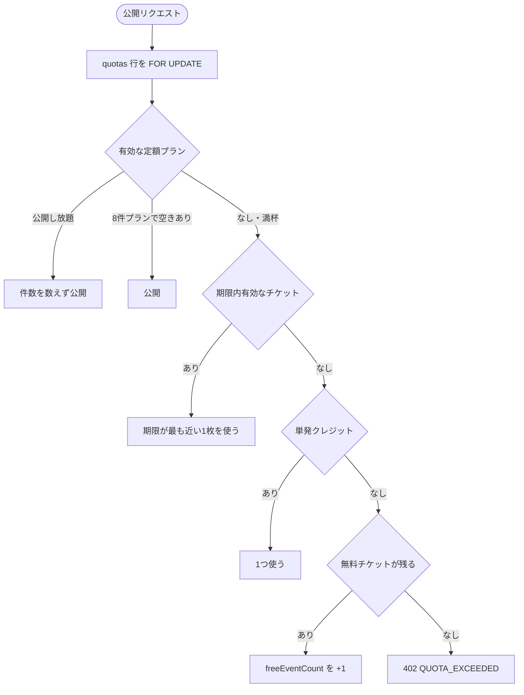

# 無料チケット（紹介・動画視聴）の実装計画

> 決定日: 2026-11-02。実装するのは **紹介（P4）を先、動画（P3）は後**。
> 動画は広告事業者の SSV に直結する方針で、事業者と契約が決まるまでコードを書かない。
>
> この文書は計画なので、新規に作るファイルは `（新規）` と添え、置き場所を本文で示す。
> 実装が入った PR で、実在するパスへ書き換える（`npm run docs:links` が原稿中のパスを見るため）。
>
> Sphinx の目次へ載せるには `docs/issues/index.rst` の toctree へ1行足し、`npm run docs:gen` で
> `docs/doc-index.json` を作り直す。どちらも P5 で行う（この文書を先にコミットすると docs ジョブは赤になる）。

## 0. 結論

| 項目 | 決定 |
| :---- | :---- |
| 動画 | **10本で1枚**、ローリング30日で1枚、発行から7日有効。**今回は作らない** |
| 紹介 | **1件につき2枚**、生涯10枚、発行から3か月有効。**今回作る** |
| 付与の条件 | 紹介された人が**初回公開**したとき（登録・電話番号確認だけでは渡さない） |
| 対象 | 加入中（定額プラン）の会員にも配る。紹介券は加入者にも渡す |
| 前提条件 | 電話番号確認（`phoneVerifiedAt`）が済んでいること |
| 消費順 | 定額 → **チケット（期限が近い順）** → 単発クレジット → 無料チケット |
| 記録 | `QuotaSource` は増やさず `PAID_CREDIT` のまま。チケット行に `eventId` を残して分析する |
| 実装範囲 | P1（台帳）→ P2（消費順）→ P4（紹介）→ P5（文書・規約）。計 **6.0日** |

## 1. 数字の根拠

### 1.1. 1枚あたりの原価と広告収入

チラシは既定の画質・サイズで **1枚 約1円**、ウィザード1周は画像3枚＋LLM4回で **約3.2円**
（`services/flyer/src/domain/pricing.py` の価格表と、`services/flyer/tests/test_cost_budget.py` の前提）。
`src/modules/flyers/lib/quota.ts` の `FLYER_DRAFT_LIMIT = 3` を掛けると、1イベントの最悪値は
**約10円＋配信数円**になる。

| 項目 | 動画5本 | **動画10本** |
| :---- | --: | --: |
| 広告収入（1本 ¥2 と仮置き） | 10円 | **20円** |
| 原価（チラシ＋配信） | 12円 | 12円 |
| 差 | −2円 | **+8円** |

5本では原価割れ、10本で回収できる。これが本数の根拠。時間は5分で、リワード広告の10本連続完走率は
30〜50% まで落ちると見ているので、「本当に欲しい人だけ通す」フィルタとしても働く。

### 1.2. 月の枚数

`src/modules/billing/lib/plans.ts` の損益分岐点は「公開中4件で月額980円」。ここに無料券を渡すと、
月4回開く定期主催者は 4 − 2 = 2 件分、つまり **980円 → 598円に降格**する。
月1枚なら降格の幅が小さく、加入者に出すかどうかの分岐も不要になる。

1,000 MAU・利用率60%・スポット65%／定期30%／常設5% の試算では、月商は次のように動く
（広告なしの基準は 637,350円/月）。

| 案 | 月商 | 基準比 |
| :---- | --: | --: |
| 基準（広告なし） | 637,350円 | 100% |
| 月2枚 | 466,980円 | 73.3% |
| **月1枚** | **517,200円** | **81.1%** |
| 月1枚＋紹介の新規売上 | 571,029円 | 89.6% |

### 1.3. 紹介の採算

渡す券は生涯10枚＝5件ぶん。限界原価は 10 × 12 = 120 円。
得る新規のLTVは 637 × 4 ≒ 2,548 円/人で、5人なら 12,740円。
**ROI は約100倍**なので、上限10枚は経済的には緩い。重い紹介者を止める安全弁として置く。

## 2. データモデル

### 2.1. 設計方針

`paid_credits`（`prisma/schema.prisma` の `UserUsageQuota`）に足してはいけない。
あの列は期限を持てないので、7日の券と3か月の券が混ざった時点で期限が壊れる。
**1枚1行の台帳**を別に作り、残数はそこから数える。

### 2.2. Prisma 案

```prisma
enum FreeTicketSource {
  AD
  REFERRAL
  MANUAL
}

/// 期限つきの 1 枚。残数を列に持たず、1枚1行で持つ。
model FreeTicket {
  id              String           @id @default(uuid()) @db.Uuid
  userId          String           @map("user_id") @db.Uuid
  source          FreeTicketSource
  /// 紹介で配った相手。生涯上限の数え上げと自己紹介の検出に使う。
  grantedByUserId String?          @map("granted_by_user_id") @db.Uuid
  /// 二重付与を UNIQUE で止めるキー（例: "referral:<新規userId>"）。
  reasonKey       String?          @unique @map("reason_key") @db.VarChar(255)
  /// 動画券の広告事業者。P3 まで NULL。
  provider        String?          @db.VarChar(50)
  issuedAt        DateTime         @default(now()) @map("issued_at") @db.Timestamptz
  expiresAt       DateTime         @map("expires_at") @db.Timestamptz
  usedAt          DateTime?        @map("used_at") @db.Timestamptz
  /// どのイベントで使ったか。分析用。削除しても行は残す。
  eventId         String?          @map("event_id") @db.Uuid
  createdAt       DateTime         @default(now()) @map("created_at") @db.Timestamptz

  user      User  @relation("FreeTicketOwner", fields: [userId], references: [id], onDelete: Cascade)
  grantedBy User? @relation("FreeTicketGrantedBy", fields: [grantedByUserId], references: [id], onDelete: SetNull)

  @@index([userId, usedAt, expiresAt])
  @@index([grantedByUserId, source])
  @@index([expiresAt])
  @@map("free_tickets")
}
```

`User` に2列と、2本の関係を足す。

```prisma
  /// 紹介URLに載せる短いコード。8文字。退会後も残す。
  referralCode     String? @unique @map("referral_code") @db.VarChar(12)
  /// 誰の紹介で登録したか。確定後は変えない。
  referredByUserId String? @map("referred_by_user_id") @db.Uuid

  freeTickets   FreeTicket[] @relation("FreeTicketOwner")
  grantedTickets FreeTicket[] @relation("FreeTicketGrantedBy")
```

受け取った枚数は `free_tickets` を `grantedByUserId` で数える（`@@index([grantedByUserId, source])` がある）。
写しの列を持たない。2か所に同じ数を持つと、付与の失敗で食い違う。

`SignupIntent` に `referralCode String? @db.VarChar(12)` を足す。
`src/modules/auth/lib/verification.ts` の `beginSignupIntent` は毎回 `deleteMany` してから作り直すので、
**登録のたびにコードを渡し直さないと消える**。ここが紹介の一番の落とし穴。

### 2.3. マイグレーション

`20261102190000_free_tickets/migration.sql`（新規、`prisma/migrations/` 配下）。

- `free_tickets` の作成と3本の索引。
- `users` に2列。`referral_code` は UNIQUE、既存行は NULL のまま（バックフィルしない）。
- `signup_intents` に `referral_code`。
- 列挙型 `FreeTicketSource` の追加。

既存データを壊さない。`prisma migrate deploy` で作る前提（`npm run test:db` と同じ経路）。

## 3. 消費フロー



### 3.1. 置き場所

```ts
export async function consumeEventQuota(
  tx: Prisma.TransactionClient,
  userId: string,
): Promise<QuotaPlanType> {
  await lockQuotaRow(tx, userId);
  // ここから下がロックの内側。チケットの判定はこの中に置く。
```

`lockQuotaRow` の内側（＝ `SELECT ... FOR UPDATE` の後）にチケットの判定を入れ、`paidCredits` より前に置く。
ロックの外に出すと、同時押しで同じ1枚を2回使える。

`QuotaPlanType` は増やさない。チケットで公開したイベントの `quotaSource` は `PAID_CREDIT` にする
（`quotaSourceOf` をそのまま通す）。増やすと `/mypage` の2札（`src/modules/events/lib/published-counts.ts`）と
`countPublishedSubscriptionEvents` の数え方に波及するため。

### 3.2. 呼び出し元の修正

`eventId` を引数に足すので、2か所を直す。

- `src/modules/events/lib/events.ts` の公開処理（`consumeEventQuota(tx, userId)` → `(tx, userId, eventId)`）
- `src/modules/events/lib/lifecycle.ts` の `reopenEvent`（受付停止からの再開）

### 3.3. 純ロジック（`billing/lib/tickets.ts`・新規）

DOM も Next も DB も持たない。テスト対象はこの4関数。

```ts
export function pickUsableTicket<T extends { expiresAt: Date }>(tickets: T[], now: Date): T | null;
export function nextAdGrantAt(lastIssuedAt: Date | null, now: Date): Date | null;
export function referralGrantSize(grantedCount: number): 0 | 1 | 2;
export function ticketExpiresAt(source: FreeTicketSource, issuedAt: Date): Date;
```

- `pickUsableTicket`: 期限切れを除き、`expiresAt` 昇順の先頭。空なら null。
- `nextAdGrantAt`: 前回発行から30日。暦月にしない（1月31日→2月1日で2枚になるのを防ぐ）。
- `referralGrantSize`: 生涯10枚を超えないよう端数を落とす（9枚なら1、10枚なら0）。
- `ticketExpiresAt`: `AD` は7日、`REFERRAL` は3か月（`addMonthsUtc` を使う）。

### 3.4. DB を読む関数（`billing/lib/referral.ts`・新規）

- `ensureReferralCode(userId)`: 未発行なら `customAlphabet`（`nanoid`）で8文字を作り、UNIQUE 衝突は再試行。
- `resolveReferrer(code)`: 有効な紹介者を引く。退会（`deletedAt`）は無効。
- `grantReferralTickets(tx, newUserId)`: 初回公開時に呼ぶ。`reasonKey = "referral:<newUserId>"` を
  先に `create` して UNIQUE で冪等にする。自己紹介（`referredByUserId === newUserId`）は何もしない。
  紹介者と被紹介者の両方に配るなら枚数を分ける（既定は**紹介者に2枚のみ**）。
- `readTicketSummary(userId, now)`: 残数と次に配れる日時を返す。`billing/quota` の応答が使う。

## 4. API

| エンドポイント | メソッド | 認可 | 概要 |
| :---- | :---- | :---- | :---- |
| `/api/v1/user/referral` | GET | 会員 | 自分のコード、紹介人数、受け取った枚数、残数 |
| `/api/v1/billing/quota` | GET | 会員 | 既存の応答に `tickets` を追加（`freeGrantRemaining` とは別名） |
| `/api/v1/billing/tickets/ad` | GET/POST | 会員 | **P3**。今回は作らない |

`/api/v1/user/referral` は `src/app/api/v1/user/` 配下に置く（新規ルート）。
認可は `requireUserId(req)`。`src/app/api/v1/billing/quota/route.ts` の応答に次の形を足す。

```json
{
  "tickets": {
    "available": 2,
    "expiringAt": "2026-12-02T00:00:00.000Z",
    "ad": { "nextGrantAt": null },
    "referral": { "code": "x7Kd2mQp", "grantedCount": 2, "limit": 10 }
  }
}
```

`src/modules/events/types.ts` の `UserQuota` に同じ型を足す。`freeGrantRemaining` は0円キャンペーンの
残数で `QuotaStatusBanner.tsx` が使っている。**名前を混ぜない。**

## 5. 画面

### 5.1. 料金モーダル（402 の受け皿）

`src/modules/billing/components/PricingModal.tsx` の先頭に1ブロック足す。5画面から同じ形で呼ばれているので、
ここで完結すれば配線は増えない。

- 見出し: 「チケットで公開する」／本文: 「残り N 枚。期限。紹介した人が公開すると2枚もらえます。」
- 残数が1以上なら主操作を「チケットで公開する」に入れ替える（`btn--primary` は1画面1つ。単発と公開し放題を補助へ落とす）。押すと閉じて、呼び出した画面が公開をやり直す。
- 公開をやり直せない画面（作成中・マイページ）では札を出さない。押しても何も起きないボタンになるため。
- 0円キャンペーン中（`pricing.oneTime.chargedPrice === 0`）はこのブロックを出さない。0円で受け取れるので無意味。

なお `freeGrantRemaining` と同じく props を1つずつ足すと5ファイルに配線が増える。
**P4 の中で `quota={quota}` を1つ渡す形へ小さく直す**（以後の追加が1か所で済む）。

### 5.2. マイページ

`src/app/mypage/page.tsx` に紹介パネルを1枚。`src/modules/account/components/` に `ReferralPanel.tsx`（新規）。

- 紹介URL（`/auth/register?ref=<code>`）とコピー。
- 「紹介した人数」「もらった枚数（10枚まで）」。
- 共有は既存の `src/modules/organizers/components/LineShareDialog.tsx` の作りを流用する。

**公開が成功した直後にもリンクを出す。** 母数が小さいうちは、マイページに置くだけでは紹介が回らない。
公開すると告知ページへ移るので、プレビューの「このイベントは公開済みです」の下に1行（「紹介した人が公開すると2枚増えます。マイページ」）を添える。

### 5.3. 文言

`docs/ui-review/home-audit.md` の規約に従い、**公開画面では「チケット」を使わない**。
ホームと `/service` は「まずは2枚まで無料」のまま触らない。チケットの語はログイン後の402とマイページだけ。

- ボタンは10文字以内（「チケットで公開」）。
- 注記は30文字以内（「紹介した人が公開すると2枚もらえます」は18文字）。
- スタイルは `src/styles/components.css` の `.ticket-*` だけで足す。幅の段は増やさない。

## 6. PR 分割

| PR | 内容 | 層 | 見積り | 終了条件 |
| :---- | :---- | :---- | --: | :---- |
| P1 | 台帳と純ロジック | DB + lib | 1.5日 | `npm run check && npm run test:db` |
| P2 | 消費順の組み込みと応答の追加 | lib + API | 1.0日 | 同上 |
| P4 | 紹介（帰属・付与・画面） | API + UI | 2.5日 | `npm run check && npm run test:db`（モックは撮らない） |
| P5 | 文書・規約・索引 | docs | 1.0日 | `npm run verify` |

合計 6.0日。バッファ1.5日を見て 7.5日（本業と並行なら2.5〜3週間）。

### P1: 台帳（1.5日）

作るもの:

- `20261102190000_free_tickets/migration.sql`（新規）と `prisma/schema.prisma` の更新。
- `billing/lib/tickets.ts`（新規）— 3.3 の4関数。
- `unit/free-ticket.test.ts`（新規、`tests/` 配下）— 期限順・期限切れ・30日ローリング・生涯上限の端数。
- `integration/free-ticket.test.ts`（新規、`tests/` 配下）— 二重付与しない、期限切れは使えない、10枚で止まる。

UI を触らないのでモックの撮り直しは不要。**ここで止めても壊れた状態が残らない。**

### P2: 消費順（1.0日）

- `src/modules/billing/lib/quota.ts` の `consumeEventQuota` にチケットの判定を挿す。
- `src/modules/events/lib/events.ts` と `src/modules/events/lib/lifecycle.ts` に `eventId` を渡す。
- `src/app/api/v1/billing/quota/route.ts` に `tickets` を足し、`src/modules/events/types.ts` に型。
- `integration/free-ticket.test.ts` に「チケットが単発クレジットより先に減る」を足す。

終わった時点で「券があれば公開できる」状態になる。UIが無いだけで機能は生きている。

### P4: 紹介（2.5日）

1. `prisma/schema.prisma` の `SignupIntent.referralCode` と `User` の2列（P1 と同じマイグレーションに含めてよい）。
2. **帰属**: `src/modules/auth/lib/cookies.ts` に `ref` cookie（30日、`httpOnly`）を足し、
   `src/app/api/v1/auth/local/route.ts` と `src/app/api/v1/auth/google/callback/route.ts` の両方で読む。
   **片方だけ直すと Google 登録が漏れる。**
3. **確定**: `src/modules/auth/lib/phone.ts` の `tx.user.create` の同じトランザクションで
   `referredByUserId` を引き当てる。退会者は紹介者にしない。
4. **付与**: 初回公開の成功時に `grantReferralTickets(tx, userId)`。`reasonKey` の UNIQUE で冪等。
5. **API と画面**: 4章のルート、`ReferralPanel.tsx`（新規）、`PricingModal.tsx` のブロック。

モックはこの PR では撮り直しません。実装 PR をモック待ちにしないためです。追いつくときに、別のタイミングで `npm run mock:catchup` を1回回します（`--only` の番号は `style-guide/mock-index.html` で引く）。

### P5: 文書と規約（1.0日）

- `docs/issues/index.rst` の toctree に `free-ticket-and-referral` を足す（無いと Sphinx の検索に出ない）。
- `docs/DBschema.md`、`docs/backend_api_implementation_spec.md`、`docs/front_implementation_spec.md`。
- `docs/billing_and_quota_planning_requirements.md` の §2.2 にチケットの段落を1つ。
- `src/app/terms/page.tsx` に「譲渡不可・換金不可・予告なく終了することがある・不正時は取り消す」を1項。
- この文書の新規パスを実在パスへ書き換える。
- `npm run docs:gen && npm run docs:counts:last && npm run verify`。モックは追いつくときに `npm run mock:catchup`。

## 7. テスト観点

| 層 | 確かめること |
| :---- | :---- |
| 純ロジック | 期限が最も近い券を選ぶ／期限切れは返さない／前回発行から30日未満は配らない／生涯9枚なら1枚、10枚なら0枚 |
| DB | 同じ `reasonKey` で2回呼んでも1枚／期限切れの券は消費されない／`FOR UPDATE` の内側で同時押ししても1枚 |
| 消費順 | 定額 → チケット → 単発 → 無料チケットの順。満杯の8件プランでもチケットで通る |
| 帰属 | 自己紹介は無効／退会者は紹介者になれない／`deleteMany` 後の作り直しでもコードが残る |
| 画面 | 0円キャンペーン中はブロックを出さない／ホームと `/service` に「チケット」の語が出ない |

## 8. 計測（SQL 3本）

`free_tickets` があるので、次の3つは実装を足さずに測れる。3か月後に動画へ進むかをこれで決める。

```sql
-- 1. 紹介リンクの発行率（公開完了者のうち、紹介URLを開いた人）
--    別途 referral_view を足すなら P4 で1行。無ければ「紹介で登録された数」で代用する。
SELECT count(*) FILTER (WHERE referred_by_user_id IS NOT NULL) AS referred, count(*) AS users
FROM users WHERE deleted_at IS NULL;

-- 2. 紹介券が使われるまでの日数
SELECT percentile_cont(0.5) WITHIN GROUP (ORDER BY EXTRACT(EPOCH FROM (used_at - issued_at)) / 86400) AS median_days
FROM free_tickets WHERE source = 'REFERRAL' AND used_at IS NOT NULL;

-- 3. チケット経由で公開した1件あたりの原価
SELECT count(DISTINCT f.event_id) AS events, count(l.id) * 1.0 AS images
FROM free_tickets f
LEFT JOIN flyer_generation_logs l ON l.event_id = f.event_id
WHERE f.used_at IS NOT NULL;
```

## 9. リスクと対策

| リスク | 対策 |
| :---- | :---- |
| `paid_credits` に足して期限が壊れる | 1枚1行の別テーブル。残数を列に持たない |
| `QuotaSource` を増やして数え方が波及する | `PAID_CREDIT` のまま。分析は `free_tickets.eventId` |
| `freeGrantRemaining` と名前が衝突する | 応答は `tickets`。`QuotaStatusBanner.tsx` は触らない |
| ロックの外で消費して二重に使われる | `lockQuotaRow` の内側に置く。結合テストで同時押しを見る |
| 登録のやり直しで `ref` が消える | `beginSignupIntent` の `deleteMany` に合わせ、cookie から毎回渡す |
| Google 登録だけ帰属が漏れる | `auth/local` と `auth/google/callback` の両方に読み取りを置く。テストで固定 |
| 自作自演で10枚取られる | 電話番号確認＋「相手の初回公開で付与」。登録完了では渡さない |
| チラシの原価が公開前に出る | `flyer_generation_logs` で「チケット経由の公開1件あたり原価」を測る（8章の3本目） |
| モックの追いつきを忘れて写しが古いまま残る | 実装 PR では撮らない。任意のタイミングで `npm run mock:catchup` を1回回す（`check` は止まらないので、追いつきの予定を別に持つ） |

## 10. やらないこと

- 動画（P3）は今回作らない。事業者契約が決まるまでコードを書かない。
- チケットの譲渡・換金・他者への付与。
- 紹介の多段（A が B を紹介し、B が C を紹介しても A には渡さない）。
- 「残り枚数」を `paid_credits` に合算した表示。2つの残高を混ぜない。
- ホームと `/service` への無料チケットの掲載（「まずは2枚まで無料」を崩さない）。
- 管理画面の紹介実績。当面は 8章の SQL で足りる。

## 11. 動画（P3）を再開する条件

契約の前に、次を確認する。ここが通らない事業者とは組まない。

| 確認項目 | なぜ必要か |
| :---- | :---- |
| Web でリワード動画を配信できるか | 国内はアプリ向けが主流。Web のリワードは事業者が限られる |
| SSV（Server-to-Server）があるか | 無いと API 直叩きで無限に取れる。ここが無い事業者は選ばない |
| SSV の署名方式とリプレイ防止 | 署名検証とトランザクションIDの UNIQUE 制約が必須 |
| 付与確定のタイミング | 「視聴完了」で即か、数分後か。公開画面で待たせない |
| eCPM と最低出稿額 | 1枚20円の前提が崩れると本数の設計が変わる |

API の形は事業者に依存させない。`provider` 列と署名検証を `billing/lib/ad-tickets.ts`（新規）に閉じ、
`tickets.ts` の純関数は触らない。これで事業者を変えても P1 のテストは無傷で済む。

## 12. 未決事項

- **紹介券を被紹介者にも渡すか。** いまは「紹介者に2枚」だけ。被紹介者にも1枚渡すと初回公開の
  ハードルは下がるが、原価が1枚増える（12円）。P4 に入れる前に決める。
- **動画券を加入者に出すか。** 月1枚なら差は0.1ポイントなので、分岐を作らない判断を既定にした。
- **`free_tickets` の保持期間。** 使用済み行をいつ消すか。当面は消さない（分析に使う）。
