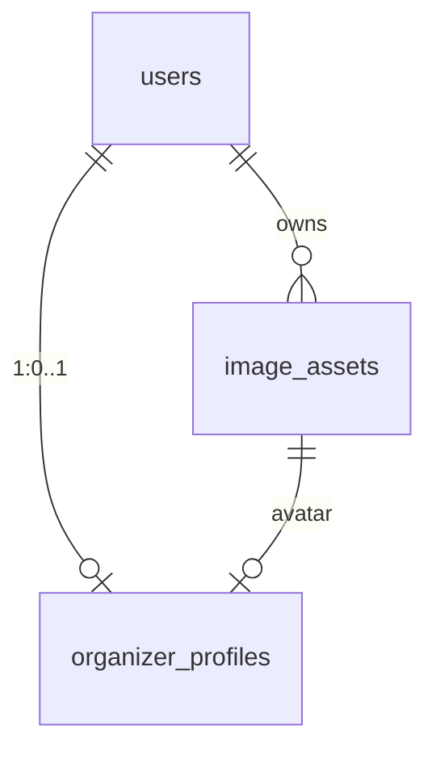

# 公開プロフィールにアイコン画像とセマンティックテーマを足す

> [organizer-profile.md](organizer-profile.md) の「スコープ外」から切り出した issue。プロフィールの本文（肩書き・自己紹介・リンク）は動いている前提で、そこに「その人らしさ」を出す手段を 2 つ足す。

## 背景

プロフィールの本文が書けても、公開ページは他の主催者と同じ紙面になる。名前の頭文字だけの丸と、全員共通の配色では、屋号を持つ主催者や、世界観で集客している催し（ライブ・占い・撮影会）の違いが出ない。

チラシは作れるのに、そのチラシを貼る「店構え」が無い状態だった。アイコンと紙面の雰囲気を選べるようにして、プロフィールを「読む page」から「その人の page」にする。

ただし、公開ページは参加者がスマホで開く最初の画面であり、重くしてはいけない。テーマは**サーバーが属性を 1 つ出し、静的な CSS が色を差し替える**だけにして、テーマ用の JavaScript も追加のリクエストも持たせない。

## 決定

| 論点 | 決定 |
| :---- | :---- |
| テーマの適用範囲 | 公開ページ全体（プロフィール＋カレンダー＋一覧）。プロフィールのカードだけに色を付けると、紙面の途中で配色が切り替わって読みにくい |
| テーマの数 | 初期は 5 つ。`modern-slate` / `enterprise-clean` / `parchment` / `neo-brutalism` / `neon` |
| 未選択の扱い | `theme_id` が NULL なら**現行の見た目を完全に維持する**。`SemanticThemeScope` は要素を増やさず children をそのまま返す |
| 非公開のとき | アイコンは出す。テーマは適用しない（本文を隠しているのに紙面だけ変えると、下書きが公開されたように見える） |
| テーマの当て方 | `<div class="semantic-theme" data-semantic-theme="...">` と `[data-semantic-theme="..."]` の CSS 変数。クライアント JS は使わない |
| ID の置き場 | `src/lib/semantic-themes.ts` の 1 箇所。DB は `VARCHAR(32)` で、列挙型にしない |
| 色の正 | `src/styles/themes.css`。TS 側は ID・日本語ラベル・1 行の説明だけを持つ |
| アイコンの保存形式 | アップロード時に `sharp` で**中央正方形に切り抜き、最大 256px の WebP（品質 82）**へ作り直す。原本は置かない |
| アイコンの上限 | 4MB。JPEG / PNG / WebP のみ（先頭バイトで判定）。SVG・GIF・アニメーションは対象外 |
| アイコンの配信 | `/api/v1/image-assets/{id}/image`。`Cache-Control: public, max-age=31536000, immutable` |
| アイコンの保存単位 | 本文の `PUT` とは別のエンドポイント。選んだ時点で保存する |
| 画像の持ち方 | 汎用の `image_assets`。プロフィールは `avatar_image_id` で参照する。将来のイベント表紙も同じ表を使う |
| 差し替え | 新しい行を作り、参照を付け替えてから旧行を退役（`is_deleted = true` とファイル削除）。ID が変わるのでキャッシュを壊さない |
| 実績の扱い | 変えない。テーマは色と形だけで、数え方は既存のまま |

### なぜ「属性＋静的 CSS」なのか

- テーマごとに CSS ファイルを分けて `next/dynamic` で読むと、色が変わるまで一瞬標準の色が見える（FOUC）。SSR の属性なら最初の 1 フレームから正しい色になる。
- `localStorage` に選んだテーマを置いてクライアントで適用すると、HTML とハイドレーション後で色が食い違う。公開ページは `noindex` の共有用ページで、閲覧者ごとの設定を持つ理由も無い。
- 追加される CSS は 5 テーマで数 KB。`backdrop-filter` とアニメーションは初期テーマでは使わない（テストで固定している）。

## データ

`prisma/migrations/20261028120000_organizer_profile_theme_and_avatar/migration.sql`

### `image_assets`（新規）

| 列 | 型 | 説明 |
| :---- | :---- | :---- |
| `id` | UUID PK | 保存時に採番。公開 URL の一部になる |
| `user_id` | UUID NULL | `users.id` への外部キー。`ON DELETE SET NULL`（退会しても行は残す） |
| `kind` | VARCHAR(20) NOT NULL | `AVATAR` / `EVENT_COVER`。DB の列挙型にはしない（用途が増えるたびにマイグレーションが要るため） |
| `content_type` | VARCHAR(40) NOT NULL | いまは `image/webp` だけ |
| `width` / `height` | INTEGER NOT NULL | 変換後の実寸。`` の `width` / `height` に使う |
| `byte_size` | INTEGER NOT NULL | 変換後のバイト数。保存量の監視用 |
| `is_deleted` | BOOLEAN NOT NULL DEFAULT FALSE | 参照が外れた画像。行は残し、配信を止める |
| `created_at` | TIMESTAMPTZ | 監査用 |

索引は `(user_id, is_deleted)`。ある会員の現役の画像を引くため。

### `organizer_profiles`（追加列）

| 列 | 型 | 説明 |
| :---- | :---- | :---- |
| `avatar_image_id` | UUID NULL UNIQUE | `image_assets.id` への外部キー。`ON DELETE SET NULL`。1 会員 1 アイコンを UNIQUE で担保する |
| `theme_id` | VARCHAR(32) NULL | 選んだテーマの ID。NULL は標準 |

`theme_id` を列挙型にしないのは、テーマを足すたびに DB マイグレーションを挟まないため。値の正しさは API の Zod（`OrganizerProfileSchema`）で担保し、未知の値は 400 にする。DB に残った未知の値は `normalizeSemanticThemeId` が NULL に落とし、標準の見た目で表示する（表示が壊れるより、標準に戻るほうがよい）。



### 置き場所

- ファイルは `storage/images/{id}.webp`。`.gitignore` に `storage/images` を追加し、`Dockerfile` の `mkdir` に `/app/storage/images` を足した。
- チラシ（`storage/flyers`）と同じく、**単一インスタンス前提**。複数台に増やすときは S3 などへ移す（[deploy.rst](../deploy.rst)）。

## 実装

### 1. テーマの定義

`src/lib/semantic-themes.ts`（DB も Next.js も触らない）

| 名前 | 役割 |
| :---- | :---- |
| `SEMANTIC_THEME_IDS` | 5 つの readonly tuple。ID の一覧はここだけ |
| `SemanticThemeId` | 上の要素の union |
| `SEMANTIC_THEMES` | ID・日本語ラベル・1 行の説明。色は持たない |
| `isSemanticThemeId(value)` | 一覧に含まれるか |
| `normalizeSemanticThemeId(value)` | 未知・空・NULL を NULL（標準）に寄せる |
| `semanticTheme(id)` | 定義を引く。未知は NULL |

ラベルと説明:

| ID | ラベル | 説明 |
| :---- | :---- | :---- |
| `modern-slate` | 夜のスレート | 暗い地に白い文字。写真が映え、落ち着いて読めます。 |
| `enterprise-clean` | クリーン | 明るい地に細い枠。どんな催しにも合わせやすい標準的な見た目。 |
| `parchment` | 羊皮紙 | 生成りの地に明朝。読み物として、ゆっくり読ませたいとき。 |
| `neo-brutalism` | ネオ・ブルータリズム | 太い黒枠と硬い影。手づくりのチラシらしい勢いが出ます。 |
| `neon` | ネオン | 黒地にシアンの発光。クラブ・ライブ・夜の催し向け。 |

### 2. `src/styles/themes.css`

`src/styles/index.css` の**最後**に `@import "./themes.css";` を置く。読み込み順は `tokens` → `base` → `components` → `screens` → `deco` → `themes`。装飾（deco）が付ける硬い影・傾き・固定色を、テーマの作法で打ち消す必要があるため。

トークン（テーマが必ず持つ 10 個。`tests/unit/semantic-theme-css.test.ts` が固定している）:

| トークン | 役割 |
| :---- | :---- |
| `--st-surface-base` | ページの地 |
| `--st-surface-raised` | カード・パネルの面 |
| `--st-content-primary` | 本文 |
| `--st-content-secondary` | 補足・ラベル |
| `--st-accent-primary` | 差し色 |
| `--st-accent-contrast` | 差し色の上に置く文字 |
| `--st-border-width` | 枠の太さ（ブルータリズムは 3px） |
| `--st-border-color` | 枠の色 |
| `--st-radius-base` | 角丸の基準（ブルータリズムは 0） |
| `--st-shadow-elevation` | 影（ブルータリズムは `4px 4px 0 #000`） |

書き方は 3 段:

1. `[data-semantic-theme="..."]` が `--st-*` を定義する（テーマ固有の色はここだけ）
2. `.semantic-theme` が既存の `--color-*` / `--radius-*` / `--shadow-*` へ**写す**。部品（カード・ボタン・カレンダー）は今までどおりの変数名を見続けるので、テーマのために部品を書き換えない
3. `.deco .semantic-theme[data-semantic-theme] ...` で、詳細度を上げて固定色の部品を寄せる

`.semantic-theme--page` は `margin-inline: calc(50% - 50vw)` と `padding-inline: max(1rem, calc((100vw - var(--width-content)) / 2))` で、`main.page` の余白を打ち消して地を画面幅いっぱいに広げる。広げた内側で読み幅を作り直すので、行長は標準と同じ。

固定色を持っていたので上書きした部品:

- カレンダーの短冊 `.cal__event`（山吹）→ `--st-accent-primary`。満員は `--st-warning`
- 未ログインの白塗り `.organizer-locked__notice` → 地を 64% 透かす
- ジャンルチップ `.chip`、`.eyebrow` の札、`.profile-head__avatar` のモノグラム
- `.btn--primary` / `.btn--outline` / `.btn--ghost` の枠と影
- 入力欄 `.input` / `.textarea` / `.select`（`.deco` が面を白で固定している）→ `--st-surface-raised` と `--st-content-primary`。暗いテーマでは地に白い板が浮き、テーマの明るい字と同化して入力した文字が読めなくなるため。案内文は `--color-placeholder`（`--st-content-secondary` を 35% 混ぜる）で、地ではなく**入力欄の面**を基準に薄くする

`parchment` の見出しはシステムの明朝（`Hiragino Mincho ProN`, `Yu Mincho`, serif）。Web フォントは 1 つも増やしていない。

印刷（`@media print`）では地を塗らず、文字を黒にする。テーマは画面のためのもの。

### 3. `SemanticThemeScope` と `ThemePicker`

`src/components/ui/SemanticThemeScope.tsx`（サーバーコンポーネントから使える）

```tsx
export function SemanticThemeScope({ themeId, children, page = false }: SemanticThemeScopeProps) {
  const theme = normalizeSemanticThemeId(themeId);
  if (!theme) return <>{children}</>;

  return (
    <div
      className={page ? "semantic-theme semantic-theme--page" : "semantic-theme"}
      data-semantic-theme={theme}
    >
      {children}
    </div>
  );
}
```

- フックを持たない。`"use client"` を付けない。
- テーマが NULL のときは要素を増やさない（既存の DOM と見た目を変えない）。
- `page` は公開ページでは `true`、編集画面のプレビューでは `false`（すでに枠の中にあるため）。

`src/components/ui/ThemePicker.tsx` は編集画面だけで使うクライアント部品。`fieldset` + radio で、「標準」＋5 テーマを並べる。各選択肢は `data-semantic-theme` を付けた小さな見本（`theme-swatch`）で、色は CSS だけで描く（選択肢の色を TS に写さない）。

### 4. 画像の保存と配信

`src/lib/image-upload.ts`（ブラウザとサーバーの両方が読む）

| 名前 | 役割 |
| :---- | :---- |
| `MAX_IMAGE_BYTES`（8MB） | チラシの上限 |
| `MAX_AVATAR_BYTES`（4MB） | アイコンの上限 |
| `UPLOAD_ACCEPT` | `image/jpeg,image/png,image/webp` |
| `detectImageKind(bytes)` | 先頭バイトで JPEG / PNG / WebP を判定。それ以外は NULL |
| `imageContentType` / `imageExtension` | MIME と拡張子 |

チラシ側の `src/modules/flyers/lib/upload.ts` と `upload-limit.ts` は、ここからの再エクスポートに置き換えた（既存の import とテストはそのまま）。

`src/lib/image-assets.ts`

| 関数 | 役割 |
| :---- | :---- |
| `createImageAsset({ userId, kind, bytes })` | `sharp` で作り直して `storage/images/{id}.webp` に書き、`image_assets` の行を作る。行の作成に失敗したらファイルを消す。変換に失敗したら 422 `INVALID_IMAGE` |
| `readImageAssetFile(id)` | 未削除の行とファイルを返す。どちらか欠けたら 404 |
| `retireImageAsset(id)` | `is_deleted = true` にし、ファイルを消す。二重参照の確認のため行は残す |
| `imageAssetImagePath(id)` | `/api/v1/image-assets/{id}/image` |

`sharp` の指定:

```ts
sharp(bytes, { limitInputPixels: 25_000_000, failOn: "error" })
  .rotate()                                  // EXIF の向きを反映してから切る
  .resize(size, size, { fit: "cover", position: "centre" })
  .webp({ quality: 82 })
```

- `size` は 256 を上限に、元画像の短い辺まで。64px 未満の画像だけ 64px まで引き伸ばす（小さい画像でも丸の中が空白にならないように）。
- 画素数は 2500 万で頭打ちにする。展開後に巨大な画像で詰まらないため。
- 元の向き（`orientation`）が 5 以上なら幅と高さが入れ替わるので、短い辺の計算で入れ替える。

`src/app/api/v1/image-assets/[id]/image/route.ts`

- UUID を検証し、未削除の行だけ返す。
- `Content-Type: image/webp`、`Cache-Control: public, max-age=31536000, immutable`、`X-Content-Type-Options: nosniff`、`Content-Length`。
- ID は差し替えのたびに変わるので、内容は不変。CDN 越しでも都度 DB を引かない。

### 5. アイコンの API

`src/app/api/v1/organizer/profile/avatar/route.ts`

| メソッド | 認可 | 内容 |
| :---- | :---- | :---- |
| `POST` | 会員＋主催イベント1件以上 | `multipart/form-data` の `file` を 1 つ。201 で `{ avatarUrl }` |
| `DELETE` | 同左 | 参照を NULL に戻し、旧画像を退役。200 で `{ avatarUrl: null }` |

`POST` の順序:

1. `requireOrganizerAccount` → `assertOrganizerMember`（本文の `PUT` と同じ壺）
2. `Content-Length` が 4MB + 1MB を超えたら 413（`formData()` を読む前に弾く）
3. `file` が無い・0 バイトなら 400
4. 4MB を超えたら 413
5. `detectImageKind` で JPEG / PNG / WebP 以外を 422 `INVALID_IMAGE`
6. `consumeUploadAttempt("avatar:" + userId)`（10 分に 5 回まで）
7. 既存の `avatar_image_id` を覚える
8. `createImageAsset` → `setOrganizerAvatar`
9. **参照を移したあとで**旧画像を退役させる。先に消すと、途中で失敗したときにアイコンが消えたままになる
10. 1〜8 のどこかで失敗したら、作った画像を退役させてから返す（配信 URL を持たない行を残さない）

本文の `PUT` と分けたのは、画像は「選んだ時点で反映」したほうが分かりやすく、本文の検証エラーでアイコンだけ巻き戻る事故が無いため。

レート制限はチラシと同じ `src/lib/upload-limit.ts`。キーだけ `avatar:{userId}` に分ける。

### 6. プロフィールの型・スキーマ・ストア

- `src/lib/schemas.ts` の `OrganizerProfileSchema` に `themeId: z.enum(SEMANTIC_THEME_IDS).nullable().default(null)` を足した。`.strict()` は維持するので、未知の項目も未知のテーマ ID も 400。
- `OrganizerProfileDraft` に `themeId`、`OrganizerProfileContent` に `avatarUrl` と `themeId`、`OrganizerProfileDraftResponse` に `avatarUrl`。
- `profileContentFromDraft(draft, stats, avatarUrl)` が両方を載せる。
- `profileContentFromRow` は、**非公開でも `avatarUrl` を返す**（本文・リンク・実績・テーマは隠す）。行が無い会員はすべて NULL。
- `profile-store.ts` に `readOrganizerAvatarUrl` / `readOrganizerAvatarId` / `setOrganizerAvatar` / `clearOrganizerAvatar`。
- `PUT /api/v1/organizer/profile` の応答に `avatarUrl` を足した（GET と同じ形）。
- `GET /api/v1/public/organizers/[userId]` は、既存の `profile` に `avatarUrl` と `themeId` がそのまま載る。

### 7. 画面

**SCR-ORG-14 `/organizer/profile`**（`OrganizerProfileForm`）

- 「公開ページに出る内容」の枠の先頭に `OrganizerAvatarField`。現在のアイコン（80px）または頭文字、「画像を選ぶ」「削除」。
  - `accept={UPLOAD_ACCEPT}`。クライアント側でも 4MB を事前に弾く。
  - 選ぶとすぐ `POST` し、成功したら `avatarUrl` を差し替えてトーストを出す。失敗は `readProblem` の文言。
  - 「選ぶとすぐに保存されます」と補足する。
- 「公開」の下に `ThemePicker`。選択肢は「標準」＋5 テーマで、`draft.themeId` を更新する。保存は既存の「保存する」（他の入力と同じ単位）。
- プレビューは `SemanticThemeScope`（`page={false}`）で `OrganizerProfileView` を包み、`profileContentFromDraft(draft, stats, avatarUrl)` を渡す。保存前のテーマも確認できる。
- 見出し下のリードと `screen-note` に、アイコンとテーマの 1 文を足した。

**SCR-PUB-14 `/organizers/[userId]`**

```tsx
<SemanticThemeScope themeId={loaded.profile.themeId} page>
  <div className="stack">
    <OrganizerProfileView name={loaded.name} profile={loaded.profile} />
    <Suspense fallback={...}>
      <OrganizerPageView userId={loaded.userId} />
    </Suspense>
  </div>
</SemanticThemeScope>
```

- `.profile-head__avatar` は、`avatarUrl` があれば ``、無ければ頭文字。
- `overflow: hidden` と `img { width: 100%; height: 100%; object-fit: cover; }` で丸に収める。
- テーマ未選択なら `SemanticThemeScope` が children をそのまま返すので、DOM も見た目も現行のまま。
- `generateMetadata` の `openGraph.images` に `avatarUrl` があれば載せる（`metadataBase` があるので相対 URL でよい）。
- モック（`style-guide/`）は 06 主催者のページに、未ログイン・ログイン済みに加えて標準と 5 テーマの状態を持つ（計 8 枚）。属性を差し替えて撮るので、テーマごとのデモ会員は増やしていない（[ui-review/mock-sync.md](../ui-review/mock-sync.md)）。

### 8. パフォーマンス

| 項目 | 実際 |
| :---- | :---- |
| テーマ用の JS | 0 バイト。属性と静的 CSS だけ |
| 追加される CSS | 5 テーマで数 KB（1 枚の `themes.css`） |
| テーマごとの追加リクエスト | 無し |
| Web フォント | 増やしていない（`parchment` はシステム明朝） |
| `backdrop-filter` / アニメーション | 初期テーマでは使わない（テストで固定） |
| アイコンの重さ | 最大 256px 角の WebP。数十 KB |
| アイコンのキャッシュ | `immutable` で 1 年。差し替えは URL が変わる |
| CLS | `` に `width` / `height`（64）を付けて防ぐ |
| Next の画像最適化 | 通さない（`sharp` で 1 回だけ変換する。二重の変換を避ける） |
| 公開ページの追加クエリ | 無し。`organizer_profiles` の 2 列を既存の SELECT に足しただけ |
| 編集画面の追加クエリ | `readOrganizerAvatarUrl` の 1 回だけ |

### 9. 将来のイベント公開ページ

同じ部品をそのまま使える形にしてある。

- `events` に `theme_id VARCHAR(32)` を足し、`SemanticThemeScope` / `ThemePicker` / `semantic-themes.ts` を使い回す。テーマの選択肢はプロフィールと同じ 5 つ。
- 表紙画像は `events.cover_image_id` から `image_assets` を参照し、`kind = 'EVENT_COVER'` で `createImageAsset` を呼ぶ。`transform` の分岐だけが違う（幅 1200 に揃え、高さは原本の比に任せる。`COVER_WIDTH` は定義済み）。
- `image_assets` は**参照する側に外部キーを置く**形にしたので、用途が増えてもこの表は変えない。ポリモーフィックな所有者列は持たない。

## テスト

- 単体 `tests/unit/semantic-theme.test.ts`（10件）: ID が重複しない・5 件ある・表示名と説明が空でない、`normalizeSemanticThemeId` が未知・NULL・空文字を NULL にする、`OrganizerProfileSchema` が 5 テーマと NULL を受け、未知の ID を 400 にする。
- 単体 `tests/unit/semantic-theme-css.test.ts`（5件）: すべての ID に `[data-semantic-theme]` のブロックがある、必須 10 トークンが揃う、`themes.css` が `index.css` の最後、`backdrop-filter`・アニメーション・`@keyframes` を持たない、全幅の面が負のマージンで広がる。
- 単体 `tests/unit/organizer-profile.test.ts`（42件）: `profileContentFromDraft` が `themeId` と `avatarUrl` を載せる、非公開の行はテーマと本文を隠してアイコンは残す、など。
- 結合 `tests/integration/organizer-avatar.test.ts`（8件）: 小さな PNG の `POST` で 201・DB 行・`GET /api/v1/image-assets/{id}/image` が WebP で返る、`POST` の差し替えで旧画像が 404 になる、`DELETE` で参照が NULL になり画像が 404、4MB 超は 413、JPEG でないバイト列は 422。`storage/images` の後片付けをする。
- 結合 `tests/integration/organizer-profile.test.ts`（16件）: `PUT` で `themeId` が保存され公開 API に返る、未知の `themeId` は 400、アイコンの URL が応答に載る。
- チラシ側の `tests/unit/flyer-upload.test.ts` は、再エクスポート経由でそのまま通る。
- 単体 `tests/unit/mock-sync.test.mjs`: 目録（39 状態）が 5 テーマと未選択を 1 枚ずつ持ち、表示名が `SEMANTIC_THEMES` のラベルと一致すること。

## ドキュメント

- `docs/DBschema.md`: `image_assets`、`organizer_profiles` の追加列、DDL。
- `docs/backend_api_implementation_spec.md`: 5.12 / 5.14 / 5.17 / 5.18（avatar の POST / DELETE、image-assets、公開プロフィールの応答）。
- `docs/front_implementation_spec.md`: SCR-ORG-14 / SCR-PUB-14。
- `docs/overall_system_requirements_common.md`: 画面一覧の 2 行。
- `docs/deploy.rst`: `storage/images` と単一インスタンス前提。
- `docs/sitemap.rst` / `docs/issues/index.rst`: この issue。
- `AGENTS.md` / `src/styles/index.css`: 層の順番に `themes` を最後として足した。

## 受け入れ条件

- [x] `/organizer/profile` でアイコン画像を選ぶと、その場で保存され、丸いアイコンに切り替わる
- [x] アイコンを削除すると頭文字に戻り、画像の URL は 404 になる
- [x] 4MB 超・JPEG / PNG / WebP 以外は、理由の分かるエラーになる
- [x] 5 テーマから選んで保存でき、公開ページ全体に適用される
- [x] テーマ未選択（標準）では、DOM も見た目も現行と変わらない
- [x] 非公開にするとテーマは外れ、アイコンは残る
- [x] 編集画面のプレビューが、テーマ込みで公開ページと同じ見た目になる
- [x] 公開ページのテーマ適用にクライアントコンポーネントを足していない（`SemanticThemeScope` はサーバーで属性を出すだけ）
- [x] アイコンの応答が `immutable` で、`width` / `height` 付きの `` で出る
- [x] 未知のテーマ ID は 400、DB に残った未知の値は標準の見た目になる
- [x] 390px で横スクロールが出ず、アイコンとテーマの見本が 1 列に収まる
- [x] `npm run check:full`・`npm run docs:links`・`npm run build` が通る

## スコープ外

- テーマの自由な色指定（背景色・文字色を選ばせる）。読みにくい組み合わせを作られると、直せない
- アイコンのトリミング位置の指定。中央固定にする
- アニメーション・動画・GIF のアイコン
- テーマごとのレイアウト変更（段組み・ヒーローの形）。色・角・影・書体だけ
- プロフィール以外（告知ページ・参加者ホーム）へのテーマ適用。イベント表紙と合わせて別 issue
- 画像の CDN・オブジェクトストレージへの移設（単一インスタンス前提のまま）
