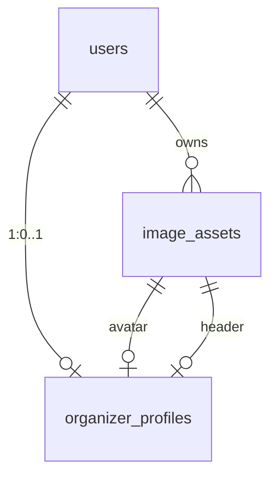

# 公開プロフィールにヘッダー画像を足す

> 公開プロフィールの本文は [public-organizer-page.md](public-organizer-page.md) で、アイコンとテーマは [organizer-profile-appearance.md](organizer-profile-appearance.md) で足した。この issue は、そのあとに残った「ページの先頭に絵を置く」を扱う。

## 背景

プロフィールの本文・アイコン・テーマが揃っても、公開ページの先頭は名前の行から始まる。ライブ・占い・撮影会のように、写真で世界観を見せる催しの主催者には、チラシの絵をそのまま置ける場所が無い。チラシは作れるのに、そのチラシを貼る「店構え」がまだ名前と丸だけだった。

そこで、プロフィールの先頭に**画面幅いっぱい（フルブリード）の 3:1 の画像**を 1 枚置けるようにする。紙面の見出しを写真に置き換えるだけで、主催者のページが「読む page」から「その人の page」に変わる。

ただし公開ページは参加者がスマホで最初に開く画面である。足すのは**変換済みの 1 枚（1920x640 の WebP）だけ**にし、テーマと同じくクライアントの JavaScript を増やさない。位置と倍率を決める画面は、アップロードする前にだけ開く。

## 決定

| 論点 | 決定 |
| :---- | :---- |
| 表示 | 画面幅いっぱい（フルブリード）の 3:1。プロフィールの本文の列の外まで広げ、画面の端から端まで敷く |
| 保存形式 | サーバーで必ず **1920x640 の WebP（品質 80）** に作り直す。原本は置かない |
| 元画像の下限 | **横 800px・縦 267px**（3:1 の高さ）。これ未満は粗く見えるので 422 `IMAGE_TOO_SMALL` で断る |
| 元画像の上限 | 8MB（チラシと同じ）。JPEG / PNG / WebP のみ。判定は先頭バイトだけで行う |
| 切り抜き | **アップロードする前に**、3:1 の枠の中でドラッグして位置を決め、スライダーで **1〜3 倍**に拡大する。中央固定にしない |
| 切り出しの下限 | 幅 800px。倍率の上限は画像ごとに計算し、800px を割る範囲は選べない |
| クライアントが送る形 | 3:1 に切り出した **JPEG（品質 0.9）**。出力幅は **3200px** を上限にする（サーバーが 1920px に作り直すため、それ以上の画素は送らない） |
| 保存の単位 | **選んだ時点で保存**。本文（`PUT /api/v1/organizer/profile`）とは別のエンドポイントにする。本文の検証エラーで画像だけ巻き戻る事故を作らない |
| 非公開のとき | **出さない**。アイコンは「その人を示す印」なので非公開でも返すが、ヘッダーは本文の一部として扱う。編集画面のプレビューでは自分の画像として見える |
| 画像の持ち方 | 汎用の `image_assets`。プロフィールは `header_image_id` で参照する（`avatar_image_id` と同じ形） |
| 差し替え | 新しい行を作り、参照を付け替えてから旧行を退役（`is_deleted = true` とファイル削除）。ID が変わるのでキャッシュを壊さない |
| OGP | `headerUrl ?? avatarUrl`。ヘッダーがあれば横長（1920x640）を優先し、無ければアイコン（256px 角）を使う |
| 試行の上限 | 会員ごとに 10 分間 5 回（`header:{userId}`）。超過は 429。アイコンとは別のキーにする |

### なぜ「画面側で切り抜いてから送る」のか

- 3:1 は縦に短い。中央で切るだけだと、顔や題字が切れる画像が必ず出る。位置と倍率を選べる画面を出さないと、選び直しを繰り返すことになる。
- 3:1 に切り出してから送れば、送る量が減り、サーバーの変換も 1 回の縮小で済む。端末の向き（EXIF）は `createImageBitmap` の `from-image` で先に反映するので、見えている範囲がそのまま保存される。
- サーバー側の中央切り抜きは残す。画面を通らずに比のずれた画像が届いても、帯が歪まないようにするため。

## データ

`prisma/migrations/20261101150000_organizer_profile_header_image/migration.sql`

### `organizer_profiles`（追加列）

| 列 | 型 | 説明 |
| :---- | :---- | :---- |
| `header_image_id` | UUID NULL UNIQUE | `image_assets.id` への外部キー。`ON DELETE SET NULL`。1 会員 1 ヘッダーを UNIQUE で担保する |

```sql
ALTER TABLE "organizer_profiles"
    ADD COLUMN "header_image_id" UUID;

CREATE UNIQUE INDEX "organizer_profiles_header_image_id_key"
    ON "organizer_profiles"("header_image_id");

ALTER TABLE "organizer_profiles"
    ADD CONSTRAINT "organizer_profiles_header_image_id_fkey"
    FOREIGN KEY ("header_image_id") REFERENCES "image_assets"("id")
    ON DELETE SET NULL ON UPDATE CASCADE;
```

### `image_assets`

表は変えない。`kind` に **`PROFILE_HEADER`** を足すだけで、値はアプリ側（`src/lib/image-assets.ts` の `IMAGE_ASSET_KINDS`）で検証する。

| 列 | 型 | 説明 |
| :---- | :---- | :---- |
| `kind` | VARCHAR(20) NOT NULL | `AVATAR` / `EVENT_COVER` / `PROFILE_HEADER`。列挙型にしないのは、用途が増えるたびにマイグレーションが要るため |
| `width` / `height` | INTEGER NOT NULL | 変換後の実寸。ヘッダーは 1920 / 640 |

`ImageAsset` から `OrganizerProfile` への関係が 2 本になるため、Prisma の関係に名前を付ける（`OrganizerProfileAvatar` / `OrganizerProfileHeader`）。



既存行は `header_image_id` が NULL のままで、ヘッダーを設定していない主催者の見た目は変わらない。

## 実装

### 1. 画像の変換

`src/lib/image-assets.ts`

| 名前 | 役割 |
| :---- | :---- |
| `PROFILE_HEADER_WIDTH`（1920）/ `PROFILE_HEADER_HEIGHT`（640） | 保存する大きさ。3:1 を保つ |
| `MIN_PROFILE_HEADER_WIDTH`（800） | 受け付ける元画像の最小幅 |
| `transform()` の `PROFILE_HEADER` 分岐 | 向きを反映した実寸で最小を判定し、`resize(1920, 640, { fit: "cover", position: "centre" })` → `webp({ quality: 80 })` |
| `createImageAsset()` | `transform` の `ProblemDetailException` をそのまま通す。大きさ不足の文言を画面へ返せるようにするため |

- 向き（`orientation >= 5`）の画像は幅と高さが入れ替わるので、判定の前に取り替える。
- 最小の高さは `ceil(800 / 3)` = 267。横 800px ちょうどの画像も通す。
- 画素数は 2500 万で頭打ちにする（展開後に巨大な画像で詰まらないため）。

`src/lib/image-upload.ts` に `MAX_HEADER_BYTES`（8MB）を足した。`UPLOAD_ACCEPT` と `detectImageKind` はアイコンと共用する。

### 2. ヘッダーの API

`src/app/api/v1/organizer/profile/header/route.ts`

| メソッド | 認可 | 内容 |
| :---- | :---- | :---- |
| `POST` | 会員＋主催イベント1件以上 | `multipart/form-data` の `file` を 1 つ。201 で `{ headerUrl }` |
| `DELETE` | 同左 | 参照を NULL に戻し、旧画像を退役。200 で `{ headerUrl: null }` |

`POST` の順序:

1. `requireOrganizerAccount` → `assertOrganizerMember`（本文の `PUT` と同じ壺）
2. `Content-Length` が 8MB + 1MB を超えたら 413（`formData()` を読む前に弾く）
3. `file` が無い・0 バイトなら 400
4. 8MB を超えたら 413
5. `detectImageKind` で JPEG / PNG / WebP 以外を 422 `INVALID_IMAGE`
6. `consumeUploadAttempt("header:" + userId)`（10 分に 5 回まで）
7. 既存の `header_image_id` を覚える
8. `createImageAsset({ kind: "PROFILE_HEADER" })` → `setOrganizerHeader`
9. **参照を移したあとで**旧画像を退役させる。先に消すと、途中で失敗したときにヘッダーが消えたままになる
10. 1〜8 のどこかで失敗したら、作った画像を退役させてから返す

| 状態 | error | 意味 |
| :---- | :---- | :---- |
| 400 | - | `file` が無い、0 バイト、または本文を読めない |
| 413 | - | 8MB を超えた |
| 422 | `INVALID_IMAGE` | JPEG / PNG / WebP でない、または画像として読めない |
| 422 | `IMAGE_TOO_SMALL` | 横 800px・縦 267px に満たない |
| 429 | - | 短時間のアップロードが多すぎる |

### 3. 型・ストア

- `src/modules/organizers/types.ts`: `OrganizerProfileContent.headerUrl` と `OrganizerProfileDraftResponse.headerUrl`（どちらも `string | null`）。
- `src/modules/organizers/lib/profile-store.ts`: `ProfileRowShape.headerImageId`、`emptyContent()` の `headerUrl: null`、`readOrganizerHeaderId` / `readOrganizerHeaderUrl` / `setOrganizerHeader` / `clearOrganizerHeader`。
- `profileContentFromRow` は**公開中だけ** `headerUrl` を出し、非公開では null のまま（アイコンの `avatarUrl` だけは残す）。
- `src/modules/organizers/lib/profile.ts`: `profileContentFromDraft(draft, stats, avatarUrl, headerUrl)`。4 番目は省略できる。
- `src/app/api/v1/organizer/profile/route.ts`: GET / PUT の応答に `headerUrl` を載せる（`loadResponse` の `Promise.all` に 1 本足すだけ）。

### 4. 切り抜きの純ロジック

`src/modules/organizers/lib/crop.ts`（DOM にも Next.js にも依存しない。単体試験の対象）

| 関数 | 役割 |
| :---- | :---- |
| `coverScale(naturalW, naturalH, frameW, frameH)` | 画像が枠をちょうど覆う倍率。幅と高さの比の大きいほう |
| `clampOffset(offset, scaledSize, frameSize)` | ずらし幅を ±(拡大後の大きさ − 枠)/2 に収める。端に隙間を残さない |
| `zoomAroundCenter(...)` | 倍率を変えたとき、枠の中心にある画素を動かさずにずらし幅を伸ばす |
| `cropSourceRect(...)` | 枠に入っている範囲を元画像座標の整数矩形にする。必ず画像の内側に収まる |
| `maxZoomForMinCrop(...)` | 切り出し幅が 800px を割らない最大の倍率 |
| `isCropLargeEnough(...)` | 指定の倍率で切り出した幅が 800px 以上か |

定数は `MIN_HEADER_CROP_WIDTH`（800）/ `MIN_ZOOM`（1）/ `MAX_ZOOM`（3）。画面はこの計算を呼ぶだけで、位置と倍率の式を TSX へ書き戻さない。

### 5. 切り抜き画面

`src/modules/organizers/components/ImageCropDialog.tsx`（クライアント）

- 共通の `Dialog` を使い、見出しは「ヘッダー画像を切り抜く」。操作は「この範囲で決定」と「やめる」。送信中は閉じ道を消す。
- `.header-crop__frame`（3:1）の中で `<canvas>` に描き、Pointer Events のドラッグで位置を動かす。矢印キーでも動かせる（1 回 10px、Shift で 30px）。
- スライダーは 1〜3 倍。上限は `maxZoomForMinCrop` と `MAX_ZOOM` の小さいほうを 0.1 刻みで切り下げた値。現在の倍率は `.header-crop__value` に「1.5倍」の形で出す。
- 幅 800px を割る範囲は確定できない。そのときは「画像が小さいため切り出せません。幅800px以上の画像を選んでください。」を出す。
- 確定すると元画像の矩形をオフスクリーンの `<canvas>` へ描き、`toBlob("image/jpeg", 0.9)` で返す。出力幅は 3200px を上限に縮める。
- 向きは `createImageBitmap(file, { imageOrientation: "from-image" })` で反映する。閉じたら画素（`ImageBitmap` と canvas）をすぐ手放す。

### 6. 編集画面

`src/modules/organizers/components/OrganizerHeaderField.tsx`（クライアント）

- `.header-field__preview` に現在の画像を 3:1 の小さな見本で出す。未設定なら「まだ設定していません」。
- 「画像を選ぶ」／「画像を変える」と「削除」、`accept={UPLOAD_ACCEPT}` の隠し input。8MB を超えるファイルは切り抜き画面を開く前に弾く。
- 選んだ時点では送らず `ImageCropDialog` を開き、確定後に `POST` する。成功したら `headerUrl` を差し替えて「ヘッダー画像を変更しました。」のトーストを出し、失敗は `readProblem` の文言をダイアログの中に出す。
- 補足は「選ぶとすぐに保存されます。公開中のみ表示されます（JPEG / PNG / WebP・8MBまで）。」。

`src/modules/organizers/components/OrganizerProfileForm.tsx`

- `headerUrl` の state を足し、`applyResponse` で受ける。
- 「公開ページに出る内容」の枠の先頭、**アイコンの上**に置く（公開ページでも名前より先に出るため）。
- プレビューは `profileContentFromDraft(draft, stats, avatarUrl, headerUrl)` を渡す。
- 枠の注記は公開中なら「公開中です。参加者のページにこの内容が出ます。ヘッダー画像はページの先頭に横長で出ます。」、非公開なら「非公開です。名前とイベントへの導線だけが出ます。ヘッダー画像は公開するとページの先頭に出ます。」。

### 7. 公開ページ

`src/modules/organizers/components/OrganizerProfileView.tsx`

- `profile.headerUrl` があるとき、`.stack` の先頭に `.profile-hero` を出す。
- ``。直下に名前があるので `alt` は空（飾り）。

`src/styles/deco/surface.css`

```css
.profile-hero {
  margin-inline: calc(50% - 50vw);
  aspect-ratio: 3 / 1;
  overflow: hidden;
  background: var(--color-surface);
}
.semantic-theme--page .profile-hero {
  margin-block-start: -2rem; /* テーマの地の上端まで */
}
.profile-hero img { display: block; width: 100%; height: 100%; object-fit: cover; }
```

- `html` / `body` は既に `overflow-x: clip` なので、フルブリードで横スクロールは出ない（テーマの `.semantic-theme--page` と同じ手法）。
- 非公開のときは `headerUrl` が null なので、何も出ない。

`src/app/organizers/[userId]/page.tsx`

- `generateMetadata` の `openGraph.images` を `headerUrl ?? avatarUrl` にする。どちらも無ければ指定しない（既定の OGP 画像に任せる）。

### 8. パフォーマンス

| 項目 | 実際 |
| :---- | :---- |
| 追加のクエリ | 無し。`organizer_profiles` の SELECT に 1 列足しただけ |
| 公開ページの追加リクエスト | 画像 1 枚（1920x640 の WebP）。数十〜百 KB |
| クライアント JS | 切り抜き画面は編集画面でしか読み込まない（`"use client"` の部品） |
| CLS | `` に `width` / `height`（1920 / 640）と `aspect-ratio` の枠を付けて防ぐ |
| キャッシュ | `/api/v1/image-assets/{id}/image` が `immutable` で 1 年。差し替えは URL が変わる |
| 変換 | `sharp` で 1 回だけ（WebP 品質 80）。Next の画像最適化は通さない |

## テスト

- 単体 `tests/unit/image-crop.test.ts`（24件）: 枠を覆う倍率（横長・縦長・3:1・同じ大きさ）、ずらし幅が端で止まること・はみ出しが無ければ 0、中心を保つ拡大と縮小、`cropSourceRect` が整数で元画像の外へ出ないこと・倍率を上げると狭くなること、`maxZoomForMinCrop` が 800px ちょうどの倍率を返すこと・小さすぎる画像では 1 を返すこと。
- 単体 `tests/unit/organizer-profile.test.ts`（44件）: `profileContentFromDraft` が `headerUrl` を載せる（未設定は null）、`profileContentFromRow` が公開中だけ `headerUrl` を出し、非公開では本文・テーマ・ヘッダーを隠してアイコンを残す。
- 結合 `tests/integration/organizer-header.test.ts`（9件）: 1200x800 の PNG を `POST` すると 201、`image_assets` が `kind = PROFILE_HEADER` で WebP 1920x640、配信が `immutable`、`header_image_id` が設定される。公開 API に `headerUrl` が載り、非公開にすると null。差し替えで旧画像が 404、`DELETE` で参照が外れて画像も 404。横 800px 未満は 422 `IMAGE_TOO_SMALL`（行を残さない）、画像でないバイト列は 422 `INVALID_IMAGE`、8MB 超は 413、未ログインは 401。`storage/images` の後片付けも行う。
- 結合 `tests/integration/organizer-profile.test.ts`（17件）: 編集画面の GET / PUT の応答に `headerUrl` が入る（未設定は null）。
- 表示は `npm run mock:sync` の 390 / 1280 で、横スクロールが出ないことと 3:1 が崩れないことを確認する。ブレークポイントは増やさない。

## ドキュメント

- `docs/DBschema.md`: `organizer_profiles.header_image_id`、DDL、`image_assets.kind` の `PROFILE_HEADER`。
- `docs/backend_api_implementation_spec.md`: 5.16.1（header の POST / DELETE）、5.11 と 5.13 の応答の `headerUrl`。
- `docs/front_implementation_spec.md`: SCR-ORG-14 / SCR-PUB-14 の表と詳細、部品とテストの一覧。
- `docs/testing/scope.rst`: `tests/unit/image-crop.test.ts` と `tests/integration/organizer-header.test.ts` の行。件数は `npm run docs:counts` で書き戻す。
- `docs/issues/index.rst`: この issue。
- `docs/doc-index.json` / `docs/api-routes.md` / `docs/traceability.md` / `llms.txt` は `npm run docs:gen` の生成物である。

## 受け入れ条件

- [x] `/organizer/profile` でヘッダー画像を選ぶと切り抜き画面が開き、位置と倍率を決めてから保存できる
- [x] 3:1 に切り出した JPEG が送られ、保存は 1920x640 の WebP になる
- [x] 公開ページに画面幅いっぱいの 3:1 で出て、390px でも横スクロールが出ない
- [x] 非公開にするとヘッダーは出ず、名前とアイコンだけが残る
- [x] 差し替えで旧画像の URL が 404 になり、削除で参照が外れて画像も 404 になる
- [x] 横 800px 未満は理由の分かるエラー（422 `IMAGE_TOO_SMALL`）になる
- [x] 8MB 超・JPEG / PNG / WebP 以外は、理由の分かるエラーになる
- [x] OGP の画像が `headerUrl ?? avatarUrl` になる
- [x] 編集画面のプレビューに、保存前のヘッダーが出る
- [ ] デモデータにヘッダーを足し、`npm run mock:sync` で撮り直す（別の手順で行う）

## スコープ外

- **非公開のあいだはヘッダーを出さない。** 「非公開なら名前とアイコンだけ」という既存の決まりに合わせる。編集画面では自分の画像として見えるので、公開したときの見え方はプレビューで確かめられる
- **トリミングの位置は自由だが、拡大は 3 倍まで。** それ以上に拡大すると、元画像の画素が足りずに粗く写る。800px を割る範囲も選べない
- ヘッダーの複数枚（スライド・動画・GIF）。1 枚だけにする
- 位置を数値で入れる欄、プリセット（左寄せ・右寄せ）、自動の被写体検出
- テーマごとにヘッダーの見え方（高さ・ぼかし・重ね方）を変えること
- イベントの表紙画像（`events.cover_image_id` と `kind = EVENT_COVER`）。同じ `image_assets` を使う想定だが、別 issue
- 画像の CDN・オブジェクトストレージへの移設。チラシと同じく単一インスタンス前提のまま（[deploy.rst](../deploy.rst)）
