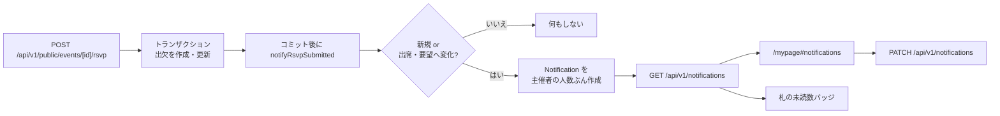

# 参加表明を主催者へアプリ内で知らせる

## 背景

参加者が出欠を送っても、幹事は名簿を開くまで気づけない。幹事は複数の催しを持ち、名簿を開くのは直前になりがちなので、参加表明や参加要望が出たその場で気づける入口が要る。

`docs/issues/waitlist.md` では「通知は作らない（メールもプッシュもしない）」と決めていたが、参加要望は幹事の承認待ちを伴うため、起きたことが分からないと順番待ちの人が待ち続ける。メールは送信量に比例して費用が掛かるため、まずは費用 0 円のアプリ内通知だけを実装する。

## 決定

| 論点 | 決定 |
| :---- | :---- |
| 経路 | アプリ内のみ。メール・SMS・プッシュ・SSE は作らない（`MAIL_WEBHOOK_URL` には触れない） |
| 知らせる出来事 | 出席の新規表明と、参加要望の新規発生 |
| 受け取る人 | その催しの会員主催者（`OWNER` と `CO_HOST`）。ゲスト主催者（`user_id IS NULL`）は宛先にしない |
| 自分自身の出欠 | 自分が主催する催しに自分で出欠しても、自分には通知しない（他の主催者には通知する） |
| 知らせない変化 | 出席→参加要望、出席・要望→欠席、出欠の取り消し、幹事自身の承認操作 |
| 費用 | DB の行だけなので 0 円。メールを足すときは事業者の料金だけ |
| 見せ方 | 390px のヘッダーは「ブランド・作成・頭文字」で埋まっているので、ベルは足さず、頭文字の札に未読数の丸バッジを重ねる |
| 数字 | 1〜9 はその数字、10 以上は `9+`（桁で幅が変わらないようにする） |
| 読み上げ | 札のボタンの `aria-label` に「未読 N 件」を入れる。色だけで伝えない |
| 本文の保存 | 作成時点の催し名・参加者名を焼き付ける。後から名前を変えても過去の通知は動かない |

## 処理の流れ



通知は出欠のトランザクションの外で作る。通知の失敗で出欠を失敗させないため、呼び出し側は `try/catch` で `console.error` に留める。

## 1. DB

`NotificationKind`（`RSVP_ATTENDING` / `RSVP_WAITLISTED`）と `Notification` を追加する。

```prisma
model Notification {
  id            String           @id @default(uuid()) @db.Uuid
  userId        String           @map("user_id") @db.Uuid
  eventId       String           @map("event_id") @db.Uuid
  participantId String?          @map("participant_id") @db.Uuid
  kind          NotificationKind
  title         String           @db.VarChar(100)
  body          String           @db.VarChar(300)
  /// 同じ出欠行の同じ変化を二重に作らない指紋（sha256 の hex）。
  dedupeKey     String           @unique @map("dedupe_key") @db.VarChar(64)
  readAt        DateTime?        @map("read_at") @db.Timestamptz
  createdAt     DateTime         @default(now()) @map("created_at") @db.Timestamptz

  user        User         @relation(fields: [userId], references: [id], onDelete: Cascade)
  event       Event        @relation(fields: [eventId], references: [id], onDelete: Cascade)
  participant Participant? @relation(fields: [participantId], references: [id], onDelete: SetNull)

  @@index([userId, readAt, createdAt])
  @@index([userId, createdAt])
  @@map("notifications")
}
```

- 催しを削除すると通知も消える。出欠行が消えても通知は残し、`participant_id` だけ `NULL` にする（文面に誰の表明かが残っている）。
- `dedupe_key` の一意制約が、同時送信・リトライでの二重作成を吸収する。
- マイグレーション: `prisma/migrations/20261029190000_rsvp_notifications/migration.sql`。

## 2. 判定と文面（純ロジック）

`src/modules/notifications/lib/rsvp-notification.ts`（DOM も Next も DB も持たない）。

| 関数 | 役割 |
| :---- | :---- |
| `shouldNotifyRsvp({ created, previousStatus, nextStatus })` | 下の表の判定 |
| `buildRsvpNotification({ eventTitle, participantName, status })` | `{ kind, title, body, href }` |
| `participantsPath(eventId)` | 行き先 `/organizer/events/<eventId>/participants` |
| `dedupeKeyFor({ userId, participantId, kind, changedAt })` | `sha256` の hex（64 文字） |
| `notificationRecipientIds(organizers, participantUserId)` | `userId` のある主催者だけを重複なく返し、本人は除く |

| 変化 | 通知 |
| :---- | :---- |
| 新規 → `ATTENDING` | する（出席） |
| 新規 → `WAITLISTED` | する（参加要望） |
| `DECLINED` → `ATTENDING` / `WAITLISTED` | する |
| `WAITLISTED` → `ATTENDING` | する（要望から出席へ） |
| 同じ状態の再送信 | しない |
| `ATTENDING` → `WAITLISTED` / `DECLINED` | しない |
| 出席の取り消し（行の削除） | しない |

文面（`title` は 100 文字、`body` は 300 文字で切る）:

- 出席: 題「参加表明がありました」／本文「〇〇 さんが「△△」に出席します。」
- 要望: 題「参加要望が届きました」／本文「〇〇 さんが「△△」の参加を希望しています。定員に達しているため、名簿から承認できます。」

未読数の文字列 `formatUnreadCount(count)` は `src/modules/notifications/lib/unread.ts` に置く。共通ヘッダーはクライアントで描くため、`node:crypto` を使う判定側と分けてある（`rsvp-notification.ts` からも再輸出する）。

## 3. 作成（DB）

`src/modules/notifications/lib/notify.ts` の `notifyRsvpSubmitted(input)`。

- `POST /api/v1/public/events/[id]/rsvp` の `submit()` が `previousStatus` を返す（更新時は `target.status`、新規は `null`）。
- コミット後に呼ぶ。失敗しても出欠は成功させる。
- 主催者は `eventOrganizer.findMany({ where: { eventId } })` から取り、`notificationRecipientIds` で絞る。
- `prisma.notification.createMany({ skipDuplicates: true })` でまとめて作る。一意制約違反（`P2002`）は成功として扱う。
- `deliver()` は今は何もしない。メールを足すときは、ここで `src/lib/mail.ts` の `deliverMail()` に同じ `title` / `body` を渡す。

## 4. API

`src/app/api/v1/notifications/route.ts`。認可は `requireUserId(req)`（未ログインは 401）。自分の行しか読めない・既読にできない。

- `GET /api/v1/notifications?limit=20`（1〜50、既定 20）

  ```json
  {
    "unreadCount": 2,
    "notifications": [
      {
        "id": "…",
        "kind": "RSVP_ATTENDING",
        "title": "参加表明がありました",
        "body": "佐藤 みのり さんが「秋の芋煮会」に出席します。",
        "eventId": "…",
        "participantId": "…",
        "href": "/organizer/events/<eventId>/participants",
        "readAt": null,
        "createdAt": "2026-10-29T09:55:00.000Z"
      }
    ]
  }
  ```

  `createdAt` の降順。`unreadCount` は `readAt: null` の件数。
- `PATCH /api/v1/notifications` — `{ "all": true }` または `{ "ids": ["…"] }`。`updateMany({ where: { userId, readAt: null, ... } })` で既読にし、`{ "unreadCount": 0 }` を返す。
- 入力の検証は `src/lib/schemas.ts` の `MarkNotificationsSchema`（`all` も `ids` も無い要求は 400）。

## 5. 画面

- `src/modules/notifications/hooks/useNotifications.ts` — 未読数を 60 秒ごと・`visibilitychange`・パス移動・`notifications:changed` で取り直す。主催者でない会員は呼ばない。
- `src/modules/notifications/components/NotificationList.tsx` — 既存の `Section` / `SectionHead` / `Rows` / `Row` / `Badge` を使う。未読は行の左に点、状態は「出席」「参加要望」のバッジ。行は名簿へのリンクで、押したら `PATCH { ids }` してから遷移する。見出しの右に「すべて既読にする」。
- `src/app/mypage/page.tsx` — 集計の直後に `<Section id="notifications">` を置く。取得は既存の `load()` に 1 本足す。
- `src/components/common/Navbar.tsx` — 主催者のとき、頭文字の札の右上に未読数の丸バッジ（`.site-user__badge`）を絶対配置で重ねる。`0` のときは要素ごと出さない。メニューに `SITE.nav.notifications`（`/mypage#notifications`）を足し、件数を小さく添える。
- スタイルは `src/styles/base.css` の `.site-user` 周辺と、`src/styles/screens/organizer.css` の `.notif__*` だけ。幅の段は増やさない。

## 6. テスト

- `tests/unit/rsvp-notification.test.ts` — 判定の表、文面と 300 文字の切り詰め、指紋の安定性、宛先の絞り込み、`formatUnreadCount`。
- `tests/integration/rsvp-notifications.test.ts`（`TEST_DATABASE_URL` があるときだけ） — 宛先、自分の出欠、二重作成の防止、種別、既読の範囲、他人の通知が読めないこと、未ログインは 401。

## 受け入れ条件

- [x] 参加者が出席を送ると、主催者の頭文字の札に未読数のバッジが出て、`/mypage#notifications` に「参加表明がありました」が出る
- [x] 未読が 10 件以上なら札のバッジが `9+` になり、ヘッダーの高さと幅が変わらない（390px で横スクロールしない）
- [x] 札のボタンの読み上げに「未読 N 件」が入る
- [x] 満員で参加要望が発生したときも、同じく通知が出る
- [x] 同じ人が出欠を直しても、同じ状態なら通知は増えない
- [x] ゲスト主催者と、自分自身の出欠では通知が作られない
- [x] 通知を押すと名簿へ移動し、その 1 件が既読になる
- [x] 「すべて既読にする」で未読数と札のバッジが消える
- [x] 他の会員の通知は読めない・既読にできない
- [x] 通知の作成に失敗しても出欠の送信は成功する
- [x] メールは送られない（`MAIL_WEBHOOK_URL` を設定しても配送しない）

## スコープ外

- メール・SMS・プッシュ・SSE での配信
- 欠席・取り消し・幹事の承認操作の通知
- 通知の削除・保持期間・設定（受け取る／受け取らない）
- 参加者向けの通知（参加者ホームや「あとで」のリマインドは別の仕組み）

## メールを後から足すとき

`src/modules/notifications/lib/notify.ts` の `deliver()` を差し替えるだけで足せる。作成した通知と同じ `title` / `body` を `src/lib/mail.ts` の `deliverMail()` に渡し、`MAIL_WEBHOOK_URL` が空なら `RECORDED` として記録する（既存のリマインドと同じ挙動）。配信結果を残すなら `Notification` に `emailStatus` / `emailedAt` を足すマイグレーションが 1 本増える。今回のマイグレーションには列を作っていない。

## 参考

- `prisma/schema.prisma` — `Notification`、`NotificationKind`
- `src/modules/notifications/lib/rsvp-notification.ts` — 判定・文面・指紋
- `src/modules/notifications/lib/notify.ts` — 通知の作成
- `src/app/api/v1/notifications/route.ts` — 取得と既読
- `src/app/api/v1/public/events/[id]/rsvp/route.ts` — 出欠の送信
- `src/components/common/Navbar.tsx` — 未読数のバッジ
- `src/app/mypage/page.tsx` — 新着欄
