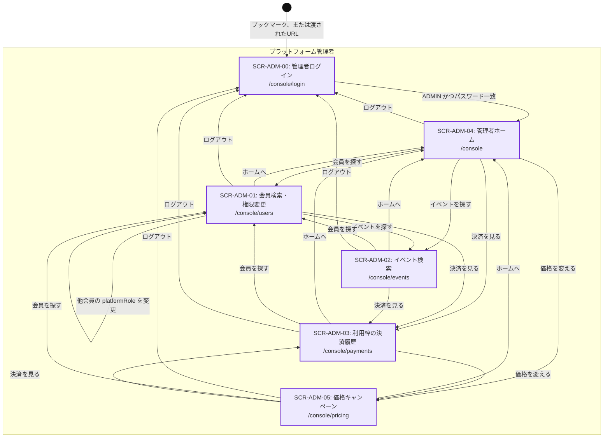

# 全体システム要件定義書（機能横断・共通編）
**ファイル名: `overall_system_requirements_common.md`**  
**システム名称: チラシファースト型イベント告知・出欠＆プラットフォーム基盤**  
**版数: 第1.19版（正本の範囲・課金と Cookie の確定・体裁の修正）**

---

## 1. 文書概要・目的

### 1.1. 本ドキュメントの目的
本ドキュメントは、機能スライス（Vertical Slice）として先行策定された「チラシ生成機能」、「イベント紹介ページ生成・出欠管理機能」、「権限管理・段階的会員基盤」、「利用枠管理・課金決済基盤」を1つのWebシステムとして有機的に結合するための「**機能横断・共通要件定義書**」である。

機能単位の先行実装で生じやすい「機能間の隙間（エアポケット）」や「動線・画面の抜け漏れ（トップページの未定義など）」を排除し、システム全体の境界、情報アーキテクチャ（IA）、全アクターの動線を統制する。

```text
【最上位：全体企画構想（共通編：本ドキュメント）】
  ├─ システム境界・ツール型モデル定義（告知URL共有 × クローズド出欠）
  ├─ ユースケースと画面対応（第3.5節。画面網羅の判定）
  ├─ アクター別カスタマージャーニー＆流入経路分析（Traffic & Journey）
  ├─ リソース × アクター CRUD+L マトリクス（操作の担当画面）
  └─ 情報アーキテクチャ（IAツリー）＆ 全体画面遷移仕様（Mermaid）
      ↓
【中間：機能別スライス要件・設計（確定済み）】
  ├─ チラシ生成機能（AI背景生成 ＋ 決定論的文字描画）
  ├─ イベント紹介ページ・出欠管理機能（7項目入力、ポスター埋め込みFV、未登録出欠）
  ├─ 権限管理・段階的会員基盤（ゲストCookie照会、排他編集ロック、Hydration）
  └─ 利用枠・課金決済基盤（2回無料、単発299円/サブスク980円、canCreateEvent認可）
      ↓
【下流：統合実装・共通基盤】
  └─ Next.js App Router 統合、Prisma単一インスタンス、Stripe二重化、環境変数一元化
```

### 1.2. 正本の範囲

共通編と機能別文書が食い違ったとき、どちらを正とするかを先に決める。次の範囲だけが共通編の上書き対象である。

| 範囲 | 正とする文書 | 内容 |
| :--- | :--- | :--- |
| 共通編が上書きする | 本ドキュメント | システム境界、公開フラグと `status`、画面 ID と URL、アクターの動線、機能間の認可境界、課金の判定順、Cookie の名前と期限 |
| 機能別文書に残す | 各機能の文書 | 画面の部品と文言、API のフィールド定義、データベースの物理定義、チラシの描画 |

機能別文書のうち、次の 4 つを上位の根拠にする。実装の細部は共通ドキュメント（`DBschema`、`backend_api_implementation_spec`、`front_implementation_spec`）を見る。

* チラシ生成: {doc}`flyer/specs/system_requirements`
* イベント告知・出欠: {doc}`archive/event-page/specs/event_page_system_requirements`
* 会員・権限: {doc}`archive/user-management/detailed_design_spec`
* 利用枠・課金: {doc}`billing_and_quota_system_requirements`

食い違いを見つけたときは、上の表で「共通編が上書きする」に入る範囲だけ共通編を直し、それ以外は機能別文書を直す。同じ内容が両方にある場合は、機能別文書に寄せて共通編からは消す。この取り決めが無いあいだは、正本が 2 つある。

---

## 2. システム基本コンセプトとビジネスモデル

### 2.1. ツール型（告知URL共有）の設計
本システムは、主催者が作った告知ページのURLを、LINE・Instagram・X などで参加者へ直接共有するツールである。不特定多数へ向けたイベントの一覧・検索は持たない。

1. **対象とするイベント:**
   - バーのジャズナイト、マルシェの出店、地域フェス、社内勉強会、プライベート飲み会、特定サークルの集会など、主催者が参加者へ直接URLを届けられる催し。
   - 参加者は、主催者から受け取ったURLを開いて内容を読み、出欠を答える。
2. **配布は主催者が行う:**
   - 主催者は、公開完了モーダル（SCR-ORG-04）で告知URLをコピーし、自分のチャネルで共有する。
   - 参加者は、ホーム（`/`）からイベントを探さない。ホームはサービスの説明と、作成・ログインの入口である。
3. **将来のメディアサイト:**
   - イベントを一般に集客する一覧・検索は、このアプリの外に別サービスとして足す。
   - そのため `events.visibility` と `GET /api/v1/public/events/[id]` の読み取り契約は残す。ただし、いまのアプリは一覧を持たず、`visibility` は常に `UNLISTED`（紹介制）である。

### 2.2. 掲載フラグ（Visibility）の予約
`events.visibility` は、将来のメディアサイトが一覧に出すかどうかを表す列として残す。いまのアプリは一覧を持たないため、作成・編集画面には出さず、API も入力を受け取らない。値は常に `UNLISTED`（紹介制）である。

* **`UNLISTED`（紹介制）:** 告知URL（`/events/[id]`）を直接開いた人だけが閲覧・出欠できる。いまの唯一の値である。
* **`PUBLIC`（一覧掲載）:** 将来のメディアサイトの一覧・検索に出す値。いまのアプリはこの値を保存しない。メディアサイトを足すときに、主催者の再同意を得て設定する。
* **検索エンジンへの掲載:** しない。告知ページは `robots` を `noindex, nofollow` にする。OGP のタイトル、説明、チラシ画像は、チャットや SNS に URL を貼ったときのカードのために出す。
* **一覧・検索の API:** 持たない。`GET /api/v1/public/events` のような一覧の取得は置かず、告知は `GET /api/v1/public/events/[id]` の単体取得だけである。
* **終了後と削除後:** `CLOSED` でも告知URLは残り、閲覧だけできる。論理削除（`isDeleted = true`）と下書きは 404 にする。

### 2.3. 公開状態（status）・削除との組み合わせ
`status`（`DRAFT` / `PUBLISHED` / `CLOSED`）と論理削除（`isDeleted`）だけで、告知URLと出欠の可否を決める。

| 条件 | 告知URL `/events/[id]` | 出欠 |
| :--- | :--- | :--- |
| `PUBLISHED` かつ未削除 | 閲覧できる | 期限前なら受け付ける |
| `CLOSED` かつ未削除 | 閲覧できる | 停止する |
| `DRAFT`、または `isDeleted = true` | 開かない（404） | 受け付けない |

* **完全削除（SCR-MOD-03）:** 行の物理削除はしない。`isDeleted = true` の論理削除とし、出欠履歴は残す。
* **出欠受付停止（SCR-MOD-03）:** `status = CLOSED` とする。告知URLは残し、出欠だけを止める。
* **申し込み期限:** `events.rsvp_deadline`（任意。日本時間で入力し、`TIMESTAMPTZ` で保存する）。空なら期限はない。`PUBLISHED` かつ未削除でも、現在時刻が期限以降なら新規の出欠と変更は受け付けない。取消は受け付ける。告知URLの条件は `status` のままである。期限切れだけでは `CLOSED` にしない。
* **公開状態の変更:** 新規作成は `PUBLISHED` で保存する。利用枠が無いとき（HTTP 402）は `DRAFT` で保存し、決済後に `draftId` を引き継いで SCR-ORG-02 から公開する。この経路では公開の時点で枠を1つ消費する。複製は `DRAFT` で作り、複製した時点で枠を消費する（公開時に二重に引かない）。`PUBLISHED` から `DRAFT` へ戻す操作は持たない。受付停止は SCR-MOD-03 の `CLOSED` だけである。

### 2.4. サービス表示名と公開クロム（仮置き）
ヘッダー、フッター、ブラウザタイトルに出すサービス名は仮置きである。値は `src/lib/site.ts` の定数テーブル `SITE` に置く。画面とメタデータはそこだけを読む。いまの `SITE.name` は `EventKreater` である。名称を変えるときはこの定数だけを書き換える。データベースには持たない。

公開ナビとフッターの文言・パスも同じテーブルの `SITE.nav` に置く。料金と Cookie はドメイン側の定数のままである。

| キー | いまのラベル | 着地 |
| :--- | :--- | :--- |
| `SITE.nav.home` | トップ | SCR-PUB-00 |
| `SITE.nav.service` | サービスと料金 | SCR-PUB-06 |
| `SITE.nav.createEvent` | イベント告知ページを作る | SCR-ORG-02 |
| `SITE.nav.organizerList` | 主催一覧 | SCR-ORG-01 |
| `SITE.nav.organizerLogin` | 主催者ログイン | SCR-PUB-02 |
| `SITE.nav.participantLogin` | 参加者ログイン | SCR-PUB-07 |
| `SITE.nav.participantHome` | 参加者ホーム | SCR-PUB-08 |
| `SITE.nav.participantCalendar` | 参加カレンダー | SCR-PUB-12 |
| `SITE.nav.participantHistory` | 参加履歴 | SCR-PUB-09 |
| `SITE.nav.mypage` | 主催者マイページ | SCR-PUB-03 |
| `SITE.nav.organizerSwitch` | 主催者として使う | SCR-ORG-01 |
| `SITE.nav.participantSwitch` | 参加者として見る | SCR-PUB-08 |
| `SITE.nav.terms` | 利用規約 | SCR-PUB-10 |

### 2.4.1. ステークホルダー別の共通ヘッダー表示区分

共通ヘッダー（`Navbar`）は、閲覧者と現在の画面領域の組み合わせで出す機能を変える。主催者の機能と参加者の機能を同じ並びに混ぜない。閲覧者の役割は `GET /api/v1/user/profile` の `isOrganizer`（主催イベントを 1 件以上持つか）で決め、画面領域はパスで決める。主催者画面は `/mypage`、`/organizer`、`/invitations` である。

| # | ステークホルダー | 状態・現在地 | ヘッダーに出す機能 | 出さない機能 |
| :--- | :--- | :--- | :--- | :--- |
| 1 | 未ログイン（参加者・見込み客・主催検討） | 全画面 | サービスと料金（SCR-PUB-06）、イベント告知ページを作る（SCR-ORG-02）、参加者ログイン（SCR-PUB-07）、主催者ログイン（SCR-PUB-02） | 参加者ホーム、参加履歴、主催一覧、主催者マイページ、管理コンソール |
| 2 | 参加者（会員・主催イベントなし） | 公開画面・参加者画面 | 参加者ホーム（SCR-PUB-08）、参加カレンダー（SCR-PUB-12）、参加履歴（SCR-PUB-09）、アカウント（SCR-PUB-11）、主催者として使う（SCR-ORG-01） | 主催一覧、主催者マイページ、イベント告知ページを作る、利用枠、管理コンソール |
| 3 | 主催者（会員・主催イベントあり） | 公開画面・参加者画面 | 参加者ホーム、参加カレンダー（SCR-PUB-12）、参加履歴、アカウント（SCR-PUB-11）、主催者マイページ（SCR-PUB-03） | 主催一覧、イベント告知ページを作る、利用枠、管理コンソール |
| 4 | 主催者（会員・主催イベントあり） | 主催者画面 | 主催一覧（SCR-ORG-01）、イベント告知ページを作る（SCR-ORG-02）、主催者マイページ（SCR-PUB-03）、アカウント（SCR-PUB-11）、参加者として見る（SCR-PUB-08） | 参加者ホーム、参加履歴、サービスと料金、管理コンソール |
| 5 | プラットフォーム管理者 | `/console` | 別枠の管理バー（`AdminChrome`） | 共通ヘッダーとフッター |

* **主催者画面のヘッダー:** 主催一覧、イベント告知ページを作る、主催者マイページ、参加者として見る、だけを出す。他会主催のイベントへの参加履歴（SCR-PUB-09）は並べない。参加者の画面へ移るときは「参加者として見る」1 本に集約する。
* **参加者画面のヘッダー:** 参加者ホーム、参加カレンダー、参加履歴、だけを出す。主催一覧とイベント作成と利用枠は並べない。主催イベントを持つ会員にだけ「主催者マイページ」を 1 本出す。持たない会員には「主催者として使う」を出す。
* **アカウント（SCR-PUB-11）:** ログイン済みの会員には、主催者画面と参加者画面のどちらにも「アカウント」（`/account`）を 1 本出す。表示名、メールアドレス、電話番号、パスワードの変更と退会は、主催者と参加者で同じ画面を使う。管理コンソールのバーには出さない。
* **役割の切り替え:** 同じ会員が主催者と参加者の両方の顔を持つ場合も、ログインし直さずに 1 本のリンクで行き来できる。主催者画面から参加者画面へは SCR-PUB-08、参加者画面から主催者画面へは SCR-PUB-03 である。
* **現在地:** 表示中の機能には `aria-current="page"` と `is-current` を付ける。
* **管理コンソール:** どの状態でも共通ヘッダーとフッターに出さない（SCR-ADM-00 は直接 URL だけ）。

公開ヘッダーの未ログイン時の導線は「参加者ログイン」と「主催者ログイン」の 2 本である。参加者の出欠にログインは要らない。管理者ログイン（SCR-ADM-00）は公開ナビに出さない。SCR-PUB-02 の画面名は「会員登録・ログイン」のままである。フッターには「利用規約」（SCR-PUB-10）を出す。料金ページと課金モーダルからも同じページへリンクする。

---

## 3. 画面・動線の網羅性検証フレームワーク（漏れ防止規定）

画面が足りているかの判定は、第3.5節のユースケースを正とする。各ユースケースはアクターの目的と、その目的で開く画面 ID を持つ。第5節の画面は第3.5節の対応表にすべて現れ、ユースケースの各ステップが指す画面は第5節の ID か、外部の Stripe 画面だけである。

第3.1節から第3.4節は、そのユースケースを流入経路、操作の担当、URL、補った機能へ分解したものである。

### 3.1. アクター別カスタマージャーニー＆流入経路分析（Traffic & Journey）
ユーザーが画面URLを認知・取得する経路（流入元）を全アクターについて逆引き定義する。

| アクター | 流入経路（Traffic Origin） | ユーザーの心理・行動ステージ | 着地画面（Landing Page） | 次の遷移先 |
| :--- | :--- | :--- | :--- | :--- |
| **未ログイン（告知URL未取得）** | Google検索、ブックマーク、SNSトップリンク | 「何のサービスか知りたい」 | **SCR-PUB-00: ホーム (`/`)。短いサービス紹介** | 自分で作るなら SCR-ORG-02。料金は SCR-PUB-06。告知URLを持っている人は SCR-PUB-01 |
| **参加者（招待型）** | 主催者のLINE、SNSの共有URL直踏み | 「送られてきたイベントの日時確認・出欠回答」 | **SCR-PUB-01: イベント告知・出欠 (`/events/[id]`)** | 出欠完了（SCR-PUB-01）。履歴を会員に残すときだけ UC-03 で SCR-PUB-07 |
| **参加者から主催を検討する人** | 告知ページの出欠フォーム直下の勧誘カード「イベント告知ページを作る」 | 「自分も似た催しを開きたい」 | **SCR-PUB-01 (`/events/[id]`)**。幹事本人と主催イベント持ちの会員にはカードを出さない | **SCR-ORG-02 (`/organizer/events/new?ref=<イベントID>`)**。登録を先に挟まない。未登録のまま公開したら **SCR-ORG-10** |
| **会員参加者（再訪型）** | ブラウザ直接入力、幹事が送るリマインドメール | 「自分が申し込んだイベントの日時や場所を再確認」 | 告知URLのリンクは **SCR-PUB-01**。参加者ホームのリンクは **SCR-PUB-08 (`/participant`)**、履歴は **SCR-PUB-09 (`/participant/history`)** | 申込の詳細は SCR-PUB-01。自分の領収書は SCR-PUB-04 |
| **見込み客（主催検討）** | 検索広告、比較記事、知人の紹介、ホーム・公開ナビ・フッターの「サービスと料金」 | 「いくらかかり、何ができるかを確認してから作りたい」 | **SCR-PUB-06: サービス・プラン紹介 (`/service`)** | 作成は SCR-ORG-02。アカウントが要る操作は SCR-PUB-02。購入の開始は SCR-MOD-01 |
| **料金条件を確認する人** | 料金ページ、フッター、課金モーダルの「利用規約」 | 「自動更新や解約、返金の条件を知りたい」 | **SCR-PUB-10: 利用規約 (`/terms`)** | 料金は SCR-PUB-06。作成は SCR-ORG-02 |
| **主催幹事（新規）** | ホームまたはサービス・プラン紹介の「イベント告知ページを作る」 | 「告知ページとチラシを作りたい」 | ホーム経由は **SCR-PUB-00 (`/`)**。料金を先に見た人は **SCR-PUB-06 (`/service`)** | SCR-ORG-02。チラシ生成は SCR-ORG-08、過去チラシは SCR-ORG-03。作成に会員登録は要らない |
| **パスワード登録者** | 登録時に届く確認メールのリンク | 「登録を終えてログインしたい」 | **SCR-PUB-05: メール確認 (`/auth/verify`)** | 成功後は SCR-PUB-02 の電話番号確認。既に会員行があるときはログインする |
| **電話番号の確認** | メール確認のあと、Google の新規、または電話未確認のログイン | 「同じ人として会員になり、無料枠を使いたい」 | **SCR-PUB-02 (`/auth/register?step=phone`)**。参加者入口から始めた登録は **SCR-PUB-07 (`/participant/login?step=phone`)** | 確認後は許可した `next`。無ければ主催者は SCR-PUB-03、参加者は SCR-PUB-08 |
| **領収書を見る参加者** | 告知ページまたはマイページの「領収書」 | 「自分の参加費の領収書を見たい」 | **SCR-PUB-04 (`/events/[id]/receipt`)** | 印刷する。幹事の領収書画面は開かない |
| **決済から戻る筆頭幹事** | Stripe Hosted Checkout の成功 URL またはキャンセル URL | 「支払いのあと、作成を続けたい」 | **SCR-ORG-02 (`/organizer/events/new`)** | 成功なら枠を確認して公開を続ける。キャンセルも同じ画面に戻る |
| **契約を終えた筆頭幹事** | Stripe Customer Portal の終了 | 「解約やカード変更のあと、管理へ戻る」 | **SCR-ORG-01 (`/organizer/events`)** | 主催一覧に留まる。マイページから開いても復帰先は同じ |
| **主催幹事（既存）** | SCR-PUB-02 でのログイン、管理ブックマーク | 「出欠状況の確認、過去イベントの複製、編集」 | **SCR-ORG-01: 主催イベント一覧 (`/organizer/events`)** | 編集と複製は SCR-ORG-05、参加者は SCR-ORG-06、削除・停止は SCR-MOD-03 |
| **共同主催（招待受諾）** | 既存幹事から送られた招待URL | 「幹事権限を受け取り、管理に加わる」 | **SCR-ORG-07: 共同主催者の招待 (`/invitations/[code]`)** | ログイン済みなら SCR-ORG-01。未ログインなら SCR-PUB-02 を経て SCR-ORG-07 へ戻る。未登録のままの受諾は不可 |
| **プラットフォーム管理者** | ブックマーク、または運用者から渡された URL。公開ナビ、フッター、サービス・プラン紹介、サイトマップには出さない | 「登録会員、イベント、利用枠の決済を調べ、販売価格を期間限定で変え、必要なら別の会員を管理者にする」 | **SCR-ADM-00: 管理者ログイン (`/console/login`)** | 成功時は SCR-ADM-04（管理者ホーム）。そこから会員、イベント、決済、料金へ進む |

会員登録（SCR-PUB-02）の主目的は、幹事が管理、複製、招待受諾に入ることである。参加者の出欠にアカウントは要らない。出欠履歴を会員へ移す UC-03 と、申込一覧を見る UC-04 は、同じ画面の別目的である。

### 3.2. リソース × アクター CRUD+L マトリクス
主要エンティティに対し、各アクターが実行可能な操作（C:作成, R:閲覧, U:更新, D:削除, **L:一覧**）の整合性を検証する。

| エンティティ | アクター | C | R | U | D | **L (一覧・検索)** | 担当画面 / 備考 |
| :--- | :--- | :---: | :---: | :---: | :---: | :---: | :--- |
| **Event (告知URL)** | 参加者・未ログイン | × | ◯ | × | × | **× (一覧なし)** | SCR-PUB-01。`PUBLISHED` または `CLOSED` かつ未削除の URL 直開きのみ |
| **Event (全種)** | 主催幹事 | ◯ | ◯ | ◯ | ◯ | **◯** | **SCR-ORG-01。削除と受付停止は筆頭幹事だけ（SCR-MOD-03）** |
| **Participant** | 参加者（本人） | ◯ | ◯ | ◯ | ◯ | × | SCR-PUB-01: 端末Cookieによる自回答照会。未ログインの本人に一覧画面は無い |
| **Participant** | 会員（本人） | ◯ | ◯ | ◯ | ◯ | **◯** | **SCR-PUB-08 が申込一覧、SCR-PUB-09 が参加履歴。詳細と出欠の変更は SCR-PUB-01（UC-04）** |
| **Participant** | 主催幹事 | × | ◯ | ◯ | ◯ | **◯** | **SCR-ORG-06。一覧、CSV、出欠の変更と削除。参加者へのリマインド** |
| **FlyerAsset** | 主催幹事 | ◯ | ◯ | × | ◯ | **◯** | **作成は SCR-ORG-08。一覧・選択・削除は SCR-ORG-03** |
| **EventLock** | 主催幹事 | ◯ | ◯ | ◯ | ◯ | × | SCR-ORG-05, SCR-MOD-02: 排他制御 |
| **Quota / Plan** | 筆頭幹事 | × | ◯ | × | × | × | **SCR-MOD-01。画面が行うのは購入と残数の参照だけ。利用枠の行は電話番号確認と Stripe の付与が作り、金額や状態は画面から変えない。解約とカード変更は SCR-ORG-01 と SCR-PUB-03 から Stripe Portal。出欠の対価ではない** |
| **User（会員）** | プラットフォーム管理者 | × | ◯ | ◯ | × | **◯** | **SCR-ADM-01。変更できるのは `platformRole` だけ。自分の権限は変えられない** |
| **Event（全状態）** | プラットフォーム管理者 | × | ◯ | × | × | **◯** | **SCR-ADM-02。下書き、公開中、受付停止、削除済みを含む。内容は変えない** |
| **BillingTransaction（利用枠の決済）** | プラットフォーム管理者 | × | ◯ | × | × | **◯** | **SCR-ADM-03。単発、月額の初回、月額の更新、失敗、返金、異議申立。金額の変更や返金操作はしない** |
| **PricingCampaign（価格キャンペーン）** | プラットフォーム管理者 | ◯ | ◯ | ◯ | × | **◯** | **SCR-ADM-05。作成、編集、停止だけ。削除はしない。監査ログを残す。公開側は SCR-PUB-06 と SCR-MOD-01 が読む** |
| **Receipt（参加費の領収書）** | 主催幹事 | ◯ | ◯ | ◯ | × | × | **SCR-ORG-06 で出席者へ発行・再発行。表示は SCR-ORG-09。参加費の決済はしない** |
| **Receipt（参加費の領収書）** | 参加者（本人） | × | ◯ | × | × | × | **SCR-PUB-04。端末 Cookie または会員の参加履歴から、自分の領収書だけ** |

### 3.3. URL・情報アーキテクチャ（IA）階層定義
RESTfulな階層関係およびディレクトリ構造に基づき、URLの欠落を防止する。

```text
/ (SCR-PUB-00: ホーム / 短いサービス紹介 / 作成とログインの入口)
│  ※ イベントの一覧・検索は持たない。ID なしの /events は / へリダイレクトする
│
├── /service (SCR-PUB-06: サービス・プラン紹介。料金の比較はここ)
│
├── /terms (SCR-PUB-10: 利用規約。料金、自動更新、無料期間の通知、解約、返金)
│
├── /events/[id] (SCR-PUB-01: 公開告知・出欠登録画面)
│   └── /receipt (SCR-PUB-04: 参加者向け領収書)
│
├── /organizers/[userId] (SCR-PUB-14: 主催者のプロフィール。誰でも開ける。非公開なら名前と催しへの導線だけ)
│   └── /events (SCR-PUB-13: 主催者の催し。参加者のログイン必須。カレンダーと一覧)
│
├── /auth/register (SCR-PUB-02: 主催者の会員登録・ログイン。電話番号確認は ?step=phone)
├── /auth/verify (SCR-PUB-05: パスワード登録のメール確認。成功後は電話番号確認へ進む)
│
├── /participant/login (SCR-PUB-07: 参加者の会員登録・ログイン。着地は /participant)
├── /participant (SCR-PUB-08: 参加者ホーム / これからの参加)
│   ├── /participant/calendar (SCR-PUB-12: 参加カレンダー / 出欠を選んだ日程に並べる)
│   └── /participant/history (SCR-PUB-09: 参加履歴 / 出欠と領収書)
│
├── /mypage (SCR-PUB-03: 主催者マイページ / 主催イベントの要約、利用枠、契約管理、公開プロフィール。参加履歴は出さない)
│
├── /account (SCR-PUB-11: アカウント設定 / プロフィール・メール・電話・パスワード・退会)
│   └── /account/email/verify (SCR-PUB-11: 新しいメールアドレスの確認。確認リンクの着地)
│
├── /organizer
│   ├── /organizer/events (SCR-ORG-01: 主催イベント一覧)
│   │   ├── /organizer/events/new (SCR-ORG-02: 新規イベント作成)
│   │   │   ├── (パネル) SCR-ORG-08: チラシ生成
│   │   │   ├── (モーダル) SCR-ORG-03: チラシ選択・削除
│   │   │   ├── (モーダル) SCR-ORG-04: 公開完了モーダル
│   │   │   └── (モーダル) SCR-MOD-01: 課金プラン選択モーダル
│   │   ├── (モーダル) SCR-MOD-01: 複製時の枠不足（筆頭幹事）
│   │   ├── (モーダル) SCR-MOD-03: 削除・受付停止（筆頭幹事）
│   │   ├── Stripe Customer Portal（筆頭幹事の解約・カード変更。SCR-PUB-03 の同じボタンからも開き、復帰先はこの一覧）
│   │   └── /organizer/events/[id]
│   │       ├── /edit (SCR-ORG-05: 排他編集)
│   │       │   ├── (パネル) SCR-ORG-08: チラシ生成
│   │       │   ├── (モーダル) SCR-ORG-03: チラシ選択・削除
│   │       │   └── (モーダル) SCR-MOD-02: 排他ロック競合モーダル
│   │       ├── /participants (SCR-ORG-06: 参加者名簿、CSV、変更、削除、リマインド、領収書発行、売上サマリ)
│   │       ├── /revenue (SCR-ORG-12: 売上の内訳。主催者別の按分・プラン別・開催回別)
│   │       └── /receipts/[participantId] (SCR-ORG-09: 幹事向け領収書)
│   ├── /organizer/revenue (SCR-ORG-11: 売上。見込み・領収書発行額・差額・イベント別。本文内サブタブで一覧・カレンダーと行き来する)
│   └── /organizer/calendar (SCR-ORG-13: カレンダー。月グリッドと選んだ日の予定一覧。本文内サブタブで一覧・売上と行き来する)
│
├── /invitations/[code] (SCR-ORG-07: 共同主催者の招待)
│
├── /console (SCR-ADM-04: 管理者ホーム。公開ナビ・フッターからは入らない)
│   ├── /console/login (SCR-ADM-00: 管理者ログイン)
│   ├── /console/users (SCR-ADM-01: 会員検索・権限変更)
│   ├── /console/events (SCR-ADM-02: イベント検索)
│   ├── /console/payments (SCR-ADM-03: 利用枠の決済履歴)
│   └── /console/pricing (SCR-ADM-05: 価格キャンペーンの作成・編集・停止)
│
└── /api/v1/... (バックエンドRoute Handlers)
```

### 3.4. 第3節で補った画面と機能
第3.1節から第3.3節の操作に、次の置き場を置く。

* **ホーム:** SCR-PUB-00（`/`）である。冒頭は `SITE.tagline`「催し・イベントのチラシと告知WEBページを、5分で作る。」と、入力から公開までの流れを示すリードである。その下が使い方と、告知URLは主催者から受け取る旨の案内である。機能紹介は告知・出欠・集計・売上・運営（主催者と共同主催）・日程（カレンダー）の6つで、第1項で「チラシと告知ページが5分でできる」と言い切る。イベントの一覧・検索は置かない。料金の比較は置かない。
* **サービス・プラン紹介:** SCR-PUB-06（`/service`）である。見込み客が検索広告、比較記事、知人の紹介、ホーム、公開ナビ、フッターから入る。無料2回、単発299円、月額980円を示す。期間限定のキャンペーン中は、販売価格と定価を併記し、期限を添える。この画面では Stripe を開かない。「イベント告知ページを作る」は SCR-ORG-02、「主催者ログイン」は SCR-PUB-02 である。
* **利用規約:** SCR-PUB-10（`/terms`）である。料金、無料枠、価格キャンペーンの適用条件、0円単発の付与条件、0円月額のカード登録と自動更新、無料期間終了の3日前・1日前の通知、解約と返金を載せる。フッター、SCR-PUB-06、SCR-MOD-01、SCR-PUB-03 からリンクする。
* **アカウント設定:** SCR-PUB-11（`/account`）である。主催者と参加者が同じ画面を使い、表示名、メールアドレス、電話番号、パスワードの変更と退会を行う。導線は両方の画面領域の共通ヘッダーに 1 本置く。管理者は管理コンソールから入らない。
* **価格キャンペーン（SCR-ADM-05）:** 管理者が単発・月額の販売価格を期間限定で変える。作成・編集・停止だけを行い、削除はしない。0円の単発は1人N回までとし、電話番号確認を条件にする。0円の月額はStripeの100%クーポンを使い、カード登録を必須にして、期間終了後は定価で自動請求する。既存購入者の割引は遡及して変えない。
* **チラシ生成（SCR-ORG-08）:** 新規作成と編集の画面内パネル。ポスターは日時と費用を1件しか描けないため、フォーム先頭の日時と先頭プランの費用をチラシアセットに保存する。
* **過去チラシ（SCR-ORG-03）:** 同じ端末またはログイン中の会員が生成したチラシを選ぶ。催し名・場所・雨天・定員に加え、先頭の開催日時と先頭プランの費用へ流し込む。プラン名が空なら「標準」にする。削除は一覧から外す論理削除であり、すでに掲載しているイベントの画像は残す。
* **複製:** 会員の筆頭幹事として利用枠を消費し、下書きを作って SCR-ORG-05 を開く。下書きの公開は、その編集画面で `status` を `PUBLISHED` にして保存する。枠が無いときは下書きを作らず、SCR-ORG-01 上の SCR-MOD-01 を開く。公開完了モーダル（SCR-ORG-04）は開かない。
* **削除と受付停止（SCR-MOD-03）:** 筆頭幹事だけ。受付停止は `status = CLOSED`。完全削除は `isDeleted = true`。
* **名簿（SCR-ORG-06）:** CSV 出力、出欠の変更、参加者の削除。リマインドは、会員のメールアドレスへの送信と、アカウントのない参加者への文面コピーの2つを標準で持つ。本文に告知URLと参加履歴へのリンクを入れる。文面は画面からコピーして LINE や DM に貼れる。メール配送先 `MAIL_WEBHOOK_URL` が無いときは送信記録だけを残す。名簿からは参加者ページのプレビューと共有リンクのコピーもできる。費用プラン列は、出席者では申込時点の金額を出す（プラン金額を後から編集しても名簿と売上が食い違わないようにする）。出席者には参加費の領収書を発行できる。金額の既定値も申込時点の金額で、幹事が書き換えられる。システムの利用枠決済とは別であり、参加費の集金は行わない。発行後の表示は SCR-ORG-09、参加者の表示は SCR-PUB-04 である。
* **売上（SCR-ORG-11 / SCR-ORG-12）:** 会員の幹事だけが開ける。出席者が選んだ費用プランの金額に出席人数を掛けて、見込みの売上を出す。金額は出欠を入れた時点の写し（`participants.price_amount`）を持ち、費用プランを後から編集しても申込済みの金額は変えない。領収書の発行額を並べ、その差を「要確認の差額」として出す。未回収額ではない。あわせて、プラン選択済みの出席者1人あたりの平均単価を出す。期間は開催日（`events.sort_date`）で絞り、初期表示は全期間である。出席しているのにプラン未選択の参加者は売上に含めず、人数だけを出して名簿へ誘導する。サマリはカードを並べず、罫線で区切った帳票の行として出す。ラベルを左、金額を右に置き、注記は短い名詞句にする。差額が何を意味するかの説明は、行の中ではなく表の下の脚注に1回だけ置く。同じサマリを名簿・内訳・横断の3画面で使う。主催一覧と売上の行き来は本文冒頭のサブタブで行い、ヘッダーのナビには足さない。参加費の集金と決済は行わない。共同主催がいるイベントでは、売上を主催者ごとに按分して表示する。方式はイベントごとに「割合」（basis points、合計100%）と「人数」（連れてきた人数）から選び、主催者が設定する。按分は見込みと領収書発行額の両方に同じ配分を掛け、各人を切り捨てて余りは主催者へ寄せる。人数方式で配り切れない分は「未割当」として残す。按分は集金の分担を決める表示であり、送金・決済は行わない。公開範囲はイベントごとに「全員に公開」「各自の分だけ」を選べ、既定は各自の分だけとする。主催者は常に全員分を見る。横断の売上には按分後の「あなたの取り分」を出す。
* **申し込み期限:** 作成（SCR-ORG-02）と編集（SCR-ORG-05）で任意入力する。基本7項目には数えない。チラシには描かない。複製は期限の値をコピーする。
* **男女別の費用:** 作成（SCR-ORG-02）と編集（SCR-ORG-05）で「男女別の費用を設定する」を入れると、1プランが男性用・女性用の1組になる。プラン名は組で1つだけ入力し、男性用・女性用の両方の行に同じ名前を保存する。金額と補足は行ごとに設定する。対象は画面から選べず固定表示であり、追加も削除も組単位で行う。1組は2件として数え、上限は8件である。出席者がいるイベントでは、共通／男女別の切り替えと、出席者が選んでいるプランの削除・対象変更を止める（409 `PRICING_LOCKED`）。移行前のデータに残る対象「共通」の行は書き換えず、そのまま「共通」と表示する。
* **Stripe Portal:** 筆頭幹事の解約とカード変更である。SCR-ORG-01 と SCR-PUB-03 から開き、どちらから開いても SCR-ORG-01 へ戻る。参加者の出欠では開かない。
* **告知の共有:** 公開完了モーダル（SCR-ORG-04）で告知URLをコピーし、主催者が LINE・Instagram・X などで共有する。参加者はそのURLから SCR-PUB-01 を開く。
* **将来のメディアサイト:** イベントの一覧・検索は、このアプリの外に別サービスとして足す。判定は `src/modules/media/lib/listings.ts` の `isListable` に閉じ込め、いまは HTTP ルートを公開しない。アプリ内に一覧APIは置かない。
* **プラットフォーム管理者:** 公開登録では作れない。既存のローカル会員をデータベースで `ADMIN` にしたあと、秘匿 URL の SCR-ADM-00 から入る。ログイン後の着地は SCR-ADM-04（`/console`）。会員の検索と権限変更は SCR-ADM-01、全状態のイベント検索は SCR-ADM-02、利用枠の決済履歴は SCR-ADM-03、価格キャンペーンは SCR-ADM-05。公開画面からのリンクは置かない。決済の返金や金額の変更は、この画面では行わない。価格キャンペーンは販売価格の設定であり、返金や既存購入者の金額の変更ではない。

### 3.5. ユースケースと画面の対応

画面が網羅されているかは、この節で判定する。

* 各ユースケースは、アクター、目的、基本フロー、代替フローを持つ。フローの各ステップは画面 ID を1つ名指しする。
* 第5節の画面 ID は、本節末尾の対応表にすべて並ぶ。対応表に無い ID を第5節へ足すときは、先に本節のフローへその ID を書く。
* フローが名指しできるのは、第5節の画面 ID、Stripe Hosted Checkout、Stripe Customer Portal である。
* 出欠の完了表示、ログアウト、招待 URL のコピー、告知 URL の 404 は、開いている画面のうえでの結果である。そのステップの画面 ID は、開いている画面のままにする。

#### 3.1節のアクターとユースケース

| 3.1節のアクター | ユースケース |
| :--- | :--- |
| 未ログイン（告知URL未取得） | UC-01、UC-02 |
| 参加者（招待型） | UC-02、UC-03 |
| 会員参加者（再訪型） | UC-04、UC-18 |
| 見込み客（主催検討） | UC-15 |
| 主催幹事（新規） | UC-05、UC-11、UC-15 |
| パスワード登録者 | UC-03、UC-04、UC-07、UC-10 |
| 領収書を見る参加者 | UC-04、UC-14 |
| 決済から戻る筆頭幹事 | UC-11 |
| 契約を終えた筆頭幹事 | UC-11 |
| 主催幹事（既存） | UC-06、UC-07、UC-08、UC-09、UC-10、UC-11、UC-14、UC-18 |
| 共同幹事（招待受諾） | UC-06、UC-09、UC-10、UC-14 |
| プラットフォーム管理者 | UC-12、UC-13、UC-16 |

#### UC-01 ホームでサービスの性質を知る

* **アクター:** 未ログイン（告知URL未取得）
* **目的:** 何のサービスか、イベントを探す場所ではないことを知る。
* **基本フロー:**
  1. SCR-PUB-00 で短いサービス紹介と使い方を見る。料金の比較は SCR-PUB-06 である。
  2. 「イベントを探している方へ」で、一覧・検索はなく、主催者が共有した告知URLから開くことを読む。
  3. 告知URLを持っているときは、そのURLから SCR-PUB-01 を開く。
* **代替フロー:** 自分でイベントを作るときは SCR-ORG-02、料金を知りたいときは SCR-PUB-06 である。

#### UC-02 告知を読み、出欠を答える

* **アクター:** 参加者（未ログイン可）
* **目的:** 送られた URL から告知を開き、出欠を残す。
* **基本フロー:**
  1. SCR-PUB-01 を開く。`PUBLISHED` かつ未削除である。
  2. 同じ画面で、ニックネーム、出欠、コメントを送る。端末に出欠 Cookie が付く。完了の表示も SCR-PUB-01 である。
  3. 同じ端末で SCR-PUB-01 を再度開くと、自回答が表示される。変更と取消も同じ画面で行う。
* **代替フロー:**
  * `CLOSED` かつ未削除のときは、SCR-PUB-01 で告知を読める。出欠は受け付けない。
  * `PUBLISHED` でも申し込み期限以降は、新規の出欠と変更を受け付けない。取消は同じ画面でできる。告知は読める。告知URLは開いたままである。
  * `DRAFT` または削除済みの告知 URL は、2.3節のとおり 404 である。結果は SCR-PUB-01 のパスに対するものとし、画面 ID は追加しない。
  * 回答の履歴を会員に残すときは UC-03 へ進む。

#### UC-03 出欠の履歴を会員に紐付ける

* **アクター:** 未登録の参加者
* **目的:** 端末上の出欠を、会員アカウントへ移す。
* **基本フロー:**
  1. SCR-PUB-01 から SCR-PUB-02 を開く。
  2. パスワードで新規登録するときは、SCR-PUB-02 で確認メールの送信完了を見て、メールのリンクから SCR-PUB-05 を開く。確認後、同じ SCR-PUB-02 の電話番号確認へ進む。
  3. 電話番号の確認が完了したとき、端末の httpOnly Cookie にある出欠トークンとゲスト幹事トークンだけを会員へ紐付け、SCR-PUB-08 に申込一覧を出す。
* **代替フロー:**
  * ログイン済みで電話番号も確認済みの会員は SCR-PUB-02 を経由せず、SCR-PUB-08 で一覧を見る。
  * ログイン済みで電話番号が未確認のときは、SCR-PUB-02 の電話番号確認へ進む。
  * Google で続けるときは、確認済みの Google メールで既存会員を探す。同じ `googleSub` または同じ確認済みメールの会員があればその行へ空いている手段を足す。無ければ SCR-PUB-05 は開かず、SCR-PUB-02 の電話番号確認へ進む。同じ確認済み電話番号の会員があれば新しい行は作らず、その会員へ手段を足す。

#### UC-04 申し込み済みのイベントを見直す

* **アクター:** 会員参加者
* **目的:** 自分が答えたイベントの日時と場所を確認し、出欠を変える。
* **基本フロー:**
  1. SCR-PUB-08 で、本人の申込一覧を見る。
  2. 告知を SCR-PUB-01 で開く。出欠の変更は UC-02 と同じ画面で行う。
  3. 幹事からのリマインドメールも、告知 URL なら SCR-PUB-01、参加履歴のリンクなら SCR-PUB-09 を開く。
* **代替フロー:**
  * 未ログインのときは、公開ナビの「参加者ログイン」から SCR-PUB-07 を開き、パスワードまたは Google のあと確認番号を入力してから SCR-PUB-08 へ進む。確認番号の既定は登録済み電話へのSMSである。SMSが届かないときは同じ画面で確認済みメールへ切り替える。
  * ログアウトは SCR-PUB-08 上の操作である。完了後の着地は SCR-PUB-00 である。
  * 自分の参加に領収書があるときは、SCR-PUB-09 から SCR-PUB-04 を開く。告知画面に自分の回答があるときも、SCR-PUB-01 から SCR-PUB-04 を開く。

#### UC-05 イベントとチラシを作って公開する

* **アクター:** 主催幹事。未ログインのゲスト幹事を含む。
* **目的:** 告知ページを公開し、必要ならチラシを載せる。
* **基本フロー:**
  1. SCR-PUB-00 の作成、または SCR-ORG-01 の新規作成から、SCR-ORG-02 を開く。
  2. SCR-ORG-02 で基本7項目と、任意の申し込み期限を入れる。公開状態は `PUBLISHED` で保存する。
  3. チラシを新規に作るときは SCR-ORG-08 を開き、生成後は SCR-ORG-02 のフォームへ戻る。過去のチラシを使うときは SCR-ORG-03 で選び、7項目の流し込み後に SCR-ORG-02 へ戻る。チラシが無くても公開できる。
  4. 公開する。利用枠があるときは SCR-ORG-04 が開く。
  5. SCR-ORG-04 から告知 URL の SCR-PUB-01 を開くか、SCR-ORG-01 へ戻る。告知URLは主催者が共有する。
* **代替フロー:**
  * 利用枠が無い公開は HTTP 402 となり、SCR-ORG-02 上で SCR-MOD-01 を開く。購入手順は UC-11 である。モーダルを閉じても SCR-ORG-02 に留まる。このときの入力は `DRAFT` として保存済みで、`draftId` を `?draftId=` に持ち続ける。戻ってきたときは、その下書きを読み直してフォームに入れる。
  * 未登録のゲスト幹事は `DRAFT` を作れない（403 `REGISTER_REQUIRED`）。先に SCR-PUB-02 で登録し、そのあと SCR-ORG-02 で公開する。
  * SCR-ORG-03 での削除は、一覧から外す論理削除である。すでに掲載しているイベントの画像は残る。閉じたあとは SCR-ORG-02 である。
  * 公開時の枠判定は 4.2節に従う。

#### UC-06 公開済みイベントを編集する

* **アクター:** 筆頭幹事または共同幹事
* **目的:** 告知の7項目と申し込み期限を、同時編集を防いで更新する。複製した下書きは、この画面で公開する。
* **基本フロー:**
  1. SCR-ORG-01、または SCR-PUB-03 の主催イベントの要約から、SCR-ORG-05 を開く。
  2. ロックを取得し、7項目と申し込み期限を保存する。保存後はロックを解放し、SCR-ORG-01 へ戻る。
  3. チラシを作り直すときは SCR-ORG-08 を開き、結果は SCR-ORG-05 へ戻す。過去チラシは SCR-ORG-03 で選び、流し込み後に SCR-ORG-05 へ戻る。
* **代替フロー:**
  * 下書きのときだけ、公開状態を `PUBLISHED` にして保存できる。利用枠が未消費の下書きなら、保存の時点で枠を1つ消費する。`PUBLISHED` や `CLOSED` から別の状態へは変えられない。受付停止は UC-08 の SCR-MOD-03 である。
  * 他の幹事が期限内のロックを持っているときは、SCR-MOD-02 を開く。一覧へ戻るときは SCR-ORG-01、閲覧のみまたは強制引き継ぎのときは SCR-ORG-05 に留まる。
  * 編集をキャンセルするときは、ロックを解放して SCR-ORG-01 へ戻る。

#### UC-07 過去イベントを複製する

* **アクター:** 会員である筆頭幹事
* **目的:** 既存の内容を下書きとしてコピーし、告知 URL を開ける状態にする。
* **基本フロー:**
  1. SCR-ORG-01 で複製する。利用枠を消費し、申し込み期限を含む内容の `DRAFT` を作って SCR-ORG-05 を開く。
  2. SCR-ORG-05 で内容を直し、`status` を `PUBLISHED` にして保存する。保存後は SCR-ORG-01 へ戻る。告知 URL が開く条件は 2.3節である。複製した時点で枠を消費済みなので、公開では二重に引かない。
* **代替フロー:**
  * この公開では SCR-ORG-04 を開かない。SCR-ORG-04 を開くのは UC-05 の新規公開だけである。
  * 会員でない幹事は複製できない。画面は SCR-ORG-01 のままで、登録またはログインは SCR-PUB-02 である。
  * 利用枠が無いときは下書きを作らない。SCR-ORG-01 上で SCR-MOD-01 を開く。購入手順は UC-11 である。モーダルを閉じると SCR-ORG-01 に戻る。

#### UC-08 イベントを削除する、または出欠を止める

* **アクター:** 筆頭幹事
* **目的:** 告知URLを閉じるか、出欠だけを止める。
* **基本フロー:**
  1. SCR-ORG-01 で対象を選ぶ。
  2. SCR-MOD-03 で、完全削除（`isDeleted = true`）または受付停止（`status = CLOSED`）を確認する。
  3. 確定後は SCR-ORG-01 へ戻る。削除済みの告知 URL は UC-02 の 404、受付停止後の告知 URL は UC-02 の閲覧である。
* **代替フロー:** 共同幹事には SCR-MOD-03 を出さない。共同幹事の編集は UC-06、名簿は UC-09 である。

#### UC-09 参加者名簿を扱い、会員へ知らせる

* **アクター:** 筆頭幹事または共同幹事
* **目的:** 出欠の一覧を確認し、参加者へ告知を再送する。
* **基本フロー:**
  1. SCR-ORG-01 から SCR-ORG-06 を開く。
  2. 同じ画面で、名簿の閲覧、CSV 出力、出欠の変更、参加者の削除を行う。
  3. 同じ画面から、会員のメールアドレスへリマインドを送る。本文のリンクは告知の SCR-PUB-01 と、参加履歴の SCR-PUB-09 である。
  4. アカウントの無い参加者には、同じ文面をコピーして LINE や DM で個別に送る。参加者ページのプレビューと共有リンクのコピーも同じ画面から行う。
* **代替フロー:** `MAIL_WEBHOOK_URL` が無いときは、SCR-ORG-06 に留まり、送信記録だけを残す。

#### UC-14 出席者へ参加費の領収書を発行する

* **アクター:** 筆頭幹事または共同幹事
* **目的:** 出席者へ、参加費を受け取った旨の領収書を渡す。
* **基本フロー:**
  1. SCR-ORG-06 で出席者を選ぶ。
  2. 同じ画面で、宛名、金額（円の整数）、但し書きを入れて発行する。金額の初期値は費用プランの表示文から取らない。費用プランは文章であり、金額は幹事が入れる。
  3. SCR-ORG-09 で領収書を表示し、印刷する。
* **代替フロー:**
  * 欠席者には発行しない。
  * 同じ出席者へ再発行すると、同じ領収書の宛名、金額、但し書き、発行者、発行日を上書きする。
  * 参加者は SCR-PUB-04 で自分の領収書を見る。幹事の SCR-ORG-09 は開かない。
  * この操作では Stripe を使わない。利用枠の 299 円と 980 円の領収書ではない。

#### UC-10 共同主催者を招待し、受諾する

* **アクター:** 招待を出す筆頭幹事と、招待 URL を受け取った会員
* **目的:** 別の会員を、そのイベントの共同主催者として管理に加える。
* **基本フロー:**
  1. 筆頭幹事は、SCR-ORG-04（イベント編集）の幹事パネルで招待 URL を作る。作れるのは登録済みの筆頭幹事だけである。
  2. 受け取った人は SCR-ORG-07 を開く。
  3. ログイン済みなら受諾し、SCR-ORG-01 へ進む。受諾するとその人は共同主催者になり、名簿・領収書・編集を分担する。
  4. 筆頭幹事は同じ幹事パネルで共同主催者を一覧し、外せる。外された人は、そのイベントの幹事権限と編集ロックを失う。
* **代替フロー:**
  * 未ログインのときは SCR-PUB-02 で登録またはログインし、SCR-ORG-07 へ戻ってから受諾する。未登録のままの受諾は 403 `REGISTER_REQUIRED` で受け付けない。受諾後は SCR-ORG-01 である。
  * 筆頭幹事は外せない。イベントを消すか、共同主催者だけを外す。
  * 共同主催者の一覧・招待・解除は、共同主催者には表示しない。

#### UC-11 利用枠を購入し、契約を管理する

* **アクター:** 会員である筆頭幹事
* **目的:** イベントを追加できる枠を得て、月額契約とカードを自分で変える。
* **基本フロー:**
  1. UC-05 または UC-07 が HTTP 402 のとき、SCR-MOD-01 で単発 299 円または月額 980 円を選ぶ。UC-05 で下書きを作ったときは、その `draftId` を Checkout のメタデータに載せる。
  2. Stripe Hosted Checkout で支払う。成功時は `session_id` 付きで SCR-ORG-02 へ戻り、枠を確認する。`draftId` も戻るので、SCR-ORG-02 は入力を復元する。復元したあと公開すると、枠を1つ消費して `PUBLISHED` になり、UC-05 として SCR-ORG-04 へ進む。複製が起点でも、Checkout の戻り先は SCR-ORG-02 であり、複製のやり直しは SCR-ORG-01 で行う。
  3. 契約中の解約とカード変更は、SCR-ORG-01 または SCR-PUB-03 から Stripe Customer Portal を開く。どちらから開いても、終了後は SCR-ORG-01 へ戻る。
* **代替フロー:**
  * Checkout をキャンセルしたときも、戻り先は SCR-ORG-02 である。
  * 自動更新、無料期間の終了、解約、返金の条件は、SCR-MOD-01 と SCR-PUB-03 の「利用規約」から SCR-PUB-10 を開いて読む。
  * 参加者の出欠（UC-02）では、SCR-MOD-01 も Stripe の画面も開かない。

#### UC-12 登録会員とイベントを検索して確認する

* **アクター:** プラットフォーム管理者
* **目的:** 登録済みの会員、下書き・公開中・削除済みを含むイベント、利用枠の決済を探す。
* **基本フロー:**
  1. 公開ナビゲーションに無い URL で SCR-ADM-00 を開く。
  2. SCR-ADM-00 でメールとパスワードによりログインする。入れるのは `platformRole = ADMIN` かつ `password_hash` があり、メール確認済みで、確認済み電話番号がある会員だけである。
  3. 同じ画面で確認番号を入力する。既定は登録済み電話へのSMSである。SMSが届かないときは確認済みメールへ切り替えられる。成功時は SCR-ADM-04（管理者ホーム）へ進む。会員、イベント、決済の入口を選ぶ。
  4. SCR-ADM-01 で、名前またはメールアドレスの部分一致により会員を検索し、一覧を見る。
  5. SCR-ADM-02 で、催し名、場所、または幹事の名前・メールアドレスの部分一致によりイベントを検索し、一覧を見る。対象は状態と削除を問わない。
  6. SCR-ADM-03 で、会員の名前・メール、または Stripe のセッション ID・請求書 ID・PaymentIntent ID により決済を検索し、一覧を見る。
* **代替フロー:**
  * メールが無い、パスワードが違う、メール未確認、`MEMBER` である、のどれでも SCR-ADM-00 に留まり、同じ失敗メッセージを出す。
  * 未ログインで SCR-ADM-04、SCR-ADM-01、SCR-ADM-02、SCR-ADM-03 を開いたときは SCR-ADM-00 へ戻す。
  * 既に管理者セッションがある状態で SCR-ADM-00 を開いたときは SCR-ADM-04 へ進む。
  * 会員としてログイン済みの非管理者が管理画面を開いたときは、管理画面を出さない。
  * 確認済み電話が無い管理者は SCR-ADM-00 に留まり、会員ログインから電話番号を確認する。

#### UC-13 会員のプラットフォーム権限を変更する

* **アクター:** プラットフォーム管理者
* **目的:** 別の会員を管理者にする、または会員へ戻す。
* **基本フロー:**
  1. SCR-ADM-01 で対象を検索する。
  2. 同じ画面で、その会員の `platformRole` を `MEMBER` または `ADMIN` に変える。
* **代替フロー:**
  * 自分の権限は変えられない。画面は SCR-ADM-01 のままである。
  * 最初の管理者は公開登録では作れない。既存会員の `platform_role` をデータベースで `ADMIN` にする。手順はデータベース手順書にある。

#### UC-15 サービスと料金を読んでから作り始める

* **アクター:** 見込み客（主催を検討している人。未ログイン可）
* **目的:** 何ができて、いくらから使えるかを知ったうえで、イベント作成へ進む。
* **基本フロー:**
  1. 検索広告、比較記事、知人の紹介、または SCR-PUB-00 と公開ナビとフッターの「サービスと料金」から SCR-PUB-06 を開く。
  2. 同じ画面で、チラシと出欠の説明、参加者の出欠は無料であること、無料2回、単発299円、月額980円を読む。
  3. 「イベント告知ページを作る」で SCR-ORG-02 を開く。作成に会員登録は要らない。
* **代替フロー:**
  * 先にアカウントが要るときは SCR-PUB-02 を開く。
  * 告知URLを持っているときは SCR-PUB-01 を開く。ホームからイベントを探す導線はない。
  * この画面では支払わない。支払いは UC-11 の SCR-MOD-01 である。
  * 自動更新、解約、返金の条件は、同じ画面の「利用規約」から SCR-PUB-10 を開いて読む。

#### UC-16 販売価格を期間限定で変え、0円販売を止める

* **アクター:** プラットフォーム管理者
* **目的:** 単発チケットと月額プランの販売価格を、期間と対象を決めて変える。0円の販売を始め、または止める。
* **基本フロー:**
  1. SCR-ADM-04 から SCR-ADM-05 を開く。
  2. 同じ画面で、名前、対象（単発／月額／両方）、割引の種類（割合／無料）、割引率、開始と終了（日本時間）、優先度、0円の上限回数を入れる。入力中の割引率から、単発と月額の販売価格を即時プレビューする。
  3. 保存する。100%以外の割引は10円単位の切り上げ、最低10円とする。100%だけ0円とする。値引きが成立しない割引率は受け付けない。
  4. 販売中のキャンペーンを止めるときは、同じ画面で停止する。新規の申込だけが止まり、既に購入した人と加入中の人の割引は終了日まで続く。
* **代替フロー:**
  * 編集で価格に関わる項目を変えたときは版を上げ、月額用のStripeクーポンを作り直す。既存の加入者には影響しない。
  * 公開側の表示は SCR-PUB-06 と SCR-MOD-01 が読む。管理者が SCR-ADM-05 を開かない限り、価格は変わらない。
  * 0円の月額に加入した人には、終了日の3日前と1日前にメールを送る。送信は `POST /api/v1/internal/billing/notices` を日次で叩く。同じ無料期間には1回だけ送る。
  * 返金と金額の訂正は、この画面では行わない。Stripe 側で行う。

#### UC-17 自分のアカウント情報を変える・退会する

* **アクター:** 会員（主催者・参加者のどちらも同じ）
* **目的:** 表示名、メールアドレス、電話番号、パスワードを自分で変える。使い続けないときは退会する。
* **基本フロー:**
  1. 主催者画面または参加者画面のヘッダーから SCR-PUB-11 を開く。表示名、メールアドレス（マスク）、電話番号（下4桁）、パスワードの有無、退会の節が縦に並ぶ。
  2. 表示名を変える。保存すると `users.name` だけが変わる。過去の出欠の `participants.name` と領収書の宛名は変えない。
  3. メールアドレスを変える。まず現在の連絡先（SMS またはメール）へ確認番号を送り、照合できたら新しいアドレスへ確認リンクを送る。リンクを開いた時点で `users.email` が変わる。他の端末のログインは切る。
  4. 電話番号を変える。現在のパスワード（Google のみの会員は確認番号）で本人確認し、新しい番号へ届いた6桁を照合する。他の端末のログインは切る。
  5. パスワードを変える（Google のみの会員は最初の1回を設定として使う）。現在のパスワードまたは確認番号が要る。他の端末のログインは切る。
  6. 退会する。パスワードまたは確認番号を照合し、確認のうえ実行する。完了すると SCR-PUB-00 へ戻り、退会した旨を出す。
* **代替フロー:**
  * メールアドレスが既に他の会員のものなら、確認番号を消費する前に 409 で止める。電話番号も同じく、使用中なら SMS を送る前に 409 で止める。
  * 管理者（`platformRole = ADMIN`）は退会できない。HTTP 403 `ADMIN_CANNOT_WITHDRAW` とし、先に管理者権限を外すよう案内する。
  * 有効な Stripe サブスクリプションがあるときは、即時に解約する。解約に失敗したら退会を中止し、HTTP 502 `SUBSCRIPTION_CANCEL_FAILED` を返す。
  * 退会した会員の行は消さない。`users.deleted_at` を立て、表示名を「退会した会員」、メールアドレスを `deleted+{id}@deleted.invalid` に置き換え、パスワードと Google の結び付けを外す。**確認済みの電話番号（`phone_e164` / `phone_verified_at`）だけは残す。**
  * 筆頭幹事（`OWNER`）のイベントは `is_deleted = true`、`status = CLOSED` にする。共同幹事（`CO_HOST`）の紐付けは削除する。参加者としての出欠は記録として残す。
  * 退会済みと同じ電話番号で再登録したときは、新しい行を作らず、その行を復帰させる（`deleted_at = NULL`、新しいメール・表示名・パスワードで上書き）。`user_usage_quotas` はそのまま引き継ぎ、消化済みの無料枠は戻さない。復帰は `account_change_logs` に `REACTIVATE` として残す。
  * 退会済みの行は、ログイン、パスワード再設定、確認番号の発行のいずれの入口でも使えない。
  * 管理者コンソール（SCR-ADM-01）の会員一覧には、退会済みを「退会済み」のバッジで出し、電話番号は下4桁だけを出す。

#### UC-18 主催者のほかの催しを見る

* **アクター:** 参加者（会員）
* **目的:** 気になった主催者が、ほかにどんな催しを開いているかをカレンダーと一覧で確認する。
* **基本フロー:**
  1. SCR-PUB-01 の主催者欄、または SCR-PUB-08 の参加カードから SCR-PUB-14（主催者のプロフィール）を開く。
  2. SCR-PUB-14 の「催しを見る」から SCR-PUB-13 を開く。プロフィールが未作成・非公開のときは、名前と催しへの導線だけを出す。
  3. SCR-PUB-13 でカレンダーと一覧を切り替える。カレンダーは JST の今月を初期表示にし、前月（今月より前は選べない）・次月・今月で移動する。月は `?month=YYYY-MM`、表示は `?view=calendar|list` に持つ。
  4. 催しを選ぶと SCR-PUB-01 を開き、出欠は UC-02 と同じ画面で答える。
* **代替フロー:**
  * 未ログインのときは、SCR-PUB-13 の中身を返さない。骨組みをぼかしたうえで「このページは参加者登録・ログイン後に閲覧できます」と出し、参加者ログイン（SCR-PUB-07）へ進める。URL と画面 ID は SCR-PUB-13 のままである。
  * 会員が存在しない、または退会済みのときは、SCR-PUB-13 で「主催者が見つかりません」と出す。
  * 掲載するのは `PUBLISHED`・未削除・申し込み期限内・今日以降の開催日がある催しだけである。満員の催しも掲載し、参加要望を受け付けている旨を出す。
  * 主催者は SCR-ORG-01 のプレビューから SCR-PUB-13 の中身を確認できる。プレビューの解除は SCR-ORG-01 上の操作である。

#### 画面 ID とユースケースの対応

第5節の画面 ID は次の行である。外部の2画面は画面 ID を持たず、第6節の遷移図にノードを持つ。

| 画面 ID | 画面名 | その画面を開くユースケース |
| :--- | :--- | :--- |
| SCR-PUB-00 | ホーム（短いサービス紹介・使い方） | UC-01、UC-04、UC-05、UC-15 |
| SCR-PUB-06 | サービス・プラン紹介 | UC-15 |
| SCR-PUB-10 | 利用規約 | UC-11、UC-15 |
| SCR-PUB-01 | イベント告知・出欠 | UC-01、UC-02、UC-03、UC-04、UC-05、UC-09 |
| SCR-PUB-02 | 会員登録・ログイン | UC-03、UC-04、UC-07、UC-10、UC-15 |
| SCR-PUB-05 | メール確認 | UC-03、UC-04、UC-07、UC-10 |
| SCR-PUB-08 | 参加者ホーム | UC-03、UC-04、UC-18 |
| SCR-PUB-09 | 参加履歴 | UC-04、UC-14 |
| SCR-PUB-03 | 主催者マイページ | UC-05、UC-06、UC-07、UC-09、UC-11 |
| SCR-PUB-11 | アカウント設定（プロフィール・メール・電話・パスワード・退会） | UC-17 |
| SCR-PUB-04 | 参加者向け領収書 | UC-04、UC-14 |
| SCR-PUB-13 | 主催者の催し | UC-18 |
| SCR-ORG-01 | 主催イベント一覧 | UC-05、UC-06、UC-07、UC-08、UC-09、UC-10、UC-11 |
| SCR-ORG-13 | 主催者カレンダー | UC-05、UC-06、UC-09 |
| SCR-ORG-02 | 新規イベント作成 | UC-05、UC-11、UC-15 |
| SCR-ORG-03 | チラシ選択モーダル | UC-05、UC-06 |
| SCR-ORG-04 | 公開完了モーダル | UC-05、UC-11 |
| SCR-ORG-05 | 排他編集 | UC-06、UC-07 |
| SCR-ORG-06 | 参加者名簿 | UC-09、UC-14 |
| SCR-ORG-09 | 幹事向け領収書 | UC-14 |
| SCR-ORG-07 | 共同主催者の招待 | UC-10 |
| SCR-ORG-08 | チラシ生成パネル | UC-05、UC-06 |
| SCR-MOD-01 | 課金プラン選択モーダル | UC-05、UC-07、UC-11 |
| SCR-MOD-02 | 排他ロック競合モーダル | UC-06 |
| SCR-MOD-03 | イベント削除・停止確認 | UC-08 |
| SCR-ADM-00 | 管理者ログイン | UC-12 |
| SCR-ADM-04 | 管理者ホーム | UC-12 |
| SCR-ADM-01 | 会員検索・権限変更 | UC-12、UC-13 |
| SCR-ADM-02 | イベント検索 | UC-12 |
| SCR-ADM-03 | 利用枠の決済履歴 | UC-12 |
| SCR-ADM-05 | 価格キャンペーン | UC-16 |
| （外部） | Stripe Hosted Checkout | UC-11 |
| （外部） | Stripe Customer Portal | UC-11 |

---

## 4. 機能間インテグレーション・共通境界仕様

### 4.1. チラシ生成機能 ⇄ イベント告知機能の疎結合参照
* **原則:** イベント機能とチラシ生成機能は、物理ファイルや内部実装を直接参照せず、`flyer_asset_id` および配信URLを介して疎結合に連携する。
* **流し込み（Prefill）連携:**
  - 主催者が「チラシ選択モーダル（SCR-ORG-03）」で過去に生成したチラシを選択すると、チラシの催し名・場所・雨天・定員をフォームへ流し込む。日時と費用はポスターが1件のため、先頭の開催日時と先頭プランの費用に入れる。プラン名が空なら「標準」とする。
  - イベント自体の開催日時と費用プランは、それぞれ 1〜8 件登録できる。出席の回答では、その中から日時を1つ、費用プランを1つ選ぶ。男女別の費用では、1プランを男性用・女性用の1組として扱い、2件として数える。プラン名は組で共有し、金額と補足は行ごとに持つ。1組の途中で上限に当たることはない。
* **チラシ任意構成:**
  - チラシ未生成または配置しない場合もイベント公開を許可する（標準グラフィックテンプレートをフォールバック表示）。

### 4.2. 課金認可ゲート（`canCreateEvent`）と作成フロー
* **作成の入口:** イベント作成は `POST /api/v1/public/events` の 1 本だけである。`/api/v1/organizer/events` は主催イベントの一覧 `GET` であり、作成を持たない。`POST /api/v1/events` は使わない。公開一覧の取得 API は持たない（2.2 節）。
* **下書き作成（枠不足の退避）:** `POST /api/v1/public/events` は `status` を受け取る。既定は `PUBLISHED` である。`DRAFT` を指定したときは課金判定を通さず、`status = DRAFT` で保存する。保存した時点では枠を消費しない（`events.quota_charged_at` は `NULL`）。未登録のゲスト幹事は `DRAFT` を作れない（403 `REGISTER_REQUIRED`）。
* **下書きの公開:** 枠の消費と `PUBLISHED` への遷移は、`POST /api/v1/organizer/events/[id]/publish` が 1 トランザクションで行う。この API は編集ロックを要求しない。`quota_charged_at` が `NULL` のときだけ枠を1つ消費して `quota_charged_at` を入れ、`PUBLISHED` にする。すでに入っているときは枠を引かずに `PUBLISHED` にする。複製した下書きは複製時点で `quota_charged_at` が入るため、公開で二重に引かない。`PUT /api/v1/organizer/events/[id]` で `DRAFT` から `PUBLISHED` に変えるときも、同じ規則で枠を消費する。
  * 枠が足りないときは 402 を返し、`PUBLISHED` にしない。下書きはそのまま残る。
* **Checkout の意図引き継ぎ:** 下書きを作ったあとの課金は、`draftId` と `returnTo` を Checkout の `metadata` と成功・キャンセルの URL に載せる。`returnTo` は自オリジンの `/organizer/events/new` だけを許す。`POST /api/v1/billing/checkout/verify` は、検証済みセッションの `metadata` から `draftId` と `returnTo` を返す。画面は `?draftId=` を保ったまま SCR-ORG-02 に戻り、フォームを復元する。
* **認可インターフェース:** 主催者がイベント公開（`POST /api/v1/public/events`）を要求した際、コントローラーの最前線で課金クォータを判定する。
* **「有効」の定義:** 月額が有効なのは、`subscription_status` が `ACTIVE` かつ `current_period_end` が現在時刻より後であるときだけである。`INCOMPLETE` と `CANCELED` は無効、`NONE` は未加入として扱う。
* **判定優先順位:** 上から順に見て、最初に当てはまったもので決める。
  1. `subscription_status` が `PAST_DUE` → `HTTP 402`。未払いの月額があるあいだは、無料枠も単発クレジットも使わせない。文言は支払い方法の更新を促す。
  2. 有効なサブスクリプション（月額980円）が存在する → 作成認可（枠消費なし）
  3. 単発購入クレジット（299円/回）が1以上残存 → クレジットを1消費して作成認可
  4. 無料枠累計作成数が2回未満、かつ確認済み電話番号がある → 無料カウントを+1して作成認可
  5. 無料枠は残っているが電話番号が未確認 → `HTTP 403`（`PHONE_REQUIRED`）。SCR-PUB-02 の電話番号確認へ進む。
  6. 上記すべてに非該当 → `HTTP 402 Payment Required` を返却し、フロントエンドで課金モーダル（SCR-MOD-01）を強制起動
* **無料枠の主体:** 無料 2 回は、確認済み電話番号 1 件につき 1 会員の利用枠へ紐付く。メールアドレスや Google アカウントを増やしても、同じ電話番号なら同じ会員であり、枠は増えない。単発クレジットと有効な月額は、電話確認の有無にかかわらず消費できる。
* **ゲスト公開:** 未ログインのゲスト幹事は利用枠の行を持たないため、無料 2 回・単発・月額のどれも消費しない。代わりに、端末のゲスト幹事 Cookie（`org_token_*`）で作れるイベントを 1 件に限る。2 件目は `HTTP 403`（`REGISTER_REQUIRED`）で止め、SCR-ORG-10 で会員登録を案内する。登録すると、その端末のイベントは会員へ引き継がれる。無料 2 回の電話番号確認は、会員の経路にだけ適用する。
* **共同幹事の免除:** 課金枠を消費するのは「筆頭作成者（オーナー幹事）」のみであり、招待された共同幹事の枠は一切消費しない。
* **課金主体:** 支払いが発生するのは、筆頭幹事が公開または複製で利用枠を使うときだけである。参加者の出欠では課金しない。会員かどうかは問わない。料金の説明は SCR-PUB-06 に置き、その画面では Stripe を開かない。購入は SCR-MOD-01 である。SCR-PUB-03 のポータルボタンは、同じ会員アカウントが筆頭幹事であるときの契約管理であり、参加の対価ではない。ポータルの復帰先は SCR-ORG-01 である。
* **参加費の領収書:** 幹事が宛名と金額と但し書きを入れて発行する文書である。Stripe の請求書でも、利用枠の領収書でもない。集金の成否はこのシステムでは確認しない。
* **利用枠の付与条件:** Checkout の完了と、同期検証 `POST /api/v1/billing/checkout/verify` は、同じ条件を満たすときだけ枠を増やす。`payment_status` が `paid` であること、通貨が `jpy` であること、単発は現在の販売価格、月額は現在の販売価格かつ Price が `STRIPE_PRICE_ID_MONTHLY_980` であること、セッションの `livemode` が秘密鍵のモードと一致すること、`metadata.userId` と Stripe 顧客 ID がその会員の利用枠行と一致すること。金額が無いセッションは付与しない。
* **販売価格の制御:** 定価は単発 299 円、月額 980 円である。管理者が SCR-ADM-05 で期間と対象を決めたキャンペーンを置くと、公開側の SCR-PUB-06 と SCR-MOD-01 はその販売価格を出す。適用するキャンペーンは、有効期間内で対象が一致するもののうち、優先度が最も高く、同じ優先度なら作成日時が新しい1件だけである。重ね掛けはしない。100% 割引のときだけ 0 円とし、それ以外は 10 円単位の切り上げで最低 10 円とする。既存の購入と加入の金額は遡及して変えない。
* **0円の単発:** 販売価格が 0 円のときは Stripe のセッションを作らない。確認済み電話番号がある会員に限り、`paid_credits` を 1 増やし、0 円の `SUCCEEDED` 取引を `listAmount`、`discountAmount`、`campaignId`、`appliedPercent` 付きで残す。同じキャンペーンで受け取れる回数は1人N回まで（既定1回）とする。`Idempotency-Key` を `requestKey` として保存し、二重付与を防ぐ。
* **0円の月額:** Stripe の Price は定価の `STRIPE_PRICE_ID_MONTHLY_980` のまま置き、100% off の `repeating` クーポンを付ける。`payment_method_collection` は `always` とし、0 円でもカードを登録させる。割引の月数は加入時からキャンペーン終了までを暦月で数えて切り上げ、1〜12か月とする。期間が終われば Stripe が定価で自動請求する。初回の 0 円請求は `payment_status = "no_payment_required"` として正常に扱う。
* **無料期間の終了前通知:** 0 円の月額、および 100% 未満の割引で加入した月額は、`discount_ends_at` の 3 日前と 1 日前にメールで知らせる。文面には終了日時、終了後の月額 980 円、解約は SCR-PUB-03 から Customer Portal を開くこと、SCR-PUB-10 の利用規約を入れる。送信は `POST /api/v1/internal/billing/notices` を日次で叩く。同じ無料期間には1回だけ送り、`billing_notices` に記録する。解約済みの契約には送らない。
* **決済履歴:** `billing_transactions` に、Checkout 開始時の行、月額の更新請求、失敗、全額返金、異議申立を残す。月額の初回請求は Checkout の行へ請求書 ID を足し、2 回目以降は行を増やす。全額返金と異議申立では、単発の未使用クレジットが残っていれば 1 つ戻す。使い切ったあとの公開済みイベントは自動では非公開にしない。月額の全額返金と異議申立では、その会員の月額状態を `CANCELED` にする。管理者は SCR-ADM-03 でこの表を見る。返金操作そのものは Stripe 側で行う。

### 4.3. 権限・セッション・端末Cookie統合（Hydration）
* **ゼロフリクション出欠:** 未登録参加者はニックネーム・出欠（Yes/No）・コメントのみで回答可能。回答時に暗号学的トークンを発行し、Cookie 名 `rsvp_token_<イベントID>`、`Max-Age` 30 日（`2592000`）、`Path=/`、`HttpOnly`、`SameSite=Lax`、`Secure` は HTTPS のときだけ、で端末に置く。DB には SHA-256 ハッシュで保存する。`Path` を `/events/<ID>` にしないのは、`/auth/register` と `/participant` でも同じトークンを読むためである。`PUBLISHED` でも、申し込み期限以降の新規登録と変更は拒否する。取消は期限後もできる。
* **端末自動照会:** 同一端末から再訪した場合、Cookieのトークンハッシュ照合により本人の出欠状態を自動表示し、ワンタップで変更・取り消しを可能とする。
* **参加要望（キャンセル待ち）:** 定員（`events.capacity`）に達した催しでは、出席の代わりに「参加要望」を受け付ける。`participants.status` は `ATTENDING`（出席）/ `DECLINED`（欠席）/ `WAITLISTED`（参加要望）の3値である。要望は名前とコメントだけを保存し、日時・費用プラン・金額は持たない。`participants.waitlisted_at` を要望日時として残し、承認順は `waitlisted_at ASC, created_at ASC, id ASC` とする。要望は参加人数・売上・領収書に数えない。空きが出ても自動繰り上げはせず、幹事が名簿から手動で承認する。承認時は定員を再確認し、出席日時と費用プランを必須にする。既に席を確保している出席者は、満員になっても出席のまま変更・取消できる。定員判定は `events` の行ロック（`SELECT ... FOR UPDATE`）を取ったトランザクション内で行い、同時送信で定員を超えない。画面を開いた直後に最後の1席が埋まる競合では、出席の送信を 409 で断らず参加要望へ読み替える。
* **アカウントの主目的:** 会員登録の入口は役割で分ける。主催者は SCR-PUB-02、履歴を残す参加者は SCR-PUB-07 を使う。パスワード登録は、確認メールのリンク（SCR-PUB-05）を開くまでログインできない。新規の会員行と利用枠は、電話番号の確認が終わるまで作らない。ログイン完了後の着地は、`next` が `/mypage`、`/participant`、`/organizer`、`/invitations`、`/events` のいずれかであるときだけそのパスであり、それ以外は主催者入口なら SCR-PUB-03、参加者入口なら SCR-PUB-08 である。招待の途中なら SCR-ORG-07 へ戻る。
* **会員の決定順:** 順番を入れ替えると、メールと Google で別の会員行と無料枠ができる。次の順だけを正とする。
  1. ログイン手段だけを確認する。パスワードは確認メール、Google は ID トークンの `sub` と確認済みメール。この時点では会員行も利用枠も作らない。
  2. 既存会員を、`googleSub`、次に確認済みメールの順で探す。あれば空いている手段だけを足す。`googleSub` が別の値なら結び付けない。
  3. 見つからなければ SMS で電話番号を確認する。番号は E.164 に正規化する。確認済みの番号だけを `users.phone_e164` に一意で保存する。未確認の番号は会員行へ入れない。
  4. 確認済み番号が既存会員にあれば、その行へ手段を足し、利用枠は増やさない。番号が新しければ、会員 1 行、利用枠 1 行、電話番号を同じトランザクションで作る。
* **出欠履歴の任意紐付け:** 未登録参加者は、出欠のあとで同じ画面を使い、端末上の出欠を会員へ移せる（UC-03）。このときの着地は SCR-PUB-08 である。出欠自体に会員登録は要らない。申込一覧を見るためのログイン（UC-04）の着地も SCR-PUB-08 である。
* **アカウント統合（Hydration）:** 会員セッションができたとき、そのリクエストの Cookie のうち `rsvp_token_*` と `org_token_*` で始まるものを全部集め、1トランザクションでその会員へ紐付ける。電話番号確認の前に会員行が無い新規登録では、確認完了後に紐付ける。リクエスト本文のトークンは受け取らない。
* **セッション:** パスワードまたは Google が通っただけではセッションを発行しない。確認番号の照合が成功してから `auth_sessions` の行を作り、JWT の `jti` がその行を指す。ログアウトはその行を失効させ、Cookie を消す。失効した JWT は期限前でも受け付けない。HTTPS では Cookie 名を `__Host-auth_token` とし、`Secure`、`Path=/`、Domain なしとする。HTTP のローカル開発では `auth_token` のままにする。
* **ログイン第二段階:** 確認番号は 6 桁、有効期限は 10 分、ハッシュだけを `login_challenges` に置く。チャレンジ ID は HttpOnly Cookie（`login_challenge` / `__Host-login_challenge`）である。確認済み電話番号があるときは、その番号へSMSで6桁を送る。SMSが届かないときだけ、同じチャレンジを確認済みメールへ切り替える。電話が無い会員はメールだけである。管理者は確認済み電話が必須であり、電話が無いとコンソールに入れない。送信元は固定とし、ログイン時に新しい宛先は書かせない。SMSは番号あたり 1 時間に 5 回、メールは会員あたり 1 時間に 5 回、入力は IP あたり 1 時間に 20 回とする。確認番号は 1 チャレンジあたり 10 回まで入力でき、3 回以上間違えると「あと n 回でアカウントがロックされます」と表示する。10 回に達したときはアカウントを 15 分ロックし、ロック中は解除までの残り分数と解除予定時刻を表示する。失敗回数とロックの開始時刻は `auth_attempts` に置き、確認番号を発行し直しても失敗回数を引き継ぐ。`SMS_WEBHOOK_URL` が無いときは本文をサーバログに残す。登録直後の電話番号確認が成功したときは、すでに番号を証明しているので第二段階は開かない。
* **管理者の入口:** 管理者（`platformRole` が `ADMIN`）は SCR-ADM-00（`/console/login`）からだけログインできる。主催者向けの `/auth/register` と Google ログインは、パスワードや Google の確認が通っても管理者には確認番号チャレンジを発行しない。会員向けの入口で管理者と分かったときは、`/console/login` へ案内する。
* **登録の試行回数:** パスワード登録は IP あたり 1 時間に 5 回まで、ログイン失敗はメールあたり 15 分に 10 回かつ IP あたり 15 分に 40 回までとする。管理者ログインも同じ上限とする。確認番号のSMS送信と確認メールの再送、電話番号の確認コード送信は、会員・メールアドレス・電話番号あたり 1 時間に 5 回、IP あたり 1 時間に 10 回までとする。確認番号のメール送信は会員あたり 1 時間に 5 回とする。確認の試行は IP あたり 1 時間に 20 回、1 コードあたり 10 回までとする。コードを使い切ったときは無効にし、再送を促す。会員がいないログインでも、パスワード照合と同じ時間をかける。登録 API は、メールが既にあるかどうかで応答を変えない。漏えい済みパスワード（Have I Been Pwned の範囲 API。パスワード全文は送らない）は拒否する。照合先が応答しないときは登録を止めない。SMS の配送先 `SMS_WEBHOOK_URL` が無いときは、本文をサーバログに残す。
* **試行回数の表示:** 回数に上限のある操作では、失敗のたびに画面へ「何の操作が」「どのくらいの時間に」「何回までか」「あと何回か」「いつ再試行できるか」を出す。上限に達したときは 429 と `Retry-After` を返し、画面は再試行可能時刻を出す。上限はサーバの `src/modules/auth/lib/rate-limits.ts` に集約し、環境変数で調整できる。すべての上限に対象名を持たせ、名前の無い上限を追加できないようにする。パスワード照合に成功したら、メールアドレス単位の失敗回数は消す。IP 単位は、共有回線の巻き添えを攻撃者に利用させないため消さない。

### 4.4. 排他編集ロック（期限なし / Takeover）
* **通常取得:** 編集画面（SCR-ORG-05）を開いたとき、ロックが無い、または自分が保持中なら、排他ロックを取得する。ロックに有効期限は無く、保持者が解放するか他の幹事が引き継ぐまで保持される。HTTP 409 にはしない。
* **保持の確認:** 編集中のクライアントは30秒ごとにロックの保持を確認する。引き継がれていればトークン不一致となり、閲覧専用へ落ちる。
* **競合（HTTP 409 Conflict）:** 他の幹事がロックを持っているときだけ返す。競合モーダル（SCR-MOD-02）で次のいずれかを選ばせる。
  - 「一覧へ戻る（編集を諦める）」  - 「閲覧専用モード（Read-Only）で画面にとどまる」  - 「強制引き継ぎ（Takeover）」。他の幹事のロックを上書きする。前の保持者は、次の保持確認でトークン不一致となり編集できなくなる。

### 4.5. プラットフォーム権限（`platformRole`）
幹事ロール（`OrganizerRole`: `OWNER` / `CO_HOST`）は、イベント単位の編集権限である。プラットフォーム全体の確認と権限付与は、会員行の `platformRole` で分ける。

* **`MEMBER`:** 既定値。公開の会員登録と Google サインインで作った会員は、常にこれになる。管理コンソールには入れない。
* **`ADMIN`:** 管理コンソールに入れる。登録会員を検索し、他の会員の `platformRole` を変更できる。登録イベントは下書き、公開中、受付停止、論理削除を含めて検索できる。イベントの作成、編集、削除、出欠の変更、課金の操作はしない。

権限の付け方は次のとおりである。

* 公開の会員登録 API は `platformRole` を受け取らない。保存値は常に `MEMBER` である。
* 最初の管理者は、`password_hash` がある既存会員に対し、データベースで `platform_role = 'ADMIN'` とする。手順はデータベース手順書と `npm run admin:promote` にある。
* 2人目以降は SCR-ADM-01 で別の管理者が変更する。自分の行は変更できない。操作中の管理者が自分を会員へ戻して締め出されることを防ぐ。
* パスワードが無い会員を `ADMIN` にしても、秘匿ログインはメールとパスワードだけなので入れない。コンソールに入る管理者は `password_hash` と確認済み電話番号を持つ。

秘匿の条件は次のとおりである。

* パスは `/console`（管理者ホーム）、`/console/login`、`/console/users`、`/console/events`、`/console/payments` である。ログイン成功の着地は `/console` である。
* トップ、ナビゲーション、フッター、公開の画面遷移からはリンクしない。`/console` では公開ヘッダーとフッターを出さない。
* `robots.txt` は `/console` を拒否する。管理画面は `noindex` とする。
* ログイン失敗は、メールが無い、パスワードが違う、メール未確認、`MEMBER` である、のどれでも同じ HTTP 401 である。試行回数の上限を超えたときは HTTP 429 である。
* セッションは会員と同じ JWT である。HTTPS の Cookie 名は `__Host-auth_token`、HTTP では `auth_token` である。管理 API は毎回データベースの `platformRole` を見る。JWT には権限を載せない。ログアウトはセッション行を失効させる。

### 4.6. アカウント自己管理（SCR-PUB-11）と退会・復帰

主催者と参加者は、同じ `/account` で自分の情報を変える。画面は役割で分けない。変更の入口ごとに本人確認の強さを変える。

| 変更 | 本人確認 | 確定のしかた | 他の端末のログイン |
| :--- | :--- | :--- | :--- |
| 表示名 | 不要（セッションだけ） | その場で `users.name` を更新 | 切らない |
| メールアドレス | 現在の連絡先へ6桁（SMS またはメール） | 新しいアドレスへ24時間有効のリンクを送り、開いた時点で確定 | 切る |
| 電話番号 | 現在のパスワード、または確認番号 | 新しい番号へ6桁を送り、照合した時点で確定 | 切る |
| パスワード | 現在のパスワード、または確認番号 | その場で更新。Google のみの会員は最初の設定に使う | 切る |
| 退会 | パスワード、または確認番号 | 論理削除。確認のうえ実行 | 全失効 |

* **表示名の非連動:** 表示名を変えても、過去の `participants.name` と領収書の宛名は変えない。これらは回答時点の記録である。
* **確認番号の共通化:** アカウント操作の確認番号は、ログインの第二段階と同じ `login_challenges` とチャレンジ Cookie を使う。発行は `POST /api/v1/user/reauth` で、会員セッションを要求する。照合してもセッションは発行しない。`deleted_at` の立った会員には発行しない。
* **衝突の事前判定:** メールアドレスと電話番号は、確認番号を消費する前に使用中かを判定する。使用中なら 409 `EMAIL_CONFLICT` / `PHONE_CONFLICT` を返し、SMS や確認リンクを送らない。
* **監査:** 表示名、メール、電話、パスワード、退会、復帰は `account_change_logs` に残す。値はマスク済み（メールは `a***@example.com`、電話は下4桁）だけを入れ、パスワードは入れない。IP は SHA-256 のハッシュだけを残す。

退会の扱いは次のとおりである。

* **論理削除:** `users.deleted_at` を立てる。行は消さない。表示名は「退会した会員」、メールアドレスは `deleted+{userId}@deleted.invalid` に置き換え、`password_hash`、`google_sub`、`email_verified_at` を空にする。元のメールアドレスは解放され、別の会員が登録できる。
* **電話番号の保持:** `phone_e164` と `phone_verified_at` は消さない。再登録の突き合わせだけに使い、画面には出さない。
* **イベント:** 筆頭幹事（`OWNER`）のイベントは `is_deleted = true`、`status = CLOSED` にする。共同幹事（`CO_HOST`）の紐付けは削除し、他の筆頭幹事のイベントは残す。参加者としての出欠は記録として残す。
* **課金:** 有効な Stripe サブスクリプションは即時解約する（日割り計算なし）。解約に失敗したら退会を中止する。`user_usage_quotas` の行は残し、サブスクリプション ID と割引の項目を空にする。無料枠の消化数と単発クレジットは消さない。
* **セッション:** 全セッションを失効させ、Cookie を消す。退会済みの行はログイン、パスワード再設定、確認番号の発行のどれも通さない。
* **管理者:** `platformRole = ADMIN` の会員は退会できない。HTTP 403 `ADMIN_CANNOT_WITHDRAW` とし、先に権限を外させる。

復帰の扱いは次のとおりである。

* 同じ確認済み電話番号で登録し直したときは、新しい行を作らず、退会済みの行を復帰させる（`deleted_at = NULL`）。メールアドレス、表示名、パスワード、Google の結び付けは、今回の登録内容で上書きする。
* `user_usage_quotas` は引き継ぐ。消化済みの `free_event_count` と `paid_credits` は戻さない。無料枠の使い回しを防ぐためである。
* 復帰は `account_change_logs` に `REACTIVATE` として残す。
* 同じ電話番号で別の会員行が見つかったときは、今までどおり 409 `PHONE_CONFLICT` とする。

管理者コンソール（SCR-ADM-01）は、退会済みの会員も検索結果に出す。「退会済み」のバッジと `deleted_at` を出し、メールアドレスと電話番号はマスクする。管理コンソールから退会させる操作は置かない。

### 4.7. 告知ページからの主催者勧誘と未登録幹事の境界

告知ページ（SCR-PUB-01）は参加者だけの画面にしない。参加者が集まる場所を、次の主催者の入口としても使う。

* **勧誘カードの位置:** 出欠フォーム（`DynamicRsvpBox`）の直下に置く。見出しは `あなたも{SITE.nav.createEvent.label}をしませんか？`、ボタンは `SITE.nav.createEvent.label` 1 本だけにする。料金や登録の説明はここでは出さない。
* **出さない相手:** そのイベントの幹事（会員と、ゲスト幹事の端末 Cookie の両方）と、削除されていない主催イベントを 1 件以上持つ会員。自分が作ったページや、すでに主催者として使っている人の画面には出さない。未登録の幹事は、端末の Cookie で `OWNER` のイベントを持っていれば出さない（共同幹事だけなら出す）。
* **出す相手:** 未ログインの閲覧者と、主催イベントを持たない会員。催しが `CLOSED`（受付停止）でも出す。参加の受付を止めても、次の主催者を拾う導線は残す。
* **判定:** 公開情報 API の `viewer`（`loggedIn` / `isThisEventsOrganizer` / `hasOrganizerRole`）だけで決める。画面側で Cookie や会員情報を推測しない。
* **着地:** 「イベント告知ページを作る」は SCR-ORG-02 に `?ref=<このイベントID>` を付けて開く。登録を先に挟まない。電話番号の確認へ回るときも `ref` を `next` に載せて温存する。
* **参照元の記録:** 作成時に `events.referrer_event_id` へ直接の参照元だけを保存する。紹介の連鎖は数えない。存在しない、削除済み、下書きの ID は保存せず、作成自体も止めない（黙って `NULL` にする）。

未登録の幹事（ゲスト幹事）は、会員登録をしなくてもイベントを 1 件作って公開できる。ただし、公開したあとに使える機能を分ける。

| 操作 | 未登録の幹事 | 会員の幹事 |
| :--- | :--- | :--- |
| イベントの作成・公開 | できる（1 件） | できる（利用枠に従う） |
| 公開 URL の共有 | できる | できる |
| 出欠の確認（名簿） | できない（403 `REGISTER_REQUIRED`） | できる |
| リマインドの送信・文面のコピー | できない（403 `REGISTER_REQUIRED`） | できる |
| 領収書の発行・再発行 | できない（403 `REGISTER_REQUIRED`） | できる |
| 共同幹事の招待 | できない（403 `REGISTER_REQUIRED`） | できる |
| イベントの編集 | 作成から 24 時間だけできる。以降は 403 `REGISTER_REQUIRED` | できる |
| 受付停止・削除 | できる | できる |

* **公開直後の案内:** 未登録のまま公開したら、SCR-ORG-04 の完了モーダルではなく SCR-ORG-10（`/organizer/register-required?eventId=<id>`）へ送る。共有 URL とコピー、会員登録・ログインのボタンを置く。イベントは `PUBLISHED` のまま残す。登録済みの幹事がこの画面を開いたら管理画面へ返し、第三者・不正な ID には案内を出さない。
* **管理 API の扱い:** 幹事権限はあるが会員でない要求には、403 と `error = "REGISTER_REQUIRED"` を返す。画面はこれを見て SCR-ORG-10 へ送る。401 にはしない（本人であることは Cookie で分かっている）。
* **未登録の上限:** 未登録のまま作れるイベントは 1 件だけ。2 件目は 403 `REGISTER_REQUIRED` で止め、作成画面に登録の案内を出す。共同幹事としての招待は数えない。削除済みも作成の消費として数える。
* **編集の猶予:** 誤字直しのために、作成から 24 時間は編集とロック取得を許す。過ぎたらロック取得と保存を 403 にする。ロックの解放は常に通す。受付停止と削除は猶予の対象外である。
* **登録後の引き継ぎ:** 会員登録またはログインの直後に `POST /api/v1/user/hydrate` が、その端末のゲスト幹事の紐付けを会員へ付け替える。イベントは会員の主催一覧に移る。筆頭幹事だった件数は `freeEventCount` に加算し、上限で頭打ちにする。登録で無料枠が増えることはない。共同幹事は加算しない。

---

## 5. 全体画面カタログ（Screen Catalog 完全版）

各画面を開くユースケースは第3.5節の対応表を正とする。第5節にだけ現れ、第3.5節の対応表に無い画面 ID は置かない。

| 画面ID | パス（Next.js App Router） | 画面名 | 対象アクター | 認可・アクセス条件 | 構成要素・主要機能 |
| :--- | :--- | :--- | :--- | :--- | :--- |
| **SCR-PUB-00** | `/` | **ホーム（短いサービス紹介・使い方）** | 未ログイン、参加者、主催者 | なし（パブリック） | **冒頭の短いサービス紹介、ヘッダーのサービス名は `SITE.name`（仮置き `EventKreater`）、公開ナビのログインは「参加者ログイン」（`SITE.nav.participantLogin`）と「主催者ログイン」（`SITE.nav.organizerLogin`）、使い方、告知URLは主催者から受け取る旨の案内、新規作成CTA、サービス・プラン紹介へのリンク。イベントの一覧・検索は置かない。ID なしの `/events` は `/` へリダイレクトする** |
| **SCR-PUB-06** | `/service` | **サービス・プラン紹介** | 見込み客（未認証可） | なし（パブリック） | **チラシと出欠の説明、無料2回・単発299円・月額980円、作成へのボタン、主催者ログインへのボタン。キャンペーン中は販売価格と定価、期限を併記する。自動更新と通知の要約、利用規約へのリンク。支払いは始めない** |
| **SCR-PUB-10** | `/terms` | **利用規約** | 誰でも | なし（パブリック） | **料金、無料枠、価格キャンペーンの適用条件と丸め、既存購入者への非遡及、0円単発の条件、0円月額のカード登録と自動更新、終了の3日前・1日前の通知、解約（Customer Portal）と返金** |
| **SCR-PUB-01** | `/events/[id]` | イベント告知・出欠画面 | 参加者（未認証可） | なし（URL直開き） | チラシFV（Peek UI）、基本7項目メタ情報、申し込み期限、3秒出欠フォーム、期限後は新規と変更を止める、再訪自動照会、自分の領収書へのリンク、出欠フォーム直下の主催者勧誘カード（幹事本人と主催イベント持ちの会員には出さない）、会場名から Google マップを開くリンク、下部固定の出欠バー（Sticky CTA）。カレンダーへの追加は持たない。`noindex, nofollow` |
| **SCR-PUB-04** | `/events/[id]/receipt` | 参加者向け領収書 | 参加者（本人） | 出欠 Cookie または会員の参加履歴 | 宛名、金額、但し書き、発行日、発行者。印刷 |
| **SCR-PUB-02** | `/auth/register` | 主催者の会員登録・ログイン | 未ログインの幹事（管理者は不可） | 未ログイン、または電話未確認の会員 | メール/パスワード、または Google。パスワード登録は確認メールを送るまでログインしない。ログインは `?step=login-code` で確認番号。既定は登録済み電話へのSMS、予備は確認済みメール。電話番号確認は `?step=phone`。新規の会員行は電話確認後に作る。同じ確認済み電話番号なら既存会員へ手段を足す。応答はメールの登録有無で変えない。着地は許可した相対パスだけ。ページであり、モーダルにはしない |
| **SCR-PUB-07** | `/participant/login` | 参加者の会員登録・ログイン | 履歴を残したい参加者 | 未ログイン、または電話未確認の会員。管理者も可 | SCR-PUB-02 と同じ部品を使い、文言と着地だけを参加者向けにする。`?step=phone` と `?step=login-code` の意味は同じ。着地は SCR-PUB-08（`next` があればそのパス）。管理者はこの入口だけ通り抜けられる |
| **SCR-PUB-05** | `/auth/verify` | メール確認 | 確認メールのリンクを開いた人 | トークンを持つこと | パスワード登録の確認。成功後は SCR-PUB-02 の電話番号確認へ進む。参加者入口から始めた登録は `?audience=participant` で SCR-PUB-07 の電話番号確認へ進む。既に会員行があるときはログインへ戻る |
| **SCR-PUB-03** | `/mypage` | 主催者マイページ | 主催幹事（会員） | 認証済みセッション | 主催イベントの要約（直近3件）と「すべて見る」→ SCR-ORG-01、利用枠の残数、ログアウト（着地は SCR-PUB-00）。筆頭幹事の契約管理ボタン（出欠の対価ではない）。公開プロフィールの状態と編集・公開ページへの導線。**他の幹事のイベントへの参加履歴は出さない**（SCR-PUB-09 へ） |
| **SCR-PUB-08** | `/participant` | 参加者ホーム | 参加者（会員） | 認証済みセッション | これからの参加、出席・欠席の件数、次のイベント、参加履歴への導線。主催者でもある会員には SCR-PUB-03 への切り替えを出す |
| **SCR-PUB-12** | `/participant/calendar` | 参加カレンダー | 参加者（会員） | 認証済みセッション | 出欠を答えた催しを、選んだ日程の日付に置く（未選択なら代表日）。出席・欠席の両方を出し、欠席は控えめにする。月グリッドと選んだ日の一覧、前月・次月・今月の移動（`?month=YYYY-MM`）。一覧・検索は持たない |
| **SCR-PUB-09** | `/participant/history` | 参加履歴 | 参加者（会員） | 認証済みセッション | 出欠の回答一覧、出欠・時期の絞り込み、ページ送り、領収書（SCR-PUB-04）へのリンク。主催イベントの情報は出さない |
| **SCR-PUB-14** | `/organizers/[userId]` | **主催者のプロフィール** | 誰でも（未ログイン可） | なし（URL直開き） | 主催者名、頭文字のモノグラム、自己紹介、肩書き、活動エリア、活動ジャンル（3つまで）、X・Instagram・Webサイト・LINEへのリンク、任意で「主催 N回・YYYY年から」。催しへの導線は `/organizers/[userId]/events`。会員が無い・退会済み・催しが0件なら 404。プロフィール未作成・非公開のときは名前と催しへの導線だけを出し、自己紹介・リンク・実績は出さない。`noindex, nofollow` |
| **SCR-PUB-13** | `/organizers/[userId]/events` | **主催者の催し** | 参加者（会員） | 認証済みセッション（未ログインは 403 `LOGIN_REQUIRED` とぼかした骨組み） | 主催者名、カレンダーと一覧のタブ（`?view=calendar\|list`）、月グリッドと選んだ日の催し、前月（今月以降のみ）・次月・今月（`?month=YYYY-MM`）。掲載は `PUBLISHED`・未削除・申し込み期限内・今日以降の開催日がある催しだけ。満員は参加要望受付中として出す。筆頭幹事と共同主催の催しをまとめる。プロフィール（SCR-PUB-14）から遷移する。主催者は SCR-ORG-01 のプレビューで同じ内容を確認できる。`noindex, nofollow` |
| **SCR-PUB-11** | `/account`（メール確認は `/account/email/verify`） | **アカウント設定** | 主催者・参加者の会員 | 認証済みセッション（管理者は除く） | 表示名、メールアドレス（マスク表示）、電話番号（下4桁）、パスワード、退会を縦に並べる。それぞれの変更の前に、現在の連絡先へ確認番号を送る。メールは新しいアドレスへ確認リンクを送って確定する。電話は新しい番号へ6桁を送る。パスワード・メール・電話を変えたら、その端末以外のログインを切る。退会は論理削除で、確認済みの電話番号だけを残す |
| **SCR-ORG-01** | `/organizer/events` | 主催イベント一覧 | 主催幹事 | 幹事トークン or 認証済 | 主催イベントカード、出欠集計、複製（編集画面へ）、削除・受付停止、Stripe Portal。本文冒頭のサブタブで SCR-ORG-13・SCR-ORG-11・SCR-ORG-14 と行き来する。公開プロフィールと催しページのプレビュー・共有リンクもここに置く |
| **SCR-ORG-14** | `/organizer/profile` | **公開プロフィール編集** | 主催幹事（会員） | 認証済みセッション ＋ 主催イベント1件以上（0件は 403 `NOT_ORGANIZER`、未登録の幹事は 403 `REGISTER_REQUIRED`） | 公開/非公開、肩書き（60文字）、自己紹介（400文字）、活動エリア（50文字）、活動ジャンル（固定リストから3つまで）、X・Instagram・Webサイト・LINEのURL、実績（主催回数と活動開始年）の表示可否。保存前の内容を SCR-PUB-14 と同じ見た目でプレビューできる。表示名は SCR-PUB-11 で変える |
| **SCR-ORG-13** | `/organizer/calendar` | 主催者カレンダー | 主催幹事・共同主催者 | 幹事トークン or 認証済 | 日本時間の今月を初期表示にした日曜始まりの月グリッドと、選んだ日の予定一覧。開催日が複数ある催しは、すべての日付に1件ずつ出す。前月・次月・今月で移動し、月は `?month=YYYY-MM` に持つ。予定から下書きは SCR-ORG-05、それ以外は SCR-ORG-06 へ進む。外部カレンダー連携（`.ics`・購読URL）は持たない |
| **SCR-ORG-02** | `/organizer/events/new` | 新規イベント作成 | 主催幹事 | 認証済 or ゲスト幹事 | 7項目入力、申し込み期限、チラシ呼出、公開実行（`status = PUBLISHED`、`visibility = UNLISTED`）。入力を「催しの名前と開催日時」「費用プラン」「開催場所」「定員と申し込み期限」「チラシ生成」の5ステップに分け、開いているステップの入力欄だけを出す。必須が埋まると次を開き、済んだステップは要約1行に畳む。定員は1〜50のプルダウンと「51以上（数値入力）」。男女別の費用では対象を固定表示し、プラン名は組で1つだけ入力し、組単位で追加・削除する。告知ページの勧誘から来たときは `?ref=<参照元イベントID>` を受け取り、作成時に `referrer_event_id` へ保存する。未登録のまま公開したら SCR-ORG-10 へ送る。2件目は 403 `REGISTER_REQUIRED` で止め、画面内に会員登録の案内を出す |
| **SCR-ORG-03** | （モーダル） | チラシ選択モーダル | 主催幹事 | SCR-ORG-02 と SCR-ORG-05 上 | 過去の生成チラシ一覧、7項目の流し込み、論理削除 |
| **SCR-ORG-04** | （モーダル） | 公開完了モーダル | 主催幹事 | 公開API 201成功時（会員の幹事のみ） | 告知URL（共有リンク）の表示とコピー、公開ページを開く、管理画面へ戻る。LINE/SNS のシェアボタンと QR は持たない。未登録の幹事はこのモーダルではなく SCR-ORG-10 へ送る |
| **SCR-ORG-10** | `/organizer/register-required` | 公開直後の会員登録案内 | 未登録の幹事 | その端末のゲスト幹事 Cookie、または未ログイン（`eventId` は クエリ） | 公開した旨、参加者に配る共有 URL とコピー、会員登録（`?mode=register&next=/organizer/events/[id]`）とログインのボタン。イベントは公開のまま残すこと、編集は 24 時間以内なら登録なしでできることを書く。名簿・リマインド・領収書・招待は、この画面から会員登録したあとに使える。登録済みの幹事は管理画面へ返す。第三者・不正な ID には案内を出さず、公開ページかトップへ送る。`noindex` |
| **SCR-ORG-05** | `/organizer/events/[id]/edit` | 排他編集 | 幹事 | 幹事権限 ＋ ロック所持。未登録の幹事は作成から 24 時間以内 | 排他ロック取得・保持確認、基本7項目と申し込み期限の変更、複製下書きの `PUBLISHED` 化、男女別の費用では対象を固定表示し、プラン名は組で1つだけ入力し、組単位で追加・削除、保存後はロックを解放して SCR-ORG-01 へ戻る。24 時間を過ぎた未登録の幹事には 403 `REGISTER_REQUIRED` を返し、SCR-ORG-10 へ送る |
| **SCR-ORG-06** | `/organizer/events/[id]/participants` | 参加者名簿 | 幹事（会員のみ） | 幹事権限 ＋ 会員登録（未登録の幹事は 403 `REGISTER_REQUIRED`） | 名簿、CSV、出欠の変更と削除、参加者へのリマインド、参加者ページのプレビューと共有、出席者への領収書発行 |
| **SCR-ORG-09** | `/organizer/events/[id]/receipts/[participantId]` | 幹事向け領収書 | 幹事（会員のみ） | 幹事権限 ＋ 会員登録 | 発行済み領収書の表示、印刷、再発行。未登録の幹事は 403 `REGISTER_REQUIRED` |
| **SCR-ORG-07** | `/invitations/[code]` | 共同主催者の招待 | 招待された会員 | 有効な招待コード | 招待内容（催し名・主催者名・日時・場所・費用）の確認、共同主催者としての参加、未ログイン時の登録・ログイン導線。未登録のままの受諾は 403 `REGISTER_REQUIRED` |
| **SCR-ORG-08** | （パネル） | チラシ生成 | 主催幹事 | SCR-ORG-02 と SCR-ORG-05 上 | デザイン選択、7項目からの生成、生成結果のプレビュー |
| **SCR-MOD-01** | （モーダル） | 課金プラン選択モーダル | 主催幹事 | 公開または複製の HTTP 402 検知 | 単発299円 / 月額980円プラン比較、Stripe Hosted Checkout誘導。キャンペーン中は販売価格、定価、期限を出す。0円の単発は「無料で受け取る」でその場で付与する。利用規約へのリンク。公開時は SCR-ORG-02 上、複製時は SCR-ORG-01 上 |
| **SCR-MOD-02** | （モーダル） | 排他ロック競合モーダル | 主催幹事 | 編集時 HTTP 409 検知（他幹事の期限内ロック） | 他幹事編集中通知、残り秒数カウントダウン、一覧へ戻る / 閲覧のみ / 期限内ロックの強制引き継ぎ |
| **SCR-MOD-03** | （モーダル） | イベント削除・停止確認 | 筆頭幹事 | SCR-ORG-01 上。オーナーのみ | 完全削除（`isDeleted = true`）または出欠受付停止（`status = CLOSED`）の確認 |
| **SCR-ADM-00** | `/console/login` | 管理者ログイン | プラットフォーム管理者 | 公開ナビに出さない。`ADMIN` かつパスワードあり、確認済み電話必須 | メールとパスワードのあと確認番号。既定はSMS、予備はメール。失敗理由は区別しない。成功後は SCR-ADM-04 |
| **SCR-ADM-04** | `/console` | 管理者ホーム | プラットフォーム管理者 | `platformRole = ADMIN` | ログイン後の着地。会員、イベント、決済への入口。検索や権限変更はしない |
| **SCR-ADM-01** | `/console/users` | 会員検索・権限変更 | プラットフォーム管理者 | `platformRole = ADMIN` | 名前・メールの部分一致、権限の表示と変更、自分の行は変更不可 |
| **SCR-ADM-02** | `/console/events` | イベント検索 | プラットフォーム管理者 | `platformRole = ADMIN` | 催し名・場所・幹事の部分一致。下書き、公開中、受付停止、削除済みを含む。内容は変えない |
| **SCR-ADM-03** | `/console/payments` | 利用枠の決済履歴 | プラットフォーム管理者 | `platformRole = ADMIN` | 単発と月額。支払済み、手続き中、失敗、返金済み、異議申立。検索は会員と Stripe ID。返金操作はしない |
| **SCR-ADM-05** | `/console/pricing` | 価格キャンペーン | プラットフォーム管理者 | `platformRole = ADMIN` | 名前、対象、割引の種類と率、期間、優先度、0円の上限回数、版、実績。作成、編集、停止。停止しても既存購入者の割引は続く。監査ログを残す。返金と既存金額の訂正はしない |

SCR-ORG と SCR-ADM のページとモーダルは、冒頭の見出しにこの表の画面名を出す。催し名、宛名、会員名はリードまたは本文に置く。管理コンソールの共通バーは「管理コンソール」とナビだけとし、画面名は各ページの `h1` に置く。

`/organizer/events/[id]` という画面は持たない。主催者がイベントを開く先は編集画面 `/organizer/events/[id]/edit`（SCR-ORG-05）であり、ID だけの URL は 404 になる。

---

## 6. 全体画面遷移仕様（利用者別）

ホームは SCR-PUB-00（`/`）である。短いサービス紹介と使い方を同じ画面に置く。イベントの一覧・検索は置かない。別URLのホームはない。サービスと料金の説明は SCR-PUB-06（`/service`）である。

遷移は第3.1節の流入と、第3.5節のユースケースに対応する。図は利用者3種類に分ける。各図の黒丸は UML の開始点である。画面 ID は持たない。流入経路は、黒丸から着地画面への矢印に書く。

1. **参加者。** 告知URLを持たない人はホームでサービスを知る。招待型は共有URLから告知へ直接入る。会員の再訪型は、リマインドの告知リンクなら告知へ、参加者ホームのリンクなら申込一覧へ着地する。領収書は告知または申込一覧のリンクから開く。
2. **主催者。** 料金を先に知る見込み客は、検索広告、比較記事、紹介、ホーム、公開ナビ、フッターからサービス・プラン紹介へ着地する。新規の作成は、ホームまたはサービス・プラン紹介の「イベント告知ページを作る」から入る。既存はログインまたは管理ブックマークから主催一覧へ入る。パスワード登録者は確認メールのリンクからメール確認へ着地する。共同幹事は招待URLから受諾画面へ入る。決済の成功とキャンセルは作成画面へ戻る。契約管理の終了は主催一覧へ戻る。
3. **プラットフォーム管理者。** 公開ナビ、公開ホーム、フッター、サービス・プラン紹介からは入らない。渡されたURLで管理者ログインへ直接入る。成功後は管理者ホームへ進む。

参加者が主催の操作へ出る線（参加者ホームから主催者マイページ・主催一覧・編集・契約管理）は、主催者の図に書く。管理者の図へは、公開画面から線を引かない。

### 6.1. 参加者

```mermaid
graph TD
    classDef public fill:#E0F2FE,stroke:#0284C7,stroke-width:2px;
    classDef member fill:#DCFCE7,stroke:#16A34A,stroke-width:2px;
    classDef organizer fill:#FEF3C7,stroke:#D97706,stroke-width:2px;
    classDef initial fill:#111111,stroke:#111111,color:#111111;

    S_UNKNOWN((●)):::initial
    S_SHARE((●)):::initial
    S_REVISIT((●)):::initial
    S_RECEIPT((●)):::initial
    S_VERIFY((●)):::initial
    S_ACCOUNT((●)):::initial

    subgraph attendee["参加者"]
        direction TB
        PUB00["SCR-PUB-00: ホーム<br/>サービス紹介・使い方 `/`"]:::public
        PUB06["SCR-PUB-06: サービス・プラン紹介<br/>/service"]:::public
        PUB10["SCR-PUB-10: 利用規約<br/>/terms"]:::public
        PUB01["SCR-PUB-01: イベント告知・出欠<br/>/events/[id]"]:::public
        PUB04["SCR-PUB-04: 参加者向け領収書<br/>/events/[id]/receipt"]:::public
        PUB05["SCR-PUB-05: メール確認<br/>/auth/verify"]:::public
        PUB02["SCR-PUB-02: 主催者の会員登録・ログイン<br/>/auth/register"]:::organizer
        PUB07["SCR-PUB-07: 参加者の会員登録・ログイン<br/>/participant/login"]:::member
        PUB08["SCR-PUB-08: 参加者ホーム<br/>/participant"]:::member
        PUB12["SCR-PUB-12: 参加カレンダー<br/>/participant/calendar"]:::member
        PUB09["SCR-PUB-09: 参加履歴<br/>/participant/history"]:::member
        PUB11["SCR-PUB-11: アカウント設定<br/>/account"]:::member
        PUB14["SCR-PUB-14: 主催者のプロフィール<br/>/organizers/[userId]"]:::public
        PUB13["SCR-PUB-13: 主催者の催し<br/>/organizers/[userId]/events"]:::member
    end

    S_UNKNOWN -->|Google検索・ブックマーク・SNS| PUB00
    PUB00 -->|作り方を知る| PUB06
    PUB00 -->|利用規約| PUB10
    PUB06 -->|利用規約| PUB10
    PUB10 -->|ホームへ戻る| PUB00
    PUB10 -->|サービスと料金| PUB06
    PUB00 -->|主催者ログイン| PUB02
    PUB00 -->|参加者ログイン| PUB07
    S_SHARE -->|共有URL（LINE・SNS）| PUB01
    S_REVISIT -->|告知URL| PUB01
    S_REVISIT -->|未ログイン| PUB00
    S_REVISIT -->|ログイン済み| PUB08
    S_RECEIPT -->|告知または参加履歴の領収書| PUB04
    S_VERIFY -->|確認メールのリンク| PUB05
    S_ACCOUNT -->|ヘッダーのアカウント| PUB11

    PUB01 -->|出欠の登録・変更・取消| PUB01
    PUB01 -->|ホームへ戻る| PUB00
    PUB01 -->|出欠履歴を会員に残す| PUB07
    PUB01 -->|出席の履歴| PUB09
    PUB01 -->|自分の領収書| PUB04
    PUB05 -->|確認後に電話番号確認へ| PUB07
    PUB07 -->|着地: ?next があればそのパス| PUB08
    PUB07 -.->|next=/events/[id]| PUB01
    PUB08 -->|参加カレンダー| PUB12
    PUB08 -->|参加履歴| PUB09
    PUB08 -->|アカウント| PUB11
    PUB08 -->|催しを開く| PUB01
    PUB08 -->|主催者のページ| PUB14
    PUB12 -->|催しを開く| PUB01
    PUB12 -->|参加者ホームへ| PUB08
    PUB09 -->|催しを開く| PUB01
    PUB09 -->|自分の領収書| PUB04
    PUB09 -->|参加者ホームへ| PUB08
    PUB11 -->|参加者ホーム| PUB08
    PUB11 -->|退会: セッション失効| PUB00
    PUB01 -->|主催者名| PUB14
    PUB14 -->|催しを見る| PUB13
    PUB13 -->|プロフィール| PUB14
    PUB13 -->|催しを開く| PUB01
    PUB13 -->|参加者ホームへ| PUB08
    PUB13 -.->|未ログイン 403 LOGIN_REQUIRED| PUB07
```

告知URLを持たない人はホームでサービスを知る。告知URLは主催者から受け取り、招待型はホームを経由しない。出欠の回答は SCR-PUB-01 で完了し、会員登録を要しない。ログアウトの着地はホームである。領収書は、告知または参加履歴にある自分のリンクから開く。参加者の会員登録は SCR-PUB-07 から始め、着地は参加者ホーム（SCR-PUB-08）とする。参加カレンダー（SCR-PUB-12）と参加履歴（SCR-PUB-09）は参加者ホームから開く。アカウント（SCR-PUB-11）は共通ヘッダーから開き、退会するとセッションが消えてホームへ戻る。

主催者の公開プロフィール（SCR-PUB-14）は、告知ページの主催者名と参加者ホームの参加カードから開く。プロフィールから催し（SCR-PUB-13）へ進み、催しからプロフィールへ戻れる。プロフィールは誰でも読めるが、催しの一覧は参加者のログインを要し、未ログインでは骨組みだけを出して SCR-PUB-07 へ送る。主催者が未作成・非公開のときと、催しが0件のときは、名前と催しへの導線だけを出す。会員が存在しない・退会済みのときだけ 404 とする。

### 6.2. 主催者

```mermaid
graph TD
    classDef public fill:#E0F2FE,stroke:#0284C7,stroke-width:2px;
    classDef organizer fill:#FEF3C7,stroke:#D97706,stroke-width:2px;
    classDef modal fill:#FEE2E2,stroke:#DC2626,stroke-width:2px;
    classDef member fill:#DCFCE7,stroke:#16A34A,stroke-width:2px;
    classDef stripe fill:#F3E8FF,stroke:#9333EA,stroke-width:2px;
    classDef initial fill:#111111,stroke:#111111,color:#111111;

    S_NEW((●)):::initial
    S_PROSPECT((●)):::initial
    S_VERIFY((●)):::initial
    S_PAID((●)):::initial
    S_PORTAL_DONE((●)):::initial
    S_BACK((●)):::initial
    S_CO((●)):::initial
    S_MYPAGE((●)):::initial
    S_ACCOUNT((●)):::initial

    PUB00["SCR-PUB-00: ホーム `/`"]:::public
    PUB06["SCR-PUB-06: サービス・プラン紹介<br/>/service"]:::public
    PUB10["SCR-PUB-10: 利用規約<br/>/terms"]:::public
    PUB05["SCR-PUB-05: メール確認<br/>/auth/verify"]:::public
    PUB02["SCR-PUB-02: 会員登録・ログイン<br/>/auth/register"]:::organizer
    PUB01["SCR-PUB-01: 告知URL<br/>/events/[id]"]:::public
    PUB11["SCR-PUB-11: アカウント設定<br/>/account"]:::member
    PUB14["SCR-PUB-14: 主催者のプロフィール<br/>/organizers/[userId]"]:::public
    PUB13["SCR-PUB-13: 主催者の催し<br/>/organizers/[userId]/events"]:::member

    subgraph organizer["主催者"]
        direction TB
        ORG01["SCR-ORG-01: 主催イベント一覧<br/>/organizer/events"]:::organizer
        PUB03["SCR-PUB-03: 主催者マイページ<br/>/mypage"]:::organizer
        ORG02["SCR-ORG-02: 新規イベント作成<br/>/organizer/events/new"]:::organizer
        ORG05["SCR-ORG-05: 排他編集<br/>/organizer/events/[id]/edit"]:::organizer
        ORG06["SCR-ORG-06: 参加者名簿<br/>/organizer/events/[id]/participants"]:::organizer
        ORG09["SCR-ORG-09: 幹事向け領収書"]:::organizer
        ORG11["SCR-ORG-11: 売上<br/>/organizer/revenue"]:::organizer
        ORG12["SCR-ORG-12: 売上の内訳<br/>/organizer/events/[id]/revenue"]:::organizer
        ORG13["SCR-ORG-13: カレンダー<br/>/organizer/calendar"]:::organizer
        ORG07["SCR-ORG-07: 共同幹事受諾<br/>/invitations/[code]"]:::organizer
        ORG10["SCR-ORG-10: 公開直後の会員登録案内<br/>/organizer/register-required"]:::organizer
        ORG03["SCR-ORG-03: チラシ選択"]:::modal
        ORG04["SCR-ORG-04: 公開完了"]:::modal
        ORG08["SCR-ORG-08: チラシ生成"]:::organizer
        ORG14["SCR-ORG-14: 公開プロフィール編集<br/>/organizer/profile"]:::organizer
        MOD02["SCR-MOD-02: 排他ロック競合"]:::modal
        MOD03["SCR-MOD-03: 削除・受付停止"]:::modal

        subgraph bill["課金（筆頭幹事の利用枠だけ）"]
            direction TB
            MOD01["SCR-MOD-01: 課金プラン選択"]:::modal
            ST_CHECK["Stripe Hosted Checkout"]:::stripe
            ST_PORTAL["Stripe Customer Portal"]:::stripe
        end
    end

    S_NEW -->|新規幹事| PUB00
    PUB00 -->|イベント告知ページを作る| ORG02
    PUB00 -->|サービスと料金| PUB06
    S_PROSPECT -->|検索広告・比較記事・紹介| PUB06
    PUB06 -->|イベント告知ページを作る| ORG02
    PUB06 -->|主催者ログイン| PUB02
    S_VERIFY -->|確認メールのリンク| PUB05
    PUB05 -->|確認後にログイン| PUB02
    S_PAID -->|Checkout の成功またはキャンセル| ORG02
    S_PORTAL_DONE -->|Portal 終了| ORG01
    S_BACK -->|未ログイン| PUB02
    S_BACK -->|ログイン済み、または管理ブックマーク| ORG01
    PUB02 -->|ログイン完了| ORG01
    PUB02 -->|ログイン完了: next なし| PUB03
    S_CO -->|招待URL| ORG07
    ORG07 -->|未ログイン| PUB02
    PUB02 -.->|認証後に招待へ戻る| ORG07
    ORG07 -->|受諾| ORG01
    S_MYPAGE -->|主催者マイページ| PUB03
    PUB03 -->|イベントをすべて見る| ORG01
    PUB03 -->|イベントを編集| ORG05
    PUB03 -->|プロフィールを編集| ORG14
    PUB03 -->|契約管理| ST_PORTAL
    PUB03 -->|ログアウト| PUB00

    ORG01 -->|新規作成| ORG02
    ORG01 -->|複製| ORG05
    ORG01 -->|会員でないため複製できない| PUB02
    ORG01 -->|複製: 枠不足 HTTP 402| MOD01
    ORG01 -->|プロフィールを編集| ORG14
    ORG14 -->|公開ページを開く| PUB14
    PUB14 -->|催しを見る| PUB13
    MOD01 -->|閉じる（一覧へ）| ORG01
    ORG02 -->|チラシを生成| ORG08
    ORG05 -->|チラシを生成| ORG08
    ORG08 -->|作成フォームへ戻す| ORG02
    ORG08 -->|編集フォームへ戻す| ORG05
    ORG02 -->|過去チラシを選ぶ| ORG03
    ORG05 -->|過去チラシを選ぶ| ORG03
    ORG03 -->|作成へ戻る| ORG02
    ORG03 -->|編集へ戻る| ORG05
    ORG02 -->|公開できる| ORG04
    ORG02 -->|枠不足 HTTP 402| MOD01
    MOD01 -->|プランを選ぶ| ST_CHECK
    MOD01 -->|閉じる（作成に留まる）| ORG02
    ST_CHECK -->|決済成功| ORG02
    ST_CHECK -.->|決済キャンセル| ORG02
    ORG04 -->|告知を開く| PUB01
    ORG04 -->|主催一覧へ戻る| ORG01
    ORG01 -->|編集| ORG05
    ORG05 -.->|他幹事編集中 HTTP 409| MOD02
    MOD02 -->|強制引き継ぎ| ORG05
    MOD02 -->|一覧へ戻る| ORG01
    MOD02 -->|閲覧のみ| ORG05
    ORG05 -->|保存してロック解放| ORG01
    ORG05 -->|編集キャンセル| ORG01
    ORG01 -->|名簿| ORG06
    ORG06 -->|領収書を発行| ORG09
    ORG06 -.->|リマインドの告知URL| PUB01
    ORG01 -->|削除・受付停止| MOD03
    MOD03 -->|確定| ORG01
    ORG01 -->|契約管理| ST_PORTAL
    ST_PORTAL -->|終了後に復帰| ORG01

    %% プロフィール・カレンダー・売上・未登録時の案内
    PUB00 -->|利用規約| PUB10
    PUB06 -->|利用規約| PUB10
    PUB10 -->|ホームへ戻る| PUB00
    S_ACCOUNT -->|ヘッダーのアカウント| PUB11
    PUB11 -->|主催者マイページ| PUB03
    ORG01 -->|カレンダー| ORG13
    ORG01 -->|売上を見る| ORG11
    ORG01 -->|公開プロフィール| PUB14
    ORG01 -->|催しページを開く・プレビュー| PUB13
    ORG13 -->|主催一覧へ| ORG01
    ORG13 -->|予定を開く: 下書き| ORG05
    ORG13 -->|予定を開く: それ以外| ORG06
    ORG11 -->|イベントの内訳| ORG12
    ORG11 -->|主催一覧へ| ORG01
    ORG12 -->|名簿へ| ORG06
    ORG12 -->|売上へ| ORG11
    ORG02 -->|公開時: 未登録| ORG10
    ORG05 -->|未登録 403 REGISTER_REQUIRED| ORG10
    ORG10 -->|登録済みの幹事| ORG01
    ORG10 -->|会員登録・ログイン| PUB02
```



会員登録の主目的は幹事である。ホーム、サービス・プラン紹介、または主催一覧からログインした幹事は主催一覧へ進む。招待の途中で開いたときは受諾画面へ戻る。新規の公開で枠が足りるときは公開完了を開く。複製した下書きの公開は公開完了を開かず、編集画面の保存で主催一覧へ戻る。Checkout の成功とキャンセルは作成画面へ戻る。確認メールのリンクはメール確認へ着地し、成功後にログイン画面へ進む。

主催一覧（SCR-ORG-01）・カレンダー（SCR-ORG-13）・売上（SCR-ORG-11）・公開プロフィール編集（SCR-ORG-14）は、本文冒頭の `OrganizerTabs` で行き来する。カレンダーの予定からは、下書きなら SCR-ORG-05、それ以外は SCR-ORG-06 へ進む。売上から SCR-ORG-12 を開き、SCR-ORG-12 から名簿と売上へ戻る。主催一覧からは、公開プロフィール（SCR-PUB-14）と催しページ（SCR-PUB-13）を開ける。未登録のまま公開したときと、未登録の幹事が名簿・売上・領収書を開いたときは SCR-ORG-10 へ送る。アカウント（SCR-PUB-11）は共通ヘッダーから開き、着地は主催者マイページである。主催者マイページ（SCR-PUB-03）は、主催イベントの要約（直近3件）と「すべて見る」から SCR-ORG-01 を指す。参加者ホーム（SCR-PUB-08）とは別の画面であり、他の幹事のイベントへの参加履歴は出さない。

招待URLを発行した幹事は受諾画面を開かない。受諾画面を開くのは、URLを受け取った人である。サービス・プラン紹介では支払わない。支払いが始まるのは、枠が足りないときの課金モーダルだけである。

### 6.3. プラットフォーム管理者



管理者は公開ホーム（SCR-PUB-00）を経由しない。ログイン後の着地は SCR-ADM-04 である。ログアウトの着地は SCR-ADM-00 である。販売価格の変更は SCR-ADM-05 で行い、公開側の SCR-PUB-06 と SCR-MOD-01 がその値を読む。管理コンソールから公開画面へは遷移しない。

会員でないまま複製しようとしたときの登録後の着地も SCR-ORG-01 である。Checkout の成功とキャンセルは、複製が起点でも SCR-ORG-02 へ戻る。戻ったあと公開を続けると、枠があるときの線で SCR-ORG-04 へ進む。課金の入口は、筆頭幹事の公開要求と複製の HTTP 402、およびその会員の契約管理だけである。マイページからポータルを開いても、参加の支払いではなく、同じアカウントの主催者契約を開く。リマインドメールのリンクは、受け手が SCR-PUB-01 または SCR-PUB-09 を開く。

---

## 7. システム共通基盤・非機能横断要件

### 7.1. URL・APIルーティング命名規則
* **ホーム:** `/`（SCR-PUB-00）のみ。短いサービス紹介と使い方を置く。イベントの一覧・検索は置かない。料金の比較は `/service`（SCR-PUB-06）である。`/events` は画面ではなく、個別告知 `/events/[id]` のパス接頭辞である。ID のない `/events` は `/` へリダイレクトする。
* **個別告知:** `/events/[id]`（SCR-PUB-01）* **会員登録:** `/auth/register`（SCR-PUB-02）。ページであり、モーダルにはしない。主目的は幹事のログインである。参加者の出欠履歴の紐付けにも使う。パスワード登録の確認は `/auth/verify`（SCR-PUB-05）、電話番号の確認は同じ SCR-PUB-02 の `?step=phone` である。会員の一意キーは確認済み電話番号である。メールと Google はログイン手段であり、同じ確認済みメールまたは同じ電話番号なら同じ会員行にする。
* **管理者:** `/console`（SCR-ADM-04）、`/console/login`（SCR-ADM-00）、`/console/users`（SCR-ADM-01）、`/console/events`（SCR-ADM-02）、`/console/payments`（SCR-ADM-03）、`/console/pricing`（SCR-ADM-05）。公開ナビには出さない。ログイン成功の着地は `/console` である。
* **利用規約:** `/terms`（SCR-PUB-10）。フッター、`/service`、課金モーダル、`/mypage` からリンクする。ログインを要さない。
* **主催者管理系:** `/organizer/events/...`* **APIエンドポイント:** `/api/v1/<ドメイン>/...` のプレフィックスを厳格適用し、機能間の名前衝突を排除する。

### 7.2. データベース接続・トランザクション分離
* **Prisma Client 単一インスタンス化:** `src/lib/prisma.ts`（共通層）で単一インスタンスとして生成し、Next.jsのサーバーレス関数やホットリロードによるコネクション枯渇を防止する。
* **トランザクション整合性:** 
  - 課金枠チェックとイベント作成（`$transaction`）  - 端末Cookieから会員アカウントへのデータ昇格（Hydrationトランザクション）  - 排他編集ロックの原子性（PostgreSQL `ON CONFLICT DO UPDATE WHERE expires_at <= NOW()`）  - 0円単発の付与（`users` 行ロック ＋ 同じキャンペーンの付与件数 ＋ `requestKey` の一意制約）
  - 無料期間の終了前通知（`billing_notices` の `UNIQUE(user_id, kind, period_end)`）

### 7.3. 共通エラーハンドリング（RFC 7807 準拠）
すべてのAPIレスポンスは RFC 7807 Problem Details 形式に統一し、フロントエンド側でHTTPステータスコードに応じたモーダル起動・トースト通知を一元制御する。

```json
{
  "type": "https://service-domain.com/errors/quota-exceeded",
  "title": "Payment Required",
  "status": 402,
  "detail": "Free event creation quota has been exceeded.",
  "instance": "/api/v1/public/events",
  "pricingOptions": {
    "oneTimePrice": 299,
    "subscriptionMonthlyPrice": 980
  }
}
```