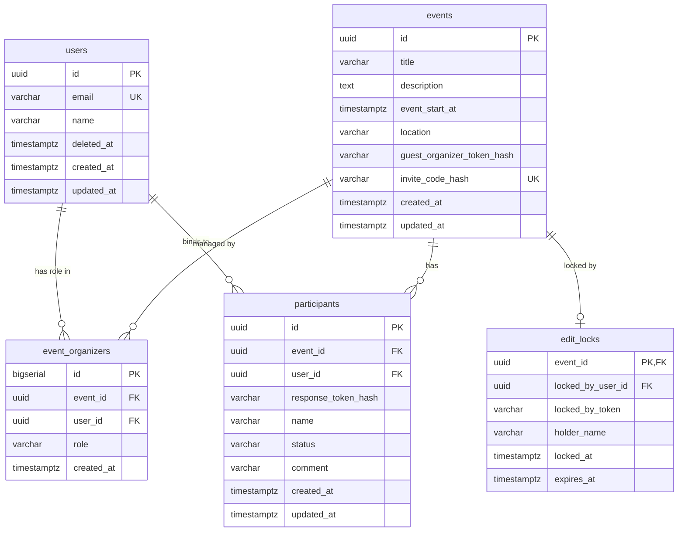

# データベース物理設計・スキーマ定義書

## イベント主催者・参加者向け 権限管理＆段階的会員基盤（PostgreSQL / Prisma 対応）

## 1. 概要と物理設計方針

本ドキュメントは、システム要件定義書に定義された「ゲスト参加」「段階的アカウント昇格（Account Hydration）」「共同幹事管理」「排他リースロック」を確実に稼働させるためのDB物理設計書である。

### 1.1. 採用技術・設計方針
* **RDBMS:** PostgreSQL 15+（MySQL 8.0+ にも容易に移殖可能な標準ANSI SQL準拠）
* **主キー戦略:** 
  * ビジネスリソース（`events`, `users`, `participants`）: 分散生成可能でURLセーフな `UUID v4`（または `ULID` / `NanoID`）を採用。
  * 関連テーブル（`event_organizers`）: 内部結合効率を考慮し `BIGSERIAL` または `UUID`。
  * 状態管理テーブル（`edit_locks`）: `event_id` をそのまま主キーとする 1:1 構造。
* **トークン保護:** 
  * ゲスト幹事トークン、招待コード、端末照会トークンは平文でDBに保存せず、SHA-256によるハッシュ値（64進数HEX）を格納。漏洩時の改ざん耐性を担保。
* **時刻管理:** すべてタイムゾーン付き日時型（`TIMESTAMPTZ`）とし、UTCで統一保存。

---

## 2. エンティティ関連図（ERD）



---

## 3. テーブル定義詳細（DDL）

### 3.1. DDLスクリプト（PostgreSQL準拠）

```sql
-- UUID拡張の有効化
CREATE EXTENSION IF NOT EXISTS "uuid-ossp";

-- =============================================================================
-- 1. users: 会員マスターテーブル
-- =============================================================================
CREATE TABLE users (
    id UUID PRIMARY KEY DEFAULT uuid_generate_v4(),
    email VARCHAR(255) UNIQUE,
    google_sub VARCHAR(255) UNIQUE,
    name VARCHAR(100) NOT NULL,
    deleted_at TIMESTAMPTZ,
    created_at TIMESTAMPTZ NOT NULL DEFAULT CURRENT_TIMESTAMP,
    updated_at TIMESTAMPTZ NOT NULL DEFAULT CURRENT_TIMESTAMP
);

COMMENT ON TABLE users IS '会員アカウントマスター';
COMMENT ON COLUMN users.email IS '確認済みのメールアドレス。退会時は deleted+{id}@deleted.invalid に置き換える';
COMMENT ON COLUMN users.google_sub IS 'Googleアカウントの識別子。本会員登録の一意キー';
COMMENT ON COLUMN users.name IS '幹事または参加者としての表示名';
COMMENT ON COLUMN users.deleted_at IS '退会（論理削除）の日時。NULL は在籍。電話番号は退会後も残す';

-- =============================================================================
-- 2. events: イベント情報テーブル
-- =============================================================================
CREATE TABLE events (
    id UUID PRIMARY KEY DEFAULT uuid_generate_v4(),
    title VARCHAR(200) NOT NULL,
    description TEXT,
    event_start_at TIMESTAMPTZ,
    location VARCHAR(255),
    guest_organizer_token_hash VARCHAR(64),
    invite_code_hash VARCHAR(64) UNIQUE,
    -- 告知ページの勧誘カードから作ったときの参照元。直接の参照元だけを持つ。
    referrer_event_id UUID REFERENCES events(id) ON DELETE SET NULL,
    created_at TIMESTAMPTZ NOT NULL DEFAULT CURRENT_TIMESTAMP,
    updated_at TIMESTAMPTZ NOT NULL DEFAULT CURRENT_TIMESTAMP
);

COMMENT ON TABLE events IS 'イベント基本情報';
COMMENT ON COLUMN events.guest_organizer_token_hash IS 'ゲスト幹事用URL認証トークンのSHA-256ハッシュ値';
COMMENT ON COLUMN events.invite_code_hash IS '共同幹事招待URL用コードのSHA-256ハッシュ値';
COMMENT ON COLUMN events.referrer_event_id IS '告知ページの勧誘から作成したときの参照元イベント。紹介の連鎖は持たない';

-- =============================================================================
-- 3. event_organizers: 幹事・共同幹事マッピングテーブル
-- =============================================================================
CREATE TABLE event_organizers (
    id BIGSERIAL PRIMARY KEY,
    event_id UUID NOT NULL REFERENCES events(id) ON DELETE CASCADE,
    user_id UUID NOT NULL REFERENCES users(id) ON DELETE CASCADE,
    role VARCHAR(20) NOT NULL DEFAULT 'CO_ORGANIZER' CHECK (role IN ('OWNER', 'CO_ORGANIZER')),
    created_at TIMESTAMPTZ NOT NULL DEFAULT CURRENT_TIMESTAMP,
    CONSTRAINT uq_event_user UNIQUE (event_id, user_id)
);

COMMENT ON TABLE event_organizers IS 'イベントと幹事ユーザーの権限紐付け';
COMMENT ON COLUMN event_organizers.role IS '幹事権限種別: OWNER（作成者）, CO_ORGANIZER（共同幹事）';

-- =============================================================================
-- 4. participants: 出欠登録テーブル
-- =============================================================================
CREATE TABLE participants (
    id UUID PRIMARY KEY DEFAULT uuid_generate_v4(),
    event_id UUID NOT NULL REFERENCES events(id) ON DELETE CASCADE,
    user_id UUID REFERENCES users(id) ON DELETE SET NULL,
    response_token_hash VARCHAR(64) NOT NULL,
    name VARCHAR(100) NOT NULL,
    status VARCHAR(20) NOT NULL CHECK (status IN ('ATTENDING', 'DECLINED', 'TENTATIVE')),
    comment VARCHAR(255),
    created_at TIMESTAMPTZ NOT NULL DEFAULT CURRENT_TIMESTAMP,
    updated_at TIMESTAMPTZ NOT NULL DEFAULT CURRENT_TIMESTAMP
);

COMMENT ON TABLE participants IS '参加者の出欠登録情報';
COMMENT ON COLUMN participants.user_id IS '会員連携時のユーザーID。ゲスト参加時はNULL';
COMMENT ON COLUMN participants.response_token_hash IS '端末照会用Cookie/LocalStorageトークンのSHA-256ハッシュ値';
COMMENT ON COLUMN participants.status IS 'ATTENDING: 参加, DECLINED: 不参加, TENTATIVE: 未定';

-- =============================================================================
-- 5. edit_locks: 排他的リースロックテーブル
-- =============================================================================
CREATE TABLE edit_locks (
    event_id UUID PRIMARY KEY REFERENCES events(id) ON DELETE CASCADE,
    locked_by_user_id UUID REFERENCES users(id) ON DELETE SET NULL,
    locked_by_token VARCHAR(64) NOT NULL,
    holder_name VARCHAR(100) NOT NULL,
    locked_at TIMESTAMPTZ NOT NULL DEFAULT CURRENT_TIMESTAMP,
    expires_at TIMESTAMPTZ NOT NULL
);

COMMENT ON TABLE edit_locks IS '同時編集防止用リースロック（1イベントにつき最大1レコード）';
COMMENT ON COLUMN edit_locks.locked_by_token IS 'ロックを保持するクライアントセッションの一意識別トークン';
COMMENT ON COLUMN edit_locks.holder_name IS '編集画面で「〇〇さんが編集中」と表示するための文字列';
COMMENT ON COLUMN edit_locks.expires_at IS 'ロック失効日時（TTL切れの自動解放判定基準）';
```

---

## 4. インデックス設計とクエリ最適化

| テーブル名 | インデックス名 | 対象カラム | 種別 | 目的・対応クエリ |
| :--- | :--- | :--- | :--- | :--- |
| `events` | `idx_events_guest_token` | `(guest_organizer_token_hash)` | B-Tree | ゲスト幹事のアクセスURL検証 |
| `events` | `idx_events_invite_code` | `(invite_code_hash)` | B-Tree / UNIQUE | 共同幹事招待URLの解決 |
| `event_organizers` | `idx_organizers_user_history` | `(user_id, created_at DESC)` | B-Tree | 会員マイページ「主催イベント一覧」の高速取得 |
| `participants` | `idx_participants_event_list` | `(event_id, created_at ASC)` | B-Tree | 幹事ダッシュボード「参加者一覧」の取得 |
| `participants` | `idx_participants_token_lookup` | `(event_id, response_token_hash)` | B-Tree | 端末Cookieによる「自身の回答自動照会」 |
| `participants` | `idx_participants_user_history` | `(user_id, created_at DESC)` | B-Tree | 会員マイページ「参加イベント履歴一覧」の取得 |
| `edit_locks` | `idx_edit_locks_expiry` | `(expires_at)` | B-Tree | 期限切れロック判定・クリーンアップ |

```sql
-- インデックス作成DDL
CREATE INDEX idx_events_guest_token ON events(guest_organizer_token_hash) WHERE guest_organizer_token_hash IS NOT NULL;
CREATE INDEX idx_organizers_user_history ON event_organizers(user_id, created_at DESC);
CREATE INDEX idx_participants_event_list ON participants(event_id, created_at ASC);
CREATE INDEX idx_participants_token_lookup ON participants(event_id, response_token_hash);
CREATE INDEX idx_participants_user_history ON participants(user_id, created_at DESC) WHERE user_id IS NOT NULL;
CREATE INDEX idx_edit_locks_expiry ON edit_locks(expires_at);
```

---

## 5. Prisma ORM スキーマ定義 (`schema.prisma`)

Prismaを採用するプロジェクト向けに、リレーションおよびインデックスを完全定義したコードブロックである。

```prisma
datasource db {
  provider = "postgresql"
  url      = env("DATABASE_URL")
}

generator client {
  provider = "prisma-client-js"
}

enum OrganizerRole {
  OWNER
  CO_ORGANIZER
}

enum RsvpStatus {
  ATTENDING
  DECLINED
  TENTATIVE
}

model User {
  id              String           @id @default(uuid()) @db.Uuid
  email           String?          @unique @db.VarChar(255)
  name            String           @db.VarChar(100)
  createdAt       DateTime         @default(now()) @map("created_at") @db.Timestamptz
  updatedAt       DateTime         @updatedAt @map("updated_at") @db.Timestamptz

  organizerRoles  EventOrganizer[]
  participations  Participant[]
  editLocks       EditLock[]

  @@map("users")
}

model Event {
  id                       String           @id @default(uuid()) @db.Uuid
  title                    String           @db.VarChar(200)
  description              String?          @db.Text
  eventStartAt             DateTime?        @map("event_start_at") @db.Timestamptz
  location                 String?          @db.VarChar(255)
  guestOrganizerTokenHash  String?          @map("guest_organizer_token_hash") @db.VarChar(64)
  inviteCodeHash           String?          @unique @map("invite_code_hash") @db.VarChar(64)
  /// 告知ページの勧誘カードから作ったときの参照元。直接の参照元だけを持ち、消えたら NULL に戻す。
  referrerEventId          String?          @map("referrer_event_id") @db.Uuid
  createdAt                DateTime         @default(now()) @map("created_at") @db.Timestamptz
  updatedAt                DateTime         @updatedAt @map("updated_at") @db.Timestamptz

  referrerEvent            Event?           @relation("EventReferral", fields: [referrerEventId], references: [id], onDelete: SetNull)
  referredEvents           Event[]          @relation("EventReferral")
  organizers               EventOrganizer[]
  participants             Participant[]
  editLock                 EditLock?

  @@index([guestOrganizerTokenHash])
  @@index([referrerEventId])
  @@map("events")
}

model EventOrganizer {
  id        BigInt        @id @default(autoincrement())
  eventId   String        @map("event_id") @db.Uuid
  userId    String        @map("user_id") @db.Uuid
  role      OrganizerRole @default(CO_ORGANIZER)
  createdAt DateTime      @default(now()) @map("created_at") @db.Timestamptz

  event     Event         @relation(fields: [eventId], references: [id], onDelete: Cascade)
  user      User          @relation(fields: [userId], references: [id], onDelete: Cascade)

  @@unique([eventId, userId])
  @@index([userId, createdAt(sort: Desc)])
  @@map("event_organizers")
}

model Participant {
  id                String     @id @default(uuid()) @db.Uuid
  eventId           String     @map("event_id") @db.Uuid
  userId            String?    @map("user_id") @db.Uuid
  responseTokenHash String     @map("response_token_hash") @db.VarChar(64)
  name              String     @db.VarChar(100)
  status            RsvpStatus
  comment           String?    @db.VarChar(255)
  createdAt         DateTime   @default(now()) @map("created_at") @db.Timestamptz
  updatedAt         DateTime   @updatedAt @map("updated_at") @db.Timestamptz

  event             Event      @relation(fields: [eventId], references: [id], onDelete: Cascade)
  user              User?      @relation(fields: [userId], references: [id], onDelete: SetNull)

  @@index([eventId, createdAt(sort: Asc)])
  @@index([eventId, responseTokenHash])
  @@index([userId, createdAt(sort: Desc)])
  @@map("participants")
}

model EditLock {
  eventId         String    @id @map("event_id") @db.Uuid
  lockedByUserId  String?   @map("locked_by_user_id") @db.Uuid
  lockedByToken   String    @map("locked_by_token") @db.VarChar(64)
  holderName      String    @map("holder_name") @db.VarChar(100)
  lockedAt        DateTime  @default(now()) @map("locked_at") @db.Timestamptz
  expiresAt       DateTime  @map("expires_at") @db.Timestamptz

  event           Event     @relation(fields: [eventId], references: [id], onDelete: Cascade)
  lockedByUser    User?     @relation(fields: [lockedByUserId], references: [id], onDelete: SetNull)

  @@index([expiresAt])
  @@map("edit_locks")
}
```

---

## 6. 主要トランザクション・整合性クエリ設計

### 6.1. 排他的リースロック制御（同時編集不可・引き継ぎ）

#### A. ロックの獲得試行（新規または期限切れ上書き）
ロックが存在しないか、既存ロックがすでに期限切れ（`expires_at <= NOW()`）である場合のみ獲得する。

```sql
-- ロック獲得クエリ (UPSERT)
INSERT INTO edit_locks (
    event_id,
    locked_by_user_id,
    locked_by_token,
    holder_name,
    locked_at,
    expires_at
)
VALUES (
    :event_id,
    :user_id,
    :new_lock_token,
    :holder_name,
    CURRENT_TIMESTAMP,
    CURRENT_TIMESTAMP + INTERVAL '180 seconds'
)
ON CONFLICT (event_id) DO UPDATE
SET
    locked_by_user_id = EXCLUDED.locked_by_user_id,
    locked_by_token = EXCLUDED.locked_by_token,
    holder_name = EXCLUDED.holder_name,
    locked_at = CURRENT_TIMESTAMP,
    expires_at = EXCLUDED.expires_at
WHERE edit_locks.expires_at <= CURRENT_TIMESTAMP; -- 期限切れ時のみ上書き許可
```
*※更新行数が 1 の場合はロック取得成功。0 の場合は他幹事が有効ロックを保持中のため `409 Conflict` を返却。*

#### B. ハートビート（ロック延長）
自身が保有する有効なロックトークンである場合のみ、有効期限を180秒延長する。

```sql
UPDATE edit_locks
SET expires_at = CURRENT_TIMESTAMP + INTERVAL '180 seconds'
WHERE event_id = :event_id
  AND locked_by_token = :current_lock_token
  AND expires_at > CURRENT_TIMESTAMP;
```

#### C. 強制引き継ぎ（Force Takeover）
他幹事のロック有効期限に関わらず、強制的に自セッションのロックで置換する。

```sql
INSERT INTO edit_locks (
    event_id,
    locked_by_user_id,
    locked_by_token,
    holder_name,
    locked_at,
    expires_at
)
VALUES (
    :event_id,
    :user_id,
    :new_lock_token,
    :holder_name,
    CURRENT_TIMESTAMP,
    CURRENT_TIMESTAMP + INTERVAL '180 seconds'
)
ON CONFLICT (event_id) DO UPDATE
SET
    locked_by_user_id = EXCLUDED.locked_by_user_id,
    locked_by_token = EXCLUDED.locked_by_token,
    holder_name = EXCLUDED.holder_name,
    locked_at = CURRENT_TIMESTAMP,
    expires_at = EXCLUDED.expires_at;
```

---

### 6.2. アカウント昇格（Account Hydration: ゲスト履歴の統合）

ゲスト参加時・ゲスト幹事時の端末保持トークン群を、会員登録完了トランザクション内で一括バインドする。

```sql
BEGIN;

-- 1. 端末が保持していた参加トークンに紐づく出欠レコードの user_id を更新
UPDATE participants
SET 
    user_id = :authenticated_user_id,
    updated_at = CURRENT_TIMESTAMP
WHERE response_token_hash IN (:hashed_tokens_from_client)
  AND user_id IS NULL;

-- 2. ゲスト幹事トークンを所持しているイベントがあれば、幹事テーブルに OWNER として登録
INSERT INTO event_organizers (event_id, user_id, role)
SELECT id, :authenticated_user_id, 'OWNER'
FROM events
WHERE guest_organizer_token_hash = :hashed_guest_organizer_token
ON CONFLICT (event_id, user_id) DO NOTHING;

-- 3. ゲスト幹事トークンを無効化（次回以降は会員認証のみで管理）
UPDATE events
SET guest_organizer_token_hash = NULL
WHERE guest_organizer_token_hash = :hashed_guest_organizer_token;

COMMIT;
```

---

### 6.3. イベント複製（ワンクリックClone）

過去の主催イベント情報（タイトル・場所・説明等）を抽出し、参加者情報・ロック・招待コードを除外した状態で新規イベントを作成する。

```sql
BEGIN;

-- 1. 過去イベントの設定値をコピーして新規イベントを作成
INSERT INTO events (
    id,
    title,
    description,
    location,
    event_start_at,
    created_at,
    updated_at
)
SELECT 
    uuid_generate_v4(),
    CONCAT(title, ' のコピー'),
    description,
    location,
    NULL, -- 日時は再設定を促すためNULL
    CURRENT_TIMESTAMP,
    CURRENT_TIMESTAMP
FROM events
WHERE id = :source_event_id
RETURNING id AS new_event_id;

-- 2. 複製実行者を新イベントの OWNER として登録
INSERT INTO event_organizers (event_id, user_id, role)
VALUES (:new_event_id, :authenticated_user_id, 'OWNER');

COMMIT;
```

---

## 7. アカウント自己管理・退会（追加マイグレーション）

会員が自分の表示名、メールアドレス、電話番号、パスワードを変える機能と、退会（論理削除）・復帰を追加する。退会しても行は消さず、確認済みの電話番号だけを残す。同じ番号で登録し直したときは、前の行と利用枠を引き継ぎ、無料枠の使い回しを防ぐ。

### 7.1. 追加する列と表

```sql
-- users に論理削除の日時を足す。電話番号（phone_e164）は退会後も残す。
ALTER TABLE users ADD COLUMN deleted_at TIMESTAMPTZ NULL;
CREATE INDEX idx_users_deleted_at ON users(deleted_at) WHERE deleted_at IS NOT NULL;

COMMENT ON COLUMN users.deleted_at IS '退会（論理削除）の日時。NULL は在籍。電話番号は再登録の突き合わせに使う。';

-- 会員が自分の情報を変えた監査ログ。追記のみ。
CREATE TYPE account_change_kind_enum AS ENUM ('NAME', 'EMAIL', 'PHONE', 'PASSWORD', 'WITHDRAW', 'REACTIVATE');

CREATE TABLE account_change_logs (
    id UUID PRIMARY KEY DEFAULT uuid_generate_v4(),
    user_id UUID NULL REFERENCES users(id) ON DELETE SET NULL,
    kind account_change_kind_enum NOT NULL,
    before_value VARCHAR(255) NULL,
    after_value VARCHAR(255) NULL,
    ip_hash VARCHAR(64) NULL,
    created_at TIMESTAMPTZ NOT NULL DEFAULT CURRENT_TIMESTAMP
);

CREATE INDEX idx_account_change_logs_user_created ON account_change_logs(user_id, created_at);

-- メールアドレス変更の保留中。新しいアドレスに届いたリンクを開くと確定する。
CREATE TABLE email_change_requests (
    id UUID PRIMARY KEY DEFAULT uuid_generate_v4(),
    user_id UUID NOT NULL REFERENCES users(id) ON DELETE CASCADE,
    new_email VARCHAR(255) NOT NULL,
    token_hash VARCHAR(64) UNIQUE NOT NULL,
    expires_at TIMESTAMPTZ NOT NULL,
    used_at TIMESTAMPTZ NULL,
    created_at TIMESTAMPTZ NOT NULL DEFAULT CURRENT_TIMESTAMP
);

CREATE INDEX idx_email_change_requests_user ON email_change_requests(user_id);
```

| 列 / 表 | 内容 |
| :--- | :--- |
| `users.deleted_at` | 退会の日時。NULL は在籍。ログイン、パスワード再設定、確認番号の発行は、この列が NULL の行だけを通す |
| `account_change_logs` | `NAME`、`EMAIL`、`PHONE`、`PASSWORD`、`WITHDRAW`、`REACTIVATE` の記録。メールはマスク、電話は下4桁、パスワードは NULL。`ip_hash` は IP の SHA-256 |
| `email_change_requests` | 新しいアドレスと SHA-256 のトークン。有効期限は24時間。使用済みは `used_at` を立てる。平文のトークンは保存しない |

### 7.2. Prisma モデル（抜粋）

```prisma
enum AccountChangeKind {
  NAME
  EMAIL
  PHONE
  PASSWORD
  WITHDRAW
  REACTIVATE
}

model User {
  // 既存の列は省略
  deletedAt DateTime? @map("deleted_at") @db.Timestamptz

  accountChangeLogs   AccountChangeLog[]
  emailChangeRequests EmailChangeRequest[]

  @@index([deletedAt])
}

model AccountChangeLog {
  id          String            @id @default(uuid()) @db.Uuid
  userId      String?           @map("user_id") @db.Uuid
  kind        AccountChangeKind
  beforeValue String?           @map("before_value") @db.VarChar(255)
  afterValue  String?           @map("after_value") @db.VarChar(255)
  ipHash      String?           @map("ip_hash") @db.VarChar(64)
  createdAt   DateTime          @default(now()) @map("created_at") @db.Timestamptz

  user User? @relation(fields: [userId], references: [id], onDelete: SetNull)

  @@index([userId, createdAt])
  @@map("account_change_logs")
}

model EmailChangeRequest {
  id        String    @id @default(uuid()) @db.Uuid
  userId    String    @map("user_id") @db.Uuid
  newEmail  String    @map("new_email") @db.VarChar(255)
  tokenHash String    @unique @map("token_hash") @db.VarChar(64)
  expiresAt DateTime  @map("expires_at") @db.Timestamptz
  usedAt    DateTime? @map("used_at") @db.Timestamptz
  createdAt DateTime  @default(now()) @map("created_at") @db.Timestamptz

  user User @relation(fields: [userId], references: [id], onDelete: Cascade)

  @@index([userId])
  @@map("email_change_requests")
}
```

### 7.3. 退会と復帰の整合性

退会は1つのトランザクションで、イベント、会員、利用枠、セッションをまとめて更新する。

1. 筆頭幹事（`OWNER`）のイベントを `is_deleted = true`、`status = 'CLOSED'` にする。共同幹事（`CO_HOST`）の紐付けは削除する。参加者としての出欠は残す。
2. `users.deleted_at` を立て、表示名を「退会した会員」、メールアドレスを `deleted+{userId}@deleted.invalid` にし、`password_hash`、`google_sub`、`email_verified_at` を空にする。`phone_e164` と `phone_verified_at` は残す。
3. `user_usage_quotas` は残し、`stripe_subscription_id` を空にし、`subscription_status = 'CANCELED'`、`current_period_end` と割引の各列を空にする。`free_event_count` と `paid_credits` は消さない。
4. `auth_sessions` を全件失効させ、未使用の `email_change_requests`、`phone_verification_codes`、`email_verification_tokens`、`login_challenges` を消す。
5. `account_change_logs` に `WITHDRAW` を残す。

Stripe のサブスクリプションは、トランザクションの前に即時解約する。解約に失敗したら退会を中止し、行は変えない。管理者（`platform_role = 'ADMIN'`）は退会できない。

復帰は、電話番号確認の完了時に、確認済みの `phone_e164` が一致する退会済みの行を見つけたときに行う。`deleted_at` を NULL に戻し、メール、表示名、パスワード、`google_sub` を今回の登録内容で上書きする。`user_usage_quotas` は `ON CONFLICT DO NOTHING` と同じ扱い（`update: {}`）で触らないため、消化済みの無料枠は戻らない。`account_change_logs` に `REACTIVATE` を残す。

### 7.4. インデックスの追加

| テーブル名 | インデックス名 | 対象カラム | 目的 |
| :--- | :--- | :--- | :--- |
| `users` | `idx_users_deleted_at` | `(deleted_at)`（部分索引） | 退会済みを除いた会員検索、管理コンソールの退会済み表示 |
| `account_change_logs` | `idx_account_change_logs_user_created` | `(user_id, created_at)` | 会員ごとの変更履歴の取得 |
| `email_change_requests` | `idx_email_change_requests_user` | `(user_id)` | 保留中の変更の差し替えと、退会時の削除 |